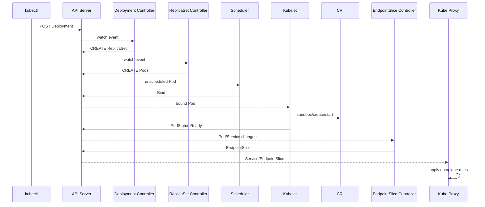

# 18. 从 Deployment 到可访问 Pod：完整时序与排障

## 18.1 创建 Deployment

kubectl discovery/RESTMapper 确定 GVR，编码请求；API Server authn/authz/admission/default/validation/strategy 后写 etcd；watch cache 将事件发给 Deployment informer。

排障：客户端连接/schema；401/403；admission timeout；422 validation；etcd/APF 延迟。

## 18.2 Deployment 创建 ReplicaSet

handler enqueue Deployment key；worker从 Lister 读最新对象；计算 template hash；查找/创建新 RS；按 rolling strategy 缩放新旧 RS；写 status observedGeneration。

排障：Deployment conditions、RS owner/hash、controller leader、progress deadline。

## 18.3 ReplicaSet 创建 Pod

RS worker claim Pods，计算副本差，设置 expectations，创建带 ownerReference 的 Pods。Pod add event满足 expectation。

排障：quota、admission、service account、expectation、无效 template。

## 18.4 Scheduler 绑定

Pod进入 activeQ；Snapshot；Filter/Score；Assume；Reserve/Permit/PreBind；Bind；informer 观察真实 nodeName。

排障：PodScheduled condition、filter reasons、backoff/unschedulable、permit timeout、Bind/dispatcher。

## 18.5 Kubelet 执行

目标 Kubelet 收到 Pod；podWorker sync；Volume Manager mount；CRI 建 sandbox/CNI；拉镜像；init/app containers；probe；status 写回。

排障：FailedMount、FailedCreatePodSandBox、ErrImagePull、CrashLoopBackOff、probe、PLEG/runtime。

## 18.6 EndpointSlice 和网络

EndpointSlice Controller 观察 Service selector、Pod IP/Ready，写 slices；kube-proxy 同步规则；客户端访问 ClusterIP并 DNAT 到 ready endpoint。

排障：selector、EndpointSlice conditions、单节点规则、conntrack、CNI route、NetworkPolicy。

## 18.7 时序图

## 18.8 一致性窗口

API write 与 informer observe、Scheduler Assume 与 Bind、Ready 与 EndpointSlice、EndpointSlice 与节点规则、Delete 与 finalizer cleanup 之间都有窗口。窗口本身不一定是 bug；关键是是否有重试、是否幂等、是否最终收敛、是否可观察。

## 18.9 排障顺序

先看对象边界：Deployment observedGeneration；RS replicas；Pod 是否创建；nodeName；containerStatuses；Ready；EndpointSlice；节点规则。每一步只定位一个组件输入输出，再看 Event、metrics、logs、trace。

## 18.10 可观测性分工

Condition 是当前结论；Event 是近期用户原因；Metric 看范围和趋势；Log 看函数决策；Trace 看一次请求/调度各阶段耗时。不要从全局日志搜索开始。

