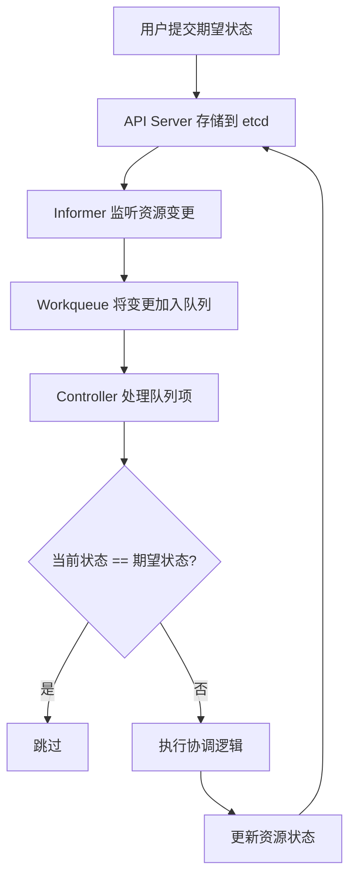
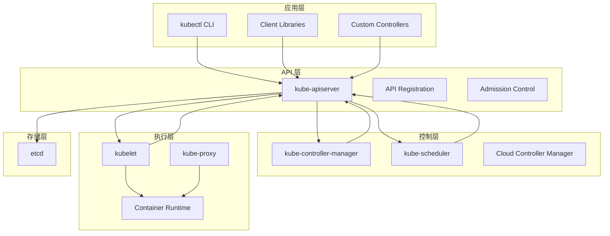
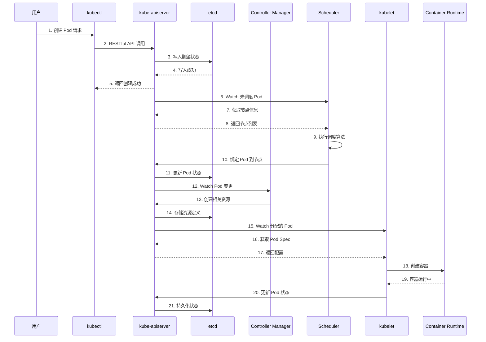
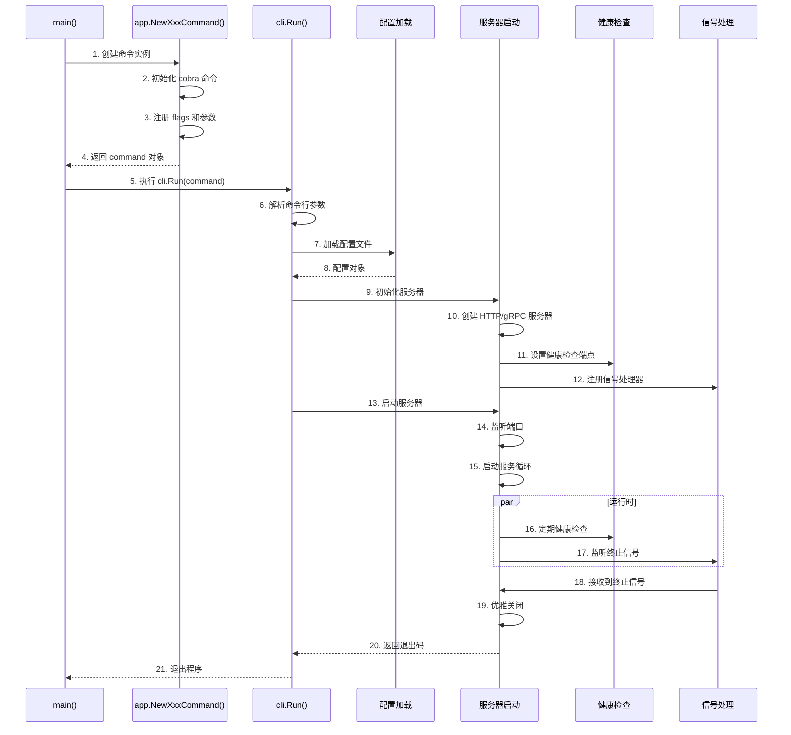
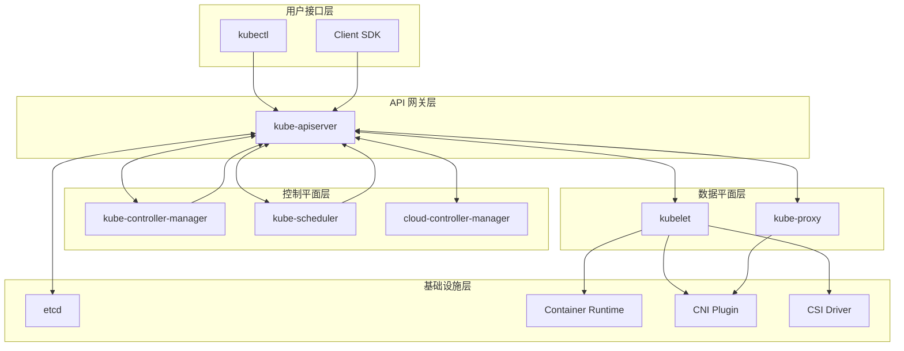
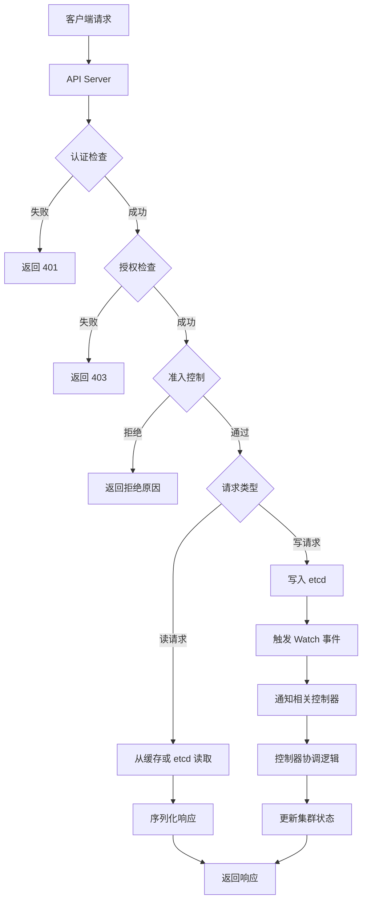
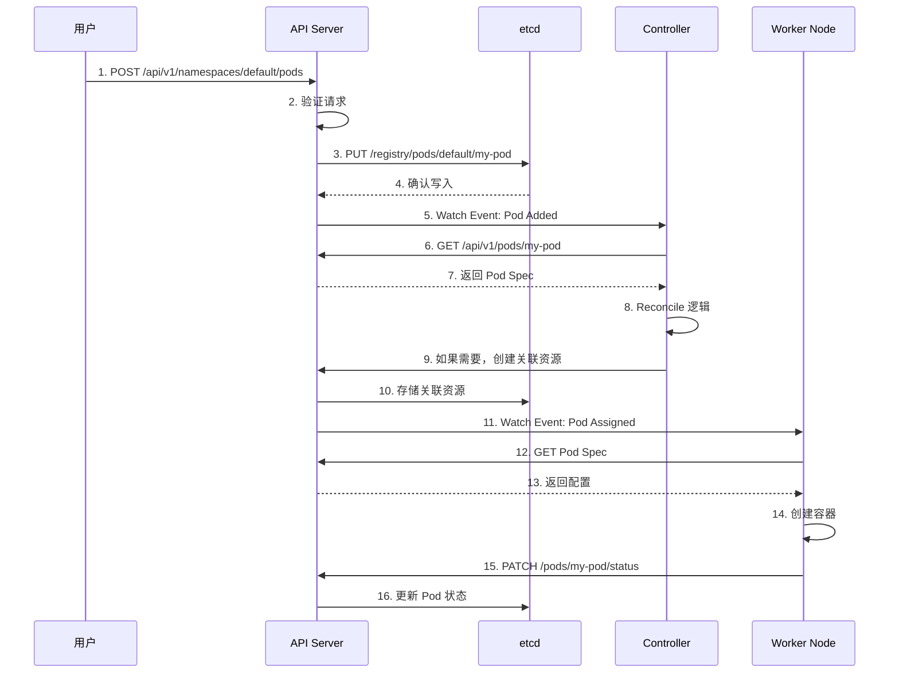
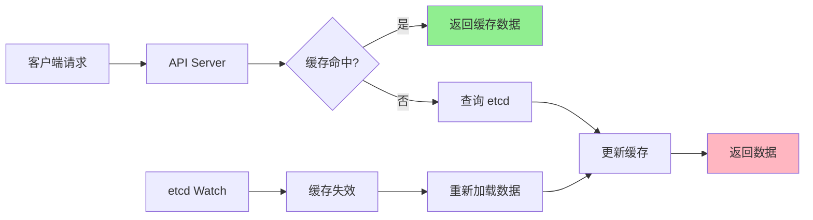
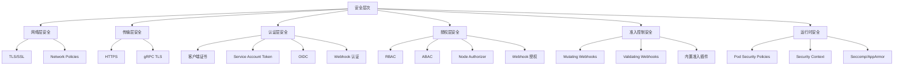

# Kubernetes 架构总览 - 源码重构级指南

## 1. 设计理念与核心原则

### 1.1 为什么采用声明式 API

**设计动机（Why）**：
Kubernetes 选择声明式 API（Declarative API）而非命令式 API（Imperative API），是基于以下深刻的技术和运维考虑：

- **最终一致性**：声明式 API 关注"期望状态"（Desired State），系统自动协调当前状态与期望状态之间的差异，实现最终一致性，无需用户关心具体的执行步骤。
- **容错和自愈**：当系统出现故障时，控制器可以持续观察状态差异并自动修复，无需人工干预，大大提高了系统的可靠性。
- **简化客户端逻辑**：用户只需提交期望的配置，无需了解复杂的执行流程和错误处理逻辑，降低了客户端的复杂度。
- **可审计性**：每次状态变更都有明确的审计记录，便于回溯和问题定位。

**实现方式（How）**：
在 Kubernetes 中，声明式 API 通过以下机制实现：

```go
// pkg/apis/core/types.go - 核心资源定义示例
type Pod struct {
    metav1.TypeMeta   // 包含 APIVersion 和 Kind
    metav1.ObjectMeta // 包含 metadata 信息
    
    Spec PodSpec      // 期望状态
    Status PodStatus  // 当前状态
}

// 用户提交的 Pod 对象包含期望的 Spec，控制器负责确保 Status 最终与 Spec 一致
```

### 1.2 控制器模式（Controller Pattern）

**核心概念**：
控制器模式是 Kubernetes 的核心设计模式，它实现了声明式 API 的协调逻辑。



**代码映射**：
- **Informer 位置**：`staging/src/k8s.io/client-go/informers/`
- **Workqueue 位置**：`staging/src/k8s.io/client-go/util/workqueue/`
- **Controller 框架**：`pkg/controller/controller_ref_manager.go`

### 1.3 分层架构设计

Kubernetes 采用清晰的分层架构，每层负责特定的职责：



## 2. 整体架构详解

### 2.1 完整系统架构图

```mermaid
graph TB
    subgraph "用户界面层"
        User[用户/运维人员]
        Kubectl[kubectl CLI]
        Dashboard[Dashboard UI]
    end
    
    subgraph "客户端层"
        ClientGo[client-go 库]
        CustomClient[自定义客户端]
        Operator[Operator 框架]
    end
    
    subgraph "API 网关层"
        APIGW[API Server]
        AuthN[认证层]
        AuthZ[授权层]
        Admission[准入控制]
    end
    
    subgraph "核心控制层"
        KCM[kube-controller-manager]
        Scheduler[kube-scheduler]
        CCM[cloud-controller-manager]
    end
    
    subgraph "数据持久层"
        Etcd[etcd 集群]
        EtcdCache[etcd 缓存]
    end
    
    subgraph "节点执行层"
        Kubelet1[kubelet Node1]
        Kubelet2[kubelet Node2]
        KubeProxy1[kube-proxy Node1]
        KubeProxy2[kube-proxy Node2]
    end
    
    subgraph "容器运行时层"
        Docker[Docker Runtime]
        Containerd[containerd Runtime]
        CRI_O[CRI-O Runtime]
    end
    
    subgraph "网络层"
        CNI[CNI Plugins]
        CoreDNS[CoreDNS]
        Ingress[Ingress Controller]
    end
    
    subgraph "存储层"
        CSI[CSI Drivers]
        PV[Persistent Volumes]
        Storage[Storage Classes]
    end
    
    User --> Kubectl
    User --> Dashboard
    Kubectl --> APIGW
    Dashboard --> APIGW
    ClientGo --> APIGW
    CustomClient --> APIGW
    Operator --> APIGW
    
    APIGW --> AuthN
    AuthN --> AuthZ
    AuthZ --> Admission
    Admission --> APIGW
    
    APIGW <--> Etcd
    APIGW --> EtcdCache
    
    APIGW --> KCM
    APIGW --> Scheduler
    APIGW --> CCM
    
    KCM --> APIGW
    Scheduler --> APIGW
    CCM --> APIGW
    
    APIGW --> Kubelet1
    APIGW --> Kubelet2
    APIGW --> KubeProxy1
    APIGW --> KubeProxy2
    
    Kubelet1 --> Docker
    Kubelet2 --> Containerd
    Kubelet1 --> CRI_O
    
    Kubelet1 --> CNI
    Kubelet2 --> CNI
    KubeProxy1 --> CNI
    KubeProxy2 --> CNI
    
    APIGW --> CoreDNS
    APIGW --> Ingress
    
    Kubelet1 --> CSI
    Kubelet2 --> CSI
    APIGW --> PV
    APIGW --> Storage
```



### 2.2 组件间通信机制

Kubernetes 组件间使用多种通信机制：



## 3. 代码组织结构深度解析

### 3.1 根目录结构设计原理

Kubernetes 的根目录结构体现了清晰的模块化设计：

```
kubernetes/
├── cmd/                    # 🎯 可执行文件入口点
├── pkg/                    # 🎯 核心功能包
├── staging/                # 🎯 过渡性代码库
├── test/                   # 🎯 测试代码
├── vendor/                 # 🎯 第三方依赖
├── build/                  # 🎯 构建配置
├── hack/                   # 🎯 开发工具脚本
├── api/                    # 🎯 API 定义文件
├── docs/                   # 🎯 项目文档
└── ...
```

**设计原理**：
1. **cmd/** - 每个子目录对应一个独立的可执行文件，遵循"一个组件一个二进制"的原则
2. **pkg/** - 存放共享的核心功能，被多个组件复用
3. **staging/** - 新功能的实验场，稳定后移入 pkg/
4. **test/** - 独立的测试代码，保持代码组织清晰

### 3.2 cmd/ 目录详解

每个 Kubernetes 组件都在 cmd/ 目录下有独立的入口点：

```
cmd/
├── kube-apiserver/        # API 服务器
│   └── apiserver.go       # main 函数：app.NewAPIServerCommand()
├── kube-controller-manager/ # 控制器管理器
│   └── controller-manager.go # main 函数：app.NewControllerManagerCommand()
├── kube-scheduler/        # 调度器
│   └── scheduler.go       # main 函数：app.NewSchedulerCommand()
├── kubelet/              # 节点代理
│   └── kubelet.go        # main 函数：app.NewKubeletCommand()
├── kubectl/              # 命令行工具
│   └── kubectl.go        # main 函数：cmd.NewDefaultKubectlCommand()
└── ...
```

**统一启动模式**：
所有组件都使用相同的启动框架，基于 `k8s.io/component-base/cli`：

```go
// cmd/kube-apiserver/apiserver.go
func main() {
    command := app.NewAPIServerCommand()  // 创建命令实例
    code := cli.Run(command)              // 使用 CLI 框架运行
    os.Exit(code)
}

// cmd/kube-scheduler/scheduler.go  
func main() {
    command := app.NewSchedulerCommand()
    code := cli.Run(command)
    os.Exit(code)
}
```

### 3.3 pkg/ 目录核心包分析

pkg/ 目录包含 Kubernetes 的核心功能实现：

```
pkg/
├── admission/             # 准入控制器框架
│   └── plugin/           # 内置准入插件
├── apis/                 # 内部 API 定义
│   ├── core/            # 核心资源 API
│   └── ...
├── auth/                 # 认证授权
│   ├── authenticator/   # 认证器实现
│   ├── authorizer/      # 授权器实现
│   └── ...
├── controller/           # 控制器实现
│   ├── deployment/      # Deployment 控制器
│   ├── replica/         # ReplicaSet 控制器
│   └── ...
├── kubeapiserver/       # API 服务器核心逻辑
│   ├── options/        # 服务器配置选项
│   └── ...
├── scheduler/           # 调度器核心
│   ├── algorithm/      # 调度算法
│   ├── framework/      # 调度框架
│   └── ...
├── kubelet/            # kubelet 核心功能
│   ├── pod/           # Pod 管理
│   ├── container/     # 容器管理
│   └── ...
└── ...
```

**关键包说明**：
- **pkg/controller/**：包含所有内置控制器的实现
- **pkg/scheduler/**：调度器的核心算法和框架
- **pkg/kubeapiserver/**：API 服务器的业务逻辑
- **pkg/kubelet/**：节点代理的核心功能

### 3.4 staging/ 目录过渡机制

staging/ 目录管理即将移入核心包的代码：

```
staging/src/k8s.io/
├── api/                  # API 类型定义
├── apimachinery/         # API 通用工具
├── apiserver/           # API 服务器框架
├── client-go/           # Go 客户端库
├── cli-runtime/         # CLI 运行时库
├── component-base/      # 组件基础功能
├── component-helpers/   # 组件辅助工具
├── controller-manager/  # 控制器管理器
├── cri-api/            # CRI API 定义
└── ...
```

**设计原理**：
- **代码迁移流程**：新功能先在 staging/ 中开发和稳定，然后移入 pkg/
- **版本管理**：确保 API 的向后兼容性
- **依赖隔离**：提供稳定的库供外部项目使用

## 4. 统一启动流程深度分析

### 4.1 组件启动时序图



### 4.2 启动代码详细分析

**kube-apiserver 启动流程**：

```go
// cmd/kube-apiserver/app/server.go
func NewAPIServerCommand() *cobra.Command {
    o := NewOptions()
    
    cmd := &cobra.Command{
        Use: "kube-apiserver",
        RunE: func(cmd *cobra.Command, args []string) error {
            // 1. 验证配置
            if err := o.Validate(); err != nil {
                return err
            }
            
            // 2. 完成配置
            if err := o.Complete(); err != nil {
                return err
            }
            
            // 3. 创建 API 服务器
            server, err := o.CreateServer(chain)
            if err != nil {
                return err
            }
            
            // 4. 运行服务器
            return server.Run()
        },
    }
    
    // 注册命令行参数
    o.AddFlags(cmd.Flags())
    return cmd
}

// pkg/kubeapiserver/options/options.go
func (o *Options) CreateServer(
    authenticationInfo authenticator.Request,
    authorizationInfo authorizer.Authorizer,
) (*genericapiserver.GenericAPIServer, error) {
    // 1. 创建通用 API 服务器配置
    genericConfig, err := o.GenericConfig
        .New("kube-apiserver", o.ServerRunOptions)
    
    // 2. 配置存储后端
    if err := o.SAOptions.ApplyTo(&genericConfig.Authentication, 
        genericConfig.SecureServing, genericConfig.OpenAPIConfig); err != nil {
        return nil, err
    }
    
    // 3. 创建 API 服务器实例
    s, err := genericConfig.Complete().New()
    if err != nil {
        return nil, err
    }
    
    // 4. 安装核心 API 组
    if err := s.InstallAPIGroups(apiGroupInfo...); err != nil {
        return nil, err
    }
    
    return s, nil
}
```

**kube-scheduler 启动流程**：

```go
// cmd/kube-scheduler/app/server.go
func NewSchedulerCommand() *cobra.Command {
    cmd := &cobra.Command{
        Use: "kube-scheduler",
        RunE: func(cmd *cobra.Command, args []string) error {
            // 1. 创建调度器选项
            o, err := options.NewOptions()
            if err != nil {
                return err
            }
            
            // 2. 完成配置
            if err := o.Complete(); err != nil {
                return err
            }
            
            // 3. 验证配置
            if err := o.Validate(); err != nil {
                return err
            }
            
            // 4. 创建调度器
            c, err := o.Config()
            if err != nil {
                return err
            }
            
            // 5. 运行调度器
            return Run(c)
        },
    }
    
    return cmd
}

// cmd/kube-scheduler/app/server.go
func Run(ctx context.Context, cc *schedulerserverconfig.CompletedConfig) error {
    // 1. 创建事件广播器
    eventBroadcaster := record.NewBroadcaster()
    
    // 2. 创建调度器客户端
    client := cc.Client
    
    // 3. 创建共享 Informer 工厂
    informerFactory := informers.NewSharedInformerFactory(client, 0)
    
    // 4. 创建调度器实例
    sched, err := scheduler.New(
        cc.Client,
        informerFactory,
        cc.KubeConfig,
        opts...,
    )
    if err != nil {
        return err
    }
    
    // 5. 启动 Informer
    informerFactory.Start(ctx.Done())
    
    // 6. 等待缓存同步
    informerFactory.WaitForCacheSync(ctx.Done())
    
    // 7. 运行调度器
    return sched.Run(ctx)
}
```

### 4.3 component-base CLI 框架

所有组件都基于 `k8s.io/component-base/cli` 框架：

```go
// staging/src/k8s.io/component-base/cli/runner.go
func Run(command *cobra.Command) int {
    // 1. 设置日志格式
    logs.InitLogs()
    defer logs.FlushLogs()
    
    // 2. 初始化监控
    metrics.Register()
    
    // 3. 执行命令
    if err := command.Execute(); err != nil {
        // 4. 错误处理
        fmt.Fprintf(os.Stderr, "Error: %v\n", err)
        return 1
    }
    
    return 0
}

// cobra 命令结构
type Command struct {
    Use     string        // 命令名称
    Short   string        // 短描述
    Long    string        // 长描述
    RunE    func(...) error // 执行函数
    Flags   *flag.FlagSet // 命令行参数
}
```

## 5. 核心组件关系网络

### 5.1 组件依赖关系图



### 5.2 组件通信协议

**gRPC 通信**：
- **位置**：`staging/src/k8s.io/apiserver/pkg/endpoints/handlers/`
- **用途**：API Server 与组件间的高性能通信
- **示例**：kubelet 与 API Server 的心跳通信

**HTTP REST API**：
- **位置**：`staging/src/k8s.io/apiserver/pkg/server/`
- **用途**：外部用户和组件的 API 访问
- **示例**：kubectl 发送 REST 请求

**WebSocket**：
- **位置**：`staging/src/k8s.io/apiserver/pkg/endpoints/websocket/`
- **用途**：实时事件通知
- **示例**：kubectl watch 命令

**Protocol Buffers**：
- **位置**：`staging/src/k8s.io/apiserver/pkg/storage/`
- **用途**：高效的数据序列化
- **示例**：etcd 数据存储格式

## 6. 数据流与状态管理

### 6.1 请求处理流程



### 6.2 状态同步机制

Kubernetes 使用复杂的分布式状态同步机制：



## 7. 关键设计模式总结

### 7.1 控制器模式
- **位置**：`pkg/controller/`
- **作用**：实现声明式 API 的状态协调
- **核心组件**：Informer、Workqueue、Reconciler

### 7.2 插件模式
- **位置**：`pkg/scheduler/framework/`
- **作用**：实现可扩展的调度策略
- **示例**：调度器插件、存储插件

### 7.3 适配器模式
- **位置**：`pkg/kubelet/container/`
- **作用**：适配不同的容器运行时
- **实现**：CRI 接口适配 Docker、containerd 等

### 7.4 观察者模式
- **位置**：`staging/src/k8s.io/client-go/informers/`
- **作用**：实现资源变更的实时通知
- **机制**：Watch、事件广播、缓存更新

### 7.5 工厂模式
- **位置**：`staging/src/k8s.io/client-go/informers/factory.go`
- **作用**：统一创建各种类型的 Informer
- **优势**：简化客户端代码、统一资源管理

## 8. 性能与可扩展性设计

### 8.1 缓存架构



### 8.2 并发控制

**工作队列机制**：
- **位置**：`staging/src/k8s.io/client-go/util/workqueue/`
- **类型**：
  - `Type`: 基础队列
  - `DelayingType`: 延迟队列
  - `RateLimitingType`: 限速队列
- **用途**：控制并发处理速率，避免雪崩

**批量处理**：
- **位置**：`pkg/controller/controller_utils.go`
- **机制**：将多个相关操作批量提交，减少 API 调用

### 8.3 水平扩展设计

**API Server 扩展**：
- **机制**：多实例部署 + 负载均衡
- **共享存储**：所有实例共享 etcd

**Controller 扩展**：
- **机制**：Leader 选举机制
- **位置**：`staging/src/k8s.io/client-go/tools/leaderelection/`

**Scheduler 扩展**：
- **机制**：多调度器实例
- **策略**：基于 Pod 的调度器选择

## 9. 安全架构设计

### 9.1 安全层次模型



### 9.2 安全代码位置

- **认证**：`staging/src/k8s.io/apiserver/pkg/authentication/`
- **授权**：`staging/src/k8s.io/apiserver/pkg/authorization/`
- **准入控制**：`pkg/admission/`
- **ServiceAccount**：`pkg/serviceaccount/`

## 10. 总结：Kubernetes 架构精髓

### 10.1 核心设计原则

1. **声明式 API**：关注期望状态而非执行过程
2. **控制器模式**：通过持续协调实现自动化
3. **模块化设计**：清晰的职责分离和接口定义
4. **可扩展性**：插件机制和 API 扩展点
5. **最终一致性**：分布式系统中的状态协调

### 10.2 关键技术亮点

- **统一的组件启动框架**：`component-base/cli`
- **高效的缓存机制**：Informer + Workqueue
- **灵活的插件系统**：调度器、存储、网络插件
- **强大的客户端库**：`client-go` 的完整工具链
- **完善的观测性**：日志、监控、追踪一体化

### 10.3 学习路径建议

1. **理解核心概念**：Pod、Service、Deployment 等
2. **阅读启动代码**：各组件的 main() 函数和初始化流程
3. **研究控制器实现**：选择一个简单控制器深入分析
4. **掌握客户端库**：client-go 的使用和原理
5. **实践扩展开发**：编写自定义控制器或调度器插件

通过理解这些核心架构原理，开发者可以：
- 快速定位和理解 Kubernetes 源码
- 高效地进行问题调试和性能优化
- 开发高质量的 Kubernetes 扩展组件
- 参与社区贡献并深入参与项目发展

这份架构总览为后续深入各个具体模块的学习奠定了坚实的基础。