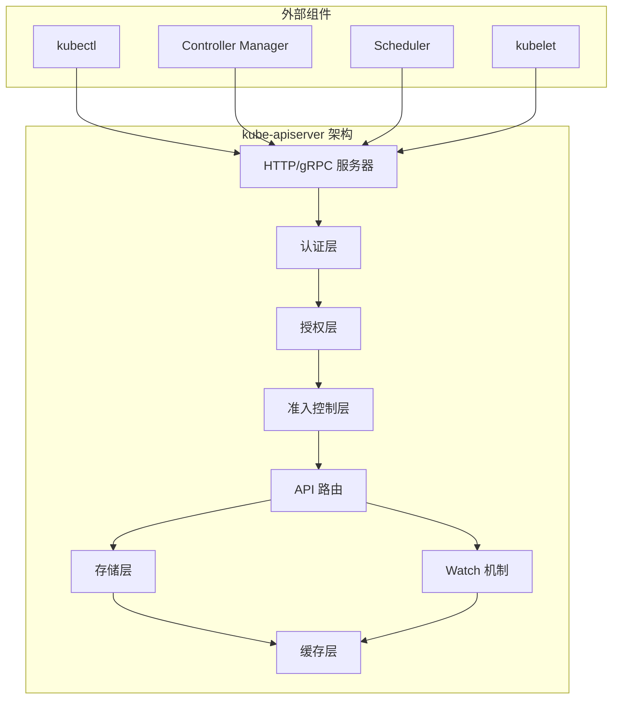
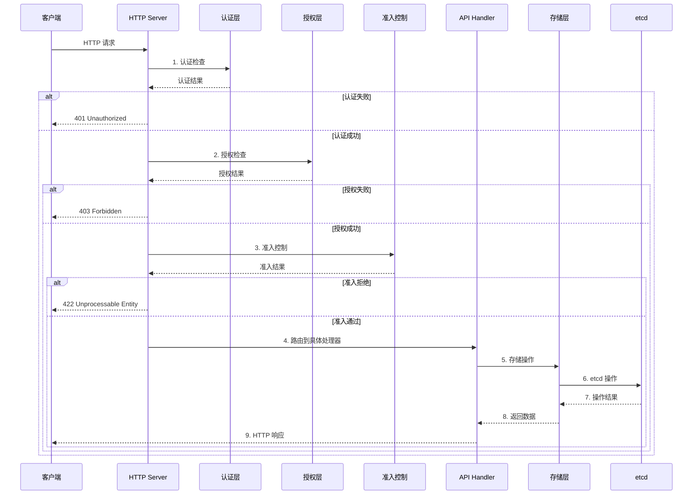
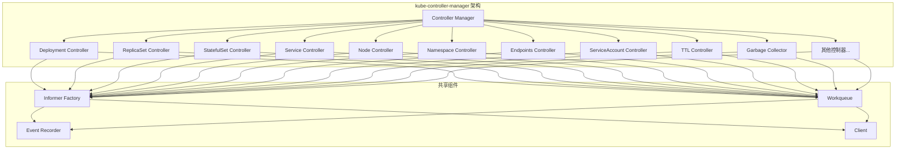
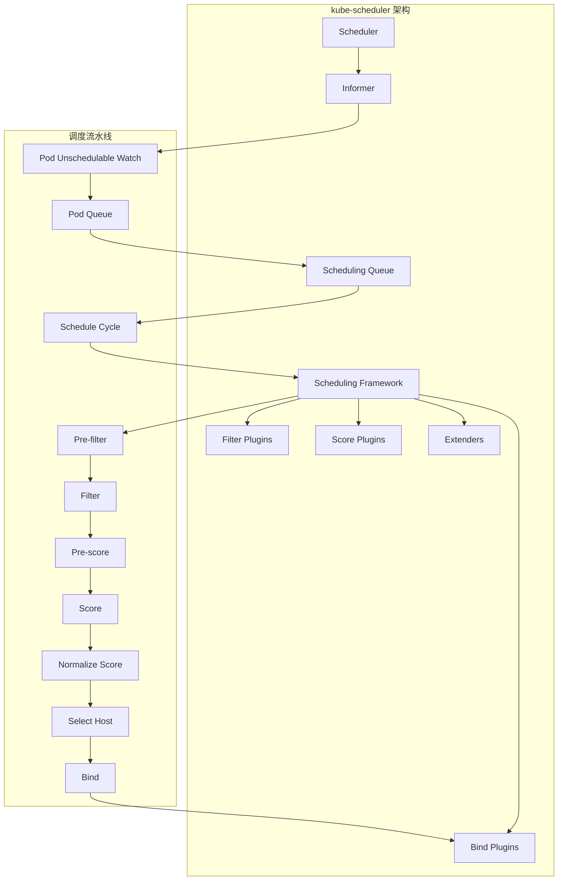
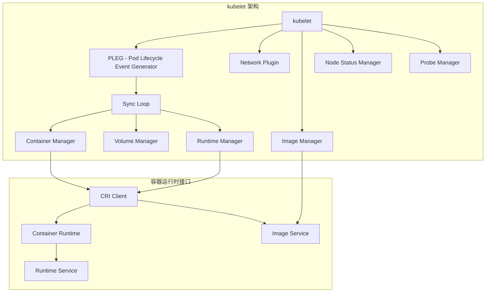
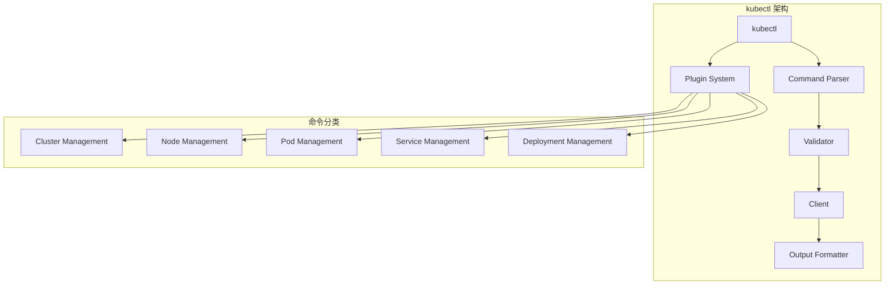

# Kubernetes 核心组件结构 - 源码重构级指南

## 1. kube-apiserver 组件深度解析

### 1.1 组件架构概述

kube-apiserver 是 Kubernetes 集群的控制中心，负责：
- 提供 RESTful API 接口
- 处理认证、授权、准入控制
- 管理集群状态数据的持久化
- 协调各组件间的通信



### 1.2 核心代码结构

**应用入口**：`cmd/kube-apiserver/app/server.go`

```go
// cmd/kube-apiserver/app/server.go
package app

import (
    "k8s.io/apiserver/pkg/server"
    "k8s.io/apiserver/pkg/server/options"
    "k8s.io/kubernetes/cmd/kube-apiserver/app/options"
)

// APIServer 配置结构
type APIServer struct {
    GenericAPIServerConfig *server.Config
    ExtraConfig            *ExtraConfig
}

// ExtraConfig 包含 kube-apiserver 特定的配置
type ExtraConfig struct {
    ServiceClusterIPRanges   netutils.IPRangeSet
    ServiceNodePortRange     utilnet.PortRange
    APIServerServiceIP       net.IP
    APIServerServicePort     int
    // ... 其他配置项
}

// CreateServer 创建并配置 API 服务器
func (c completedConfig) CreateServer(
    authenticationInfo authenticator.Request,
    authorizationInfo authorizer.Authorizer,
) (*genericapiserver.GenericAPIServer, error) {
    
    // 1. 创建通用 API 服务器
    s, err := c.GenericConfig.New("kube-apiserver", c.CompleteOptions().ServerRunOptions)
    if err != nil {
        return nil, err
    }
    
    // 2. 配置认证
    if err := c.Authentication.ApplyTo(&s.Config.Authentication, s.SecureServing, s.OpenAPIConfig); err != nil {
        return nil, err
    }
    
    // 3. 配置授权
    if err := c.Authorization.ApplyTo(&s.Config.Authorization); err != nil {
        return nil, err
    }
    
    // 4. 安装 API 组
    if err := s.InstallAPIGroups(c.APIGroupInfo...); err != nil {
        return nil, err
    }
    
    return s, nil
}
```

### 1.3 请求处理流程



### 1.4 认证机制实现

**认证器接口**：`staging/src/k8s.io/apiserver/pkg/authentication/request/union.go`

```go
// UnionAuthenticator 聚合多个认证器
type UnionAuthenticator struct {
    // 认证器列表，按顺序尝试
    Authenticators []authenticator.Request
}

// AuthenticateRequest 尝试所有认证器
func (authHandler *UnionAuthenticator) AuthenticateRequest(req *http.Request) (*authenticator.Response, bool, error) {
    var errlist []error
    
    for _, currAuthRequestHandler := range authHandler.Authenticators {
        resp, ok, err := currAuthRequestHandler.AuthenticateRequest(req)
        if err != nil {
            errlist = append(errlist, err)
            continue
        }
        
        if ok {
            // 认证成功
            return resp, true, nil
        }
    }
    
    // 所有认证器都失败
    return nil, false, utilerrors.NewAggregate(errlist)
}
```

### 1.5 授权策略实现

**授权器接口**：`staging/src/k8s.io/apiserver/pkg/authorization/authorizer/rbac/`

```go
// RBACAuthorizer 基于 RBAC 的授权器
type RBACAuthorizer struct {
    authorizationRuleResolver authorization.RuleResolver
    ruleCheckingMode          RBACRuleCheckingMode
}

// Authorize 检查授权
func (r *RBACAuthorizer) Authorize(ctx context.Context, requestAttributes authorizer.Attributes) (authorized authorizer.Decision, reason string, err error) {
    // 1. 获取用户信息
    user := requestAttributes.GetUser()
    
    // 2. 检查系统权限
    if r.hasSystemAccess(user) {
        return authorizer.DecisionAllow, "system access", nil
    }
    
    // 3. 检查 RBAC 规则
    rules, err := r.authorizationRuleResolver.RulesFor(user, requestAttributes.GetNamespace())
    if err != nil {
        return authorizer.DecisionNoOpinion, "", err
    }
    
    // 4. 匹配规则
    for _, rule := range rules {
        if rule.Matches(requestAttributes) {
            return authorizer.DecisionAllow, "RBAC: allowed by rule", nil
        }
    }
    
    return authorizer.DecisionDeny, "RBAC: no rules matched", nil
}
```

### 1.6 API 路由机制

**路由注册**：`staging/src/k8s.io/apiserver/pkg/server/handler/`

```go
// APIGroupInfo API 组信息
type APIGroupInfo struct {
    GroupMeta             apimachinery.GroupMeta
    VersionedResourcesStorageMap map[string]map[string]rest.Storage
    OptionsExternalVersion    *schema.GroupVersion
    ParameterCodec           runtime.ParameterCodec
    NegotiatedSerializer     runtime.NegotiatedSerializer
}

// InstallAPIGroups 安装 API 组
func (s *GenericAPIServer) InstallAPIGroups(apiGroupInfo ...APIGroupInfo) error {
    for _, apiGroup := range apiGroupInfo {
        // 1. 注册 API 组
        if err := s.installAPIGroup(apiGroup); err != nil {
            return err
        }
    }
    return nil
}

// installAPIGroup 安装单个 API 组
func (s *GenericAPIServer) installAPIGroup(apiGroupInfo APIGroupInfo) error {
    // 1. 创建 API 组版本信息
    apiVersions := []string{}
    for version := range apiGroupInfo.VersionedResourcesStorageMap {
        apiVersions = append(apiVersions, version)
    }
    
    // 2. 注册每个版本的资源
    for version, storageMap := range apiGroupInfo.VersionedResourcesStorageMap {
        // 注册资源路由
        for resource, storage := range storageMap {
            // 创建资源路径
            path := getAPIResourcePath(apiGroupInfo.GroupMeta.GroupVersion, version, resource)
            
            // 注册 REST 处理器
            s.Handler.GoRestfulContainer.Add(
                createRESTHandler(path, storage, apiGroupInfo),
            )
        }
    }
    
    return nil
}
```

### 1.7 存储层抽象

**存储接口**：`staging/src/k8s.io/apiserver/pkg/storage/`

```go
// Interface 定义存储接口
type Interface interface {
    // Create 创建资源
    Create(ctx context.Context, key string, obj, out runtime.Object, ttl uint64) error
    
    // Get 获取资源
    Get(ctx context.Context, key string, opts GetOptions, objPtr runtime.Object) error
    
    // List 列举资源
    List(ctx context.Context, key string, opts ListOptions, listObj runtime.Object) error
    
    // Update 更新资源
    Update(ctx context.Context, key string, obj, out runtime.Object, ttl uint64) error
    
    // Delete 删除资源
    Delete(ctx context.Context, key string, out runtime.Object, preconditions *Preconditions) error
    
    // Watch 监听资源变化
    Watch(ctx context.Context, key string, opts ListOptions) (watch.Interface, error)
}

// etcd 存储
type etcd struct {
    client        etcd.Client
    codec         runtime.Codec
    versioner     storage.Versioner
    transformer   value.Transformer
    prefix        string
    pathPrefix    string
    quorum        bool
    pagingEnabled bool
}
```

## 2. kube-controller-manager 组件深度解析

### 2.1 组件架构概述

kube-controller-manager 运行各种控制器，维护集群的期望状态：



### 2.2 核心代码结构

**应用入口**：`cmd/kube-controller-manager/app/controllermanager.go`

```go
// cmd/kube-controller-manager/app/controllermanager.go
package app

import (
    "k8s.io/controller-manager/pkg/controllermanager"
    "k8s.io/kubernetes/pkg/controller"
)

// NewControllerManagerCommand 创建控制器管理器命令
func NewControllerManagerCommand() *cobra.Command {
    o, err := options.NewControllerManagerOptions()
    if err != nil {
        klog.Fatalf("unable to initialize command options: %v", err)
    }

    cmd := &cobra.Command{
        Use: "kube-controller-manager",
        RunE: func(cmd *cobra.Command, args []string) error {
            // 1. 验证配置
            if err := o.Validate(); err != nil {
                return err
            }
            
            // 2. 完成配置
            if err := o.Complete(); err != nil {
                return err
            }
            
            // 3. 创建控制器管理器
            c, err := o.Config()
            if err != nil {
                return err
            }
            
            // 4. 运行控制器管理器
            return Run(c.Complete())
        },
    }
    
    o.AddFlags(cmd.Flags())
    return cmd
}

// Run 运行控制器管理器
func Run(c *controllermanager.Config) error {
    // 1. 创建控制器上下文
    ctx := controller.NewControllerContext()
    
    // 2. 创建 Informer 工厂
    informerFactory := informers.NewSharedInformerFactory(
        c.KubeClient,
        c.ResyncPeriod,
    )
    
    // 3. 启动控制器
    if err := StartControllers(c, ctx, informerFactory); err != nil {
        return fmt.Errorf("error starting controllers: %v", err)
    }
    
    // 4. 启动 Informer
    informerFactory.Start(ctx.Stop)
    
    // 5. 等待终止信号
    return ctx.Run(c.ShutdownDuration)
}
```

### 2.3 控制器注册机制

**控制器注册**：`cmd/kube-controller-manager/app/controllermanager.go`

```go
// KnownControllers 所有已知的控制器
var KnownControllers = []string{
    "endpoint",
    "endpointslice",
    "endpointslicemirroring",
    "replicationcontroller",
    "podgc",
    "resourcequota",
    "namespace",
    "serviceaccount",
    "garbagecollector",
    "daemonset",
    "job",
    "deployment",
    "replicaset",
    "statefulset",
    "csrcleaner",
    "crown",
    "rootcacertpublisher",
    "bootstrapsigner",
    "tokencleaner",
    "nodeipam",
    "nodelifecycle",
    "persistentvolume-binder",
    "attachdetach",
    "persistentvolume-expander",
    "clusterrole-aggregation",
    "pvc-protection",
    "pv-protection",
    "ttl-after-finished",
    "root-ca-cert-publisher",
    "bootstrapsigner",
    "tokencleaner",
    "ephemeral-volume",
}

// StartControllers 启动所有控制器
func StartControllers(c *controllermanager.Config, ctx *controller.ControllerContext, informerFactory informers.SharedInformerFactory) error {
    // 1. 创建控制器注册表
    controllers := map[string]controllerInitFunc{
        "endpoint":           startEndpointController,
        "endpointslice":      startEndpointSliceController,
        "deployment":        startDeploymentController,
        "replicaset":        startReplicaSetController,
        "statefulset":       startStatefulSetController,
        "service":           startServiceController,
        "node":              startNodeController,
        "namespace":         startNamespaceController,
        // ... 其他控制器
    }
    
    // 2. 启动启用的控制器
    for controllerName, initFunc := range controllers {
        if !c.ControllerManagerConfiguration.Controllers[controllerName] {
            continue
        }
        
        if _, err := initFunc(ctx, informerFactory); err != nil {
            return fmt.Errorf("error starting %q controller: %v", controllerName, err)
        }
    }
    
    return nil
}
```

### 2.4 Deployment 控制器实现

**控制器代码**：`pkg/controller/deployment/deployment_controller.go`

```go
// DeploymentController Deployment 控制器
type DeploymentController struct {
    kubeClient clientset.Interface
    
    // Informer
    dLister       appslisters.DeploymentLister
    rsLister      appslisters.ReplicaSetLister
    podLister     corelisters.PodLister
    
    // Workqueue
    queue         workqueue.RateLimitingInterface
    
    // Event recorder
    eventRecorder record.EventRecorder
}

// NewDeploymentController 创建 Deployment 控制器
func NewDeploymentController(...) *DeploymentController {
    dc := &DeploymentController{
        kubeClient:    kubeClient,
        eventRecorder: eventBroadcaster.NewRecorder(scheme.Scheme, v1.EventSource{Component: "deployment-controller"}),
        queue:         workqueue.NewNamedRateLimitingQueue(workqueue.DefaultControllerRateLimiter(), "deployment"),
    }
    
    // 1. 设置 Informer
    deploymentInformer.Informer().AddEventHandler(cache.ResourceEventHandlerFuncs{
        AddFunc:    dc.addDeployment,
        UpdateFunc: dc.updateDeployment,
        DeleteFunc: dc.deleteDeployment,
    })
    
    rsInformer.Informer().AddEventHandler(cache.ResourceEventHandlerFuncs{
        AddFunc:    dc.addReplicaSet,
        UpdateFunc: dc.updateReplicaSet,
        DeleteFunc: dc.deleteReplicaSet,
    })
    
    // 2. 设置 Lister
    dc.dLister = deploymentInformer.Lister()
    dc.rsLister = rsInformer.Lister()
    dc.podLister = podInformer.Lister()
    
    return dc
}

// Run 运行控制器
func (dc *DeploymentController) Run(workers int, stopCh <-chan struct{}) {
    // 1. 等待缓存同步
    if !cache.WaitForNamedCacheSync("deployment", stopCh, dc.dListerSynced, dc.rsListerSynced, dc.podListerSynced) {
        return
    }
    
    // 2. 启动工作线程
    for i := 0; i < workers; i++ {
        go wait.Until(dc.worker, time.Second, stopCh)
    }
    
    <-stopCh
}

// worker 处理工作队列
func (dc *DeploymentController) worker() {
    for dc.processNextWorkItem() {
    }
}

// processNextWorkItem 处理下一个工作项
func (dc *DeploymentController) processNextWorkItem() bool {
    key, quit := dc.queue.Get()
    if quit {
        return false
    }
    defer dc.queue.Done(key)
    
    err := dc.syncHandler(key.(string))
    if err == nil {
        dc.queue.Forget(key)
        return true
    }
    
    // 处理错误
    dc.handleErr(err, key)
    return true
}

// syncHandler 同步 Deployment 状态
func (dc *DeploymentController) syncHandler(key string) error {
    // 1. 从缓存获取 Deployment
    namespace, name, err := cache.SplitMetaNamespaceKey(key)
    if err != nil {
        return err
    }
    
    deployment, err := dc.dLister.Deployments(namespace).Get(name)
    if errors.IsNotFound(err) {
        return nil
    }
    if err != nil {
        return err
    }
    
    // 2. 获取关联的 ReplicaSet
    rsList, err := dc.getReplicaSetsForDeployment(deployment)
    if err != nil {
        return err
    }
    
    // 3. 执行滚动更新
    return dc.rolloutRolling(deployment, rsList)
}
```

### 2.5 控制器事件处理

**事件处理器**：`pkg/controller/deployment/util.go`

```go
// addDeployment 处理 Deployment 添加事件
func (dc *DeploymentController) addDeployment(obj interface{}) {
    d := obj.(*appsv1.Deployment)
    dc.enqueueDeployment(d)
}

// updateDeployment 处理 Deployment 更新事件
func (dc *DeploymentController) updateDeployment(old, cur interface{}) {
    oldD := old.(*appsv1.Deployment)
    curD := cur.(*appsv1.Deployment)
    
    // 检查是否有实际变更
    if oldD.ResourceVersion == curD.ResourceVersion {
        return
    }
    
    dc.enqueueDeployment(curD)
}

// deleteDeployment 处理 Deployment 删除事件
func (dc *DeploymentController) deleteDeployment(obj interface{}) {
    d, ok := obj.(*appsv1.Deployment)
    if !ok {
        return
    }
    
    dc.enqueueDeployment(d)
}

// enqueueDeployment 将 Deployment 加入工作队列
func (dc *DeploymentController) enqueueDeployment(deployment *appsv1.Deployment) {
    key, err := controller.KeyFunc(deployment)
    if err != nil {
        return
    }
    dc.queue.Add(key)
}
```

## 3. kube-scheduler 组件深度解析

### 3.1 组件架构概述

kube-scheduler 负责将 Pod 调度到合适的节点上：



### 3.2 核心代码结构

**应用入口**：`cmd/kube-scheduler/app/server.go`

```go
// cmd/kube-scheduler/app/server.go
package app

import (
    "k8s.io/kubernetes/pkg/scheduler"
)

// NewSchedulerCommand 创建调度器命令
func NewSchedulerCommand() *cobra.Command {
    o, err := options.NewOptions()
    if err != nil {
        klog.Fatalf("unable to initialize command options: %v", err)
    }

    cmd := &cobra.Command{
        Use: "kube-scheduler",
        RunE: func(cmd *cobra.Command, args []string) error {
            // 1. 验证配置
            if err := o.Validate(); err != nil {
                return err
            }
            
            // 2. 完成配置
            if err := o.Complete(); err != nil {
                return err
            }
            
            // 3. 创建调度器配置
            c, err := o.Config()
            if err != nil {
                return err
            }
            
            // 4. 运行调度器
            return Run(c.Complete())
        },
    }
    
    o.AddFlags(cmd.Flags())
    return cmd
}

// Run 运行调度器
func Run(ctx context.Context, cc *schedulerserverconfig.CompletedConfig) error {
    // 1. 创建事件广播器
    eventBroadcaster := record.NewBroadcaster()
    
    // 2. 创建调度器
    sched, err := scheduler.New(
        cc.Client,
        cc.InformerFactory,
        cc.KubeConfig,
        opts...,
    )
    if err != nil {
        return fmt.Errorf("couldn't create scheduler: %v", err)
    }
    
    // 3. 启动 Informer
    cc.InformerFactory.Start(ctx.Done())
    
    // 4. 等待缓存同步
    cc.InformerFactory.WaitForCacheSync(ctx.Done())
    
    // 5. 运行调度器
    return sched.Run(ctx)
}
```

### 3.3 调度器核心实现

**调度器实现**：`pkg/scheduler/scheduler.go`

```go
// Scheduler 调度器结构
type Scheduler struct {
    // 客户端
    client clientset.Interface
    
    // Informer 工厂
    informerFactory informers.SharedInformerFactory
    
    // 调度队列
    SchedulingQueue SchedulingQueue
    
    // 调度框架
    framework framework.Handle
    
    // 绑定器
    Binder Binder
    
    // 事件记录器
    EventRecorder record.EventRecorder
}

// NewScheduler 创建调度器
func New(
    client clientset.Interface,
    informerFactory informers.SharedInformerFactory,
    kubeConfig *rest.Config,
    opts ...Option,
) (*Scheduler, error) {
    
    // 1. 创建调度队列
    queue := internalqueue.NewSchedulingQueue(
        podInformer,
        schedulerName,
        podQueue,
    )
    
    // 2. 创建调度框架
    framework, err := framework.NewFramework(
        registry,
        framework.WithClientSet(client),
        framework.WithKubeConfig(kubeConfig),
    )
    if err != nil {
        return nil, err
    }
    
    // 3. 创建调度器
    return &Scheduler{
        client:          client,
        informerFactory: informerFactory,
        SchedulingQueue: queue,
        framework:       framework,
        Binder:          binder,
        EventRecorder:   eventRecorder,
    }, nil
}

// Run 运行调度器
func (sched *Scheduler) Run(ctx context.Context) {
    // 1. 启动调度队列
    sched.SchedulingQueue.Run()
    
    // 2. 等待缓存同步
    if !cache.WaitForCacheSync(ctx.Done(), sched.schedCacheSynced...) {
        return
    }
    
    // 3. 启动调度循环
    go wait.Until(sched.scheduleOne, 0, ctx.Done())
    
    // 4. 等待终止信号
    <-ctx.Done()
}

// scheduleOne 调度一个 Pod
func (sched *Scheduler) scheduleOne(ctx context.Context) {
    // 1. 从队列获取 Pod
    podInfo := sched.SchedulingQueue.NextPod()
    pod := podInfo.Pod
    
    // 2. 执行调度
    scheduleResult, err := sched.Schedule(ctx, pod)
    if err != nil {
        // 调度失败处理
        sched.handleSchedulingFailure(pod, err)
        return
    }
    
    // 3. 绑定 Pod 到节点
    err = sched.Binder.Bind(ctx, pod, scheduleResult.SuggestedHost)
    if err != nil {
        // 绑定失败处理
        sched.handleBindingFailure(pod, err)
        return
    }
    
    // 4. 记录事件
    sched.EventRecorder.Eventf(pod, v1.EventTypeNormal, "Scheduled", "Successfully assigned %v/%v to %v", pod.Namespace, pod.Name, scheduleResult.SuggestedHost)
}
```

### 3.4 调度框架实现

**调度框架**：`pkg/scheduler/framework/interface.go`

```go
// Framework 调度框架接口
type Framework interface {
    // Handle 返回框架句柄
    Handle() Handle
    
    // RunPreFilter 运行 PreFilter 插件
    RunPreFilter(ctx context.Context, state *CycleState, pod *v1.Pod) (*PreFilterResult, *Status)
    
    // RunFilter 运行 Filter 插件
    RunFilter(ctx context.Context, state *CycleState, pod *v1.Pod, nodeInfo *NodeInfo) *Status
    
    // RunPreScore 运行 PreScore 插件
    RunPreScore(ctx context.Context, state *CycleState, pod *v1.Pod, nodes []*v1.Node) *Status
    
    // RunScore 运行 Score 插件
    RunScore(ctx context.Context, state *CycleState, pod *v1.Pod, nodes []*v1.Node) (NodeScoreList, *Status)
    
    // NormalizeScore 归一化分数
    NormalizeScore(ctx context.Context, state *CycleState, pod *v1.Pod, scores NodeScoreList) *Status
    
    // SelectHost 选择节点
    SelectHost(scores NodeScoreList) (string, error)
    
    // Bind 绑定 Pod
    Bind(ctx context.Context, state *CycleState, pod *v1.Pod, nodeName string) *Status
}

// Handle 框架句柄
type Handle interface {
    // ClientSet 返回 Kubernetes 客户端
    ClientSet() clientset.Interface
    
    // SharedInformerFactory 返回共享 Informer 工厂
    SharedInformerFactory() informers.SharedInformerFactory
    
    // SnapshotSharedLister 返回快照 Lister
    SnapshotSharedLister() SnapshotLister
    
    // IterateOverWaitingPods 迭代等待中的 Pod
    IterateOverWaitingPods(callback func(WaitingPod))
    
    // GetWaitingPod 获取等待中的 Pod
    GetWaitingPod(uid types.UID) WaitingPod
    
    // RejectWaitingPod 拒绝等待中的 Pod
    RejectWaitingPod(uid types.UID, reason string)
    
    // HasFilterPlugins 检查是否有 Filter 插件
    HasFilterPlugins() bool
    
    // HasScorePlugins 检查是否有 Score 插件
    HasScorePlugins() bool
    
    // ListPlugins 列出所有插件
    ListPlugins() *config.Plugins
}
```

## 4. kubelet 组件深度解析

### 4.1 组件架构概述

kubelet 是节点代理，负责 Pod 生命周期管理：



### 4.2 核心代码结构

**应用入口**：`cmd/kubelet/app/server.go`

```go
// cmd/kubelet/app/server.go
package app

import (
    "k8s.io/kubernetes/pkg/kubelet"
)

// NewKubeletCommand 创建 kubelet 命令
func NewKubeletCommand() *cobra.Command {
    o := NewOptions()
    
    cmd := &cobra.Command{
        Use: "kubelet",
        RunE: func(cmd *cobra.Command, args []string) error {
            // 1. 验证配置
            if err := o.Validate(); err != nil {
                return err
            }
            
            // 2. 完成配置
            if err := o.Complete(); err != nil {
                return err
            }
            
            // 3. 创建并运行 kubelet
            if err := o.Run(); err != nil {
                return err
            }
            
            return nil
        },
    }
    
    o.AddFlags(cmd.Flags())
    return cmd
}

// Run 运行 kubelet
func (o *Options) Run() error {
    // 1. 创建 kubelet 依赖
    deps, err := o.CreateDependencies()
    if err != nil {
        return err
    }
    
    // 2. 创建 kubelet
    k, err := kubelet.NewMainKubelet(
        deps.PodConfig,
        deps.KubeClient,
        deps.HeartbeatClient,
        deps.KubeDeps,
        true,
        o.KubeletConfiguration,
    )
    if err != nil {
        return fmt.Errorf("failed to create kubelet: %v", err)
    }
    
    // 3. 启动 kubelet
    if err := k.Run(); err != nil {
        return fmt.Errorf("failed to start kubelet: %v", err)
    }
    
    return nil
}
```

### 4.3 kubelet 核心实现

**kubelet 实现**：`pkg/kubelet/kubelet.go`

```go
// Kubelet kubelet 结构
type Kubelet struct {
    // 配置
    hostname      string
    nodeName      types.NodeName
    syncFrequency time.Duration
    
    // 客户端
    kubeClient    clientset.Interface
    heartbeatClient clientset.Interface
    
    // 配置更新通道
    podConfig     *config.PodConfig
    
    // 状态管理
    podManager    podmanager.PodManager
    
    // 容器运行时
    containerRuntime kubecontainer.Runtime
    
    // 卷管理
    volumeManager   volumemanager.VolumeManager
    
    // 网络插件
    networkPlugin   network.NetworkPlugin
    
    // PLEG
    pleg           pleghook.PLEG
}

// NewMainKubelet 创建主 kubelet
func NewMainKubelet(
    podConfig *config.PodConfig,
    kubeClient clientset.Interface,
    heartbeatClient clientset.Interface,
    kubeDeps *kubelet.Dependencies,
    enableControllerAttachDetach bool,
    kubeletConfiguration *kubeletconfig.KubeletConfiguration,
) (*Kubelet, error) {
    
    // 1. 创建 Pod 管理器
    podManager := podmanager.NewPodManager(
        kubeDeps.PodReflector,
        kubeDeps.Secrets,
        kubeDeps.ConfigMaps,
    )
    
    // 2. 创建容器运行时
    containerRuntime, err := kubecontainer.NewRuntime(
        kubeDeps.ContainerManager,
        kubeDeps.Mounter,
        kubeletConfiguration,
    )
    if err != nil {
        return nil, err
    }
    
    // 3. 创建卷管理器
    volumeManager, err := volumemanager.NewVolumeManager(
        enableControllerAttachDetach,
        nodeName,
        kubeClient,
        kubeDeps.VolumePlugins,
        kubeDeps.Mounter,
        kubeletConfiguration,
    )
    if err != nil {
        return nil, err
    }
    
    // 4. 创建 PLEG
    pleg, err := pleghook.NewGenericPLEG(
        containerRuntime,
        plegChannelCapacity,
        plegRelistPeriod,
        podConfig,
    )
    if err != nil {
        return nil, err
    }
    
    // 5. 创建 kubelet
    k := &Kubelet{
        hostname:        hostname,
        nodeName:        nodeName,
        syncFrequency:   syncFrequency,
        kubeClient:      kubeClient,
        heartbeatClient: heartbeatClient,
        podConfig:       podConfig,
        podManager:      podManager,
        containerRuntime: containerRuntime,
        volumeManager:   volumeManager,
        pleg:            pleg,
    }
    
    return k, nil
}

// Run 运行 kubelet
func (kl *Kubelet) Run(updates <-chan kubetypes.PodUpdate) {
    // 1. 启动事件记录器
    go kl.eventClient.Start()
    
    // 2. 启动 PLEG
    go kl.pleg.Run()
    
    // 3. 启动状态管理器
    go kl.statusManager.Start()
    
    // 4. 启动同步循环
    go wait.Until(kl.syncLoop, kl.syncFrequency, wait.NeverStop)
    
    // 5. 启动心跳
    go kl.syncNetworkStatus()
    go kl.syncNodeStatus()
}

// syncLoop 同步循环
func (kl *Kubelet) syncLoop(updates <-chan kubetypes.PodUpdate) {
    for {
        select {
        case u := <-updates:
            switch u.Op {
            case kubetypes.ADD:
                kl.handlePodAdditions(u.Pods)
            case kubetypes.UPDATE:
                kl.handlePodUpdates(u.Pods)
            case kubetypes.REMOVE:
                kl.handlePodRemoves(u.Pods)
            case kubetypes.RECONCILE:
                kl.handlePodReconcile(u.Pods)
            case kubetypes.DELETE:
                kl.handlePodDeletes(u.Pods)
            }
        case <-kl.housekeepingCh:
            kl.handleHousekeeping()
        }
    }
}
```

## 5. kubectl 组件深度解析

### 5.1 组件架构概述

kubectl 是 Kubernetes 的命令行工具：



### 5.2 核心代码结构

**应用入口**：`cmd/kubectl/kubectl.go`

```go
// cmd/kubectl/kubectl.go
package main

import (
    "k8s.io/kubectl/pkg/cmd"
)

// main kubectl 主函数
func main() {
    command := cmd.NewDefaultKubectlCommand()
    if err := command.Execute(); err != nil {
        // 错误处理
        os.Exit(1)
    }
}
```

**命令创建**：`staging/src/k8s.io/kubectl/pkg/cmd/cmd.go`

```go
// NewDefaultKubectlCommand 创建默认 kubectl 命令
func NewDefaultKubectlCommand() *cobra.Command {
    // 1. 创建根命令
    cmd := &cobra.Command{
        Use:   "kubectl",
        Short: "kubectl controls the Kubernetes cluster manager",
        Long:  `kubectl controls the Kubernetes cluster manager.`,
        Run:   helpCommand,
    }
    
    // 2. 添加子命令
    cmd.AddCommand(NewCmdClusterinfo())
    cmd.AddCommand(NewCmdVersion())
    cmd.AddCommand(NewCmdApiVersions())
    cmd.AddCommand(NewCmdApiResources())
    
    // 3. 添加资源管理命令
    cmd.AddCommand(NewCmdCreate(f, ioStreams))
    cmd.AddCommand(NewCmdExpose(f, ioStreams))
    cmd.AddCommand(NewCmdRun(f, ioStreams))
    cmd.AddCommand(NewCmdSet(f, ioStreams))
    
    // 4. 添加故障排查命令
    cmd.AddCommand(NewCmdDescribe(f, ioStreams))
    cmd.AddCommand(NewCmdLogs(f, ioStreams))
    cmd.AddCommand(NewCmdExec(f, ioStreams))
    cmd.AddCommand(NewCmdPortForward(f, ioStreams))
    
    // 5. 添加应用管理命令
    cmd.AddCommand(NewCmdApply(f, ioStreams))
    cmd.AddCommand(NewCmdDelete(f, ioStreams))
    cmd.AddCommand(NewCmdEdit(f, ioStreams))
    
    return cmd
}
```

### 5.3 命令执行流程

**命令执行**：`staging/src/k8s.io/kubectl/pkg/cmd/get/get.go`

```go
// NewCmdGet 创建 get 命令
func NewCmdGet(f cmdutil.Factory, streams genericiooptions.IOStreams) *cobra.Command {
    o := NewGetOptions(streams)
    
    cmd := &cobra.Command{
        Use:                   "get",
        Short:                 "Display one or many resources",
        Long:                  getLong,
        Example:               getExample,
        Run: func(cmd *cobra.Command, args []string) {
            cmdutil.CheckErr(o.Complete(f, cmd))
            cmdutil.CheckErr(o.Validate())
            cmdutil.CheckErr(o.Run(f, cmd, args))
        },
    }
    
    // 添加参数
    cmd.Flags().StringVarP(&o.Selector, "selector", "l", "", "Selector (label query) to filter on")
    cmd.Flags().BoolVar(&o.AllNamespaces, "all-namespaces", false, "List the requested object(s) across all namespaces")
    cmd.Flags().BoolVarP(&o.Watch, "watch", "w", false, "After listing/getting the requested object, watch for changes")
    
    return cmd
}

// Run 执行 get 命令
func (o *GetOptions) Run(f cmdutil.Factory, cmd *cobra.Command, args []string) error {
    // 1. 获取 REST 客户端
    restClient, err := f.RESTClient()
    if err != nil {
        return err
    }
    
    // 2. 创建动态客户端
    dynamicClient, err := f.DynamicClient()
    if err != nil {
        return err
    }
    
    // 3. 获取资源信息
    r := f.NewBuilder().
        WithScheme(scheme.Scheme, scheme.Scheme.PrioritizedVersionsAllGroups()...).
        NamespaceParam(o.Namespace).DefaultNamespace().
        FilenameParam(o.FilenameOptions...).
        LabelSelectorParam(o.Selector).
        FieldSelectorParam(o.FieldSelector).
        ResourceTypeOrNameArgs(true, args...).
        ContinueOnError().
        Latest().
        Flatten().
        Do()
    
    // 4. 获取资源对象
    infos, err := r.Infos()
    if err != nil {
        return err
    }
    
    // 5. 格式化输出
    printer, err := o.ToPrinter(restClient, dynamicClient)
    if err != nil {
        return err
    }
    
    // 6. 打印结果
    return printer.PrintObj(info.Object, o.Out)
}
```

## 6. 组件间通信机制

### 6.1 HTTP/gRPC 通信

**HTTP 客户端**：`staging/src/k8s.io/client-go/transport/`

```go
// HTTP 传输层
type RoundTripperWrapper struct {
    http.RoundTripper
    // 包装器逻辑
}

// RoundTrip 实现 HTTP 请求
func (w *RoundTripperWrapper) RoundTrip(req *http.Request) (*http.Response, error) {
    // 1. 添加认证信息
    req = w.authenticateRequest(req)
    
    // 2. 添加追踪信息
    req = w.addTracingHeaders(req)
    
    // 3. 执行请求
    resp, err := w.RoundTripper.RoundTrip(req)
    if err != nil {
        return nil, err
    }
    
    // 4. 处理响应
    return w.handleResponse(resp), nil
}
```

### 6.2 Watch 机制

**Watch 实现**：`staging/src/k8s.io/client-go/tools/watch/`

```go
// Watch 监听资源变化
func Watch(ctx context.Context, lw ListerWatcher, resourceVersion string) (*watch.RetryWatcher, error) {
    options := metav1.ListOptions{
        ResourceVersion: resourceVersion,
        Watch:          true,
    }
    
    // 1. 启动 Watch
    w, err := lw.Watch(options)
    if err != nil {
        return nil, err
    }
    
    // 2. 创建重试 Watch
    return watch.NewRetryWatcher(resourceVersion, lw, &watch.RetryWatcherConfig{
        MinRetryInterval: time.Second,
        MaxRetryInterval: 30 * time.Second,
    }), nil
}

// RetryWatcher 重试 Watch
type RetryWatcher struct {
    lw         ListerWatcher
    lastResourceVersion string
    resultChan chan Event
    stopChan   chan struct{}
    config     *RetryWatcherConfig
}

// run 运行 Watch
func (rw *RetryWatcher) run() {
    for {
        select {
        case <-rw.stopChan:
            return
        default:
            // 执行 Watch
            w, err := rw.lw.Watch(metav1.ListOptions{
                ResourceVersion: rw.lastResourceVersion,
                Watch:          true,
            })
            if err != nil {
                // 重试逻辑
                time.Sleep(rw.getRetryInterval())
                continue
            }
            
            // 处理事件
            for event := range w.ResultChan() {
                rw.resultChan <- event
                rw.lastResourceVersion = event.Object.(*metav1.Object).GetResourceVersion()
            }
        }
    }
}
```

## 7. 总结

Kubernetes 核心组件体现了现代分布式系统设计的精髓：

### 7.1 统一设计模式
- **统一的启动框架**：所有组件使用 `component-base/cli`
- **统一的配置管理**：命令行参数 + 配置文件
- **统一的客户端库**：`client-go` 提供统一的访问接口

### 7.2 清晰的职责分离
- **API Server**：专注于 API 服务和状态管理
- **Controller Manager**：专注于状态协调
- **Scheduler**：专注于资源调度
- **kubelet**：专注于节点本地执行

### 7.3 强大的扩展机制
- **插件系统**：调度器、存储、网络插件
- **Webhook 扩展**：认证、授权、准入控制
- **CRD 机制**：自定义资源定义

通过理解这些核心组件的结构和实现，开发者可以：
- 深入理解 Kubernetes 的工作原理
- 高效地进行故障排查和性能优化
- 开发高质量的 Kubernetes 扩展组件
- 参与社区贡献并推进项目发展

这些组件的设计原理和实现模式为构建大规模分布式系统提供了宝贵的参考。