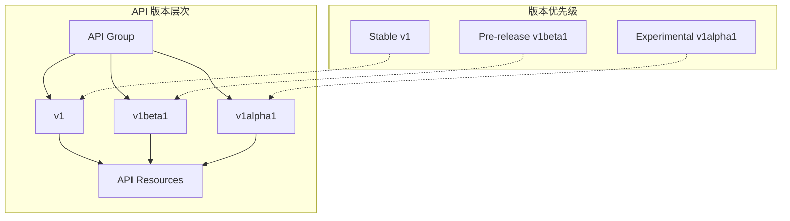
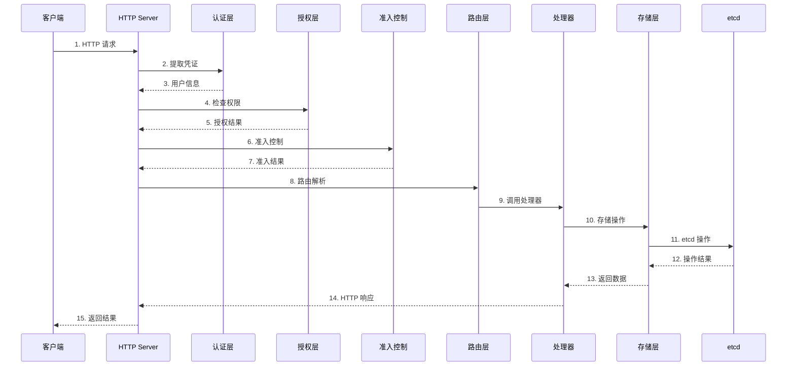

# Kubernetes API 设计与实现 - 源码重构级指南

## 1. RESTful API 设计原理

### 1.1 设计理念（Why）

Kubernetes 选择 RESTful API 作为其核心接口设计，基于以下深刻的技术考虑：

- **标准化接口**：REST 架构风格提供了统一的资源访问模式，便于理解和集成
- **无状态性**：每个请求包含所有必要信息，简化服务器设计和扩展
- **资源导向**：以资源为中心的设计模型，直观地映射集群中的各种实体
- **版本管理**：通过 API 版本实现向后兼容，支持平滑升级
- **工具生态**：丰富的 HTTP 工具和库支持，降低开发和调试成本

### 1.2 API 资源模型

Kubernetes API 遵循统一的资源模型：

```go
// staging/src/k8s.io/api/core/v1/types.go
type Pod struct {
    // 类型元数据
    metav1.TypeMeta `json:",inline"`
    
    // 对象元数据
    metav1.ObjectMeta `json:"metadata,omitempty" protobuf:"bytes,1,opt,name=metadata"`
    
    // Pod 规范（期望状态）
    Spec PodSpec `json:"spec,omitempty" protobuf:"bytes,2,opt,name=spec"`
    
    // Pod 状态（当前状态）
    Status PodStatus `json:"status,omitempty" protobuf:"bytes,3,opt,name=status"`
}

// 元数据定义
type ObjectMeta struct {
    Name              string            `json:"name,omitempty" protobuf:"bytes,1,opt,name=name"`
    Namespace         string            `json:"namespace,omitempty" protobuf:"bytes,3,opt,name=namespace"`
    SelfLink          string            `json:"selfLink,omitempty" protobuf:"bytes,4,opt,name=selfLink"`
    UID               types.UID         `json:"uid,omitempty" protobuf:"bytes,5,opt,name=uid"`
    ResourceVersion   string            `json:"resourceVersion,omitempty" protobuf:"bytes,6,opt,name=resourceVersion"`
    Generation        int64             `json:"generation,omitempty" protobuf:"varint,7,opt,name=generation"`
    CreationTimestamp metav1.Time       `json:"creationTimestamp,omitempty" protobuf:"bytes,8,opt,name=creationTimestamp"`
    DeletionTimestamp *metav1.Time      `json:"deletionTimestamp,omitempty" protobuf:"bytes,9,opt,name=deletionTimestamp"`
    Labels            map[string]string `json:"labels,omitempty" protobuf:"bytes,11,rep,name=labels"`
    Annotations       map[string]string `json:"annotations,omitempty" protobuf:"bytes,12,rep,name=annotations"`
}
```

### 1.3 API 版本管理架构



**版本转换机制**：
```go
// pkg/apis/core/v1/conversion.go
func Convert_v1_Pod_To_core_Pod(in *v1.Pod, out *core.Pod, s conversion.Scope) error {
    // 1. 转换元数据
    if err := autoConvert_v1_Pod_To_core_Pod(in, out, s); err != nil {
        return err
    }
    
    // 2. 转换 Spec
    if err := Convert_v1_PodSpec_To_core_PodSpec(&in.Spec, &out.Spec, s); err != nil {
        return err
    }
    
    // 3. 转换 Status
    if err := Convert_v1_PodStatus_To_core_PodStatus(&in.Status, &out.Status, s); err != nil {
        return err
    }
    
    return nil
}
```

## 2. API 服务器架构深度解析

### 2.1 请求处理流水线



### 2.2 HTTP 服务器实现

**服务器配置**：`staging/src/k8s.io/apiserver/pkg/server/config.go`

```go
// Config 服务器配置
type Config struct {
    // 安全配置
    SecureServing   *SecureServingInfo
    Authentication  AuthenticationInfo
    Authorization   AuthorizationInfo
    
    // API 配置
    APIGroupInfo    []APIGroupInfo
    RequestTimeout  time.Duration
    
    // 存储配置
    StorageFactory  StorageFactory
    
    // 序列化配置
    Serializer      runtime.NegotiatedSerializer
    
    // 其他配置
    EnableIndex     bool
    EnableWatchCache bool
}

// New 创建 API 服务器
func (c *Config) New(name string, delegateAPIServer ...genericapiserver.DelegationTarget) (*GenericAPIServer, error) {
    // 1. 创建服务器实例
    s := &GenericAPIServer{
        Config:         c,
        handlerChainBuilders: []HandlerChainBuilderFunc{},
    }
    
    // 2. 设置 HTTP 处理器
    s.Handler = NewAPIServerHandler(name, c.Serializer, c.HandlerChainBuilder(s))
    
    // 3. 配置安全服务
    if c.SecureServing != nil {
        if err := c.SecureServing.Serve(s.Handler, c.RequestTimeout); err != nil {
            return nil, err
        }
    }
    
    // 4. 安装 API 组
    for _, apiGroupInfo := range c.APIGroupInfo {
        if err := s.InstallAPIGroups(&apiGroupInfo); err != nil {
            return nil, err
        }
    }
    
    return s, nil
}
```

### 2.3 认证层实现

**认证器接口**：`staging/src/k8s.io/apiserver/pkg/authentication/request/union.go`

```go
// Request 认证请求接口
type Request interface {
    GetRequest() *http.Request
}

// Response 认证响应
type Response struct {
    User      user.Info
    Audiences []string
}

// Authenticator 认证器接口
type Authenticator interface {
    AuthenticateRequest(req Request) (*Response, bool, error)
}

// UnionAuthenticator 联合认证器
type UnionAuthenticator struct {
    // 认证器列表
    Authenticators []Request
}

// AuthenticateRequest 尝试所有认证器
func (authHandler *UnionAuthenticator) AuthenticateRequest(req Request) (*Response, bool, error) {
    var errlist []error
    
    for _, currAuthRequestHandler := range authHandler.Authenticators {
        resp, ok, err := currAuthRequestHandler.AuthenticateRequest(req)
        if err != nil {
            errlist = append(errlist, err)
            continue
        }
        
        if ok {
            // 认证成功
            return resp, true, nil
        }
    }
    
    return nil, false, utilerrors.NewAggregate(errlist)
}

// Token 认证器
type TokenAuthenticator struct {
    tokenReview tokenreview.TokenReviewInterface
}

// AuthenticateRequest 令牌认证
func (a *TokenAuthenticator) AuthenticateRequest(req Request) (*Response, bool, error) {
    // 1. 提取令牌
    token, ok := req.GetRequest().Header["Authorization"]
    if !ok {
        return nil, false, nil
    }
    
    // 2. 验证令牌
    review, err := a.tokenReview.Create(context.TODO(), &tokenreview.TokenReview{
        Spec: tokenreview.TokenReviewSpec{
            Token: token[0],
        },
    }, metav1.CreateOptions{})
    if err != nil {
        return nil, false, err
    }
    
    // 3. 构建用户信息
    if review.Status.Authenticated {
        return &Response{
            User: &user.DefaultInfo{
                Name:   review.Status.User.Username,
                Groups: review.Status.User.Groups,
            },
        }, true, nil
    }
    
    return nil, false, nil
}
```

### 2.4 授权层实现

**授权器接口**：`staging/src/k8s.io/apiserver/pkg/authorization/authorizer/`

```go
// Attributes 授权属性
type Attributes interface {
    GetUser() user.Info
    GetVerb() string
    IsReadOnly() bool
    GetNamespace() string
    GetResource() string
    GetSubresource() string
    GetName() string
    GetAPIGroup() string
    GetAPIVersion() string
    IsResourceRequest() bool
    GetPath() string
}

// Authorizer 授权器接口
type Authorizer interface {
    Authorize(ctx context.Context, a Attributes) (authorized Decision, reason string, err error)
}

// Decision 授权决策
type Decision int

const (
    // DecisionAllow 允许
    DecisionAllow Decision = iota
    // DecisionDeny 拒绝
    DecisionDeny
    // DecisionNoOpinion 无法决策
    DecisionNoOpinion
)

// RBACAuthorizer RBAC 授权器
type RBACAuthorizer struct {
    // 规则解析器
    authorizationRuleResolver RuleResolver
    
    // 规则检查模式
    ruleCheckingMode RBACRuleCheckingMode
}

// Authorize RBAC 授权
func (r *RBACAuthorizer) Authorize(ctx context.Context, a Attributes) (Decision, string, error) {
    // 1. 获取用户信息
    user := a.GetUser()
    
    // 2. 检查系统权限
    if r.hasSystemAccess(user) {
        return DecisionAllow, "system access", nil
    }
    
    // 3. 获取规则列表
    rules, err := r.authorizationRuleResolver.RulesFor(user, a.GetNamespace())
    if err != nil {
        return DecisionNoOpinion, "", err
    }
    
    // 4. 匹配规则
    for _, rule := range rules {
        if rule.Matches(a) {
            return DecisionAllow, "RBAC: allowed by rule", nil
        }
    }
    
    return DecisionDeny, "RBAC: no rules matched", nil
}
```

### 2.5 准入控制实现

**准入控制器接口**：`pkg/admission/interface.go`

```go
// Interface 准入控制器接口
type Interface interface {
    // Handles 检查是否处理此操作
    Handles(operation Operation) bool
    
    // Admit 执行准入控制
    Admit(ctx context.Context, a Attributes) error
}

// MutatingInterface 变更准入接口
type MutatingInterface interface {
    Interface
    
    // Admit 执行变更准入
    Admit(ctx context.Context, a Attributes) error
}

// ValidatingInterface 验证准入接口
type ValidatingInterface interface {
    Interface
    
    // Validate 执行验证准入
    Validate(ctx context.Context, a Attributes) error
}

// Attributes 准入属性
type Attributes interface {
    GetObject() runtime.Object
    GetOldObject() runtime.Object
    GetKind() schema.GroupVersionKind
    GetNamespace() string
    GetName() string
    GetResource() schema.GroupVersionResource
    GetSubresource() string
    GetOperation() Operation
    GetUserInfo() user.Info
    GetDryRun() bool
}

// Operation 操作类型
type Operation string

const (
    Create  Operation = "CREATE"
    Update  Operation = "UPDATE"
    Delete  Operation = "DELETE"
    Connect Operation = "CONNECT"
)

// MutatingAdmissionWebhook 变更准入 Webhook
type MutatingAdmissionWebhook struct {
    webhook *webhook.Webhook
}

// Admit 执行变更准入
func (m *MutatingAdmissionWebhook) Admit(ctx context.Context, a Attributes) error {
    // 1. 序列化对象
    obj, err := json.Marshal(a.GetObject())
    if err != nil {
        return err
    }
    
    // 2. 调用 Webhook
    response, err := m.webhook.CallAdmission(ctx, &admissionv1.AdmissionReview{
        Request: &admissionv1.AdmissionRequest{
            Kind:      a.GetKind(),
            Namespace: a.GetNamespace(),
            Name:      a.GetName(),
            Object:    runtime.RawExtension{Raw: obj},
            Operation: admissionv1.Operation(a.GetOperation()),
            UserInfo:  admissionv1.UserInfo{
                Username: a.GetUserInfo().GetName(),
                Groups:   a.GetUserInfo().GetGroups(),
            },
        },
    })
    if err != nil {
        return err
    }
    
    // 3. 处理响应
    if !response.Response.Allowed {
        return fmt.Errorf("webhook denied request: %s", response.Response.Result.Message)
    }
    
    // 4. 应用补丁
    if len(response.Response.Patch) > 0 {
        patch, err := jsonpatch.DecodePatch(response.Response.Patch)
        if err != nil {
            return err
        }
        
        modified, err := patch.Apply(obj)
        if err != nil {
            return err
        }
        
        // 更新对象
        if err := json.Unmarshal(modified, a.GetObject()); err != nil {
            return err
        }
    }
    
    return nil
}
```

## 3. API 路由与处理器

### 3.1 路由安装机制

**路由安装**：`staging/src/k8s.io/apiserver/pkg/endpoints/installer.go`

```go
// APIGroupInfo API 组信息
type APIGroupInfo struct {
    // 组元数据
    GroupMeta             apimachinery.GroupMeta
    
    // 版本化资源存储
    VersionedResourcesStorageMap map[string]map[string]rest.Storage
    
    // 序列化器
    ParameterCodec           runtime.ParameterCodec
    NegotiatedSerializer     runtime.NegotiatedSerializer
    
    // 上下文
    Scheme                   *runtime.Scheme
}

// InstallAPIGroups 安装 API 组
func (s *GenericAPIServer) InstallAPIGroups(apiGroupInfo ...*APIGroupInfo) error {
    for _, apiGroup := range apiGroupInfo {
        // 1. 注册 API 组
        if err := s.installAPIGroup(apiGroup); err != nil {
            return err
        }
    }
    return nil
}

// installAPIGroup 安装单个 API 组
func (s *GenericAPIServer) installAPIGroup(apiGroupInfo *APIGroupInfo) error {
    // 1. 创建 API 组版本信息
    apiVersions := []string{}
    for version := range apiGroupInfo.VersionedResourcesStorageMap {
        apiVersions = append(apiVersions, version)
    }
    
    // 2. 排序版本（稳定版本优先）
    sort.Strings(apiVersions)
    
    // 3. 注册每个版本的资源
    for _, version := range apiVersions {
        // 获取版本资源存储
        storageMap := apiGroupInfo.VersionedResourcesStorageMap[version]
        
        // 创建资源路径
        groupVersion := schema.GroupVersion{Group: apiGroupInfo.GroupMeta.Group, Version: version}
        resourcePath := "/" + groupVersion.Group + "/" + groupVersion.Version
        
        // 为每个资源创建路由
        for resource, storage := range storageMap {
            // 创建资源 REST 处理器
            ws := newWebService(resourcePath)
            
            // 添加 REST 操作
            registerResourceHandlers(storage, ws, apiGroupInfo)
            
            // 注册到服务器
            s.Handler.GoRestfulContainer.Add(ws)
        }
    }
    
    return nil
}

// registerResourceHandlers 注册资源处理器
func registerResourceHandlers(storage rest.Storage, ws *restful.WebService, apiGroupInfo *APIGroupInfo) {
    // 1. 获取资源操作
    creater, isCreater := storage.(rest.Creater)
    updater, isUpdater := storage.(rest.Updater)
    getter, isGetter := storage.(rest.Getter)
    lister, isLister := storage.(rest.Lister)
    deleter, isDeleter := storage.(rest.Deleter)
    
    // 2. 注册 GET 操作（单个资源）
    if isGetter {
        ws.Route(ws.GET("/{name}").To(handler.NamedGetHandlerFunc("get", getObject).
            Doc("get the specified " + kind)).
            Param(ws.PathParameter("name", "name of the " + kind).DataType("string")).
            Operation("get"+kind))
    }
    
    // 3. 注册 LIST 操作（资源集合）
    if isLister {
        ws.Route(ws.GET("").To(handler.NamedListHandlerFunc("list", listObject).
            Doc("list or watch objects of type " + kind)).
            Operation("list"+kind))
    }
    
    // 4. 注册 POST 操作（创建资源）
    if isCreater {
        ws.Route(ws.POST("").To(handler.NamedCreateHandlerFunc("create", createObject).
            Doc("create a " + kind)).
            Operation("create"+kind))
    }
    
    // 5. 注册 PUT 操作（更新资源）
    if isUpdater {
        ws.Route(ws.PUT("/{name}").To(handler.NamedUpdateHandlerFunc("update", updateObject).
            Doc("update the specified " + kind)).
            Param(ws.PathParameter("name", "name of the " + kind).DataType("string")).
            Operation("update"+kind))
    }
    
    // 6. 注册 DELETE 操作（删除资源）
    if isDeleter {
        ws.Route(ws.DELETE("/{name}").To(handler.NamedDeleteHandlerFunc("delete", deleteObject).
            Doc("delete the specified " + kind)).
            Param(ws.PathParameter("name", "name of the " + kind).DataType("string")).
            Operation("delete"+kind))
    }
}
```

### 3.2 REST 处理器实现

**REST 处理器**：`staging/src/k8s.io/apiserver/pkg/registry/rest/rest.go`

```go
// StandardStorage 标准存储接口
type StandardStorage interface {
    Creater
    Updater
    Getter
    Lister
    Deleter
    Watcher
    GracefulDeleter
    CollectionDeleter
}

// Creater 创建接口
type Creater interface {
    Create(ctx context.Context, obj runtime.Object, createValidation ValidateObjectFunc, options *metav1.CreateOptions) (runtime.Object, error)
}

// Updater 更新接口
type Updater interface {
    Update(ctx context.Context, name string, objInfo rest.UpdatedObjectInfo, createValidation ValidateObjectFunc, updateValidation ValidateObjectUpdateFunc, forceAllowCreate bool, options *metav1.UpdateOptions) (runtime.Object, bool, error)
}

// Getter 获取接口
type Getter interface {
    Get(ctx context.Context, name string, options *metav1.GetOptions) (runtime.Object, error)
}

// Lister 列表接口
type Lister interface {
    List(ctx context.Context, options *metav1.ListOptions) (runtime.Object, error)
}

// Deleter 删除接口
type Deleter interface {
    Delete(ctx context.Context, name string, deleteValidation ValidateObjectFunc, options *metav1.DeleteOptions) (runtime.Object, bool, error)
}

// Watcher 监听接口
type Watcher interface {
    Watch(ctx context.Context, options *metav1.ListOptions) (watch.Interface, error)
}
```

### 3.3 请求处理流程

**请求处理器**：`staging/src/k8s.io/apiserver/pkg/endpoints/handlers/`

```go
// GetResourceHandler 获取资源处理器
func GetResourceHandler(r rest.Getter, scope *RequestScope, admit admission.Interface) http.HandlerFunc {
    return func(w http.ResponseWriter, req *http.Request) {
        // 1. 解析请求
        name, err := scope.Namer.Name(req)
        if err != nil {
            scope.err(err, w, req)
            return
        }
        
        // 2. 获取对象
        result, err := r.Get(req.Context(), name, &metav1.GetOptions{})
        if err != nil {
            scope.err(err, w, req)
            return
        }
        
        // 3. 转换为期望的版本
        result, err = ConvertToTable(result, scope)
        if err != nil {
            scope.err(err, w, req)
            return
        }
        
        // 4. 序列化响应
        writeObjectNegotiated(scope.Serializer, scope.Kind.GroupVersion(), w, req, http.StatusOK, result)
    }
}

// CreateNamedResourceHandler 创建资源处理器
func CreateNamedResourceHandler(r rest.Creater, scope *RequestScope, admit admission.Interface) http.HandlerFunc {
    return func(w http.ResponseWriter, req *http.Request) {
        // 1. 解析请求体
        obj, err := DecodeObject(req, scope.Serializer)
        if err != nil {
            scope.err(err, w, req)
            return
        }
        
        // 2. 准入控制
        if admit.Handles(admission.Create) {
            if err := admit.Admit(req.Context(), admission.NewAttributesRecord(obj, nil, scope.Kind, "", scope.Resource.Name, scope.Resource.Resource, "", admission.Create, false, nil)); err != nil {
                scope.err(err, w, req)
                return
            }
        }
        
        // 3. 创建对象
        result, err := r.Create(req.Context(), obj, nil, &metav1.CreateOptions{})
        if err != nil {
            scope.err(err, w, req)
            return
        }
        
        // 4. 返回创建的对象
        writeObjectNegotiated(scope.Serializer, scope.Kind.GroupVersion(), w, req, http.StatusCreated, result)
    }
}
```

## 4. Watch 机制实现

### 4.1 Watch 原理

**Watch 接口**：`staging/src/k8s.io/apimachinery/pkg/watch/watch.go`

```go
// Interface Watch 接口
type Interface interface {
    // ResultChan 返回事件通道
    ResultChan() <-chan Event
    
    // Stop 停止监听
    Stop()
}

// Event 事件类型
type Event struct {
    // 事件类型
    Type EventType
    
    // 事件对象
    Object runtime.Object
}

// EventType 事件类型
type EventType string

const (
    Added    EventType = "ADDED"
    Modified EventType = "MODIFIED"
    Deleted  EventType = "DELETED"
    Error    EventType = "ERROR"
    Bookmark EventType = "BOOKMARK"
)

// StreamWatcher 流式监听器
type StreamWatcher struct {
    result  chan Event
    stop    chan struct{}
    reader  io.ReadCloser
    decoder streaming.Decoder
}

// NewStreamWatcher 创建流式监听器
func NewStreamWatcher(reader io.ReadCloser, decoder streaming.Decoder) *StreamWatcher {
    sw := &StreamWatcher{
        result:  make(chan Event, 10),
        stop:    make(chan struct{}),
        reader:  reader,
        decoder: decoder,
    }
    go sw.receive()
    return sw
}

// receive 接收事件
func (sw *StreamWatcher) receive() {
    defer close(sw.result)
    defer sw.reader.Close()
    
    for {
        select {
        case <-sw.stop:
            return
        default:
            // 解码事件
            obj, err := sw.decoder.Decode(nil)
            if err != nil {
                // 发送错误事件
                sw.result <- Event{Type: Error, Object: &metav1.Status{Status: metav1.StatusFailure}}
                return
            }
            
            // 确定事件类型
            event := Event{Object: obj}
            switch t := obj.(type) {
            case *metav1.WatchEvent:
                event.Type = EventType(t.Type)
                event.Object = t.Object.Object
            }
            
            // 发送事件
            select {
            case sw.result <- event:
            case <-sw.stop:
                return
            }
        }
    }
}

// ResultChan 返回事件通道
func (sw *StreamWatcher) ResultChan() <-chan Event {
    return sw.result
}

// Stop 停止监听
func (sw *StreamWatcher) Stop() {
    close(sw.stop)
}
```

### 4.2 etcd Watch 实现

**etcd Watch**：`staging/src/k8s.io/apiserver/pkg/storage/etcd3/watcher.go`

```go
// watcher etcd 监听器
type watcher struct {
    client     *clientv3.Client
    codec      runtime.Codec
    versioner  storage.Versioner
    transformer value.Transformer
    initEvents []*watchCacheEvent
    // 其他字段
}

// Watch 实现 Watch 接口
func (w *watcher) Watch(ctx context.Context, key string, opts storage.ListOptions) (watch.Interface, error) {
    // 1. 获取资源版本
    resourceVersion, err := w.versioner.ObjectResourceVersion(nil)
    if err != nil {
        return nil, err
    }
    
    // 2. 创建 etcd Watch
    revision := parseResourceVersion(resourceVersion)
    watchOpts := []clientv3.OpOption{
        clientv3.WithRev(revision),
        clientv3.WithPrevKV(),
        clientv3.WithPrefix(),
    }
    
    etcdWatch := w.client.Watch(ctx, key, watchOpts...)
    
    // 3. 创建事件通道
    eventCh := make(chan watch.Event, 10)
    
    // 4. 启动事件处理循环
    go func() {
        defer close(eventCh)
        
        for etcdResp := range etcdWatch {
            if etcdResp.Err() != nil {
                eventCh <- watch.Event{Type: watch.Error, Object: &metav1.Status{Message: etcdResp.Err().Error()}}
                return
            }
            
            for _, event := range etcdResp.Events {
                // 转换 etcd 事件为 Kubernetes 事件
                k8sEvent, err := w.transformEvent(event)
                if err != nil {
                    eventCh <- watch.Event{Type: watch.Error, Object: &metav1.Status{Message: err.Error()}}
                    return
                }
                
                eventCh <- *k8sEvent
            }
        }
    }()
    
    return newProxyWatcher(eventCh), nil
}

// transformEvent 转换事件
func (w *watcher) transformEvent(event *clientv3.Event) (*watch.Event, error) {
    // 1. 确定事件类型
    var eventType watch.EventType
    switch event.Type {
    case clientv3.EventTypePut:
        if event.IsCreate() {
            eventType = watch.Added
        } else {
            eventType = watch.Modified
        }
    case clientv3.EventTypeDelete:
        eventType = watch.Deleted
    default:
        return nil, fmt.Errorf("unsupported event type: %s", event.Type)
    }
    
    // 2. 解码对象
    obj, err := runtime.Decode(w.codec, event.Kv.Value)
    if err != nil {
        return nil, err
    }
    
    // 3. 设置资源版本
    if err := w.versioner.UpdateObject(obj, event.Kv.ModRevision); err != nil {
        return nil, err
    }
    
    return &watch.Event{
        Type:   eventType,
        Object: obj,
    }, nil
}
```

## 5. 存储层实现

### 5.1 存储接口设计

**存储接口**：`staging/src/k8s.io/apiserver/pkg/storage/interface.go`

```go
// Interface 存储接口
type Interface interface {
    // Create 创建资源
    Create(ctx context.Context, key string, obj, out runtime.Object, ttl uint64) error
    
    // Get 获取资源
    Get(ctx context.Context, key string, opts GetOptions, objPtr runtime.Object) error
    
    // List 列举资源
    List(ctx context.Context, key string, opts ListOptions, listObj runtime.Object) error
    
    // Update 更新资源
    Update(ctx context.Context, key string, obj, out runtime.Object, ttl uint64) error
    
    // Delete 删除资源
    Delete(ctx context.Context, key string, out runtime.Object, preconditions *Preconditions) error
    
    // Watch 监听资源变化
    Watch(ctx context.Context, key string, opts ListOptions) (watch.Interface, error)
    
    // GetToList 获取并列举
    GetToList(ctx context.Context, key string, opts ListOptions, listObj runtime.Object) error
    
    // GuaranteedUpdate 保证更新
    GuaranteedUpdate(ctx context.Context, key string, ptr runtime.Object, ignoreNotFound bool, preconditions *Preconditions, tryUpdate UpdateFunc, suggestion ...runtime.Object) error
}

// GetOptions 获取选项
type GetOptions struct {
    ResourceVersion string
    IgnoreNotFound  bool
}

// ListOptions 列表选项
type ListOptions struct {
    ResourceVersion     string
    ResourceVersionMatch ResourceVersionMatch
    Predicate           SelectionPredicate
    Recursive           bool
    ProgressNotify      bool
}

// Preconditions 前置条件
type Preconditions struct {
    UID             *types.UID
    ResourceVersion *string
}
```

### 5.2 etcd 存储实现

**etcd 存储**：`staging/src/k8s.io/apiserver/pkg/storage/etcd3/store.go`

```go
// store etcd 存储
type store struct {
    client        *clientv3.Client
    codec         runtime.Codec
    versioner     storage.Versioner
    transformer   value.Transformer
    pathPrefix    string
    quorum        bool
    pagingEnabled bool
}

// Create 创建资源
func (s *store) Create(ctx context.Context, key string, obj, out runtime.Object, ttl uint64) error {
    // 1. 序列化对象
    data, err := runtime.Encode(s.codec, obj)
    if err != nil {
        return err
    }
    
    // 2. 转换数据
    data, err = s.transform(data)
    if err != nil {
        return err
    }
    
    // 3. 设置 TTL
    var opts []clientv3.OpOption
    if ttl > 0 {
        opts = append(opts, clientv3.WithLease(clientv3.LeaseID(ttl)))
    }
    
    // 4. 执行创建
    getResp, err := s.client.KV.Get(ctx, key)
    if err != nil {
        return err
    }
    
    if len(getResp.Kvs) > 0 {
        return storage.NewKeyExistsError(key, 0)
    }
    
    putResp, err := s.client.KV.Put(ctx, key, string(data), opts...)
    if err != nil {
        return err
    }
    
    // 5. 设置资源版本
    if err := s.versioner.UpdateObject(obj, putResp.Header.Revision); err != nil {
        return err
    }
    
    // 6. 复制到输出对象
    if out != nil {
        return runtime.Decode(s.codec, data, out)
    }
    
    return nil
}

// Get 获取资源
func (s *store) Get(ctx context.Context, key string, opts storage.GetOptions, objPtr runtime.Object) error {
    // 1. 执行获取
    getResp, err := s.client.KV.Get(ctx, key)
    if err != nil {
        return err
    }
    
    // 2. 检查是否存在
    if len(getResp.Kvs) == 0 {
        if opts.IgnoreNotFound {
            return runtime.SetZero(objPtr)
        }
        return storage.NewKeyNotFoundError(key, 0)
    }
    
    // 3. 反序列化数据
    data := getResp.Kvs[0].Value
    data, err = s.transform(data)
    if err != nil {
        return err
    }
    
    // 4. 解码对象
    if err := runtime.Decode(s.codec, data, objPtr); err != nil {
        return err
    }
    
    // 5. 设置资源版本
    return s.versioner.UpdateObject(objPtr, getResp.Kvs[0].ModRevision)
}

// Update 更新资源
func (s *store) Update(ctx context.Context, key string, obj, out runtime.Object, ttl uint64) error {
    // 1. 序列化对象
    data, err := runtime.Encode(s.codec, obj)
    if err != nil {
        return err
    }
    
    // 2. 转换数据
    data, err = s.transform(data)
    if err != nil {
        return err
    }
    
    // 3. 设置选项
    var opts []clientv3.OpOption
    if ttl > 0 {
        opts = append(opts, clientv3.WithLease(clientv3.LeaseID(ttl)))
    }
    
    // 4. 获取当前资源版本
    resourceVersion, err := s.versioner.ResourceVersion(obj)
    if err != nil {
        return err
    }
    
    revision, _ := strconv.ParseInt(resourceVersion, 10, 64)
    if revision > 0 {
        opts = append(opts, clientv3.WithModRevision(revision))
    }
    
    // 5. 执行更新
    putResp, err := s.client.KV.Put(ctx, key, string(data), opts...)
    if err != nil {
        if err == clientv3.ErrCompaction {
            return storage.NewResourceVersionConflictError(resourceVersion, key)
        }
        return err
    }
    
    // 6. 设置新的资源版本
    if err := s.versioner.UpdateObject(obj, putResp.Header.Revision); err != nil {
        return err
    }
    
    // 7. 复制到输出对象
    if out != nil {
        return runtime.Decode(s.codec, data, out)
    }
    
    return nil
}
```

### 5.3 缓存机制

**缓存实现**：`staging/src/k8s.io/apiserver/pkg/storage/cacher/cacher.go`

```go
// cacher 缓存器
type cacher struct {
    // 底层存储
    storage storage.Interface
    
    // 配置
    config     Config
    clock      clock.Clock
    
    // 事件处理器
    watcherList  []watcher
    watchCache   *watchCache
    
    // 同步控制
    ready     chan struct{}
    once      sync.Once
}

// Config 缓存配置
type Config struct {
    // 容量
    Capacity int
    
    // 底层存储
    Storage storage.Interface
    
    // 对象类型
    Type reflect.Type
    
    // 版本器
    Versioner storage.Versioner
    
    // 资源前缀
    ResourcePrefix string
}

// NewCacher 创建缓存器
func NewCacher(config Config) (*cacher, error) {
    c := &cacher{
        storage: config.Storage,
        config:  config,
        clock:   clock.RealClock{},
        ready:   make(chan struct{}),
    }
    
    // 1. 创建 Watch 缓存
    c.watchCache = newWatchCache(config.Capacity, config.Clock)
    
    // 2. 启动事件循环
    go c.dispatchEvents()
    
    // 3. 等待初始化完成
    if err := c.watchCache.waitUntilFresh(); err != nil {
        return nil, err
    }
    
    c.once.Do(func() {
        close(c.ready)
    })
    
    return c, nil
}

// dispatchEvents 分发事件
func (c *cacher) dispatchEvents() {
    // 1. 从底层存储启动 Watch
    w, err := c.storage.Watch(context.Background(), "", storage.ListOptions{ResourceVersion: "0"})
    if err != nil {
        return
    }
    
    // 2. 处理事件流
    for event := range w.ResultChan() {
        switch event.Type {
        case watch.Added, watch.Modified:
            // 更新缓存
            c.watchCache.Add(event.Object)
            
        case watch.Deleted:
            // 从缓存删除
            c.watchCache.Delete(event.Object)
            
        case watch.Error:
            // 处理错误
            klog.Errorf("watch error: %v", event.Object)
        }
        
        // 3. 分发到所有 Watcher
        c.dispatchEvent(event)
    }
}

// Watch 实现 Watch 接口
func (c *cacher) Watch(ctx context.Context, key string, opts storage.ListOptions) (watch.Interface, error) {
    // 1. 创建 Watcher
    watcher := newWatcher(ctx, opts.Predicate)
    
    // 2. 添加到 Watcher 列表
    c.watcherListLock.Lock()
    c.watcherList = append(c.watcherList, watcher)
    c.watcherListLock.Unlock()
    
    // 3. 从缓存发送初始事件
    initEvents := c.watchCache.List()
    for _, event := range initEvents {
        watcher.add(event)
    }
    
    return watcher, nil
}
```

## 6. API 优先级和流控

### 6.1 请求优先级

**优先级配置**：`staging/src/k8s.io/apiserver/pkg/server/options/server_run_options.go`

```go
// ServerRunOptions 服务器运行选项
type ServerRunOptions struct {
    // 最大并发请求数
    MaxRequestsInFlight int
    
    // 最大变更请求数
    MaxMutatingRequestsInFlight int
    
    // 请求超时
    RequestTimeout time.Duration
    
    // 请求头超时
    MinRequestTimeout time.Duration
    
    // 优先级和公平性
    EnablePriorityAndFairness bool
}

// DefaultMaxRequestsInFlight 默认最大并发请求数
const DefaultMaxRequestsInFlight = 400

// DefaultMaxMutatingRequestsInFlight 默认最大变更并发请求数
const DefaultMaxMutatingRequestsInFlight = 200
```

### 6.2 请求限流

**限流器实现**：`staging/src/k8s.io/apiserver/pkg/util/flowcontrol/`

```go
// RequestLimitHandler 请求限流处理器
type RequestLimitHandler struct {
    // 最大并发读请求
    maxRequestsInFlight int
    
    // 最大并发写请求
    maxMutatingRequestsInFlight int
    
    // 当前请求数
    requestCount     int32
    mutatingCount    int32
}

// Handle 处理请求
func (r *RequestLimitHandler) Handle(next http.Handler) http.Handler {
    return http.HandlerFunc(func(w http.ResponseWriter, req *http.Request) {
        // 1. 确定请求类型
        isMutating := isMutatingRequest(req)
        
        // 2. 检查并发限制
        if isMutating {
            if atomic.LoadInt32(&r.mutatingCount) >= int32(r.maxMutatingRequestsInFlight) {
                // 返回 429 Too Many Requests
                writeTooManyRequests(w, req)
                return
            }
            atomic.AddInt32(&r.mutatingCount, 1)
            defer atomic.AddInt32(&r.mutatingCount, -1)
        } else {
            if atomic.LoadInt32(&r.requestCount) >= int32(r.maxRequestsInFlight) {
                // 返回 429 Too Many Requests
                writeTooManyRequests(w, req)
                return
            }
            atomic.AddInt32(&r.requestCount, 1)
            defer atomic.AddInt32(&r.requestCount, -1)
        }
        
        // 3. 调用下一个处理器
        next.ServeHTTP(w, req)
    })
}
```

## 7. 总结

Kubernetes API 设计体现了现代分布式系统接口设计的最佳实践：

### 7.1 核心设计原则

- **RESTful 风格**：统一的资源访问模式，易于理解和使用
- **版本管理**：通过 API 版本实现向后兼容和演进
- **声明式 API**：关注期望状态而非执行过程
- **资源导向**：以资源为中心的建模方式
- **可扩展性**：通过插件和 Webhook 机制支持扩展

### 7.2 关键技术亮点

- **分层架构**：认证、授权、准入控制的清晰分层
- **高效缓存**：多级缓存机制提升性能
- **Watch 机制**：实时事件通知和状态同步
- **流控机制**：防止系统过载的请求限流
- **版本转换**：自动化的 API 版本兼容处理

### 7.3 实现质量保证

- **类型安全**：强类型设计减少运行时错误
- **向后兼容**：严格的版本管理策略
- **性能优化**：缓存、批处理、并发控制
- **可观测性**：完整的日志、监控、追踪

通过理解这些 API 设计原理和实现细节，开发者可以：
- 高效使用 Kubernetes API
- 正确开发自定义控制器和 Operator
- 参与社区贡献并推动 API 演进
- 构建兼容 Kubernetes 的工具和平台

这套 API 设计为构建大规模分布式管理系统提供了坚实的架构基础。