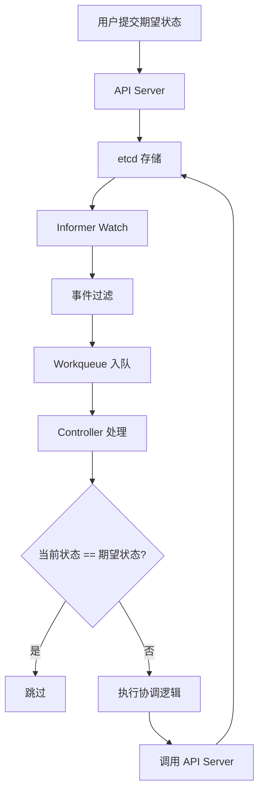
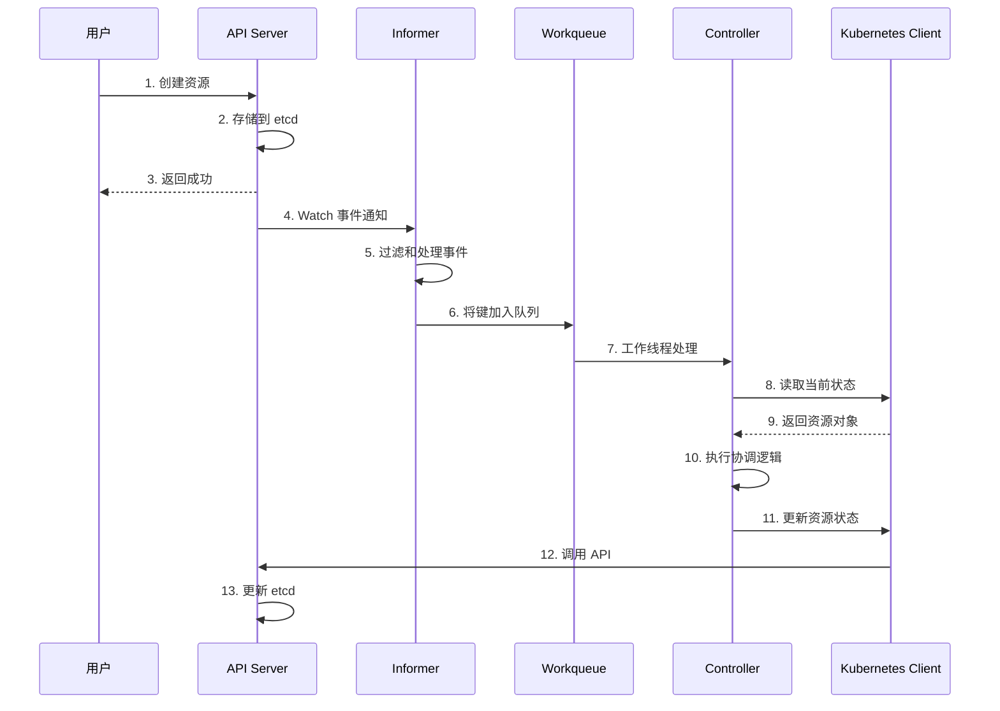

# Kubernetes 控制器框架 - 源码重构级指南

## 1. 控制器模式深度解析

### 1.1 设计理念（Why）

Kubernetes 选择控制器模式（Controller Pattern）作为其核心协调机制，基于以下深刻的设计考虑：

- **状态声明式**：用户声明期望状态，控制器自动协调当前状态与期望状态
- **持续协调**：控制器持续监控集群状态，确保系统最终达到期望状态
- **故障自愈**：当出现故障时，控制器自动检测并修复，无需人工干预
- **解耦架构**：每个控制器专注于特定资源，实现模块化和可维护性
- **可扩展性**：易于添加新的控制器和自定义控制器

### 1.2 控制器模式基本原理



### 1.3 控制器生命周期



## 2. Informer 机制深度解析

### 2.1 Informer 架构设计

**Informer 接口**：`staging/src/k8s.io/client-go/informers/`

```go
// SharedInformerFactory 共享 Informer 工厂
type SharedInformerFactory interface {
    // Start 启动所有 Informer
    Start(stopCh <-chan struct{})
    
    // WaitForCacheSync 等待缓存同步
    WaitForCacheSync(stopCh <-chan struct{}) map[reflect.Type]bool
    
    // InformerForResource 获取资源的 Informer
    InformerForResource(gvr schema.GroupVersionResource) (GenericSharedInformer, error)
}

// SharedInformerFactoryImpl 共享 Informer 工厂实现
type SharedInformerFactoryImpl struct {
    // 客户端
    client           clientset.Interface
    
    // 命名空间过滤
    namespace        string
    
    // 调整函数
    tweakListOptions TweakListOptionsFunc
    
    // 停止通道
    stopCh           <-chan struct{}
    
    // Informer 字典
    informers map[reflect.Type]cache.SharedIndexInformer
    
    // 启动锁
    startedInformers map[reflect.Type]bool
    
    // 同步锁
    mu sync.RWMutex
}

// NewSharedInformerFactory 创建共享 Informer 工厂
func NewSharedInformerFactory(client clientset.Interface, defaultResync time.Duration) SharedInformerFactory {
    return &SharedInformerFactoryImpl{
        client:           client,
        informers:       make(map[reflect.Type]cache.SharedIndexInformer),
        startedInformers: make(map[reflect.Type]bool),
    }
}
```

### 2.2 SharedInformer 实现

**共享 Informer**：`staging/src/k8s.io/client-go/tools/cache/shared_informer.go`

```go
// SharedInformer 共享 Informer
type SharedInformer interface {
    // AddEventHandler 添加事件处理器
    AddEventHandler(handler ResourceEventHandler)
    
    // Run 运行 Informer
    Run(stopCh <-chan struct{})
    
    // HasSynced 检查是否同步
    HasSynced() bool
    
    // GetStore 获取存储
    GetStore() Store
    
    // GetController 获取控制器
    GetController() Controller
}

// sharedInformer 共享 Informer 实现
type sharedInformer struct {
    // 底层 Informer
    indexer    Indexer
    
    // 控制器
    controller Controller
    
    // 事件处理器列表
    processor *sharedProcessor
    
    // 转换函数
    transformer TransformFunc
    
    // 判断函数
    determinationFunc DeterminationFunc
    
    // 启动标志
    started bool
    stopped bool
}

// NewSharedInformer 创建共享 Informer
func NewSharedInformer(lw ListerWatcher, exampleObject runtime.Object, resyncPeriod time.Duration) SharedInformer {
    // 1. 创建索引器
    indexer := NewIndexer(DeletionHandlingMetaNamespaceKeyFunc, Indexers{})
    
    // 2. 创建共享 Informer
    return &sharedInformer{
        indexer:    indexer,
        processor:  &sharedProcessor{},
        transformer: func(obj interface{}) (interface{}, error) { return obj, nil },
        determinationFunc: func(dObj runtime.Object) bool {
            return true
        },
    }
}

// Run 运行 Informer
func (s *sharedInformer) Run(stopCh <-chan struct{}) {
    defer utilruntime.HandleCrash()
    
    // 1. 创建 Delta FIFO
    fifo := NewDeltaFIFOWithOptions(DeltaFIFOOptions{
        KnownObjects:          s.indexer,
        EmitDeltaTypeReplaced: true,
    })
    
    // 2. 创建控制器
    cfg := &Config{
        Queue:            fifo,
        ListerWatcher:    s.listerWatcher,
        ObjectType:       s.objectType,
        FullResyncPeriod: s.resyncCheckPeriod,
        RetryOnError:     false,
        Process:          s.HandleDeltas,
    }
    s.controller = New(cfg)
    
    // 3. 启动处理器
    s.processor.run(stopCh)
    
    // 4. 启动控制器
    s.controller.Run(stopCh)
}

// HandleDeltas 处理 Delta
func (s *sharedInformer) HandleDeltas(obj interface{}) error {
    s.blockDeltas.Lock()
    defer s.blockDeltas.Unlock()
    
    // 1. 获取 Delta 列表
    deltas, ok := obj.(Deltas)
    if !ok {
        return fmt.Errorf("expected Deltas, got %T", obj)
    }
    
    // 2. 处理每个 Delta
    for _, delta := range deltas {
        switch delta.Type {
        case Sync, Added, Updated:
            // 添加到索引器
            if old, exists, err := s.indexer.Get(delta.Object); err == nil && exists {
                if err := s.indexer.Update(delta.Object); err != nil {
                    return err
                }
                s.processor.distribute(updateNotification{oldObj: old, newObj: delta.Object}, false)
            } else {
                if err := s.indexer.Add(delta.Object); err != nil {
                    return err
                }
                s.processor.distribute(addNotification{newObj: delta.Object}, false)
            }
            
        case Deleted:
            // 从索引器删除
            if err := s.indexer.Delete(delta.Object); err != nil {
                return err
            }
            s.processor.distribute(deleteNotification{oldObj: delta.Object}, false)
        }
    }
    
    return nil
}
```

### 2.3 事件处理器机制

**事件处理器接口**：`staging/src/k8s.io/client-go/tools/cache/controller.go`

```go
// ResourceEventHandler 资源事件处理器接口
type ResourceEventHandler interface {
    // OnAdd 处理添加事件
    OnAdd(obj interface{})
    
    // OnUpdate 处理更新事件
    OnUpdate(oldObj, newObj interface{})
    
    // OnDelete 处理删除事件
    OnDelete(obj interface{})
}

// ResourceEventHandlerFuncs 事件处理器函数
type ResourceEventHandlerFuncs struct {
    AddFunc    func(obj interface{})
    UpdateFunc func(oldObj, newObj interface{})
    DeleteFunc func(obj interface{})
}

// OnAdd 调用添加函数
func (r ResourceEventHandlerFuncs) OnAdd(obj interface{}) {
    if r.AddFunc != nil {
        r.AddFunc(obj)
    }
}

// OnUpdate 调用更新函数
func (r ResourceEventHandlerFuncs) OnUpdate(oldObj, newObj interface{}) {
    if r.UpdateFunc != nil {
        r.UpdateFunc(oldObj, newObj)
    }
}

// OnDelete 调用删除函数
func (r ResourceEventHandlerFuncs) OnDelete(obj interface{}) {
    if r.DeleteFunc != nil {
        r.DeleteFunc(obj)
    }
}
```

### 2.4 Indexer 和缓存机制

**索引器接口**：`staging/src/k8s.io/client-go/tools/cache/store.go`

```go
// Indexer 索引器接口
type Indexer interface {
    Store
    
    // Index 索引对象
    Index(indexName string, obj interface{}) ([]interface{}, error)
    
    // IndexKeys 获取索引键
    IndexKeys(indexName, indexedValue string) ([]string, error)
    
    // ListIndexFuncValues 列举索引函数值
    ListIndexFuncValues(indexName string) []string
    
    // ByIndex 按索引获取对象
    ByIndex(indexName, indexedValue string) ([]interface{}, error)
    
    // GetIndexer 获取索引函数
    GetIndexers() Indexers
    
    // AddIndexers 添加索引函数
    AddIndexers(newIndexers Indexers) error
}

// cache 缓存实现
type cache struct {
    // 存储实现
    storage storage.Interface
    
    // 索引函数
    indexers Indexers
    
    // 索引
    indices Indices
    
    // 读写锁
    lock sync.RWMutex
}

// NewStore 创建存储
func NewStore(keyFunc KeyFunc) Store {
    return &cache{
        storage:    NewThreadSafeStore(Indexers{}, Indices{}),
        keyFunc:    keyFunc,
    }
}

// Add 添加对象
func (c *cache) Add(obj interface{}) error {
    // 1. 计算键
    key, err := c.keyFunc(obj)
    if err != nil {
        return err
    }
    
    // 2. 添加到存储
    c.lock.Lock()
    defer c.lock.Unlock()
    
    if err := c.storage.Add(obj); err != nil {
        return err
    }
    
    // 3. 更新索引
    c.updateIndices(obj)
    
    return nil
}

// Get 获取对象
func (c *cache) Get(obj interface{}) (item interface{}, exists bool, err error) {
    key, err := c.keyFunc(obj)
    if err != nil {
        return nil, false, err
    }
    
    return c.GetByKey(key)
}

// GetByKey 通过键获取对象
func (c *cache) GetByKey(key string) (item interface{}, exists bool, err error) {
    c.lock.RLock()
    defer c.lock.RUnlock()
    
    item, exists = c.storage.Get(key)
    return item, exists, nil
}
```

## 3. Workqueue 机制深度解析

### 3.1 Workqueue 架构设计

**Workqueue 接口**：`staging/src/k8s.io/client-go/util/workqueue/queue.go`

```go
// Interface 工作队列接口
type Interface interface {
    // Add 添加项目
    Add(item interface{})
    
    // Len 获取队列长度
    Len() int
    
    // Get 获取项目
    Get() (item interface{}, shutdown bool)
    
    // Done 标记项目完成
    Done(item interface{})
    
    // ShutDown 关闭队列
    ShutDown()
    
    // ShuttingDown 检查是否关闭
    ShuttingDown() bool
}

// Type 基础队列实现
type Type struct {
    // 队列
    queue []t
    
    // 脏集合
    dirty set
    
    // 处理中集合
    processing set
    
    // 条件变量
    cond *sync.Cond
    
    // 关闭标志
    shuttingDown bool
    
    // 关闭锁
    shutdownLock sync.Mutex
}

// New 创建新队列
func New() *Type {
    return &Type{
        queue:      []t{},
        dirty:      set{},
        processing: set{},
        cond:       sync.NewCond(&sync.Mutex{}),
    }
}
```

### 3.2 RateLimitingQueue 限速队列

**限速队列**：`staging/src/k8s.io/client-go/util/workqueue/rate_limiting_queue.go`

```go
// RateLimitingInterface 限速队列接口
type RateLimitingInterface interface {
    Interface
    
    // AddRateLimited 按限速添加项目
    AddRateLimited(item interface{})
    
    // Forget 忘记项目
    Forget(item interface{})
    
    // AddAfter 延迟添加项目
    AddAfter(item interface{}, duration time.Duration)
}

// rateLimitingType 限速队列实现
type rateLimitingType struct {
    Interface
    
    // 限速器
    rateLimiter RateLimiter
}

// NewRateLimitingQueue 创建限速队列
func NewRateLimitingQueue(rateLimiter RateLimiter) RateLimitingInterface {
    return &rateLimitingType{
        Interface:    New(),
        rateLimiter: rateLimiter,
    }
}

// AddRateLimited 按限速添加项目
func (q *rateLimitingType) AddRateLimited(item interface{}) {
    // 1. 计算下次重试时间
    delay := q.rateLimiter.When(item)
    
    // 2. 延迟添加
    q.AddAfter(item, delay)
}
```

### 3.3 限速器实现

**限速器接口**：`staging/src/k8s.io/client-go/util/workqueue/default_rate_limiters.go`

```go
// RateLimiter 限速器接口
type RateLimiter interface {
    // When 获取项目下次可处理的时间
    When(item interface{}) time.Duration
    
    // Forget 忘记项目
    Forget(item interface{})
    
    // NumRequeues 获取重试次数
    NumRequeues(item interface{}) int
}

// ItemExponentialFailureRateLimiter 指数退避限速器
type ItemExponentialFailureRateLimiter struct {
    // 基础延迟
    baseDelay time.Duration
    
    // 最大延迟
    maxDelay time.Duration
    
    // 重试计数
    failures map[interface{}]int
    
    // 锁
    mu sync.Mutex
}

// NewItemExponentialFailureRateLimiter 创建指数退避限速器
func NewItemExponentialFailureRateLimiter(baseDelay time.Duration, maxDelay time.Duration) RateLimiter {
    return &ItemExponentialFailureRateLimiter{
        baseDelay: baseDelay,
        maxDelay:  maxDelay,
        failures:  make(map[interface{}]int),
    }
}

// When 获取下次重试时间
func (r *ItemExponentialFailureRateLimiter) When(item interface{}) time.Duration {
    r.mu.Lock()
    defer r.mu.Unlock()
    
    // 1. 增加重试计数
    exp := r.failures[item]
    r.failures[item] = exp + 1
    
    // 2. 计算延迟时间（指数退避）
    backoff := float64(r.baseDelay.Nanoseconds()) * math.Pow(2, float64(exp))
    delay := time.Duration(backoff)
    
    // 3. 限制最大延迟
    if delay > r.maxDelay {
        delay = r.maxDelay
    }
    
    return delay
}

// Forget 忘记项目
func (r *ItemExponentialFailureRateLimiter) Forget(item interface{}) {
    r.mu.Lock()
    defer r.mu.Unlock()
    
    delete(r.failures, item)
}
```

## 4. 控制器实现模式

### 4.1 基础控制器结构

**控制器模板**：基于 client-go 的控制器实现模式

```go
// Controller 基础控制器结构
type Controller struct {
    // Kubernetes 客户端
    kubeClient clientset.Interface
    
    // Informer
    informer cache.SharedIndexInformer
    
    // Lister
    lister Lister
    
    // Workqueue
    queue workqueue.RateLimitingInterface
    
    // 事件记录器
    recorder record.EventRecorder
}

// NewController 创建控制器
func NewController(
    kubeClient clientset.Interface,
    informerFactory informers.SharedInformerFactory,
) *Controller {
    
    // 1. 创建事件广播器
    eventBroadcaster := record.NewBroadcaster()
    eventBroadcaster.StartLogging(klog.Infof)
    eventBroadcaster.StartRecordingToSink(&coreclient.EventSinkImpl{Interface: kubeClient.CoreV1().Events("")})
    
    // 2. 创建 Informer
    resourceInformer := informerFactory.Apps().V1().Deployments()
    
    // 3. 创建控制器
    controller := &Controller{
        kubeClient: kubeClient,
        informer:   resourceInformer.Informer(),
        lister:     resourceInformer.Lister(),
        queue:      workqueue.NewNamedRateLimitingQueue(workqueue.DefaultControllerRateLimiter(), "resource"),
        recorder:   eventBroadcaster.NewRecorder(scheme.Scheme, v1.EventSource{Component: "resource-controller"}),
    }
    
    // 4. 注册事件处理器
    resourceInformer.Informer().AddEventHandler(cache.ResourceEventHandlerFuncs{
        AddFunc:    controller.handleObjectAdd,
        UpdateFunc: controller.handleObjectUpdate,
        DeleteFunc: controller.handleObjectDelete,
    })
    
    return controller
}

// Run 运行控制器
func (c *Controller) Run(workers int, stopCh <-chan struct{}) {
    defer c.queue.ShutDown()
    
    // 1. 等待缓存同步
    klog.Info("Waiting for informer caches to sync")
    if ok := cache.WaitForCacheSync(stopCh, c.informer.HasSynced); !ok {
        klog.Errorf("failed to wait for caches to sync")
        return
    }
    
    // 2. 启动工作线程
    klog.Info("Starting workers")
    for i := 0; i < workers; i++ {
        go wait.Until(c.runWorker, time.Second, stopCh)
    }
    
    // 3. 等待终止信号
    klog.Info("Started controller")
    <-stopCh
    klog.Info("Shutting down controller")
}

// runWorker 运行工作线程
func (c *Controller) runWorker() {
    for c.processNextWorkItem() {
    }
}

// processNextWorkItem 处理下一个工作项
func (c *Controller) processNextWorkItem() bool {
    // 1. 从队列获取项目
    key, shutdown := c.queue.Get()
    if shutdown {
        return false
    }
    
    // 2. 处理项目
    defer c.queue.Done(key)
    
    err := c.syncHandler(key.(string))
    if err == nil {
        c.queue.Forget(key)
        return true
    }
    
    // 3. 错误处理
    utilruntime.HandleError(fmt.Errorf("sync %q failed with %v", key, err))
    c.queue.AddRateLimited(key)
    
    return true
}
```

### 4.2 事件处理方法

**事件处理器**：控制器的核心事件处理逻辑

```go
// handleObjectAdd 处理添加事件
func (c *Controller) handleObjectAdd(obj interface{}) {
    resource := obj.(*appsv1.Deployment)
    klog.V(4).Infof("Handling add of %s/%s", resource.Namespace, resource.Name)
    
    // 将资源键加入队列
    c.enqueueResource(resource)
}

// handleObjectUpdate 处理更新事件
func (c *Controller) handleObjectUpdate(oldObj, newObj interface{}) {
    oldResource := oldObj.(*appsv1.Deployment)
    newResource := newObj.(*appsv1.Deployment)
    
    // 检查是否有实际变更
    if oldResource.ResourceVersion == newResource.ResourceVersion {
        return
    }
    
    klog.V(4).Infof("Handling update of %s/%s", newResource.Namespace, newResource.Name)
    c.enqueueResource(newResource)
}

// handleObjectDelete 处理删除事件
func (c *Controller) handleObjectDelete(obj interface{}) {
    resource, ok := obj.(*appsv1.Deployment)
    if !ok {
        // 处理删除 tombstone
        tombstone, ok := obj.(cache.DeletedFinalStateUnknown)
        if !ok {
            utilruntime.HandleError(fmt.Errorf("error decoding object, invalid type"))
            return
        }
        
        resource, ok = tombstone.Obj.(*appsv1.Deployment)
        if !ok {
            utilruntime.HandleError(fmt.Errorf("error decoding object tombstone, invalid type"))
            return
        }
    }
    
    klog.V(4).Infof("Handling delete of %s/%s", resource.Namespace, resource.Name)
    c.enqueueResource(resource)
}

// enqueueResource 将资源加入队列
func (c *Controller) enqueueResource(resource *appsv1.Deployment) {
    key, err := controller.KeyFunc(resource)
    if err != nil {
        utilruntime.HandleError(err)
        return
    }
    
    c.queue.Add(key)
}
```

### 4.3 协调逻辑实现

**同步处理器**：控制器的核心业务逻辑

```go
// syncHandler 同步处理器
func (c *Controller) syncHandler(key string) error {
    // 1. 解析键
    namespace, name, err := cache.SplitMetaNamespaceKey(key)
    if err != nil {
        return err
    }
    
    // 2. 从缓存获取资源
    resource, err := c.lister.Deployments(namespace).Get(name)
    if errors.IsNotFound(err) {
        // 资源已删除，清理相关资源
        klog.V(4).Infof("Resource %s/%s has been deleted", namespace, name)
        return nil
    }
    if err != nil {
        return err
    }
    
    // 3. 执行协调逻辑
    return c.reconcileResource(resource)
}

// reconcileResource 协调资源
func (c *Controller) reconcileResource(resource *appsv1.Deployment) error {
    // 1. 获取期望状态
    desiredReplicas := *resource.Spec.Replicas
    
    // 2. 获取当前状态
    pods, err := c.getPodsForDeployment(resource)
    if err != nil {
        return err
    }
    
    currentReplicas := len(pods)
    
    // 3. 比较状态并执行操作
    if currentReplicas < desiredReplicas {
        // 扩容
        return c.scaleUp(resource, desiredReplicas-currentReplicas)
    } else if currentReplicas > desiredReplicas {
        // 缩容
        return c.scaleDown(resource, currentReplicas-desiredReplicas)
    }
    
    // 4. 状态一致，无需操作
    return nil
}

// scaleUp 扩容
func (c *Controller) scaleUp(deployment *appsv1.Deployment, count int) error {
    klog.V(4).Infof("Scaling up %s/%s by %d", deployment.Namespace, deployment.Name, count)
    
    for i := 0; i < count; i++ {
        // 创建新的 Pod
        pod := c.newPodForDeployment(deployment, i)
        
        _, err := c.kubeClient.CoreV1().Pods(deployment.Namespace).Create(context.TODO(), pod, metav1.CreateOptions{})
        if err != nil {
            return err
        }
    }
    
    // 记录事件
    c.recorder.Eventf(deployment, v1.EventTypeNormal, "ScalingUp", "Scaled up by %d", count)
    
    return nil
}

// scaleDown 缩容
func (c *Controller) scaleDown(deployment *appsv1.Deployment, count int) error {
    klog.V(4).Infof("Scaling down %s/%s by %d", deployment.Namespace, deployment.Name, count)
    
    // 获取 Pod 列表
    pods, err := c.getPodsForDeployment(deployment)
    if err != nil {
        return err
    }
    
    // 删除最老的 Pod
    for i := 0; i < count && i < len(pods); i++ {
        err := c.kubeClient.CoreV1().Pods(deployment.Namespace).Delete(context.TODO(), pods[i].Name, metav1.DeleteOptions{})
        if err != nil {
            return err
        }
    }
    
    // 记录事件
    c.recorder.Eventf(deployment, v1.EventTypeNormal, "ScalingDown", "Scaled down by %d", count)
    
    return nil
}
```

## 5. 实际控制器案例分析

### 5.1 Deployment 控制器

**Deployment 控制器**：`pkg/controller/deployment/deployment_controller.go`

```go
// DeploymentController Deployment 控制器
type DeploymentController struct {
    // 客户端
    kubeClient clientset.Interface
    
    // Informer
    dLister  appslisters.DeploymentLister
    rsLister appslisters.ReplicaSetLister
    podLister corelisters.PodLister
    
    // Workqueue
    queue workqueue.RateLimitingInterface
    
    // 事件记录器
    recorder record.EventRecorder
}

// syncDeployment 同步 Deployment
func (dc *DeploymentController) syncDeployment(key string) error {
    // 1. 获取 Deployment
    namespace, name, err := cache.SplitMetaNamespaceKey(key)
    if err != nil {
        return err
    }
    
    deployment, err := dc.dLister.Deployments(namespace).Get(name)
    if errors.IsNotFound(err) {
        return nil
    }
    if err != nil {
        return err
    }
    
    // 2. 获取关联的 ReplicaSet
    rsList, err := dc.getReplicaSetsForDeployment(deployment)
    if err != nil {
        return err
    }
    
    // 3. 根据策略执行滚动更新
    switch deployment.Spec.Strategy.Type {
    case appsv1.RollingUpdateDeploymentStrategyType:
        return dc.rolloutRolling(deployment, rsList)
    case appsv1.RecreateDeploymentStrategyType:
        return dc.rolloutRecreate(deployment, rsList)
    default:
        return fmt.Errorf("unexpected deployment strategy type: %s", deployment.Spec.Strategy.Type)
    }
}

// rolloutRolling 执行滚动更新
func (dc *DeploymentController) rolloutRolling(d *appsv1.Deployment, rsList []*apps.ReplicaSet) error {
    // 1. 获取新的 ReplicaSet
    newRS, oldRSs, err := dc.getAllReplicaSetsAndSyncRevision(d, rsList, true)
    if err != nil {
        return err
    }
    
    // 2. 检查是否需要扩容
    if dc.isScalingEvent(d, newRS) {
        return dc.syncRollout(d, newRS, oldRSs)
    }
    
    // 3. 执行滚动更新
    return dc.rolloutRolling(d, newRS, oldRSs)
}
```

### 5.2 ReplicaSet 控制器

**ReplicaSet 控制器**：`pkg/controller/replicaset/replica_set.go`

```go
// ReplicaSetController ReplicaSet 控制器
type ReplicaSetController struct {
    // 客户端
    kubeClient clientset.Interface
    
    // Informer
    rsLister  appslisters.ReplicaSetLister
    podLister corelisters.PodLister
    
    // Workqueue
    queue workqueue.RateLimitingInterface
    
    // 事件记录器
    recorder record.EventRecorder
    
    // Pod 控制
    podControl controller.PodControlInterface
}

// syncReplicaSet 同步 ReplicaSet
func (rsc *ReplicaSetController) syncReplicaSet(key string) error {
    // 1. 获取 ReplicaSet
    namespace, name, err := cache.SplitMetaNamespaceKey(key)
    if err != nil {
        return err
    }
    
    rs, err := rsc.rsLister.ReplicaSets(namespace).Get(name)
    if errors.IsNotFound(err) {
        return nil
    }
    if err != nil {
        return err
    }
    
    // 2. 获取所有匹配的 Pod
    allPods, err := rsc.podLister.Pods(namespace).List(labels.Everything())
    if err != nil {
        return err
    }
    
    // 3. 过滤匹配的 Pod
    selector, err := metav1.LabelSelectorAsSelector(rs.Spec.Selector)
    if err != nil {
        return err
    }
    
    filteredPods := controller.FilterActivePods(allPods)
    filteredPods, err = rsc.claimPods(rs, selector, filteredPods)
    if err != nil {
        return err
    }
    
    // 4. 计算副本数差异
    replicas := *rs.Spec.Replicas
    currentReplicas := len(filteredPods)
    diff := replicas - currentReplicas
    
    // 5. 执行扩容或缩容
    if diff > 0 {
        return rsc.scaleUp(rs, filteredPods, diff)
    } else if diff < 0 {
        return rsc.scaleDown(rs, filteredPods, -diff)
    }
    
    return nil
}
```

## 6. 控制器性能优化

### 6.1 批量处理

**批量操作**：减少 API 调用次数

```go
// BatchOperation 批量操作
type BatchOperation struct {
    // 操作列表
    operations []Operation
    
    // 批量大小
    batchSize int
    
    // 超时时间
    timeout time.Duration
}

// Execute 执行批量操作
func (b *BatchOperation) Execute() error {
    // 1. 分批处理
    for i := 0; i < len(b.operations); i += b.batchSize {
        end := i + b.batchSize
        if end > len(b.operations) {
            end = len(b.operations)
        }
        
        batch := b.operations[i:end]
        
        // 2. 执行批量操作
        if err := b.executeBatch(batch); err != nil {
            return err
        }
    }
    
    return nil
}
```

### 6.2 并发控制

**工作线程池**：并发处理多个资源

```go
// WorkerPool 工作线程池
type WorkerPool struct {
    // 工作线程数
    workers int
    
    // 工作队列
    queue chan WorkItem
    
    // 停止通道
    stopCh chan struct{}
    
    // 等待组
    wg sync.WaitGroup
}

// WorkItem 工作项
type WorkItem struct {
    // 资源键
    Key string
    
    // 处理函数
    Handler func(string) error
}

// NewWorkerPool 创建工作线程池
func NewWorkerPool(workers int, queueSize int) *WorkerPool {
    return &WorkerPool{
        workers: workers,
        queue:   make(chan WorkItem, queueSize),
        stopCh:  make(chan struct{}),
    }
}

// Start 启动工作线程池
func (p *WorkerPool) Start() {
    for i := 0; i < p.workers; i++ {
        p.wg.Add(1)
        go p.worker()
    }
}

// worker 工作线程
func (p *WorkerPool) worker() {
    defer p.wg.Done()
    
    for {
        select {
        case item := <-p.queue:
            // 处理工作项
            if err := item.Handler(item.Key); err != nil {
                klog.Errorf("Error processing %s: %v", item.Key, err)
            }
            
        case <-p.stopCh:
            return
        }
    }
}

// Submit 提交工作项
func (p *WorkerPool) Submit(item WorkItem) error {
    select {
    case p.queue <- item:
        return nil
    default:
        return fmt.Errorf("queue is full")
    }
}

// Stop 停止工作线程池
func (p *WorkerPool) Stop() {
    close(p.stopCh)
    p.wg.Wait()
}
```

## 7. 总结

Kubernetes 控制器框架体现了现代分布式系统状态协调的最佳实践：

### 7.1 核心设计原则

- **关注点分离**：每个控制器专注于特定资源类型
- **事件驱动**：基于事件的异步处理机制
- **最终一致性**：通过持续协调达到期望状态
- **容错设计**：重试机制和错误处理
- **性能优化**：缓存、批量处理、并发控制

### 7.2 关键技术亮点

- **Informer 机制**：高效的缓存和事件通知
- **Workqueue 设计**：可靠的任务队列和限速机制
- **控制器模式**：声明式 API 的实现基础
- **事件处理**：灵活的事件处理和过滤机制
- **资源协调**：自动化的状态同步和修复

### 7.3 开发实践指南

- **使用 client-go**：利用现成的控制器框架
- **正确处理错误**：区分临时错误和永久错误
- **限速重试**：避免系统过载和雪崩
- **事件记录**：提供详细的操作日志
- **性能监控**：监控控制器性能指标

通过理解这些控制器框架的原理和实现，开发者可以：
- 高效开发自定义控制器
- 正确处理 Kubernetes 资源协调
- 构建可靠的自动化运维系统
- 参与社区贡献并改进控制器实现

这套控制器框架为构建大规模分布式管理系统提供了强大的状态协调能力。