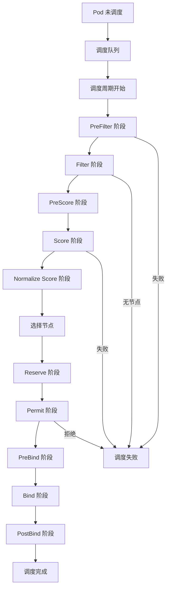
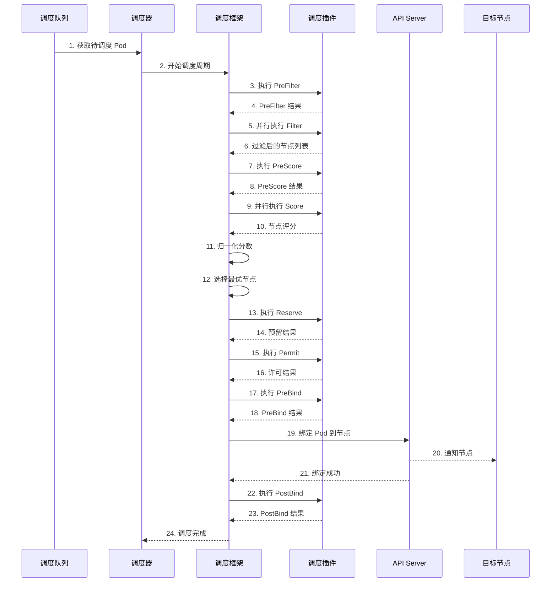

# Kubernetes 调度器架构 - 源码重构级指南

## 1. 调度器设计理念

### 1.1 核心设计原则（Why）

Kubernetes 调度器的设计基于以下核心原则：

- **资源最优分配**：在满足约束条件下最大化资源利用率
- **插件化架构**：通过插件机制支持多样化的调度策略
- **可扩展性**：支持自定义调度算法和扩展点
- **高性能**：支持大规模集群的高效调度
- **公平性**：确保多租户环境下的资源公平分配

### 1.2 调度流程概述



### 1.3 调度决策时序图



## 2. 调度器核心架构

### 2.1 调度器主结构

**调度器实现**：`pkg/scheduler/scheduler.go`

```go
// Scheduler 调度器结构
type Scheduler struct {
    // 客户端
    client clientset.Interface
    
    // Informer 工厂
    informerFactory informers.SharedInformerFactory
    
    // 调度队列
    SchedulingQueue SchedulingQueue
    
    // 调度框架
    framework framework.Handle
    
    // 绑定器
    Binder Binder
    
    // 事件记录器
    EventRecorder record.EventRecorder
    
    // 调度配置
    schedulerName string
    
    // 并发控制
    volumeScheduling bool
}

// NewScheduler 创建调度器
func New(
    client clientset.Interface,
    informerFactory informers.SharedInformerFactory,
    kubeConfig *rest.Config,
    opts ...Option,
) (*Scheduler, error) {
    
    // 1. 创建调度队列
    queue := internalqueue.NewSchedulingQueue(
        podInformer,
        schedulerName,
        podQueue,
    )
    
    // 2. 创建调度框架
    framework, err := framework.NewFramework(
        registry,
        framework.WithClientSet(client),
        framework.WithKubeConfig(kubeConfig),
    )
    if err != nil {
        return nil, err
    }
    
    // 3. 创建调度器
    return &Scheduler{
        client:          client,
        informerFactory: informerFactory,
        SchedulingQueue: queue,
        framework:       framework,
        Binder:          binder,
        EventRecorder:   eventRecorder,
    }, nil
}
```

### 2.2 调度队列实现

**调度队列**：`pkg/scheduler/internal/queue/scheduling_queue.go`

```go
// SchedulingQueue 调度队列接口
type SchedulingQueue interface {
    // Add 添加 Pod
    Add(pod *v1.Pod) error
    
    // AddUnschedulable 添加不可调度 Pod
    AddUnschedulable(pod *v1.Pod, message string)
    
    // Update 更新 Pod
    Update(oldPod, newPod *v1.Pod) error
    
    // Delete 删除 Pod
    Delete(pod *v1.Pod) error
    
    // Pop 弹出 Pod
    Pop() (*framework.QueuedPodInfo, error)
    
    // AssignedPodAdded 已分配 Pod 添加
    AssignedPodAdded(pod *v1.Pod)
    
    // AssignedPodUpdated 已分配 Pod 更新
    AssignedPodUpdated(oldPod, newPod *v1.Pod)
    
    // Run 运行队列
    Run()
    
    // Close 关闭队列
    Close()
}

// SchedulingQueueImpl 调度队列实现
type SchedulingQueueImpl struct {
    // Pod 队列
    podQueue *FIFO
    
    // 不可调度队列
    unschedulablePods *UnschedulablePods
    
    // 事件处理器
    podInformer cache.SharedIndexInformer
    
    // 锁
    mu sync.RWMutex
}

// NewSchedulingQueue 创建调度队列
func NewSchedulingQueue(
    podInformer cache.SharedIndexInformer,
    schedulerName string,
) *SchedulingQueueImpl {
    queue := &SchedulingQueueImpl{
        podQueue:         NewFIFO(),
        unschedulablePods: NewUnschedulablePods(),
        podInformer:      podInformer,
    }
    
    // 注册事件处理器
    podInformer.AddEventHandler(cache.ResourceEventHandlerFuncs{
        AddFunc:    queue.addPod,
        UpdateFunc: queue.updatePod,
        DeleteFunc: queue.deletePod,
    })
    
    return queue
}
```

### 2.3 调度周期主流程

**调度循环**：`pkg/scheduler/scheduler.go`

```go
// scheduleOne 调度一个 Pod
func (sched *Scheduler) scheduleOne(ctx context.Context) {
    // 1. 从队列获取 Pod
    podInfo := sched.SchedulingQueue.NextPod()
    pod := podInfo.Pod
    
    klog.V(4).Infof("Attempting to schedule pod: %v/%v", pod.Namespace, pod.Name)
    
    // 2. 执行调度
    scheduleResult, err := sched.Schedule(ctx, pod)
    if err != nil {
        // 调度失败处理
        if fitError, ok := err.(*framework.FitError); ok {
            sched.FailureHandler(ctx, pod, fitError)
        } else {
            sched.FailureHandler(ctx, pod, err)
        }
        return
    }
    
    // 3. 绑定 Pod 到节点
    assumedPodInfo := podInfo.DeepCopy()
    assumedPod := pod.DeepCopy()
    assumedPod.Spec.NodeName = scheduleResult.SuggestedHost
    
    // 4. 异步绑定
    go func() {
        bindingCycleCtx, cancel := context.WithCancel(ctx)
        defer cancel()
        
        err := sched.Bind(bindingCycleCtx, assumedPod, scheduleResult.SuggestedHost, scheduleResult.EvaluatedNodes)
        if err != nil {
            // 绑定失败处理
            klog.Errorf("Failed to bind pod: %v", err)
            sched.handleBindingError(bindingCycleCtx, assumedPodInfo, scheduleResult, err)
            return
        }
        
        // 记录事件
        sched.EventRecorder.Eventf(assumedPod, v1.EventTypeNormal, "Scheduled", 
            "Successfully assigned %v/%v to %v", assumedPod.Namespace, assumedPod.Name, scheduleResult.SuggestedHost)
    }()
}

// Schedule 执行调度
func (sched *Scheduler) Schedule(ctx context.Context, pod *v1.Pod) (result ScheduleResult, err error) {
    // 1. 调用调度框架
    result, err = sched.framework.Schedule(ctx, pod)
    if err != nil {
        return result, err
    }
    
    return result, nil
}
```

## 3. 调度框架深度解析

### 3.1 框架接口设计

**框架接口**：`pkg/scheduler/framework/interface.go`

```go
// Framework 调度框架接口
type Framework interface {
    // Handle 返回框架句柄
    Handle() Handle
    
    // RunPreFilter 运行 PreFilter 插件
    RunPreFilter(ctx context.Context, state *CycleState, pod *v1.Pod) (*PreFilterResult, *Status)
    
    // RunFilter 运行 Filter 插件
    RunFilter(ctx context.Context, state *CycleState, pod *v1.Pod, nodeInfo *NodeInfo) *Status
    
    // RunPreScore 运行 PreScore 插件
    RunPreScore(ctx context.Context, state *CycleState, pod *v1.Pod, nodes []*v1.Node) *Status
    
    // RunScore 运行 Score 插件
    RunScore(ctx context.Context, state *CycleState, pod *v1.Pod, nodes []*v1.Node) (NodeScoreList, *Status)
    
    // NormalizeScore 归一化分数
    NormalizeScore(ctx context.Context, state *CycleState, pod *v1.Pod, scores NodeScoreList) *Status
    
    // SelectHost 选择节点
    SelectHost(scores NodeScoreList) (string, error)
    
    // Bind 绑定 Pod
    Bind(ctx context.Context, state *CycleState, pod *v1.Pod, nodeName string) *Status
}

// Handle 框架句柄
type Handle interface {
    // ClientSet 返回 Kubernetes 客户端
    ClientSet() clientset.Interface
    
    // SharedInformerFactory 返回共享 Informer 工厂
    SharedInformerFactory() informers.SharedInformerFactory
    
    // SnapshotSharedLister 返回快照 Lister
    SnapshotSharedLister() SnapshotLister
    
    // IterateOverWaitingPods 迭代等待中的 Pod
    IterateOverWaitingPods(callback func(WaitingPod))
    
    // GetWaitingPod 获取等待中的 Pod
    GetWaitingPod(uid types.UID) WaitingPod
    
    // RejectWaitingPod 拒绝等待中的 Pod
    RejectWaitingPod(uid types.UID, reason string)
    
    // HasFilterPlugins 检查是否有 Filter 插件
    HasFilterPlugins() bool
    
    // HasScorePlugins 检查是否有 Score 插件
    HasScorePlugins() bool
    
    // ListPlugins 列出所有插件
    ListPlugins() *config.Plugins
}
```

### 3.2 调度周期状态管理

**周期状态**：`pkg/scheduler/framework/cycle_state.go`

```go
// CycleState 调度周期状态
type CycleState struct {
    // 状态数据
    state map[string]interface{}
    
    // 记录器
    recorder *metricsRecorder
    
    // 读写锁
    lock sync.RWMutex
}

// NewCycleState 创建周期状态
func NewCycleState() *CycleState {
    return &CycleState{
        state: make(map[string]interface{}),
    }
}

// Write 写入状态
func (c *CycleState) Write(key string, value interface{}) {
    c.lock.Lock()
    defer c.lock.Unlock()
    
    c.state[key] = value
}

// Read 读取状态
func (c *CycleState) Read(key string) (interface{}, bool) {
    c.lock.RLock()
    defer c.lock.RUnlock()
    
    value, exists := c.state[key]
    return value, exists
}

// Delete 删除状态
func (c *CycleState) Delete(key string) {
    c.lock.Lock()
    defer c.lock.Unlock()
    
    delete(c.state, key)
}
```

### 3.3 调度插件接口

**插件接口**：`pkg/scheduler/framework/interface.go`

```go
// Plugin 调度插件接口
type Plugin interface {
    // Name 返回插件名称
    Name() string
}

// PreFilterPlugin PreFilter 插件
type PreFilterPlugin interface {
    Plugin
    
    // PreFilter 预过滤
    PreFilter(ctx context.Context, state *CycleState, pod *v1.Pod) (*PreFilterResult, *Status)
    
    // PreFilterExtensions 预过滤扩展
    PreFilterExtensions() PreFilterExtensions
}

// FilterPlugin Filter 插件
type FilterPlugin interface {
    Plugin
    
    // Filter 过滤节点
    Filter(ctx context.Context, state *CycleState, pod *v1.Pod, nodeInfo *NodeInfo) *Status
}

// PreScorePlugin PreScore 插件
type PreScorePlugin interface {
    Plugin
    
    // PreScore 预评分
    PreScore(ctx context.Context, state *CycleState, pod *v1.Pod, nodes []*v1.Node) *Status
}

// ScorePlugin Score 插件
type ScorePlugin interface {
    Plugin
    
    // Score 评分节点
    Score(ctx context.Context, state *CycleState, pod *v1.Pod, nodeName string) (int64, *Status)
    
    // ScoreExtensions 评分扩展
    ScoreExtensions() ScoreExtensions
}

// ReservePlugin Reserve 插件
type ReservePlugin interface {
    Plugin
    
    // Reserve 预留资源
    Reserve(ctx context.Context, state *CycleState, pod *v1.Pod, nodeName string) *Status
    
    // Unreserve 取消预留
    Unreserve(ctx context.Context, state *CycleState, pod *v1.Pod, nodeName string)
}

// PermitPlugin Permit 插件
type PermitPlugin interface {
    Plugin
    
    // Permit 允许调度
    Permit(ctx context.Context, state *CycleState, pod *v1.Pod, nodeName string) (time.Duration, PermitStatus)
}

// BindPlugin Bind 插件
type BindPlugin interface {
    Plugin
    
    // Bind 绑定 Pod
    Bind(ctx context.Context, state *CycleState, pod *v1.Pod, nodeName string) *Status
}
```

## 4. 内置调度插件实现

### 4.1 NodeAffinity 插件

**节点亲和性插件**：`pkg/scheduler/framework/plugins/noderesources/affinity.go`

```go
// NodeAffinity 节点亲和性插件
type NodeAffinity struct {
    handle Handle
}

// Name 返回插件名称
func (pl *NodeAffinity) Name() string {
    return "NodeAffinity"
}

// Filter 过滤节点
func (pl *NodeAffinity) Filter(ctx context.Context, state *CycleState, pod *v1.Pod, nodeInfo *NodeInfo) *Status {
    node := nodeInfo.Node()
    
    // 1. 检查必需的节点亲和性
    if pod.Spec.Affinity != nil && pod.Spec.Affinity.NodeAffinity != nil {
        required := pod.Spec.Affinity.NodeAffinity.RequiredDuringSchedulingIgnoredDuringExecution
        if required != nil {
            // 检查节点选择器
            if !matchNodeSelectorTerms(node, required) {
                return framework.NewStatus(framework.UnschedulableAndUnresolvable, "Node didn't match required node selector")
            }
        }
    }
    
    return nil
}

// Score 评分节点
func (pl *NodeAffinity) Score(ctx context.Context, state *CycleState, pod *v1.Pod, nodeName string) (int64, *Status) {
    nodeInfo, err := pl.handle.SnapshotSharedLister().NodeInfos().Get(nodeName)
    if err != nil {
        return 0, framework.AsStatus(err)
    }
    
    node := nodeInfo.Node()
    score := int64(0)
    
    // 1. 检查首选的节点亲和性
    if pod.Spec.Affinity != nil && pod.Spec.Affinity.NodeAffinity != nil {
        preferred := pod.Spec.Affinity.NodeAffinity.PreferredDuringSchedulingIgnoredDuringExecution
        for _, pref := range preferred {
            if matchNodeSelectorTerms(node, &pref.Preference) {
                score += pref.Weight
            }
        }
    }
    
    return score, nil
}
```

### 4.2 NodeResources 插件

**节点资源插件**：`pkg/scheduler/framework/plugins/noderesources/fit.go`

```go
// Fit 资源适配插件
type Fit struct {
    handle Handle
}

// Filter 过滤节点
func (f *Fit) Filter(ctx context.Context, state *CycleState, pod *v1.Pod, nodeInfo *NodeInfo) *Status {
    node := nodeInfo.Node()
    
    // 1. 检查 CPU 资源
    if !f.checkCPU(pod, nodeInfo) {
        return framework.NewStatus(framework.UnschedulableAndUnresolvable, "Insufficient cpu")
    }
    
    // 2. 检查内存资源
    if !f.checkMemory(pod, nodeInfo) {
        return framework.NewStatus(framework.UnschedulableAndUnresolvable, "Insufficient memory")
    }
    
    // 3. 检查其他资源
    if !f.checkResources(pod, nodeInfo) {
        return framework.NewStatus(framework.UnschedulableAndUnresolvable, "Insufficient resources")
    }
    
    return nil
}

// checkCPU 检查 CPU 资源
func (f *Fit) checkCPU(pod *v1.Pod, nodeInfo *NodeInfo) bool {
    // 1. 计算 Pod 所需 CPU
    podCPU := podCPURequest(pod)
    
    // 2. 获取节点可用 CPU
    nodeCPU := nodeInfo.Allocatable.Cpu().MilliValue() - nodeInfo.Requested.Cpu().MilliValue()
    
    // 3. 检查是否足够
    return nodeCPU >= podCPU
}

// Score 评分节点
func (f *Fit) Score(ctx context.Context, state *CycleState, pod *v1.Pod, nodeName string) (int64, *Status) {
    nodeInfo, err := f.handle.SnapshotSharedLister().NodeInfos().Get(nodeName)
    if err != nil {
        return 0, framework.AsStatus(err)
    }
    
    // 1. 计算资源利用率
    cpuFraction := float64(nodeInfo.Requested.Cpu().MilliValue()) / float64(nodeInfo.Allocatable.Cpu().MilliValue())
    memoryFraction := float64(nodeInfo.Requested.Memory().Value()) / float64(nodeInfo.Allocatable.Memory().Value())
    
    // 2. 计算平均利用率
    avgFraction := (cpuFraction + memoryFraction) / 2.0
    
    // 3. 反转分数（利用率低的节点分数高）
    score := int64((1.0 - avgFraction) * float64(framework.MaxNodeScore))
    
    return score, nil
}
```

### 4.3 TaintToleration 插件

**污点容忍插件**：`pkg/scheduler/framework/plugins/tainttoleration/taint_toleration.go`

```go
// TaintToleration 污点容忍插件
type TaintToleration struct {
    handle Handle
}

// Filter 过滤节点
func (t *TaintToleration) Filter(ctx context.Context, state *CycleState, pod *v1.Pod, nodeInfo *NodeInfo) *Status {
    node := nodeInfo.Node()
    
    // 1. 获取节点污点
    taints := node.Spec.Taints
    
    // 2. 检查 Pod 是否容忍所有污点
    for _, taint := range taints {
        if !t.toleratesTaint(pod, &taint) {
            return framework.NewStatus(framework.UnschedulableAndUnresolvable, "node(s) had taint that the pod didn't tolerate")
        }
    }
    
    return nil
}

// toleratesTaint 检查 Pod 是否容忍污点
func (t *TaintToleration) toleratesTaint(pod *v1.Pod, taint *v1.Taint) bool {
    // 1. 获取 Pod 容忍度
    tolerations := pod.Spec.Tolerations
    
    // 2. 检查每个容忍度
    for _, toleration := range tolerations {
        if t.toleratesTaintWithToleration(taint, &toleration) {
            return true
        }
    }
    
    return false
}

// toleratesTaintWithToleration 检查容忍度是否匹配污点
func (t *TaintToleration) toleratesTaintWithToleration(taint *v1.Taint, toleration *v1.Toleration) bool {
    // 1. 匹配键
    if toleration.Key != taint.Key && toleration.Key != "" && toleration.Operator != v1.TolerationOpExists {
        return false
    }
    
    // 2. 匹配值
    if toleration.Operator == v1.TolerationOpEqual {
        return toleration.Value == taint.Value
    }
    
    return true
}
```

## 5. 调度性能优化

### 5.1 并行调度

**并行执行**：`pkg/scheduler/framework/parallelize/parallelism.go`

```go
// Parallelizer 并行执行器
type Parallelizer struct {
    // 并发数
    concurrency int
}

// NewParallelizer 创建并行执行器
func NewParallelizer(concurrency int) *Parallelizer {
    return &Parallelizer{
        concurrency: concurrency,
    }
}

// Until 并行执行函数直到完成
func (p *Parallelizer) Until(ctx context.Context, pieces int, doWorkPiece workPieceFunc) {
    // 1. 创建结果通道
    resultCh := make(chan result, p.concurrency)
    
    // 2. 创建工作通道
    workCh := make(chan int, pieces)
    
    // 3. 启动工作线程
    var wg sync.WaitGroup
    for i := 0; i < p.concurrency; i++ {
        wg.Add(1)
        go func() {
            defer wg.Done()
            for piece := range workCh {
                // 执行工作
                output := doWorkPiece(piece)
                
                // 发送结果
                resultCh <- result{piece: piece, output: output}
            }
        }()
    }
    
    // 4. 分发工作
    go func() {
        for i := 0; i < pieces; i++ {
            workCh <- i
        }
        close(workCh)
    }()
    
    // 5. 等待完成
    go func() {
        wg.Wait()
        close(resultCh)
    }()
    
    // 6. 收集结果
    for result := range resultCh {
        // 处理结果
        _ = result
    }
}
```

### 5.2 缓存优化

**调度缓存**：`pkg/scheduler/internal/cache/snapshot.go`

```go
// Snapshot 调度快照
type Snapshot struct {
    // 节点信息快照
    nodeInfoMap map[string]*NodeInfo
    
    // 快照时间
    timestamp time.Time
    
    // 读写锁
    mu sync.RWMutex
}

// NodeInfo 节点信息
type NodeInfo struct {
    // 节点对象
    node *v1.Node
    
    // 分配的 Pod 列表
    Pods []*v1.Pod
    
    // 请求的资源
    Requested *Resource
    
    // 可分配的资源
    Allocatable *Resource
    
    // 其他信息
    // ...
}

// NewSnapshot 创建快照
func NewSnapshot() *Snapshot {
    return &Snapshot{
        nodeInfoMap: make(map[string]*NodeInfo),
        timestamp:   time.Now(),
    }
}

// Get 获取节点信息
func (s *Snapshot) Get(nodeName string) (*NodeInfo, error) {
    s.mu.RLock()
    defer s.mu.RUnlock()
    
    nodeInfo, exists := s.nodeInfoMap[nodeName]
    if !exists {
        return nil, fmt.Errorf("node %q not found", nodeName)
    }
    
    return nodeInfo, nil
}

// UpdateNodeInfo 更新节点信息
func (s *Snapshot) UpdateNodeInfo(nodeName string, nodeInfo *NodeInfo) {
    s.mu.Lock()
    defer s.mu.Unlock()
    
    s.nodeInfoMap[nodeName] = nodeInfo
    s.timestamp = time.Now()
}
```

### 5.3 批量调度

**批量调度**：优化多个 Pod 的调度性能

```go
// BatchScheduler 批量调度器
type BatchScheduler struct {
    // 单个调度器
    scheduler *Scheduler
    
    // 批量大小
    batchSize int
    
    // 批处理超时
    batchTimeout time.Duration
}

// ScheduleBatch 批量调度 Pod
func (bs *BatchScheduler) ScheduleBatch(ctx context.Context, pods []*v1.Pod) ([]ScheduleResult, []error) {
    results := make([]ScheduleResult, len(pods))
    errors := make([]error, len(pods))
    
    // 1. 创建批量上下文
    batchCtx, cancel := context.WithTimeout(ctx, bs.batchTimeout)
    defer cancel()
    
    // 2. 并行调度
    var wg sync.WaitGroup
    for i, pod := range pods {
        wg.Add(1)
        go func(idx int, p *v1.Pod) {
            defer wg.Done()
            
            result, err := bs.scheduler.Schedule(batchCtx, p)
            results[idx] = result
            errors[idx] = err
        }(i, pod)
    }
    
    // 3. 等待完成
    wg.Wait()
    
    return results, errors
}
```

## 6. 扩展调度器

### 6.1 自定义调度插件

**自定义插件开发**：实现调度插件接口

```go
// CustomSchedulerPlugin 自定义调度插件
type CustomSchedulerPlugin struct {
    handle framework.Handle
}

// Name 返回插件名称
func (p *CustomSchedulerPlugin) Name() string {
    return "CustomScheduler"
}

// Filter 自定义过滤逻辑
func (p *CustomSchedulerPlugin) Filter(ctx context.Context, state *framework.CycleState, pod *v1.Pod, nodeInfo *framework.NodeInfo) *framework.Status {
    // 1. 获取节点信息
    node := nodeInfo.Node()
    
    // 2. 执行自定义过滤逻辑
    if !p.customFilterLogic(pod, node) {
        return framework.NewStatus(framework.UnschedulableAndUnresolvable, "Custom filter failed")
    }
    
    return nil
}

// Score 自定义评分逻辑
func (p *CustomSchedulerPlugin) Score(ctx context.Context, state *framework.CycleState, pod *v1.Pod, nodeName string) (int64, *framework.Status) {
    // 1. 获取节点信息
    nodeInfo, err := p.handle.SnapshotSharedLister().NodeInfos().Get(nodeName)
    if err != nil {
        return 0, framework.AsStatus(err)
    }
    
    // 2. 执行自定义评分逻辑
    score := p.customScoreLogic(pod, nodeInfo.Node())
    
    return score, nil
}

// customFilterLogic 自定义过滤逻辑
func (p *CustomSchedulerPlugin) customFilterLogic(pod *v1.Pod, node *v1.Node) bool {
    // 实现自定义的节点过滤逻辑
    // 例如：基于标签、注解、自定义指标等
    
    return true
}

// customScoreLogic 自定义评分逻辑
func (p *CustomSchedulerPlugin) customScoreLogic(pod *v1.Pod, node *v1.Node) int64 {
    // 实现自定义的节点评分逻辑
    // 例如：基于网络延迟、存储性能、GPU 数量等
    
    return 50
}

// NewCustomSchedulerPlugin 创建自定义插件
func NewCustomSchedulerPlugin(configuration interface{}, handle framework.Handle) (framework.Plugin, error) {
    return &CustomSchedulerPlugin{
        handle: handle,
    }, nil
}
```

### 6.2 自定义调度器

**多调度器支持**：部署多个调度器实例

```go
// CustomScheduler 自定义调度器
type CustomScheduler struct {
    // Kubernetes 客户端
    client clientset.Interface
    
    // 调度器名称
    schedulerName string
    
    // 自定义配置
    config CustomSchedulerConfig
}

// Run 运行自定义调度器
func (cs *CustomScheduler) Run(ctx context.Context) {
    // 1. 创建 Informer 工厂
    informerFactory := informers.NewSharedInformerFactory(cs.client, 0)
    
    // 2. 创建调度队列
    queue := NewCustomSchedulingQueue(
        informerFactory.Core().V1().Pods(),
        cs.schedulerName,
    )
    
    // 3. 创建调度框架
    framework, err := framework.NewFramework(
        registry,
        framework.WithClientSet(cs.client),
    )
    if err != nil {
        klog.Fatalf("Failed to create framework: %v", err)
    }
    
    // 4. 注册自定义插件
    registry.Register(&CustomSchedulerPlugin{})
    
    // 5. 启动调度循环
    go wait.Until(func() {
        cs.scheduleOne(ctx, queue, framework)
    }, time.Second, ctx.Done())
    
    // 6. 启动 Informer
    informerFactory.Start(ctx.Done())
    
    // 7. 等待终止信号
    <-ctx.Done()
}
```

## 7. 调度器监控和调试

### 7.1 性能指标

**调度器指标**：监控调度器性能

```go
// SchedulerMetrics 调度器指标
type SchedulerMetrics struct {
    // 调度尝试次数
    ScheduleAttempts *prometheus.CounterVec
    
    // 调度成功次数
    ScheduleSuccess *prometheus.CounterVec
    
    // 调度失败次数
    ScheduleFailure *prometheus.CounterVec
    
    // 调度延迟
    ScheduleLatency *prometheus.HistogramVec
    
    // 队列长度
    QueueLength *prometheus.GaugeVec
}

// NewSchedulerMetrics 创建调度器指标
func NewSchedulerMetrics() *SchedulerMetrics {
    return &SchedulerMetrics{
        ScheduleAttempts: prometheus.NewCounterVec(
            prometheus.CounterOpts{
                Name: "schedule_attempts_total",
                Help: "Total number of schedule attempts",
            },
            []string{"scheduler"},
        ),
        ScheduleSuccess: prometheus.NewCounterVec(
            prometheus.CounterOpts{
                Name: "schedule_success_total",
                Help: "Total number of successful schedules",
            },
            []string{"scheduler"},
        ),
        ScheduleFailure: prometheus.NewCounterVec(
            prometheus.CounterOpts{
                Name: "schedule_failure_total",
                Help: "Total number of failed schedules",
            },
            []string{"scheduler", "reason"},
        ),
        ScheduleLatency: prometheus.NewHistogramVec(
            prometheus.HistogramOpts{
                Name:    "schedule_duration_seconds",
                Help:    "Scheduling latency in seconds",
                Buckets: prometheus.DefBuckets,
            },
            []string{"scheduler"},
        ),
        QueueLength: prometheus.NewGaugeVec(
            prometheus.GaugeOpts{
                Name: "queue_length",
                Help: "Number of pods in the scheduling queue",
            },
            []string{"scheduler"},
        ),
    }
}
```

### 7.2 调度事件

**事件记录**：记录调度决策过程

```go
// ScheduleEvent 调度事件
type ScheduleEvent struct {
    // Pod 信息
    PodNamespace string
    PodName      string
    
    // 节点信息
    NodeName string
    
    // 调度结果
    Result ScheduleResult
    
    // 错误信息
    Error error
    
    // 时间戳
    Timestamp time.Time
}

// RecordScheduleEvent 记录调度事件
func (s *Scheduler) RecordScheduleEvent(event ScheduleEvent) {
    // 1. 构建事件消息
    message := fmt.Sprintf("Pod %s/%s scheduled to node %s", 
        event.PodNamespace, event.PodName, event.NodeName)
    
    // 2. 记录事件
    if event.Error != nil {
        s.EventRecorder.Eventf(&v1.Pod{
            ObjectMeta: metav1.ObjectMeta{
                Namespace: event.PodNamespace,
                Name:      event.PodName,
            },
        }, v1.EventTypeWarning, "FailedScheduling", "Failed to schedule: %v", event.Error)
    } else {
        s.EventRecorder.Eventf(&v1.Pod{
            ObjectMeta: metav1.ObjectMeta{
                Namespace: event.PodNamespace,
                Name:      event.PodName,
            },
        }, v1.EventTypeNormal, "Scheduled", message)
    }
    
    // 3. 更新指标
    if event.Error != nil {
        s.metrics.ScheduleFailure.WithLabelValues(s.schedulerName, event.Error.Error()).Inc()
    } else {
        s.metrics.ScheduleSuccess.WithLabelValues(s.schedulerName).Inc()
    }
}
```

## 8. 总结

Kubernetes 调度器架构体现了现代分布式系统资源调度的最佳实践：

### 8.1 核心设计优势

- **插件化架构**：灵活的扩展机制支持多样化调度需求
- **高性能设计**：并行执行、缓存优化、批量处理
- **可扩展性**：支持自定义调度算法和多调度器
- **公平性和效率**：平衡资源利用率和调度公平性
- **容错性**：重试机制和错误恢复

### 8.2 关键技术亮点

- **调度框架**：统一的插件接口和扩展点
- **多阶段调度**：Filter、Score、Bind 等多个调度阶段
- **并行执行**：提升大规模集群的调度性能
- **缓存机制**：减少 API 调用和提升响应速度
- **丰富的插件**：内置多种调度插件满足不同需求

### 8.3 实践应用指南

- **选择合适的插件**：根据业务需求配置调度插件
- **性能调优**：调整并发数、缓存大小等参数
- **自定义开发**：实现自定义插件满足特殊需求
- **监控告警**：关注调度延迟、队列长度等指标
- **故障排查**：通过事件日志分析调度失败原因

通过理解这些调度器架构的原理和实现，开发者可以：
- 优化集群资源利用率
- 实现自定义调度策略
- 开发专用调度器
- 解决复杂调度场景
- 参与社区贡献调度器改进

这套调度器架构为构建高效、灵活的分布式资源调度系统提供了完整的技术方案。