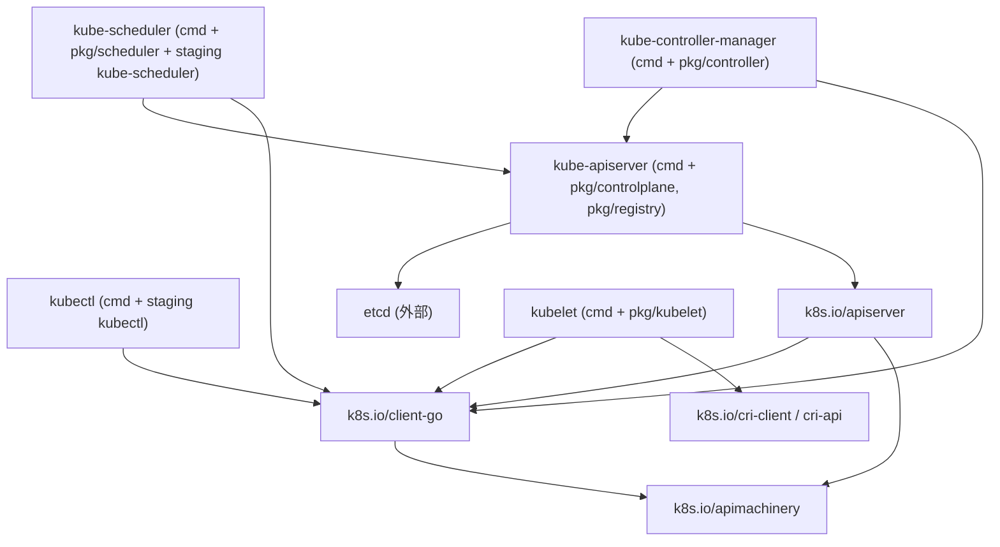

[上一篇](00-文档说明与约定.md) · [总目录](README.md) · [下一篇](02-kubectl-run全路径走读.md)

# 系统骨架
> **层级**：第一层——只描述整体结构，不深入函数实现。
> **代码基准**：master@`8893923938107170c86eb4b8cc2b7225b4e44e9b`（2026-11-18），Go 1.27.4。

## 1. 结论速览
Kubernetes 是一个声明式的容器编排系统：用户提交「期望状态」（运行哪些容器、副本数、网络与存储需求），系统持续执行「调谐」（reconciliation），让集群实际状态收敛到期望状态。集群由一组控制面进程（kube-apiserver、kube-scheduler、kube-controller-manager、cloud-controller-manager）和每个节点上的代理进程（kubelet、kube-proxy）组成，全部面向同一个唯一入口 kube-apiserver。

要点：
1. **单一 REST 入口**：kube-apiserver 是集群唯一的 REST 入口，也是唯一直接访问持久化后端（etcd）的组件。
2. **调谐驱动**：kube-controller-manager 运行所有内置控制器（Deployment、ReplicaSet、Job、Node 等），反复比对期望与现状并驱动收敛。
3. **集中调度**：kube-scheduler 为未绑定 Pod 选择节点并写回绑定。
4. **节点执行**：kubelet 在每个节点上经容器运行时接口（CRI）拉镜像、挂卷、启停容器并回报状态。
5. **组件间无直接 RPC**：各组件只与 apiserver 通信，没有组件到组件的直连调用（基于 import 检查的推断性结论，见 §4 验证）。

## 2. 生产视角
生产视角只描述组件对外呈现的角色与数据流，不展开内部实现细节；具体符号与实现留在 §3 开发视角。

### 2.1 进程与组件
本仓库 `cmd/` 下每个目录产出一个二进制。与主线相关的进程：

| 二进制 | 入口锚点 | 运行位置 | 职责 |
|---|---|---|---|
| kube-apiserver | `cmd/kube-apiserver/apiserver.go 函数：main 偏移：+0` | 控制面 | 集群唯一 REST 入口；认证、鉴权、准入、资源持久化到 etcd |
| kube-controller-manager | `cmd/kube-controller-manager/controller-manager.go 函数：main 偏移：+0` | 控制面 | 运行所有内置控制器（Deployment、ReplicaSet、Job、Node 等），通过调谐驱动状态收敛 |
| kube-scheduler | `cmd/kube-scheduler/scheduler.go 函数：main 偏移：+0` | 控制面 | 监视未调度的 Pod，按过滤/打分框架选择节点并写回绑定 |
| kubelet | `cmd/kubelet/kubelet.go 函数：main 偏移：+0` | 每个节点 | 节点上的 Pod 执行者：拉取镜像、挂载卷、通过 CRI 启停容器、上报状态 |
| kube-proxy | `cmd/kube-proxy/proxy.go 函数：main 偏移：+0` | 每个节点 | 维护 Service 的网络转发规则（本文档库不深入） |
| kubectl | `cmd/kubectl/kubectl.go 函数：main 偏移：+0` | 客户端 | 命令行工具，把用户操作翻译为 apiserver 的 REST 请求 |
| cloud-controller-manager | `cmd/cloud-controller-manager/main.go 函数：main 偏移：+0` | 控制面（可选） | 与云厂商交互的控制器（本文档库不深入） |
| kubeadm | `cmd/kubeadm/kubeadm.go 函数：main 偏移：+0` | 运维工具 | 集群引导部署工具（本文档库不深入） |

> **入口修正**：cloud-controller-manager 的真实入口是 `cmd/cloud-controller-manager/main.go`（`cmd/cloud-controller-manager/ccm.go` 在当前代码中不存在）。旧文档误写为 `cmd/cloud-controller-manager/ccm.go#main`，本次已修正。

外部依赖：**etcd** 是 apiserver 唯一的持久化后端，其他组件都不直接访问 etcd。

### 2.2 输入 / 输出
| 组件 | 输入 | 输出 |
|---|---|---|
| apiserver | REST 请求（kubectl、控制器、调度器、kubelet） | REST 响应、watch 事件流；写入 etcd |
| scheduler | watch 到的未绑定 Pod、节点与资源状态 | Pod/binding 写请求（选定的节点名） |
| controller-manager | watch 到的各类资源变化 | 创建/删除/更新下游资源的写请求 |
| kubelet | 分配到本节点的 Pod（watch/静态文件/HTTP manifest） | 容器运行状态变化；Pod status 写回 |
| kubectl | 用户命令与本地清单文件 | REST 请求；终端输出 |

### 2.3 主数据流：声明、调谐、执行
```text
用户声明（kubectl / YAML）
  ↓ POST
apiserver：认证 → 鉴权 → 准入 → 持久化到 etcd
  ↓ watch 事件
scheduler：为未绑定 Pod 选节点 → 写 binding
  ↓ watch 事件（Pod.spec.nodeName 已确定）
kubelet：同步循环 → 调 CRI 创建 sandbox/容器 → 回报 status
  ↓
controller-manager：持续 watch，比较期望与现状，增删 Pod/更新状态
  ↓
apiserver/etcd：集群状态的唯一权威存储
```

三条贯穿全系统的机制（后续第四层 11–16 篇详述）：
- **watch/informer**：各组件通过 apiserver 的 watch 建立本地缓存，事件驱动工作。
- **workqueue + worker**：控制器把事件去重入队，worker 逐个调谐。
- **声明式调谐循环**：不关心事件「是什么变了」，每次都比对全量期望与现状，失败重试直至收敛。

### 2.4 一个 Pod 的整体运行流程
1. 用户用 kubectl 提交 Pod，apiserver 校验后存入 etcd，此时节点尚未指定。
2. scheduler watch 到该 Pod，过滤不满足资源/亲和/污点的节点，对剩余节点打分，选中一个并提交绑定。
3. 目标节点的 kubelet watch 到绑定给自己的 Pod，串行处理该 Pod：准备目录与卷、创建 sandbox、拉镜像、创建并启动容器。
4. kubelet 周期感知容器状态变化，把 Pod 状态写回 apiserver。
5. 若 Pod 由 Deployment/ReplicaSet 管理，控制器持续 watch Pod 现状，数量不足则创建、过多则删除。

后续第二层将沿这条流程走一个真实最小案例，只看主成功路径。

## 3. 开发视角

### 3.1 模块依赖关系
仓库代码分两大区域：
- `cmd/`、`pkg/`、`plugin/`：属于 `k8s.io/kubernetes` 主模块，包含各组件的进程入口与 K8s 特有的业务逻辑（资源 registry、内置控制器、kubelet 主体、调度器、准入插件）。
- `staging/src/k8s.io/`：一组独立发布的库模块的源码真身，包括 `apiserver`（通用 API 服务框架）、`client-go`（客户端、informer、workqueue）、`apimachinery`（类型系统、序列化）、`kubectl`、`cri-api`、`cri-client`、`kube-scheduler` 等。主模块依赖它们；`vendor/` 是这些依赖的同步副本。

依赖方向（节点映射真实 `cmd/` 二进制与 `staging/src/k8s.io/` 模块名）：



前提与终点：
- **前提**：`cmd/` 下 8 个二进制入口存在（见 §2.1）；`staging/src/k8s.io/` 下 apiserver、client-go、apimachinery、kubectl、cri-api、cri-client、kube-scheduler 七个模块目录存在；`go.mod` 以 `=> ./staging/src/k8s.io/...` 替换指向源码真身。
- **终点**：所有组件只与 apiserver 通信，组件之间没有直接的 RPC；apiserver 经 `k8s.io/apiserver` 的 etcd3 存储实现访问外部 etcd。

### 3.2 关键符号
本节给出各机制在源码中的锚点，供后续层展开时按符号定位（符号+偏移，偏移以符号定义行为 `+0`；组件入口见 §2.1 表格）。

**apiserver 持久化（etcd3）**：
- `staging/src/k8s.io/apiserver/pkg/storage/etcd3/`（存在，含 event.go、compact.go 等）——etcd 存储实现目录。

**client-go 三条机制**：
- watch/informer：`staging/src/k8s.io/client-go/tools/cache/shared_informer.go Struct：SharedIndexInformer`、`函数：NewSharedIndexInformer`。
- workqueue 泛型：`staging/src/k8s.io/client-go/util/workqueue/queue.go Struct：Typed`（泛型 `Typed[t comparable]`）、`函数：NewTyped`；`rate_limiting_queue.go 函数：NewTypedRateLimitingQueue`；`delaying_queue.go 函数：NewTypedDelayingQueue`。**注意**：`util/workqueue/typed.go` 在当前代码中不存在，泛型定义在 `queue.go`（若引用 `typed.go` 则为错锚点）。

**scheduler**：
- `pkg/scheduler/schedule_one.go 函数：scheduleOnePod`（单 Pod 调度工作流）、`函数：finishBinding`（写 binding）。
- `pkg/scheduler/algorithm.go 函数：SchedulePod`（选节点）、`函数：findNodesThatFitPod`（过滤候选节点）。

**kubelet**：
- `pkg/kubelet/kubelet.go 函数：syncLoop`、`函数：syncLoopIteration`（同步循环）。
- `pkg/kubelet/status/status_manager.go 函数：SetPodStatus`、`函数：syncPod`（状态同步）。
- CRI 远程服务：`pkg/kubelet/kubelet.go` 直接 import `k8s.io/cri-client`，运行时服务经 `RemoteRuntimeService` 挂接。

**controller-manager（以 Deployment 为例）**：
- `pkg/controller/deployment/deployment_controller.go 函数：syncDeployment`（调谐）、`函数：processNextWorkItem`（worker 消费队列）。

### 3.3 各组件的启动顺序深度拆解

各组件进程内部不是「一条直线跑到监听端口」，而是有明确的**依赖顺序**：apiserver 按「扩展 → 核心 → 聚合」三层委托链构造；controller-manager 先起 SA token 控制器再起其余；scheduler 先起队列再起调度循环。理解启动顺序才能解释「为什么某组件起来后要等另一组件就绪」。

#### kube-apiserver：三层委托链（CreateServerChain）

**源码：** `cmd/kube-apiserver/app/server.go CreateServerChain+0`（:189）
**职责：** 按委托（delegation）顺序构造三个 server，**后建者把先建者作为 delegate**，形成「聚合层 → 核心 → 扩展」的请求委托链。

```text
CreateServerChain (+0)
├── 1. notFoundHandler（+2）
├── 2. ApiExtensions.New(空 delegate + notFoundHandler)（+5）  → apiExtensionsServer（CRD）
├── 3. KubeAPIs.New(apiExtensionsServer.GenericAPIServer)（+14） → kubeAPIServer（核心组，delegate=扩展层）
└── 4. CreateAggregatorServer(..., kubeAPIServer.GenericAPIServer, ...)（+20） → aggregatorServer（聚合层，delegate=核心层）
```
**顺序语义：**
- **构造顺序 = 扩展层 → 核心层 → 聚合层**：因为核心层要把扩展层作为 delegate（CRD 请求由核心层委托给扩展层），聚合层要把核心层作为 delegate（未匹配聚合 APIService 的请求回落到核心层）。
- **启动收尾**：`Run` 中 `CreateServerChain` → `server.PrepareRun()` → `prepared.Run(ctx)`（:177 ～ :186）——先构造完整委托链，再统一 PrepareRun/Run，避免半初始化状态对外服务。
- `crdAPIEnabled` 在建聚合层前由扩展层的 discovery 判定（+11），决定聚合层是否启用 CRD 支持。

#### kube-controller-manager：SA token 控制器先行 + 其余按序 build

**源码：** `cmd/kube-controller-manager/app/controllermanager.go buildController+0`（:737）
**职责：** 构造并启动全部内置控制器，**顺序有硬约束**。

```text
buildController（闭包）
├── 1. 构造单个 controller（+737 起）
├── 2. 注册 healthz checker（NamedPingChecker，可被 HealthCheckable 覆盖）
├── 3. Debuggable → 挂 /debug/controllers/<name>（+751 ～ +757）
├── 4. leaderelection.Pausable → 注册到 PausableRegistrar（+31，:768）
│      非 Pausable → 记入 notPausable（写请求被 write gate 拒绝，+34，:771）
└── 5. controllers = append(controllers, ctrl)
```
**启动顺序硬约束（SA token 块偏移 +45，:782）：**
- **ServiceAccountTokenController 必须最先启动**，且用**全权限 client**——因为它要为其余控制器铸造 token；若它失败则**直接 return**（其他控制器拿不到凭据，无法工作）。
- 其余控制器遍历 `controllerDescriptors`（偏移 +60，:797）：
  - `RequiresSpecialHandling()` 的跳过（如 SA token，已单独处理；偏移 +61，:798）。
  - `IsControllerEnabled` 为假 → 打 "controller is disabled" 警告并跳过（偏移 +65 ～ +66，:802 ～ :803）。
  - 否则 `buildController`（偏移 +67，:805）。
- 注册 healthz checker（偏移 +79 ～ +81，:816 ～ :818）。
- **leader election 与写门**：非 leader 期间，Pausable 控制器停止工作，非 Pausable 控制器继续运行但写请求被 write gate 拒绝（偏移 +27 注释，:764）——这是「多副本 controller-manager 高可用」的关键：不 leader 的实例不重复调谐。

#### kube-scheduler：队列先行 + 独立调度 goroutine

**源码：** `pkg/scheduler/scheduler.go Scheduler.Run+0`（:538）
**职责：** 启动调度器的队列与调度循环。
```text
Scheduler.Run (+0)
├── 1. SchedulingQueue.Run（+2）：启动待调度队列（含 BackoffQ 搬运）
├── 2. APIDispatcher.Run（+5，可选）
├── 3. go wait.UntilWithContext(ctx, ScheduleOne, 0)（+13）
│      注释（+9 ～ +12）：调度循环必须放独立 goroutine——ScheduleOne 会阻塞在
│      取下一个待调度 Pod 上；若在同 goroutine 会阻塞 SchedulingQueue 关闭，
│      导致 shutdown 死锁
├── 4. <-ctx.Done()（+15）：阻塞直至 shutdown
└── 5. 收尾：APIDispatcher.Close → SchedulingQueue.Close → 关闭实现 io.Closer 的插件
```

**三组件启动顺序对照：**

| 组件 | 构造依赖顺序 | 关键硬约束 |
|---|---|---|
| kube-apiserver | 扩展层 → 核心层 → 聚合层（每层把前层作 delegate） | 完整委托链构造完才 PrepareRun/Run |
| kube-controller-manager | SA token 控制器**最先**（全权限 client）→ 其余按 descriptor 顺序 | SA token 失败即整体失败 |
| kube-scheduler | 队列 → API dispatcher → 独立调度 goroutine | ScheduleOne 必须独立 goroutine（防 shutdown 死锁） |

**设计要点（源码可证）：**
1. **apiserver 委托链「后建者持前层 delegate」**：构造顺序与请求委托方向相反——先建最内层（扩展），再建外层并把内层作为 fallback，使聚合层成为对外唯一入口。
2. **依赖凭据的控制器最先启动**：SA token 控制器铸造 token 供其余控制器使用，故必须最先、且失败即中止——顺序错误会让所有控制器因缺凭据而空转。
3. **阻塞循环必须独立 goroutine**：scheduler 的 ScheduleOne、kubelet 的 syncLoop 都是「阻塞取下一个任务」的循环，放独立 goroutine 才能在 shutdown 时正常关闭队列（scheduler 注释 +9 ～ +12）。

## 4. 验证
- **基准**：master@`8893923938107170c86eb4b8cc2b7225b4e44e9b`，工作区仅文档库自身产物（`docs/sourceReader/.progress/` 未跟踪、`00-文档说明与约定.md` 修改），与证据索引一致；go.mod 指令 `go 1.27.0`，本机工具链 go1.27.1。
- **入口核验**：8 个 `func main()` 全部回读确认（见 §2.1 锚点）。`cmd/cloud-controller-manager/ccm.go` 不存在，入口为 `cmd/cloud-controller-manager/main.go`——旧文档 82f9fd3d 锚点错误，本次修正。
- **staging 模块核验**：apiserver、client-go、apimachinery、kubectl、cri-api、cri-client、kube-scheduler 七个目录均存在。
- **依赖方向核验**：`go.mod` 含 `k8s.io/apiserver`、`k8s.io/apimachinery` 与 `go.etcd.io/etcd/client/v3` 依赖及 `=> ./staging/src/k8s.io/...` 替换；kubelet 直接 import `k8s.io/cri-client`；`pkg/kubelet/` 大量引用 cri-api/cri-client。
- **推断性结论**：「组件间无直接 RPC」基于 import 检查——未发现 `cmd/kube-scheduler`、`cmd/kube-controller-manager`、`cmd/kube-proxy`、`cmd/kubelet` 相互 import 对方 cmd 路径（零命中）。为推断性成立，未穷尽符号级调用链。

**仍未确认项**：
- 「组件间无直接 RPC」为推断性结论（基于 import 检查），非全量符号级验证。

[上一篇](00-文档说明与约定.md) · [总目录](README.md) · [下一篇](02-kubectl-run全路径走读.md)
