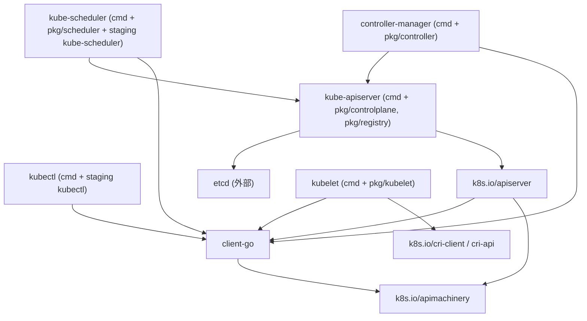

[上一篇](00-文档说明与约定.md) · [总目录](README.md) · [下一篇](02-kubectl-run全路径走读.md)

# 系统骨架
> **层级**：第一层——只描述整体结构，不深入函数实现。

## 1. Kubernetes 做什么
Kubernetes 是一个声明式的容器编排系统：用户提交"期望状态"（运行哪些容器、副本数、网络与存储需求），系统持续执行"调谐"（reconciliation），让集群实际状态接近期望状态。集群由一组控制面进程和每个节点上的代理进程组成。

## 2. 进程与组件
本仓库 `cmd/` 下每个目录产出一个二进制。与主线相关的进程：

| 二进制 | 入口 | 运行位置 | 职责 |
|---|---|---|---|
| kube-apiserver | `cmd/kube-apiserver/apiserver.go#main` | 控制面 | 集群唯一的 REST 入口；认证、鉴权、准入、资源持久化到 etcd |
| kube-controller-manager | `cmd/kube-controller-manager/controller-manager.go#main` | 控制面 | 运行所有内置控制器（Deployment、ReplicaSet、Job、Node 等），通过调谐驱动状态收敛 |
| kube-scheduler | `cmd/kube-scheduler/scheduler.go#main` | 控制面 | 监视未调度的 Pod，按过滤/打分框架选择节点并写回绑定 |
| kubelet | `cmd/kubelet/kubelet.go#main` | 每个节点 | 节点上的 Pod 执行者：拉取镜像、挂载卷、通过 CRI 启停容器、上报状态 |
| kube-proxy | `cmd/kube-proxy/proxy.go#main` | 每个节点 | 维护 Service 的网络转发规则（本文档库不深入） |
| kubectl | `cmd/kubectl/kubectl.go#main` | 客户端 | 命令行工具，把用户操作翻译为 apiserver 的 REST 请求 |
| cloud-controller-manager | `cmd/cloud-controller-manager/ccm.go#main` | 控制面（可选） | 与云厂商交互的控制器（本文档库不深入） |
| kubeadm | `cmd/kubeadm/kubeadm.go#main` | 运维工具 | 集群引导部署工具（本文档库不深入） |

外部依赖：**etcd** 是 apiserver 唯一的持久化后端，其他组件都不直接访问 etcd。

## 3. 模块依赖关系
仓库代码分两大区域：
- `cmd/`、`pkg/`、`plugin/`：属于 `k8s.io/kubernetes` 主模块，包含各组件的进程入口与 K8s 特有的业务逻辑（资源 registry、内置控制器、kubelet 主体、调度器、准入插件）。
- `staging/src/k8s.io/`：一组独立发布的库模块的源码真身，包括 `apiserver`（通用 API 服务框架）、`client-go`（客户端、informer、workqueue）、`apimachinery`（类型系统、序列化）、`kubectl`、`cri-api`、`cri-client`、`kube-scheduler` 等。主模块依赖它们；`vendor/` 是这些依赖的同步副本。

依赖方向：



所有组件只与 apiserver 通信，组件之间没有直接的 RPC。

## 4. 输入 / 输出
| 组件 | 输入 | 输出 |
|---|---|---|
| apiserver | REST 请求（kubectl、控制器、调度器、kubelet） | REST 响应、watch 事件流；写入 etcd |
| scheduler | watch 到的未绑定 Pod、节点与资源状态 | Pod/binding 写请求（选定的节点名） |
| controller-manager | watch 到的各类资源变化 | 创建/删除/更新下游资源的写请求 |
| kubelet | 分配到本节点的 Pod（watch/静态文件/HTTP manifest） | 容器运行状态变化；Pod status patch |
| kubectl | 用户命令与本地清单文件 | REST 请求；终端输出 |

## 5. 主数据流：声明、调谐、执行
```text
用户声明（kubectl / YAML）
  ↓ POST
apiserver：认证 → 鉴权 → 准入 → 持久化到 etcd
  ↓ watch 事件
scheduler：为未绑定 Pod 选节点 → 写 binding
  ↓ watch 事件（Pod.spec.nodeName 已确定）
kubelet：同步循环 → 调 CRI 创建 sandbox/容器 → 回报 status
  ↓
controller-manager：持续 watch，比较期望与现状，增删 Pod/更新状态
  ↓
apiserver/etcd：集群状态的唯一权威存储
```

三条贯穿全系统的机制（第四层 11 篇详述）：
- **watch/informer**：各组件通过 apiserver 的 watch 建立本地缓存，事件驱动工作。
- **workqueue + worker**：控制器把事件去重入队，worker 逐个调谐。
- **声明式调谐循环**：不关心事件"是什么变了"，每次都比对全量期望与现状，失败重试直至收敛。

## 6. 一个 Pod 的整体运行流程
1. 用户用 kubectl 提交 Pod，apiserver 校验后存入 etcd，此时 `spec.nodeName` 为空。
2. scheduler watch 到该 Pod，过滤不满足资源/亲和/污点的节点，对剩余节点打分，选中一个并提交绑定。
3. 目标节点的 kubelet watch 到绑定给自己的 Pod，通过 PodWorker 串行处理该 Pod：准备目录与卷、创建 sandbox、拉镜像、创建并启动容器。
4. kubelet 通过 PLEG 周期感知容器状态变化，由 statusManager 把 Pod 状态 patch 回 apiserver。
5. 若 Pod 由 Deployment/ReplicaSet 管理，控制器持续 watch Pod 现状，数量不足则创建、过多则删除。

后续第二层将沿这条流程走一个真实最小案例，只看主成功路径。

[上一篇](00-文档说明与约定.md) · [总目录](README.md) · [下一篇](02-kubectl-run全路径走读.md)
