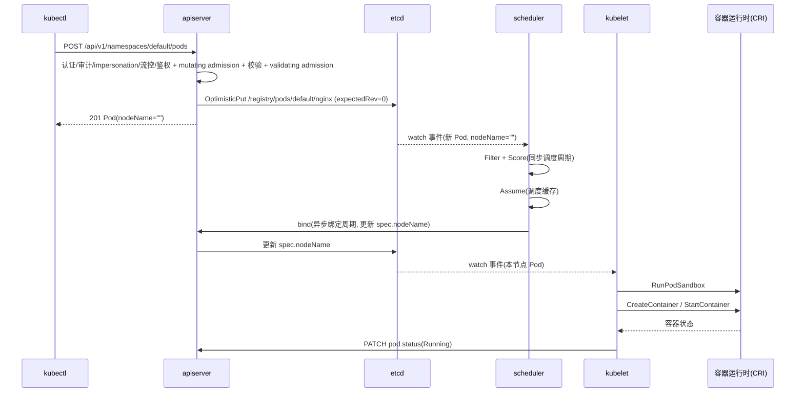

[上一篇](02-kubectl-run全路径走读.md) · [总目录](README.md) · [下一篇](04-kubectl客户端.md)

# 主链路逐步拆解

> **层级**：第三层——基于 `kubectl run nginx --image=nginx --restart=Never`，把主链路逐跳拆解，每跳说明调用双方、参数传递与转换、内部动作、返回值去向、状态变化、数据流转与错误传播。
>
> **代码基准**：`master@8893923938107170c86eb4b8cc2b7225b4e44e9b`（2026-11-18，工作区干净），Go 1.27.4。
>
> **锚点记法**：源码锚点一律「符号 + 偏移」。函数内偏移以该函数声明行为 **+0**；例如 `frameworkImpl.RunFilterPluginsWithNominatedPods`（定义行 1467）写作 `frameworkImpl.RunFilterPluginsWithNominatedPods:1467/+0`。行号仅供定位函数，不单独作为锚点。

## 0. 全链路时序



参与者即真实组件：`kubectl`（客户端）、`apiserver`（kube-apiserver 聚合端点）、`etcd`（持久化与 watch 广播）、`scheduler`（kube-scheduler）、`kubelet`（节点代理）、`容器运行时(CRI)`（经 gRPC 的 containerd 等）。

## 1. 第一段：kubectl 构造请求

### 1.1 生产视角

| 要素 | 内容 |
|---|---|
| 调用方 | cobra 命令回调：`(*RunOptions).Run`（`staging/src/k8s.io/kubectl/pkg/cmd/run/run.go`，定义行 326，+0） |
| 被调用 | `(*RunOptions).createPod`（run.go，定义行 605，+0）→ `(*RunOptions).createGeneratedObject`（run.go，定义行 679，+0） |
| 参数传递 | 命令行参数 `args[0]=nginx`、flag `--image=nginx`、`--restart=Never` 保存在 `RunOptions` |
| 参数转换 | `Run` 内默认补 label（`labels["run"]=name`，`Run` +7~+10，即 run.go:333-336，map 字面量在 +8~+10）；`createPod` 把 flags 翻译为 `*corev1.Pod`：单容器、`restartPolicy: Never`；`createGeneratedObject` 通过 `f.ToRESTMapper()`（+1，run.go:680）把 Pod 的 GVK（核心组 v1）映射为资源 `pods` |
| 内部动作 | `f.ClientForMapping(mapping)`（+31，run.go:710）构造 REST client；`resource.NewHelper(...)`（+36，run.go:715）的 `.Create(namespace, false, obj)`（+39，run.go:718）序列化对象并 POST |
| 返回值 | apiserver 响应解码回 `runtime.Object`（存回的 Pod），包成 `RunObject` |
| 状态变化 | 无本地状态；kubectl 默认不等待调度完成即打印 `pod/nginx created` |
| 数据流 | flags → Pod struct → JSON → HTTP body |
| 错误传播 | mapper/client/HTTP 错误逐层 `return err` 回到命令层打印 |

### 1.2 开发视角（函数级锚点）

调用链（锚点均为「符号 + 偏移」）：

- `RunOptions.Run`（run.go:326/+0）→ 默认 label `+7~+10` → `createPod`（run.go:605/+0）
- `RunOptions.createPod`（run.go:605/+0）→ 返回 `*corev1.Pod`
- `RunOptions.createGeneratedObject`（run.go:679/+0）→ `f.ToRESTMapper()` `+1`（run.go:680）→ `f.ClientForMapping(mapping)` `+31`（run.go:710）→ `resource.NewHelper(...)` `+36`（run.go:715）→ `.Create(...)` `+39`（run.go:718）

kubectl 段的全部锚点与上一基准（82f9fd3d）逐行一致，零源码移动。

## 2. 第二段：apiserver 接收并持久化

### 2.1 中间件链

#### 生产视角

| 要素 | 内容 |
|---|---|
| 入口 | `DefaultBuildHandlerChain`（`staging/src/k8s.io/apiserver/pkg/server/config.go`，定义行 1078，+0） |
| 顺序 | 外层（先执行）→ `WithAuthentication` → `WithAudit` → impersonation（`WithImpersonation`，`ConstrainedImpersonation` 特性开时用 `WithConstrainedImpersonation`）→ 流控（`WithPriorityAndFairness` 或 `WithMaxInFlightLimit`）→ `WithAuthorization`（`ConditionalAuthorization` 特性开时用 `WithConditionsAwareAuthorization`）→ 内层（最后执行，紧贴业务 handler） |
| 参数转换 | 认证结果（`user.Info`）写入 request context；鉴权从 context 取 user 与请求属性做决策 |
| 错误传播 | 认证失败直接写 401；鉴权失败写 403；请求在中间件层被短路，不进入路由 |
| 分流 | 通过 `[staging] server/handler.go` 的 director 在 go-restful container 与 NonGoRestfulMux 间选择 |

#### 开发视角（外层 → 内层，含源码偏移）

`DefaultBuildHandlerChain`（config.go:1078/+0）内，核心五件套从**外层（先执行）到内层（后执行、近业务 handler）**的包裹顺序（源码出现顺序与包裹后执行顺序相反）：

| 中间件 | 源码偏移（config.go:1078 为 +0） | 执行层次 |
|---|---|---|
| `WithAuthentication`（:1132） | +54 | 最外（核心五件套） |
| `WithAudit`（:1121） | +43 | 内二 |
| `WithConstrainedImpersonation`（:1113，默认关）/ `WithImpersonation`（:1116） | +35 / +38 | 内三 |
| `WithPriorityAndFairness`（:1105）/ `WithMaxInFlightLimit`（:1108） | +27 / +30 | 内四 |
| `WithConditionsAwareAuthorization`（:1084，默认关）/ `WithAuthorization`（:1091） | +6 / +13 | 最内（贴业务 handler） |

再外（config.go 内仍属本函数，先于核心五件套执行）：CORS `+57`（:1135）/ WarningRecorder `+61`（:1139）/ TimeoutForNonLongRunning `+65`（:1143）/ RequestDeadline `+67`（:1145）/ CacheControl `+76`（:1154）/ RequestInfo `+89`（:1167）/ RequestReceivedTimestamp `+90`（:1168）/ PanicRecovery `+95`（:1173）/ AuditInit `+96`（:1174，最外）。

结论：顺序「认证 → 审计 → impersonation → 流控 → 鉴权（鉴权最内）」成立。新增两个特性分支（均默认关）：`WithConditionsAwareAuthorization`、`WithConstrainedImpersonation`，关闭时分别回落到 `WithAuthorization`、`WithImpersonation`。

### 2.2 资源 handler

#### 生产视角

| 要素 | 内容 |
|---|---|
| 调用方 | go-restful 路由：`(*APIInstaller).registerResourceHandlers`（`[staging] endpoints/installer.go`）把 POST `pods` 绑定到 `restfulCreateResource` |
| 被调用 | `CreateResource`（`[staging] endpoints/handlers/create.go`，定义行 53 附近）→ `createHandler` 返回的闭包 |
| 参数传递 | `*http.Request`；从 URL 取 namespace（`default`），name 为空（服务端生成/取对象内 name） |
| 内部步骤（带偏移，`createHandler` 定义行为 +0） | 设置 34s 超时（`WithTimeout` +26~+27）→ 协商输入/输出序列化（+29、+36）→ 限量读 body → decode 为 Pod（`Decode` +74，经 `DecoderToVersion` 转到内部版本处理）→ 校验 GV 匹配（+90~+95，核心 +91）→ 取对象 name（+99~+100）→ 擦除系统只读字段（`WipeObjectMetaSystemFields` +112~+119，核心 +118）→ 保证 namespace 一致（`EnsureObjectNamespaceMatchesRequestNamespace` +121~+125，核心 +122） |
| admission | 构造 `admission.Attributes`（`NewAttributesRecord` +129）；`FinishRequest` 内先更新 managed fields（`UpdateNoErrors` +146），再执行 mutating：`mutatingAdmission.Admit`（+149~+153，核心 +150） |
| 被调存储 | 闭包 `requestFunc`（+130~+138）调 `r.Create(ctx, name, obj, AdmissionToValidateObjectFunc(...), options)`（+131），实际接收者是 Pod `storage.REST`（内嵌 `Store`） |
| 返回值 | 存储层返回存回的对象；`transformResponseObject`（+182）以 201 写出（`StatusCreated` 常量在 +174） |
| 错误传播 | decode/序列化错误转 400；admission 拒绝原样向上；对象过大时删 managedFields 重试一次（+156~+162） |

#### 开发视角

`CreateResource`（create.go:53 附近）→ `createHandler`（create.go:53/+0）闭包；`requestFunc` 闭包（+130~+138）→ `r.Create(...)`（+131）。本段锚点与上一基准逐行相同，偏差均为旧文档数字不精，非代码漂移。

### 2.3 泛型 Store 与 etcd

#### 生产视角

| 要素 | 内容 |
|---|---|
| 调用方 | createHandler 的 `requestFunc` |
| 被调用 | `(*Store).Create`（`[staging] generic/registry/store.go`，定义行 564，+0）→ `(*Store).create`（store.go，定义行 595，+0） |
| 参数转换 | 传入的 validating 回调类型为 `rest.ValidateObjectFunc`；`create` 内先 `FillObjectMetaSystemFields`（+4~+10，调用 +7，填 UID/CreationTimestamp/ResourceVersion 语义字段） |
| 默认化 | `rest.BeforeCreate(e.CreateStrategy, ...)`（+24，podStrategy：默认值填充与名称生成） |
| 校验 | validating admission 回调执行（+29~+33，调用 +30，deep copy 后传入）；声明式校验在 strategy 链路中 |
| 取 key | `ObjectNameFunc` 得 name（+35）→ `KeyFunc` 生成存储 key（+39）：`/registry/pods/default/nginx` |
| 持久化 | `e.Storage.Create(ctx, key, obj, out, ttl, dryRun)`（+49）→ `[staging] storage/etcd3/store.go` 的 `(*store).Create`（定义行 293，+0）：编码 → `PrepareObjectForStorage`（+16，仅 versioner 预处理，**非加密**）→ `Encode`（+20）→ lease（+29）→ **真正加密 `TransformToStorage`（+35）** → `OptimisticPut`（+43，`expectedRev=0`，即 key 不存在才成功） |
| 返回值 | etcd 成功后 decode 到 `out` 返回；`AfterCreate`（+74~+77，调用 +75）做后置加工 |
| 状态变化 | etcd 新增 key；watch 机制随后向订阅者广播 |
| 错误传播 | key 已存在：解释为 AlreadyExists，再 `Get` 一次（+52~+66，调用 +55）现存对象返回冲突；其余存储错误直接上抛 |

#### 开发视角

- `Store.create`（store.go:595/+0）：`FillObjectMetaSystemFields` `+7` → `BeforeCreate` `+24` → validating admission `+30` → `ObjectNameFunc` `+35` → `KeyFunc` `+39` → `e.Storage.Create` `+49` → 冲突时 `Get` `+55` → `AfterCreate` `+75`。
- 本函数**无独立 `Decorator`**，后置加工仅 `AfterCreate`（`Decorator` 用于 Get/List 路径，不在 create 路径）。
- `(*store).Create`（etcd3 store.go:293/+0）：`PrepareObjectForStorage` `+16`（versioner 预处理，**非加密**）→ `runtime.Encode` `+20` → `GetLease` `+29` → `TransformToStorage` `+35`（**加密变换**）→ `OptimisticPut` `+43`（`expectedRev=0`）。

**语义修正**：旧文档把「加密变换」误挂在 `PrepareObjectForStorage` 上，实际加密在 `TransformToStorage`（`+35`）；`PrepareObjectForStorage`（`+16`）仅做版本化预处理。

## 3. 第三段：scheduler 调度与绑定

### 3.1 生产视角

| 要素 | 内容 |
|---|---|
| 触发 | scheduler 的 Pod informer watch 到 `spec.nodeName=""` 的新 Pod，经事件处理入 `PriorityQueue`（`pkg/scheduler/backend/queue/scheduling_queue.go`，`PriorityQueue.Pop` 定义行 1516） |
| worker | `(*Scheduler).Run`（`pkg/scheduler/scheduler.go`，定义行 538）中 `wait.UntilWithContext(ctx, sched.ScheduleOne, 0)`（+14，:552）；`ScheduleOne`（`schedule_one.go`，定义行 68，+0）从队列 `NextEntity` 取 Pod（+2，:70），分派给 `scheduleOnePod`（+19，:87） |
| 同步：快照 | `schedulingCycle`（schedule_one.go:170，+0）开头 `Cache.UpdateSnapshot`（+8，:178）取节点最新快照 |
| 同步：过滤 | `schedulingAlgorithm`（schedule_one.go:287，+0）→ `SchedulePod`（`algorithm.go` 定义行 162，+0）→ `findNodesThatFitPod`（algorithm.go:351，+0）→ `findNodesThatPassFilters`（algorithm.go:449，+0）内绑定 `RunFilterPluginsWithNominatedPods`（调用点 algorithm.go:506，函数内偏移 +57；定义在 `frameworkImpl.RunFilterPluginsWithNominatedPods`，`framework.go:1467/+0`）：逐节点跑 Filter 插件（资源、端口、卷、亲和、污点等），聚合可行节点 |
| 同步：打分 | `prioritizeNodes`（schedule_one.go:644，+0）内 `RunScorePlugins`（调用点 schedule_one.go:693，函数内偏移 +49；定义在 `frameworkImpl.RunScorePlugins`，`framework.go:1598/+0`）对可行节点打分，选 `SuggestedHost` |
| Assume | `prepareForBindingCycle`（schedule_one.go:228，+0）→ `AssumeAndReserveInCache`（+8，:236）：修改 Pod 的 nodeName 并放入调度缓存，即"假定已分配"，随后跑 Permit 插件（`RunPermitPlugins` +15，:243） |
| 异步绑定 | `go sched.runBindingCycle(...)`（`scheduleOnePod` +74，:142）；`bindingCycle`（schedule_one.go:352，+0）依次 `RunPreBindPreFlights`（+15，:367）/ `WaitOnPermit`（+35，:387）/ `RunPreBindPlugins`（+72，:424）/ `bind`（+84，:436）/ `RunPostBindPlugins`（+106，:458）；`bind`（schedule_one.go:780，+0）内 `RunBindPlugins`（+10，:790，默认 bind 插件向 apiserver 提交 Binding） |
| 状态变化 | 调度缓存先变（assume），apiserver/etcd 后变（bind 成功）；两处的短暂不一致靠 assume 语义容忍 |
| 数据流 | Pod + 节点快照 → `ScheduleResult{SuggestedHost}` → assumed Pod → Binding 请求 |
| 错误传播 | 调度周期失败走 `runFailureHandler`（`scheduleOnePod` +43，:137；其内 `FailureHandler` 在 `runFailureHandler` +7，:849，回队列/标记 nominated node）；绑定失败 `handleBindingCycleError`（schedule_one.go:470，+0）内 `UnreserveAndForgetFromCache`（+12，:482）撤销 assume 并 `FailureHandler`（+43，:513） |

### 3.2 开发视角（调用链）

```
Scheduler.Run(scheduler.go:538/+0)
  └─ ScheduleOne(schedule_one.go:68/+0) ─ NextEntity +2(:70) → scheduleOnePod +19(:87)
       ├─ schedulingCycle(schedule_one.go:170/+0) ─ UpdateSnapshot +8(:178)
       │     └─ schedulingAlgorithm(schedule_one.go:287/+0) ─ SchedulePod +18(:305)
       │           └─ SchedulingAlgorithm.SchedulePod(algorithm.go:162/+0) ─ findNodesThatFitPod +9(:171)
       │                 └─ SchedulingAlgorithm.findNodesThatFitPod(algorithm.go:351/+0) ─ findNodesThatPassFilters +44(:395)
       │                       └─ SchedulingAlgorithm.findNodesThatPassFilters(algorithm.go:449/+0) ─ RunFilterPluginsWithNominatedPods +57(:506)
       │                             └─ frameworkImpl.RunFilterPluginsWithNominatedPods(framework.go:1467/+0)
       └─ runBindingCycle(schedule_one.go:53附近) ─ bindingCycle(schedule_one.go:352/+0)
             └─ bind(schedule_one.go:780/+0) ─ RunBindPlugins +10(:790)
```

打分旁路：`scheduleOnePod` → `schedulingCycle` → `schedulingAlgorithm` 之前，`prioritizeNodes`（schedule_one.go:644/+0）内 `RunScorePlugins` `+49`（:693）→ `frameworkImpl.RunScorePlugins`（framework.go:1598/+0）。

**关键修正**：`RunFilterPluginsWithNominatedPods` 的调用点（algorithm.go:506，函数内偏移 +57）**属于 `findNodesThatPassFilters`（algorithm.go:449）**，经链 `schedulingAlgorithm → SchedulePod → findNodesThatFitPod → findNodesThatPassFilters` 到达；旧文「schedulingAlgorithm 内绑定 algorithm.go:457」的**父函数归属有误**（应属 `findNodesThatPassFilters`）。`RunScorePlugins` 调用点（schedule_one.go:693）仍属 `prioritizeNodes`（schedule_one.go:644，函数内偏移 +49）。

## 4. 第四段：kubelet 执行

### 4.1 配置接入与事件分派

#### 生产视角

| 要素 | 内容 |
|---|---|
| 数据来源 | `NewSourceApiserver`（`pkg/kubelet/config/apiserver.go`）的 ListWatch（字段选择器 `spec.nodeName=<本节点>`）→ `PodConfig`（`pkg/kubelet/config/config.go`）合并后向更新通道发 `PodUpdate{Op: ADD}` |
| 调用方 | `(*Kubelet).syncLoop` 循环调用 `syncLoopIteration`（`pkg/kubelet/kubelet.go`，定义行 2889，+0） |
| 内部分派 | select 命中 `configCh`（+4，:2893），`Op==ADD` 分支（+13，:2902）调 `handler.HandlePodAdditions`（+19，:2908） |
| 其他事件源 | 同函数还 select：`plegCh`（+38，:2927，容器事件触发 sync/清理）、`syncCh`（+55，:2944，定时）、liveness/readiness/startup 探针（+63/:67/:76，:2952/:2956/:2965）、containerManager 设备更新（+85，:2974） |

### 4.2 准入与下发 PodWorker

#### 生产视角

| 要素 | 内容 |
|---|---|
| 调用方 | syncLoopIteration |
| 被调用 | `(*Kubelet).HandlePodAdditions`（kubelet.go，定义行 3047，+0） |
| 内部步骤 | 按创建时间排序（`sortPodsForAdmission` +3，:3050）→ 每个 Pod 先 `podManager.AddPod`（+10，:3057，登记期望状态）→ 非终止 Pod 走本地准入 `allocationManager.AddPod`（+38，:3085）：检查 CPU/内存/设备是否够；拒绝则 `rejectPod`（+39，:3086）并跳过 |
| 下发 | 准入通过后 `podWorkers.UpdatePod(UpdatePodOptions{UpdateType: SyncPodCreate})`（+59~+64，:3106-3111） |
| 状态变化 | podManager（期望集合）与 allocationManager（资源分配记录）更新 |
| 错误传播 | 准入失败不返回 error，直接把 Pod 标记为拒绝并写事件；其余 panic 风险由 PodWorker 层恢复 |

### 4.3 PodWorker 与 SyncPod

#### 生产视角

| 要素 | 内容 |
|---|---|
| 调用方 | HandlePodAdditions → `(*podWorkers).UpdatePod`（`pkg/kubelet/pod_workers.go`） |
| 串行化 | 每个 Pod 首见时启动一个 `podWorkerLoop` goroutine（pod_workers.go，定义行 1266），更新信号经 per-pod channel 投递；同一 Pod 的 sync/kill 严格串行 |
| 被调用 | `podWorkerLoop` 从 podCache 取运行时现状后调 `podSyncer.SyncPod`（+79，:1345），实现者即 Kubelet |
| SyncPod | `(*Kubelet).SyncPod`（kubelet.go，定义行 2158，+0）：生成 API 状态（`generateAPIPodStatus` +53，:2211）→ 终态直接返回（+65~+70，:2223-2228）→ `volumeManager.WaitForAttachAndMount` 等待卷就绪 → `kl.containerRuntime.SyncPod(...)`（**+228，:2386**） |
| 参数转换 | Pod 的期望状态 + podCache 的运行时现状 + pull secrets 一同传入运行时层 |
| 错误传播 | SyncPod 返回 `(isTerminal, postSync, err)`；err 回到 podWorkerLoop，按失败指数退避重试该 Pod |

**关键修正**：`kl.containerRuntime.SyncPod` 调用点在 kubelet.go **:2386**（函数内偏移 **+228**），旧文 2282 需修正（行号 2282→2386，函数内偏移 +214→+228）。

### 4.4 CRI 执行

#### 生产视角

| 要素 | 内容 |
|---|---|
| 调用方 | Kubelet.SyncPod |
| 被调用 | `(*kubeGenericRuntimeManager).SyncPod`（`pkg/kubelet/kuberuntime/kuberuntime_manager.go`，定义行 1854，+0）→ `computePodActions`（调用 +14，:1868，定义行 1388）求差集（新 Pod：1 个 sandbox + N 个容器）→ `createPodSandbox`（调用 +164，:2018，定义行 43 于 `kuberuntime_sandbox.go`）→ 对每个容器 `startContainer`（调用 +290，:2144，定义行 213 于 `kuberuntime_container.go`：拉镜像 → `CreateContainer` → `StartContainer`） |
| gRPC | `[staging] cri-client/pkg/remote_runtime.go` 的 `remoteRuntimeService` 经 cri-api grpc stub 发往 containerd |
| 状态变化 | 容器运行时内：sandbox ready → container created → running |
| 数据流 | Pod spec → CRI 配置（sandbox config / container config，含镜像、命令、挂载、label）→ 运行时响应（容器 ID） |
| 错误传播 | 任一 CRI 调用失败上抛为 SyncPod 错误，触发重试；镜像拉取失败进入 CrashLoop 风格的退避（细节第四层 10 篇） |

#### 开发视角

kuberuntime `SyncPod`（kuberuntime_manager.go:1854/+0）内部：`computePodActions` `+14`（:1868）→ `createPodSandbox` `+164`（:2018）→ `startContainer` `+290`（:2144）。函数绝对行较上一基准 +278，内部偏移 +3/+147/+253 → +14/+164/+290。

## 5. 第五段：状态回报

| 要素 | 内容 |
|---|---|
| 感知 | `GenericPLEG.Relist`（`pkg/kubelet/pleg/generic.go`，定义行 296，+0）周期列出全部容器，与上次状态对比，发现 sandbox/容器 running |
| 上报 | `(*manager).syncPod`（`pkg/kubelet/status/status_manager.go`，定义行 1352，+0）后台循环：合并 PodStatus（phase、IP、容器状态、条件）→ `PatchPodStatus`（`pkg/util/pod/pod.go`，定义行 34，+0）发 PATCH |
| 状态变化 | apiserver/etcd 中 Pod status 更新为 `Running`；watch 广播给所有订阅者（含等待中的 kubectl `-w`） |
| 数据流 | 运行时列表 → PLEG 事件/状态缓存 → statusManager 待上报队列 → PATCH body → etcd |
| 错误传播 | PATCH 冲突（status 已被其他写动过）时重读重试；上报失败保留在队列下个周期重试 |

本段锚点与上一基准一致（零漂移），与第 02 篇一致。

#### 状态回报机制深度拆解

状态回报不是「容器一启动就上报」，而是 kubelet 侧一条独立的异步上报管线，核心是 `pkg/kubelet/status/status_manager.go` + `pkg/util/pod/pod.go`。

**收集与去抖（`updateStatusInternal`，status_manager.go:1024）：**
1. 取缓存旧状态：`m.podStatuses[pod.UID]`（无缓存则退回 mirrorPod.Status 或 pod.Status）。
2. **非法状态迁移检查**：`checkContainerStateTransition`（+23 附近）拦截非法的容器状态回退，命中则中止本次更新。
3. 逐 condition 调 `updateLastTransitionTime`（ContainersReady/Ready/Initialized/PodReadyToStartContainers/PodScheduled/DisruptionTarget/AllContainersRestarting）：**只在状态实际变化时刷新 LastTransitionTime**，避免无意义的时间戳跳动。
4. 保持 `StartTime` 跨更新不变。

**批量上报（`Start`，status_manager.go:285）：**
- `syncPod` 与 `syncBatch` **共享同一 goroutine**（注释：避免 sync race）。
- 两个触发源：`m.podStatusChannel`（有更新，`syncBatch(false)` 仅同步有变化的）+ `syncTicker`（周期 `syncPeriod`，`syncBatch(true)` 同步全部）。
- `kubeClient == nil`（master 上的 kubelet 负责引导 master 组件 Pod）时不启动 status manager。

**PATCH 上报（`syncPod`，status_manager.go:1352）：**
1. `kubeClient.Get` 取服务端最新 Pod；**NotFound 直接忽略**（Pod 已删，status 会被 `RemoveOrphanedStatuses` 清理）。
2. **UID 翻译与新建检测**：`TranslatePodUID` 后若与传入 uid 不一致 → 判定「Pod 被删后重建」，`deletePodStatus(uid)` 丢弃本次更新（防旧 status 写到新 Pod 上）。
3. `mergePodStatus` 合并服务端现状与本地 status（`PodCouldHaveRunningContainers` 参与判断）。
4. **`PatchPodStatus`** 发 PATCH。

**PATCH 的精确性（`PatchPodStatus`，pkg/util/pod/pod.go:34）：**
1. `preparePatchBytesForPodStatus`（:63）用 `CreateTwoWayMergePatch(oldData, newData, v1.Pod{})` 生成 **StrategicMergePatch**。
2. **关键细节**：`newData` 只在 ObjectMeta 里放 `uid`（注释：`only put the uid in the new object to ensure it appears in the patch as a precondition`）——使 uid 成为 PATCH 的**前置条件**，服务端校验 uid 匹配才应用。
3. **unchanged 判定**（:78 ～ +80）：若 patch 等于 `{"metadata":{"uid":<uid>}}`（即只有 uid、无 status 差异），返回 `unchanged=true`，调用方跳过网络调用。
4. 真正的 PATCH 走 `Pods(namespace).Patch(..., StrategicMergePatchType, patchBytes, ..., "status")`（:46 ～ +48）——**只 patch status 子资源**。

**设计要点（源码可证）：**
1. **异步批量而非同步阻塞**：状态上报与容器启动解耦，syncPod/syncBatch 单 goroutine 串行，容器执行不被上报耗时阻塞。
2. **双触发（事件 + 周期）**：channel 触发保证变更及时上报，ticker 兜底保证不丢（`syncBatch(true)` 全量对账）。
3. **PATCH 而非 PUT + uid 前置条件**：只 patch status 子资源、以 uid 为 precondition，避免覆盖 spec、避免把 status 写到已重建的同名 Pod 上。
4. **unchanged 短路**：无差异时不发网络请求，显著减少 apiserver 负载（大量 Pod 稳定运行时）。
5. **冲突安全**：StrategicMergePatch + status 子资源 + uid precondition 三重保证并发安全，冲突由 apiserver 侧判定。

## 6. 本层边界

以上每一步都沿主成功路径。第四层开始对这些函数逐个展开：签名、全部参数与返回值、完整调用关系、关键分支与循环、并发模型，以及本层省略的错误恢复细节。

## 7. 验证（证据核对）

依据 `docs/sourceReader/.progress/evidence/03.md`（基准 `master@8893923938107170c86eb4b8cc2b7225b4e44e9b`，只读验证）核对，结论如下：

**零移动（行号逐行一致，旧文偏移偏差 = 旧文自身不精）**：kubectl run.go 全部（326/605/679/680/710/715/718）；createHandler 全部（53~236）；`DefaultBuildHandlerChain` 的 `With*` 顺序；syncLoopIteration 内部（+4/+13/+19）；HandlePodAdditions 内部（+3/+10/+38/+39/+59）。

**函数绝对行移动但相对偏移稳定**：`Store.create` 545→595（+50）；etcd3 `store.Create` 288→293（+5）。

**函数与内部偏移均漂移（本文已改）**：

| 符号 | 旧基准锚点 | 当前锚点 | 漂移 |
|---|---|---|---|
| `DefaultBuildHandlerChain` | config.go:1036 | config.go:1078 | +42（顺序不变） |
| `ScheduleOne` | schedule_one.go:66 | schedule_one.go:68 | +2 |
| `scheduleOnePod` | :92 | :94 | +2 |
| `schedulingCycle` | :168 | :170 | +2 |
| `prepareForBindingCycle` | :195 | :228 | +33 |
| `schedulingAlgorithm` | :249 | :287 | +38 |
| `bindingCycle` | :314 | :352 | +38 |
| `handleBindingCycleError` | :422 | :470 | +48 |
| `bind` | :681 | :780 | +99 |
| `prioritizeNodes` | :565 | :644 | +79 |
| `findNodesThatPassFilters` | algorithm.go:419 | algorithm.go:449 | +30 |
| `RunFilterPluginsWithNominatedPods` 调用点 | algorithm.go:457（内偏移 +38） | algorithm.go:506（内偏移 +57） | +49 |
| `RunScorePlugins` 调用点 | schedule_one.go:594（内偏移 +29） | schedule_one.go:693（内偏移 +49） | +99 |
| `syncLoopIteration` | kubelet.go:2759 | kubelet.go:2889 | +130 |
| `HandlePodAdditions` | kubelet.go:2896 | kubelet.go:3047 | +151 |
| `Kubelet.SyncPod` | kubelet.go:2068 | kubelet.go:2158 | +90 |
| `kl.containerRuntime.SyncPod` 调用点 | kubelet.go:2282（内偏移 +214） | kubelet.go:2386（内偏移 +228） | +104 |
| kuberuntime `SyncPod` | kuberuntime_manager.go:1576 | kuberuntime_manager.go:1854 | +278（内偏移 +3/+147/+253 → +14/+164/+290） |
| `GenericPLEG.Relist` / `manager.syncPod` / `PatchPodStatus` | generic.go:296 / status_manager.go:1352 / pod.go:34 | 同左 | 0 |

**本层关键修正（已并入正文）**：

1. `RunFilterPluginsWithNominatedPods` 调用点（algorithm.go:506，内偏移 +57）**属 `findNodesThatPassFilters`（algorithm.go:449）**，非旧文的 `schedulingAlgorithm`；经链 `schedulingAlgorithm → SchedulePod → findNodesThatFitPod → findNodesThatPassFilters` 到达。
2. `RunScorePlugins` 调用点 schedule_one.go:693（内偏移 +49），仍属 `prioritizeNodes`（:644）。
3. `kl.containerRuntime.SyncPod` 调用点 kubelet.go:2386（内偏移 +228），旧文 2282 修正。
4. 加密变换是 `TransformToStorage`（etcd3 `store.Create` +35），**不是** `PrepareObjectForStorage`（后者仅版本化）。
5. 泛型 `Store.create` 后置加工仅 `AfterCreate`（+74~+77），**无 Decorator**。
6. 中间件链新增特性分支（默认关）：`WithConditionsAwareAuthorization`、`WithConstrainedImpersonation`；顺序仍为 认证→审计→impersonation→流控→鉴权（鉴权最内）。

**消失符号**：无（全部锚点均存在）。**未确认项**：无（所有引用偏移均经只读源码验证；`Scheduler.Run`、`PriorityQueue.Pop`、`runBindingCycle` 等非证据索引列出的锚点已按当前源码重新定位确认）。

[上一篇](02-kubectl-run全路径走读.md) · [总目录](README.md) · [下一篇](04-kubectl客户端.md)
