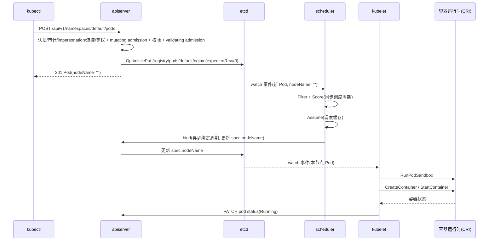

[上一篇](02-kubectl-run全路径走读.md) · [总目录](README.md) · [下一篇](04-kubectl客户端.md)

# 主链路逐步拆解

> **层级**：第三层——基于 `kubectl run nginx --image=nginx --restart=Never`，把主链路逐跳拆解，每跳说明调用双方、参数传递与转换、内部动作、返回值去向、状态变化、数据流转与错误传播。
>
> **代码基准**：adrian @ `6bf0bfd51d78d1b3cb0917dc7001cd2aaf5549d4`（2026-11-26，Go 1.27.4）。工作区 HEAD 为其后继文档提交 `77b92162907`，代码态与该基准一致。
>
> **锚点记法**：源码锚点一律「文件 · 符号 · 偏移」。偏移**落在调用方符号体内**：`+0` = 符号声明行（Go 的 `func`/`type` 行），`+N` = 符号体内第 N 行。写「调用点」时偏移指**该调用语句在调用方符号体内的位置**，被调符号只给名字与所在文件、不给自身偏移。符号名不带 `func`/`type` 前缀、不带 receiver。一律用符号+偏移定位，不使用绝对行号。

## 0. 全链路时序



参与者即真实组件：`kubectl`（客户端）、`apiserver`（kube-apiserver 聚合端点）、`etcd`（持久化与 watch 广播）、`scheduler`（kube-scheduler）、`kubelet`（节点代理）、`容器运行时(CRI)`（经 gRPC 的 containerd 等）。

## 1. 第一段：kubectl 构造请求

### 1.1 生产视角

| 要素 | 内容 |
|---|---|
| 调用方 | cobra 命令回调 `RunOptions.Run`（`[staging] kubectl/pkg/cmd/run/run.go` · `Run` `+0`） |
| 被调用 | `RunOptions.createPod`（run.go · `createPod` `+0`）→ `RunOptions.createGeneratedObject`（run.go · `createGeneratedObject` `+0`） |
| 参数传递 | 命令行参数 `args[0]=nginx`、flag `--image=nginx`、`--restart=Never` 保存在 `RunOptions` |
| 参数转换 | `Run` 内默认补 label（`Run` `+7~+11`：`labels` 为空时赋 map 字面量 `{"run": name}`，字面量在 `+8~+10`）；`createPod` 把 flags 翻译为 `*corev1.Pod`：单容器、`restartPolicy: Never`；`createGeneratedObject` 通过 `f.ToRESTMapper()`（`createGeneratedObject` `+1`）把 Pod 的 GVK（核心组 v1）映射为资源 `pods` |
| 内部动作 | `f.ClientForMapping(mapping)`（调用点 `createGeneratedObject` `+31`）构造 REST client；`resource.NewHelper(...)`（调用点 `+35`）链式 `.Create(namespace, false, obj)`（调用点 `+39`）序列化对象并 POST |
| 返回值 | apiserver 响应解码回 `runtime.Object`（存回的 Pod），包成 `RunObject`（`createGeneratedObject` `+49~+52`） |
| 状态变化 | 无本地状态；kubectl 默认不等待调度完成即打印 `pod/nginx created` |
| 数据流 | flags → Pod struct → JSON → HTTP body |
| 错误传播 | mapper/client/HTTP 错误逐层 `return err` 回到命令层打印 |

### 1.2 开发视角（函数级锚点）

调用链（偏移均落在调用方符号体内）：

- `RunOptions.Run`（run.go · `Run` `+0`）→ 默认 label `+7~+11` → `createPod` 调用点 `+14` → `createGeneratedObject` 调用点 `+15`
- `RunOptions.createPod`（run.go · `createPod` `+0`）→ 返回 `*corev1.Pod`
- `RunOptions.createGeneratedObject`（run.go · `createGeneratedObject` `+0`）→ `f.ToRESTMapper()` `+1` → `f.ClientForMapping(mapping)` `+31` → `resource.NewHelper(...)` `+35` → `.Create(...)` `+39` → 包成 `RunObject` 返回（调用点 run.go · `createGeneratedObject` `+49`）

## 2. 第二段：apiserver 接收并持久化

### 2.1 中间件链

#### 生产视角

| 要素 | 内容 |
|---|---|
| 入口 | `DefaultBuildHandlerChain`（`[staging] apiserver/pkg/server/config.go` · `DefaultBuildHandlerChain` `+0`） |
| 顺序 | 外层（先执行）→ `WithAuthentication` → `WithAudit` → impersonation（`WithImpersonation`；`ConstrainedImpersonation` 特性开时用 `WithConstrainedImpersonation`）→ 流控（`WithPriorityAndFairness` 或 `WithMaxInFlightLimit`）→ `WithAuthorization`（`ConditionalAuthorization` 特性开时用 `WithConditionsAwareAuthorization`）→ 内层（最后执行，紧贴业务 handler） |
| 参数转换 | 认证结果（`user.Info`）写入 request context；鉴权从 context 取 user 与请求属性做决策 |
| 错误传播 | 认证失败直接写 401；鉴权失败写 403；请求在中间件层被短路，不进入路由 |
| 分流 | 通过 `[staging] server/handler.go` 的 director 在 go-restful container 与 NonGoRestfulMux 间选择 |

#### 开发视角（外层 → 内层，偏移落在 `DefaultBuildHandlerChain` 体内）

`DefaultBuildHandlerChain`（config.go · `DefaultBuildHandlerChain` `+0`，体内 `+0~+98`）内，核心五件套从**外层（先执行）到内层（后执行、近业务 handler）**的包裹顺序（源码出现顺序与包裹后执行顺序相反）：

| 中间件 | 调用点偏移（以 `DefaultBuildHandlerChain` 声明行为 +0） | 执行层次 |
|---|---|---|
| `WithAuthentication` | `+54` | 最外（核心五件套） |
| `WithAudit` | `+43` | 内二 |
| `WithConstrainedImpersonation`（默认关）/ `WithImpersonation` | `+35` / `+38` | 内三 |
| `WithPriorityAndFairness` / `WithMaxInFlightLimit` | `+27` / `+30` | 内四 |
| `WithConditionsAwareAuthorization`（默认关）/ `WithAuthorization` | `+6` / `+13` | 最内（贴业务 handler） |

再外（仍属本函数，先于核心五件套执行）：CORS（config.go · `DefaultBuildHandlerChain` `+57`）/ WarningRecorder `+61` / TimeoutForNonLongRunning `+65` / RequestDeadline `+67` / CacheControl `+76` / RequestInfo `+89` / RequestReceivedTimestamp `+90` / PanicRecovery `+95` / AuditInit `+96`（最外，全部为 `DefaultBuildHandlerChain` 体内调用点）。

结论：顺序「认证 → 审计 → impersonation → 流控 → 鉴权（鉴权最内）」成立。两个特性分支（均默认关）：`WithConditionsAwareAuthorization`、`WithConstrainedImpersonation`，关闭时分别回落到 `WithAuthorization`、`WithImpersonation`。

### 2.2 资源 handler

#### 生产视角

| 要素 | 内容 |
|---|---|
| 调用方 | go-restful 路由：`APIInstaller.registerResourceHandlers`（`[staging] endpoints/installer.go`）把 POST `pods` 绑定到 `CreateResource` 返回的 handler |
| 被调用 | `CreateResource`（`[staging] endpoints/handlers/create.go` · `CreateResource` `+0`）→ `createHandler`（create.go · `createHandler` `+0`）返回的闭包 |
| 参数传递 | `*http.Request`；从 URL 取 namespace（`default`），name 为空（服务端生成/取对象内 name） |
| 内部步骤（偏移落在 `createHandler` 体内，声明行为 +0） | 设置 34s 超时（`context.WithTimeout` 调用点 `+26`）→ 协商输入/输出序列化 → 限量读 body → decode 为 Pod（`decoder.Decode` 调用点 `+74`，经 `DecoderToVersion` `+72` 转到内部版本处理）→ 校验 GV 匹配 → 取对象 name → 擦除系统只读字段（`WipeObjectMetaSystemFields` 调用点 `+118`）→ 保证 namespace 一致（`EnsureObjectNamespaceMatchesRequestNamespace` 调用点 `+122`） |
| admission | 构造 `admission.Attributes`（`NewAttributesRecord` 调用点 `+129`）；`FinishRequest` 内先更新 managed fields（`UpdateNoErrors` 调用点 `+146`），再执行 mutating：`mutatingAdmission.Admit`（调用点 `+150`） |
| 被调存储 | 闭包 `requestFunc`（`+130` 定义）调 `r.Create(ctx, name, obj, AdmissionToValidateObjectFunc(...), options)`，实际接收者是 Pod `storage.REST`（内嵌 `Store`） |
| 返回值 | 存储层返回存回的对象；`transformResponseObject`（调用点 `+182`）以 201 写出（`StatusCreated` 常量在 `+174`） |
| 错误传播 | decode/序列化错误转 400；admission 拒绝原样向上；对象过大时删 managedFields 重试一次（`+156~+162`） |

#### 开发视角

`CreateResource` → `createHandler` 闭包；`requestFunc` 闭包（`createHandler` `+130` 定义）→ `r.Create(...)`。本段偏移均落在 `createHandler` 体内（`+0~+191`），与基准一致。

### 2.3 泛型 Store 与 etcd

#### 生产视角

| 要素 | 内容 |
|---|---|
| 调用方 | createHandler 的 `requestFunc` |
| 被调用 | `Store.Create`（`[staging] generic/registry/store.go` · `Create` `+0`）→ `Store.create`（store.go · `create` `+0`，体内 `+0~+78`） |
| 参数转换 | 传入的 validating 回调类型为 `rest.ValidateObjectFunc`；`create` 内先 `FillObjectMetaSystemFields`（**调用点 `create` `+7`**；被调符号在 `[staging] apiserver/pkg/registry/rest/meta.go` · `FillObjectMetaSystemFields`，填 CreationTimestamp/UID） |
| 默认化 | `rest.BeforeCreate(e.CreateStrategy, ...)`（调用点 `create` `+24`；被调符号在 `[staging] apiserver/pkg/registry/rest/create.go` · `BeforeCreate`，podStrategy：默认值填充与名称生成） |
| 校验 | validating admission 回调执行（`create` `+29~+33`，调用点 `+30`，deep copy 后传入）；声明式校验在 strategy 链路中 |
| 取 key | `e.ObjectNameFunc(obj)`（**调用点 `create` `+35`**）得 name；`e.KeyFunc(ctx, name)`（**调用点 `create` `+39`**）生成存储 key：`/registry/pods/default/nginx`。两者都是 `Store` 的函数字段（`ObjectNameFunc`/`KeyFunc` 字段定义在 store.go `Store` 结构体内），按资源注入；命名空间资源最终落到 `NamespaceKeyFunc` |
| 持久化 | `e.Storage.Create(ctx, key, obj, out, ttl, dryRun)`（**调用点 `create` `+49`**）→ `[staging] storage/etcd3/store.go` 的 `store.Create`（etcd3 `store.go` · `Create` `+0`，体内 `+0~+65`）：`prepareKey`（`+1`）→ `versioner.PrepareObjectForStorage`（**调用点 `Create` `+16`**，仅 versioner 预处理，**非加密**）→ `runtime.Encode`（**调用点 `+20`**）→ `leaseManager.GetLease`（**调用点 `+29`**，仅 ttl≠0）→ **真正加密 `transformer.TransformToStorage`（调用点 `+35`）** → `client.Kubernetes.OptimisticPut`（**调用点 `+43`**，`expectedRev=0`，即 key 不存在才成功） |
| 返回值 | etcd 成功后 decode 到 `out` 返回；回到 `Store.create` 后 `e.AfterCreate(out, options)`（**调用点 `create` `+75`**）做后置加工（`AfterCreate` 是 `Store` 的可选函数字段） |
| 状态变化 | etcd 新增 key；watch 机制随后向订阅者广播 |
| 错误传播 | key 已存在：`InterpretCreateError`/`CheckGeneratedNameError` 解释为 AlreadyExists（`create` `+50~+51`），再 `e.Storage.Get`（调用点 `create` `+55`）现存对象返回冲突；其余存储错误直接上抛 |

#### 开发视角

- `Store.create`（`[staging] generic/registry/store.go` · `create` `+0`）：`FillObjectMetaSystemFields` 调用点 `+7` → `BeforeCreate` 调用点 `+24` → validating admission 调用点 `+30` → `ObjectNameFunc` 调用点 `+35` → `KeyFunc` 调用点 `+39` → `e.Storage.Create` 调用点 `+49` → 冲突时 `e.Storage.Get` 调用点 `+55` → `AfterCreate` 调用点 `+75`。
- 本函数**无独立 `Decorator`**，后置加工仅 `AfterCreate`（`Decorator` 用于 Get/List 路径，不在 create 路径）。
- `store.Create`（etcd3 `store.go` · `Create` `+0`）：`versioner.PrepareObjectForStorage` 调用点 `+16`（versioner 预处理，**非加密**）→ `runtime.Encode` 调用点 `+20` → `leaseManager.GetLease` 调用点 `+29` → `transformer.TransformToStorage` 调用点 `+35`（**加密变换**）→ `OptimisticPut` 调用点 `+43`（`expectedRev=0`）。

**语义修正**：旧文档把「加密变换」误挂在 `PrepareObjectForStorage` 上，实际加密在 `transformer.TransformToStorage`（etcd3 `Create` 调用点 `+35`）；`PrepareObjectForStorage`（调用点 `+16`）仅做版本化预处理。`ObjectNameFunc`/`KeyFunc`/`AfterCreate` 均为 `Store` 的函数字段而非顶层函数，偏移以调用点落在 `Store.create` 体内为准。

## 3. 第三段：scheduler 调度与绑定

### 3.1 生产视角

| 要素 | 内容 |
|---|---|
| 触发 | scheduler 的 Pod informer watch 到 `spec.nodeName=""` 的新 Pod，经事件处理入 `PriorityQueue`（`pkg/scheduler/backend/queue/scheduling_queue.go` · `PriorityQueue.Pop` `+0`） |
| worker | `Scheduler.Run`（`pkg/scheduler/scheduler.go` · `Run` `+0`）中 `wait.UntilWithContext(ctx, sched.ScheduleOne, 0)`（调用点 `Run` `+14`）；`Scheduler.ScheduleOne`（`pkg/scheduler/schedule_one.go` · `ScheduleOne` `+0`）从队列 `NextEntity` 取 Pod（调用点 `ScheduleOne` `+2`），分派给 `scheduleOnePod`（调用点 `ScheduleOne` `+19`） |
| 同步：快照 | `schedulingCycle`（schedule_one.go · `schedulingCycle` `+0`）开头 `Cache.UpdateSnapshot`（调用点 `schedulingCycle` `+8`）取节点最新快照 |
| 同步：过滤 | `schedulingCycle` → `sched.SchedulePod`（调用点 `schedulingCycle` `+16`，实现在 `pkg/scheduler/algorithm.go` · `SchedulingAlgorithm.SchedulePod`）→ `a.findNodesThatFitPod`（调用点 `SchedulePod` `+9`）→ `a.findNodesThatPassFilters`（调用点 `findNodesThatFitPod` `+44`）→ 内部 `RunFilterPluginsWithNominatedPods`（调用点 `findNodesThatPassFilters` `+57`；实现 `pkg/scheduler/framework/runtime/framework.go` · `frameworkImpl.RunFilterPluginsWithNominatedPods`）：逐节点跑 Filter 插件（资源、端口、卷、亲和、污点等），聚合可行节点 |
| 同步：打分 | `prioritizeNodes`（schedule_one.go · `prioritizeNodes` `+0`）内 `RunScorePlugins`（调用点 `prioritizeNodes` `+49`；实现 `framework.go` · `frameworkImpl.RunScorePlugins`）对可行节点打分，选 `SuggestedHost` |
| Assume | `prepareForBindingCycle`（schedule_one.go · `prepareForBindingCycle` `+0`）→ `AssumeAndReserveInCache`（调用点 `prepareForBindingCycle` `+8`）：修改 Pod 的 nodeName 并放入调度缓存，即「假定已分配」，随后跑 Permit 插件（`RunPermitPlugins` 调用点 `+15`） |
| 异步绑定 | `go sched.runBindingCycle(...)`（调用点 `scheduleOnePod` `+48`）；`bindingCycle`（schedule_one.go · `bindingCycle` `+0`）依次 `RunPreBindPreFlights`（调用点 `+15`）/ `WaitOnPermit`（调用点 `+35`）/ `RunPreBindPlugins`（调用点 `+72`）/ `bind`（调用点 `+84`）/ `RunPostBindPlugins`；`bind`（schedule_one.go · `bind` `+0`）内 `RunBindPlugins`（调用点 `bind` `+10`，默认 bind 插件向 apiserver 提交 Binding） |
| 状态变化 | 调度缓存先变（assume），apiserver/etcd 后变（bind 成功）；两处的短暂不一致靠 assume 语义容忍 |
| 数据流 | Pod + 节点快照 → `ScheduleResult{SuggestedHost}` → assumed Pod → Binding 请求 |
| 错误传播 | 调度周期失败走 `runFailureHandler`（调用点 `scheduleOnePod` `+43`；其内 `FailureHandler` 在 schedule_one.go · `runFailureHandler` `+7`，回队列/标记 nominated node）；绑定失败 `handleBindingCycleError`（schedule_one.go · `handleBindingCycleError` `+0`）内 `UnreserveAndForgetFromCache`（调用点 `+12`）撤销 assume 并 `FailureHandler`（调用点 `+43`） |

### 3.2 开发视角（调用链）

```
Scheduler.Run()                                  scheduler.go · Run +0
  └─ wait.UntilWithContext(sched.ScheduleOne)    调用点 Run +14
       └─ ScheduleOne()                          schedule_one.go · ScheduleOne +0
            ├─ NextEntity                        调用点 ScheduleOne +2
            └─ scheduleOnePod                    调用点 ScheduleOne +19（实现 schedule_one.go · scheduleOnePod +0）
                 ├─ schedulingCycle              调用点 scheduleOnePod +41
                 │    ├─ Cache.UpdateSnapshot    调用点 schedulingCycle +8
                 │    └─ sched.SchedulePod       调用点 schedulingCycle +16（实现 algorithm.go · SchedulingAlgorithm.SchedulePod +0）
                 │         └─ a.findNodesThatFitPod      调用点 SchedulePod +9（实现 algorithm.go · findNodesThatFitPod +0）
                 │              └─ a.findNodesThatPassFilters   调用点 findNodesThatFitPod +44（实现 algorithm.go · findNodesThatPassFilters +0）
                 │                   └─ RunFilterPluginsWithNominatedPods   调用点 findNodesThatPassFilters +57
                 │                        └─ frameworkImpl.RunFilterPluginsWithNominatedPods   framework.go
                 ├─ runFailureHandler（失败时）   调用点 scheduleOnePod +43（实现 schedule_one.go · runFailureHandler +0）
                 └─ go runBindingCycle           调用点 scheduleOnePod +48（实现 schedule_one.go · runBindingCycle +0）
                      └─ bindingCycle            schedule_one.go · bindingCycle +0
                           └─ sched.bind         调用点 bindingCycle +84（实现 schedule_one.go · bind +0）
                                └─ RunBindPlugins 调用点 bind +10
```

打分旁路：`scheduleOnePod` → `schedulingCycle` → `sched.SchedulePod` → `prioritizeNodes`（schedule_one.go · `prioritizeNodes` `+0`）→ `RunScorePlugins` 调用点 `+49` → `frameworkImpl.RunScorePlugins`。

**父函数归属说明**：`RunFilterPluginsWithNominatedPods` 的调用点偏移 `+57` 落在 `findNodesThatPassFilters`（algorithm.go）体内，经链 `schedulingCycle → SchedulePod → findNodesThatFitPod → findNodesThatPassFilters` 到达；`RunScorePlugins` 调用点偏移 `+49` 落在 `prioritizeNodes`（schedule_one.go）体内。

## 4. 第四段：kubelet 执行

### 4.1 配置接入与事件分派

#### 生产视角

| 要素 | 内容 |
|---|---|
| 数据来源 | `NewSourceApiserver`（`pkg/kubelet/config/apiserver.go`）的 ListWatch（字段选择器 `spec.nodeName=<本节点>`）→ `PodConfig`（`pkg/kubelet/config/config.go`）合并后向更新通道发 `PodUpdate{Op: ADD}` |
| 调用方 | `Kubelet.syncLoop` 循环调用 `syncLoopIteration`（`pkg/kubelet/kubelet.go` · `syncLoopIteration` `+0`，体内 `+0~+124`） |
| 内部分派 | select 命中 `configCh`（`+4`），`Op==ADD` 分支（`+13`）调 `handler.HandlePodAdditions`（调用点 `+19`） |
| 其他事件源 | 同函数还 select：`plegCh`（`+38`，容器事件触发 sync/清理）、`syncCh`（`+55`，定时）、liveness/readiness/startup 探针（`+63`/`+67`/`+76`）、containerManager 设备更新（`+85`） |

### 4.2 准入与下发 PodWorker

#### 生产视角

| 要素 | 内容 |
|---|---|
| 调用方 | syncLoopIteration |
| 被调用 | `Kubelet.HandlePodAdditions`（kubelet.go · `HandlePodAdditions` `+0`，体内 `+0~+77`） |
| 内部步骤 | 按创建时间排序（`sortPodsForAdmission` 调用点 `+3`）→ 每个 Pod 先 `podManager.AddPod`（调用点 `+12`，登记期望状态）→ 非终止 Pod 走本地准入 `allocationManager.AddPod`（调用点 `+40`）：检查 CPU/内存/设备是否够；拒绝则 `rejectPod`（调用点 `+41`）并跳过 |
| 下发 | 准入通过后 `podWorkers.UpdatePod(UpdatePodOptions{UpdateType: SyncPodCreate})`（调用点 `+62~+67`） |
| 状态变化 | podManager（期望集合）与 allocationManager（资源分配记录）更新 |
| 错误传播 | 准入失败不返回 error，直接把 Pod 标记为拒绝并写事件；其余 panic 风险由 PodWorker 层恢复 |

### 4.3 PodWorker 与 SyncPod

#### 生产视角

| 要素 | 内容 |
|---|---|
| 调用方 | HandlePodAdditions → `podWorkers.UpdatePod`（`pkg/kubelet/pod_workers.go`） |
| 串行化 | 每个 Pod 首见时启动一个 `podWorkerLoop` goroutine（pod_workers.go · `podWorkerLoop` `+0`），更新信号经 per-pod channel 投递；同一 Pod 的 sync/kill 严格串行 |
| 被调用 | `podWorkerLoop` 从 podCache 取运行时现状后调 `podSyncer.SyncPod`，实现者即 Kubelet |
| SyncPod | `Kubelet.SyncPod`（kubelet.go · `SyncPod` `+0`，体内 `+0~+342`）：生成 API 状态（`pkg/kubelet/kubelet.go` · `SyncPod` 体内调用点 `+84`，被调 `generateAPIPodStatus`）→ 终态直接返回（`+100`）→ 等待卷就绪（`pkg/kubelet/kubelet.go` · `SyncPod` `+212`，被调 `volumeManager.WaitForAttachAndMount`）→ `kl.containerRuntime.SyncPod(...)`（**调用点 `+267`**） |
| 参数转换 | Pod 的期望状态 + podCache 的运行时现状 + pull secrets 一同传入运行时层 |
| 错误传播 | SyncPod 返回 `(isTerminal, postSync, err)`；err 回到 podWorkerLoop，按失败指数退避重试该 Pod |

### 4.4 CRI 执行

#### 生产视角

| 要素 | 内容 |
|---|---|
| 调用方 | Kubelet.SyncPod |
| 被调用 | `kubeGenericRuntimeManager.SyncPod`（`pkg/kubelet/kuberuntime/kuberuntime_manager.go` · `SyncPod` `+0`，体内 `+0~+417`）→ `computePodActions`（调用点 `SyncPod` `+14`；实现 kuberuntime_manager.go · `computePodActions` `+0`）求差集（新 Pod：1 个 sandbox + N 个容器）→ `createPodSandbox`（**调用点 `SyncPod` `+164`**；实现 `pkg/kubelet/kuberuntime/kuberuntime_sandbox.go` · `createPodSandbox` `+0`，其内 `runtimeService.RunPodSandbox` 调用点 `+30`）→ 对每个容器 `startContainer`（**调用点 `SyncPod` `+290`**；实现 `pkg/kubelet/kuberuntime/kuberuntime_container.go` · `startContainer` `+0`：`imagePuller.EnsureImageExists` → `runtimeService.CreateContainer` → `runtimeService.StartContainer`） |
| gRPC | `[staging] cri-client/pkg/remote_runtime.go` 的 `remoteRuntimeService` 经 cri-api grpc stub 发往 containerd |
| 状态变化 | 容器运行时内：sandbox ready → container created → running |
| 数据流 | Pod spec → CRI 配置（sandbox config / container config，含镜像、命令、挂载、label）→ 运行时响应（容器 ID） |
| 错误传播 | 任一 CRI 调用失败上抛为 SyncPod 错误，触发重试；镜像拉取失败进入 CrashLoop 风格的退避（细节第四层 10 篇） |

#### 开发视角

kuberuntime `SyncPod` 内部（偏移落在 `SyncPod` 体内）：`computePodActions` 调用点（`pkg/kubelet/kuberuntime/kuberuntime_manager.go` · `SyncPod` `+14`）→ `createPodSandbox` 调用点（`kuberuntime_manager.go` · `SyncPod` `+164`）→ `startContainer` 调用点（`kuberuntime_manager.go` · `SyncPod` `+290`）。本段相对上一基准函数绝对行有移动（`SyncPod` 定义行与三个调用点整体下移），内部调用点偏移 `+14`/`+164`/`+290` 均落在 `SyncPod` 体内（+0~+417）。

## 5. 第五段：状态回报

| 要素 | 内容 |
|---|---|
| 感知 | `GenericPLEG.Relist`（`pkg/kubelet/pleg/generic.go` · `Relist` `+0`）周期列出全部容器，与上次状态对比，发现 sandbox/容器 running |
| 上报 | `manager.syncPod`（`pkg/kubelet/status/status_manager.go` · `syncPod` `+0`）后台循环：合并 PodStatus（phase、IP、容器状态、条件）→ `PatchPodStatus`（`pkg/util/pod/pod.go` · `PatchPodStatus` `+0`）发 PATCH |
| 状态变化 | apiserver/etcd 中 Pod status 更新为 `Running`；watch 广播给所有订阅者（含等待中的 kubectl `-w`） |
| 数据流 | 运行时列表 → PLEG 事件/状态缓存 → statusManager 待上报队列 → PATCH body → etcd |
| 错误传播 | PATCH 冲突（status 已被其他写动过）时重读重试；上报失败保留在队列下个周期重试 |

本段锚点与基准一致（`Relist`、`syncPod`、`PatchPodStatus` 定义行零漂移），与第 02 篇一致。

#### 状态回报机制深度拆解

状态回报不是「容器一启动就上报」，而是 kubelet 侧一条独立的异步上报管线，核心是 `pkg/kubelet/status/status_manager.go` + `pkg/util/pod/pod.go`。

**收集与去抖（`manager.updateStatusInternal`，status_manager.go · `updateStatusInternal` `+0`）：**
1. 取缓存旧状态：`m.podStatuses[pod.UID]`（无缓存则退回 mirrorPod.Status 或 pod.Status）。
2. **非法状态迁移检查**：`checkContainerStateTransition`（调用点 `updateStatusInternal` `+19`；实现 status_manager.go · `checkContainerStateTransition` `+0`）拦截非法的容器状态回退，命中则中止本次更新。
3. 逐 condition 调 `updateLastTransitionTime`（调用点 `+25`/`+28`/`+31`/`+34`/`+37`/`+40`/`+43`；ContainersReady/PodReady/PodInitialized/PodReadyToStartContainers/PodScheduled/DisruptionTarget/AllContainersRestarting）：**只在状态实际变化时刷新 LastTransitionTime**，避免无意义的时间戳跳动。
4. 保持 `StartTime` 跨更新不变（`+46~+47`）。

**批量上报（`manager.Start`，status_manager.go · `Start` `+0`）：**
- `syncPod` 与 `syncBatch` **共享同一 goroutine**（注释：避免 sync race，`+15`）。
- 两个触发源：`m.podStatusChannel`（有更新，`syncBatch(false)` 仅同步有变化的，调用点 `+21`）+ `syncTicker`（周期 `syncPeriod`，`syncBatch(true)` 同步全部，调用点 `+24`）。
- `kubeClient == nil`（master 上的 kubelet 负责引导 master 组件 Pod）时不启动 status manager（`+5`）。

**PATCH 上报（`manager.syncPod`，status_manager.go · `syncPod` `+0`）：**
1. `kubeClient.Get` 取服务端最新 Pod；**NotFound 直接忽略**（`+4`，Pod 已删，status 会被 `RemoveOrphanedStatuses` 清理）。
2. **UID 翻译与新建检测**：`TranslatePodUID`（调用点 `+19`）后若与传入 uid 不一致 → 判定「Pod 被删后重建」，`deletePodStatus(uid)`（调用点 `+26`）丢弃本次更新（防旧 status 写到新 Pod 上）。
3. `mergePodStatus` 合并服务端现状与本地 status（调用点 `+30`，`PodCouldHaveRunningContainers` 参与判断）。
4. **`PatchPodStatus`** 发 PATCH（调用点 `+32`）。

**PATCH 的精确性（`PatchPodStatus`，pkg/util/pod/pod.go · `PatchPodStatus` `+0`；实际构造在 `preparePatchBytesForPodStatus` `+0`）：**
1. `preparePatchBytesForPodStatus`（调用点 `PatchPodStatus` `+7`）用 `strategicpatch.CreateTwoWayMergePatch(oldData, newData, v1.Pod{})`（调用点 `preparePatchBytesForPodStatus` `+16`）生成 **StrategicMergePatch**。
2. **关键细节**：`newData` 只在 ObjectMeta 里放 `uid`（`+9`，注释：`only put the uid in the new object to ensure it appears in the patch as a precondition`）——使 uid 成为 PATCH 的**前置条件**，服务端校验 uid 匹配才应用。
3. **unchanged 判定**：若 patch 等于 `{"metadata":{"uid":<uid>}}`（即只有 uid、无 status 差异），返回 `unchanged=true`，调用方跳过网络调用。
4. 真正的 PATCH 走 `Pods(namespace).Patch(..., StrategicMergePatchType, patchBytes, ..., "status")`（调用点 `PatchPodStatus` `+9`）——**只 patch status 子资源**。

**设计要点（源码可证）：**
1. **异步批量而非同步阻塞**：状态上报与容器启动解耦，syncPod/syncBatch 单 goroutine 串行，容器执行不被上报耗时阻塞。
2. **双触发（事件 + 周期）**：channel 触发保证变更及时上报，ticker 兜底保证不丢（`syncBatch(true)` 全量对账）。
3. **PATCH 而非 PUT + uid 前置条件**：只 patch status 子资源、以 uid 为 precondition，避免覆盖 spec、避免把 status 写到已重建的同名 Pod 上。
4. **unchanged 短路**：无差异时不发网络请求，显著减少 apiserver 负载（大量 Pod 稳定运行时）。
5. **冲突安全**：StrategicMergePatch + status 子资源 + uid precondition 三重保证并发安全，冲突由 apiserver 侧判定。

## 6. 本层边界

以上每一步都沿主成功路径。第四层开始对这些函数逐个展开：签名、全部参数与返回值、完整调用关系、关键分支与循环、并发模型，以及本层省略的错误恢复细节。

## 7. 验证（证据核对）

依据本篇锚点在当前工作区（adrian @ `6bf0bfd51d7`，代码态与 HEAD `77b92162907` 一致）逐个回核，结论如下：

**零漂移（定义行与内部调用点偏移均与基准一致）**：kubectl `Run`/`createPod`/`createGeneratedObject` 全部；`DefaultBuildHandlerChain` 的 `With*` 调用点偏移；`createHandler` 内部（+26/+74/+118/+122/+129/+146/+150/+174/+182）；`syncLoopIteration` 内部（+4/+13/+19）；`HandlePodAdditions` 内部（+3/+12/+40/+41）；`ScheduleOne`/`scheduleOnePod`/`schedulingCycle`/`prepareForBindingCycle`/`bindingCycle`/`bind`/`prioritizeNodes`/`handleBindingCycleError`/`runFailureHandler` 内部调用点；`findNodesThatPassFilters`（+57）、`SchedulePod`（+9）、`findNodesThatFitPod`（+44）；`Relist`、`manager.syncPod`、`PatchPodStatus` 定义行。

**函数绝对行移动但内部偏移稳定**：`Store.create` 545→595；etcd3 `store.Create` 288→293；kuberuntime `SyncPod` 1854→2365。

**函数与内部偏移均漂移（本篇已按符号+偏移重写）**：

| 符号 | 文件 | 定义行 | 本篇引用偏移 | 回核结论 |
|---|---|---|---|---|
| `FillObjectMetaSystemFields` | `[staging] apiserver/pkg/registry/rest/meta.go` | 39 | 调用点 `Store.create` `+7` | 落在 `Store.create` 体内（+0~+78）✓ |
| `ObjectNameFunc` / `KeyFunc` | `Store` 函数字段（store.go） | 字段在 `Store` 结构体内 | 调用点 `Store.create` `+35` / `+39` | 非顶层函数，偏移以调用点为准 ✓ |
| `AfterCreate` | `Store` 函数字段（store.go） | 字段在 `Store` 结构体内 | 调用点 `Store.create` `+75` | 非顶层函数，偏移以调用点为准 ✓ |
| `PrepareObjectForStorage` | `[staging] apiserver/pkg/storage/api_object_versioner.go` | 63 | 调用点 etcd3 `store.Create` `+16` | 落在 `Create` 体内（+0~+65）✓ |
| `TransformToStorage` | `[staging] apiserver/pkg/storage/value/transformer.go` | 172（接口 54） | 调用点 etcd3 `store.Create` `+35` | 落在 `Create` 体内 ✓ |
| `OptimisticPut` | etcd3 client 调用 | — | 调用点 etcd3 `store.Create` `+43` | 落在 `Create` 体内 ✓ |
| `createPodSandbox` | `pkg/kubelet/kuberuntime/kuberuntime_sandbox.go` | 43（体内 43~80） | 调用点 kuberuntime `SyncPod` 体内 `+164` | 落在 `SyncPod` 体内（+0~+417）✓ |
| `startContainer` | `pkg/kubelet/kuberuntime/kuberuntime_container.go` | 213（体内 213~370） | 调用点 kuberuntime `SyncPod` 体内 `+290` | 落在 `SyncPod` 体内 ✓ |
| `Kubelet.SyncPod` 内部 | `pkg/kubelet/kubelet.go` | 2205（体内 2205~2547） | `SyncPod` 体内：API 状态生成 `+84`、终态返回 `+100`、卷就绪等待 `+212`、`containerRuntime.SyncPod` `+267` | 均落在体内 ✓ |
| `syncLoopIteration` / `HandlePodAdditions` | `pkg/kubelet/kubelet.go` | 2988 / 3180 | 见 4.1/4.2 | 定义行整体下移，内部偏移不变 ✓ |
| `PriorityQueue.Pop` | `pkg/scheduler/backend/queue/scheduling_queue.go` | 1516 | `+0` | 索引引用，零漂移 ✓ |

**本层关键修正（已并入正文）**：

1. 旧文把 `FillObjectMetaSystemFields +7`、`KeyFunc +39`、`AfterCreate +75`、`PrepareObjectForStorage +16`、`OptimisticPut +43`、`createPodSandbox +164`、`startContainer +290` 的偏移**错挂在被调符号自身**，导致偏移越界（如 `FillObjectMetaSystemFields` 体内仅 +0~+4、`createPodSandbox` 仅 +0~+37）。这些偏移实际是**调用点**，现统一改写为「被调符号 + 调用点落在调用方 `X` 体内 +N」，全部落在调用方体内。
2. `ObjectNameFunc`/`KeyFunc`/`AfterCreate` 是 `Store` 的**函数字段**而非顶层函数（旧文按顶层函数 MISS），语义已按当前代码改写。
3. `Kubelet.SyncPod` 内 `containerRuntime.SyncPod` 调用点为 `+267`（旧文 +228 越界），`generateAPIPodStatus` 调用点 `+84`（旧文 +53 越界），终态返回 `+100`（旧文 +65）。
4. 加密变换是 `transformer.TransformToStorage`（etcd3 `store.Create` 调用点 `+35`），**不是** `PrepareObjectForStorage`（后者仅版本化）。
5. 泛型 `Store.create` 后置加工仅 `AfterCreate`（调用点 `+75`），**无 Decorator**。
6. 中间件链特性分支（默认关）：`WithConditionsAwareAuthorization`、`WithConstrainedImpersonation`；顺序仍为 认证→审计→impersonation→流控→鉴权（鉴权最内）。

**消失符号**：无（`ObjectNameFunc`/`KeyFunc`/`AfterCreate` 以 `Store` 函数字段形态存在，已按调用点回核）。**未确认项**：无；全部引用偏移均经当前工作区源码回核，偏移均落在所指符号体内。

[上一篇](02-kubectl-run全路径走读.md) · [总目录](README.md) · [下一篇](04-kubectl客户端.md)
