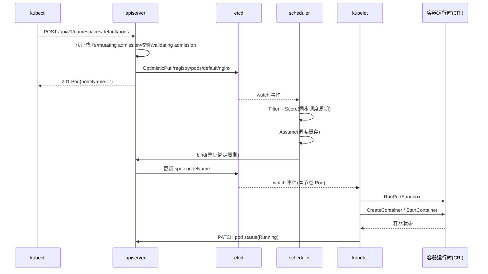

[上一篇](02-kubectl-run全路径走读.md) · [总目录](README.md) · [下一篇](04-kubectl客户端.md)

# 主链路逐步拆解
> **层级**：第三层——基于 `kubectl run nginx --image=nginx --restart=Never`，把主链路逐跳拆解，每跳说明调用双方、函数、参数传递与转换、内部动作、返回值去向、状态变化、数据流转与错误传播。

## 0. 全链路时序

## 1. 第一段：kubectl 构造请求
| 要素 | 内容 |
|---|---|
| 调用方 | cobra 命令回调：`[staging] kubectl/pkg/cmd/run/run.go#(*RunOptions).Run`（+0） |
| 被调用 | `(*RunOptions).createPod`（run.go，+0）→ `(*RunOptions).createGeneratedObject`（+0） |
| 参数传递 | 命令行参数 `args[0]=nginx`、flag `--image=nginx`、`--restart=Never` 保存在 `RunOptions` |
| 参数转换 | `Run` 内默认补 label（`run: nginx`，+5 ～ +9）；`createPod` 把 flags 翻译为 `*corev1.Pod`：单容器、`restartPolicy: Never`；`createGeneratedObject` 通过 `f.ToRESTMapper()`（+1）把 Pod 的 GVK（核心组 v1）映射为资源 `pods` |
| 内部动作 | `f.ClientForMapping(mapping)`（+31）构造 REST client；`resource.NewHelper(...).Create(namespace, false, obj)`（+34 ～ +38）序列化对象并 POST |
| 返回值 | apiserver 响应解码回 `runtime.Object`（存回的 Pod），包成 `RunObject` |
| 状态变化 | 无本地状态；kubectl 默认不等待调度完成即打印 `pod/nginx created` |
| 数据流 | flags → Pod struct → JSON → HTTP body |
| 错误传播 | mapper/client/HTTP 错误逐层 `return err` 回到命令层打印 |

## 2. 第二段：apiserver 接收并持久化

### 2.1 中间件链
| 要素 | 内容 |
|---|---|
| 入口 | `[staging] apiserver/pkg/server/config.go#DefaultBuildHandlerChain` |
| 顺序 | CORS/Timeout/Deadline（外层）→ `WithAuthentication` → `WithAudit` → impersonation → 流控（P&F 或 MaxInFlight）→ `WithAuthorization`（内层，靠近业务 handler） |
| 参数转换 | 认证结果（`user.Info`）写入 request context；鉴权从 context 取 user 与请求属性做决策 |
| 错误传播 | 认证失败直接写 401；鉴权失败写 403；请求在中间件层被短路，不进入路由 |
| 分流 | 通过 `[staging] server/handler.go` 的 director 在 go-restful container 与 NonGoRestfulMux 间选择 |

### 2.2 资源 handler
| 要素 | 内容 |
|---|---|
| 调用方 | go-restful 路由：`[staging] endpoints/installer.go#(*APIInstaller).registerResourceHandlers` 把 POST `pods` 绑定到 `restfulCreateResource` |
| 被调用 | `[staging] endpoints/handlers/create.go#CreateResource`（+0）→ `createHandler` 返回的闭包（+0） |
| 参数传递 | `*http.Request`；从 URL 取 namespace（`default`），name 为空（服务端生成/取对象内 name） |
| 内部步骤（带偏移） | 设置 34s 超时（+26 ～ +27）→ 协商输入/输出序列化（+29、+36）→ 限量读 body（+40）→ decode 为 Pod（+74，经 `DecoderToVersion` 转到内部版本处理）→ 校验 GV 匹配（+89 ～ +93）→ 取对象 name（+97）→ 擦除系统只读字段（+114 ～ +118）→ 保证 namespace 一致（+121 ～ +124） |
| admission | 构造 `admission.Attributes`（+127）；`FinishRequest` 内先更新 managed fields（+146 ～ +147），再执行 mutating：`mutatingAdmission.Admit`（+148 ～ +151） |
| 被调存储 | 闭包 `requestFunc`（+129 ～ +135）调 `r.Create(ctx, name, obj, AdmissionToValidateObjectFunc(...), options)`，实际接收者是 Pod `storage.REST`（内嵌 `Store`） |
| 返回值 | 存储层返回存回的对象；`transformResponseObject` 以 201 写出（+183 ～ +219） |
| 错误传播 | decode/序列化错误转 400；admission 拒绝原样向上；对象过大时删 managedFields 重试一次（+156 ～ +162） |

### 2.3 泛型 Store 与 etcd
| 要素 | 内容 |
|---|---|
| 调用方 | createHandler 的 `requestFunc` |
| 被调用 | `[staging] generic/registry/store.go#(*Store).Create`（+0）→ `(*Store).create`（+0） |
| 参数转换 | 传入的 validating 回调类型为 `rest.ValidateObjectFunc`；`create` 内先 `FillObjectMetaSystemFields`（+4 ～ +7，填 UID/CreationTimestamp/ResourceVersion 语义字段） |
| 默认化 | `rest.BeforeCreate(e.CreateStrategy, ...)`（+23，podStrategy：默认值填充与名称生成） |
| 校验 | validating admission 回调执行（+28 ～ +31，deep copy 后传入）；声明式校验在 strategy 链路中 |
| 取 key | `ObjectNameFunc` 得 name（+35）→ `KeyFunc` 生成存储 key（+38）：`/registry/pods/default/nginx` |
| 持久化 | `e.Storage.Create(ctx, key, obj, out, ttl, dryRun)`（+46）→ `[staging] storage/etcd3/store.go#(*store).Create`：编码 → `PrepareObjectForStorage`（加密变换）→ lease → `OptimisticPut`（`expectedRev=0`，即 key 不存在才成功） |
| 返回值 | etcd 成功后 decode 到 `out` 返回；`AfterCreate`/`Decorator` 做后置加工（+74 ～ +79） |
| 状态变化 | etcd 新增 key；watch 机制随后向订阅者广播 |
| 错误传播 | key 已存在：解释为 AlreadyExists，再 Get 一次现存对象返回冲突（+47 ～ +66）；其余存储错误直接上抛 |

## 3. 第三段：scheduler 调度与绑定
| 要素 | 内容 |
|---|---|
| 触发 | scheduler 的 Pod informer watch 到 `spec.nodeName=""` 的新 Pod，经事件处理入 `PriorityQueue`（`pkg/scheduler/backend/queue`） |
| worker | `pkg/scheduler/scheduler.go#(*Scheduler).Run` 中 `ScheduleOne` 循环；`schedule_one.go#ScheduleOne`（+0）从队列 `NextEntity` 取 Pod（+2 ～ +4），分派给 `scheduleOnePod`（+25，+0） |
| 同步：快照 | `schedulingCycle`（+67）开头 `Cache.UpdateSnapshot`（+8）取节点最新快照 |
| 同步：过滤 | `schedulingAlgorithm`（+183）内节点过滤绑定 `pkg/scheduler/algorithm.go:457` 的 `RunFilterPluginsWithNominatedPods`：逐节点跑 Filter 插件（资源、端口、卷、亲和、污点等），聚合可行节点 |
| 同步：打分 | `schedule_one.go:594` `RunScorePlugins` 对可行节点打分，选 SuggestedHost |
| Assume | `prepareForBindingCycle`（+125）→ `algorithm.AssumeAndReserveInCache`（+12）：修改 Pod 的 nodeName 并放入调度缓存，即"假定已分配"，随后跑 Permit 插件（+22） |
| 异步绑定 | `go sched.runBindingCycle(...)`（+73）；`bindingCycle`（+178）最终 `RunBindPlugins`（schedule_one.go:691，默认 bind 插件向 apiserver 提交 Binding） |
| 状态变化 | 调度缓存先变（assume），apiserver/etcd 后变（bind 成功）；两处的短暂不一致靠 assume 语义容忍 |
| 数据流 | Pod + 节点快照 → ScheduleResult{SuggestedHost} → assumed Pod → Binding 请求 |
| 错误传播 | 调度周期失败走 `FailureHandler`（+64，回队列/标记 nominated node）；绑定失败 `handleBindingCycleError` 并撤销 assume（+109 ～ +111 的 Unreserve 路径） |

## 4. 第四段：kubelet 执行

### 4.1 配置接入与事件分派
| 要素 | 内容 |
|---|---|
| 数据来源 | `pkg/kubelet/config/apiserver.go#NewSourceApiserver` 的 ListWatch（字段选择器 `spec.nodeName=<本节点>`）→ `PodConfig`（`pkg/kubelet/config/config.go`）合并后向更新通道发 `PodUpdate{Op: ADD}` |
| 调用方 | `pkg/kubelet/kubelet.go#(*Kubelet).syncLoop` 循环调用 `syncLoopIteration`（kubelet.go:2759，+0） |
| 内部分派 | select 命中 configCh（+4），`Op==ADD` 分支（+13）调 `handler.HandlePodAdditions`（+18） |
| 其他事件源 | 同函数还 select：plegCh（+40，容器事件触发 sync/清理）、syncCh（定时）、liveness/readiness/startup 探针（+64 ～ +80）、containerManager 设备更新（+84） |

### 4.2 准入与下发 PodWorker
| 要素 | 内容 |
|---|---|
| 调用方 | syncLoopIteration |
| 被调用 | `(*Kubelet).HandlePodAdditions`（kubelet.go:2896，+0） |
| 内部步骤 | 按创建时间排序（+3）→ 每个 Pod 先 `podManager.AddPod`（+10，登记期望状态）→ 非终止 Pod 走本地准入 `allocationManager.AddPod`（+37）：检查 CPU/内存/设备是否够；拒绝则 `rejectPod` 并跳过（+38 ～ +42） |
| 下发 | 准入通过后 `podWorkers.UpdatePod(UpdatePodOptions{UpdateType: SyncPodCreate})`（+60 ～ +65） |
| 状态变化 | podManager（期望集合）与 allocationManager（资源分配记录）更新 |
| 错误传播 | 准入失败不返回 error，直接把 Pod 标记为拒绝并写事件；其余 panic 风险由 PodWorker 层恢复 |

### 4.3 PodWorker 与 SyncPod
| 要素 | 内容 |
|---|---|
| 调用方 | HandlePodAdditions → `pkg/kubelet/pod_workers.go#(*podWorkers).UpdatePod` |
| 串行化 | 每个 Pod 首见时启动一个 `podWorkerLoop` goroutine，更新信号经 per-pod channel 投递；同一 Pod 的 sync/kill 严格串行 |
| 被调用 | `podWorkerLoop` 从 podCache 取运行时现状后调 `podSyncer.SyncPod`，实现者即 Kubelet |
| SyncPod | `kubelet.go:2068#(*Kubelet).SyncPod`（+0）：生成 API 状态（+54，`generateAPIPodStatus`）→ 终态直接返回（+67 ～ +71）→ `volumeManager.WaitForAttachAndMount` 等待卷就绪 → 第 2282 行 `kl.containerRuntime.SyncPod(...)` |
| 参数转换 | Pod 的期望状态 + podCache 的运行时现状 + pull secrets 一同传入运行时层 |
| 错误传播 | SyncPod 返回 `(isTerminal, postSync, err)`；err 回到 podWorkerLoop，按失败指数退避重试该 Pod |

### 4.4 CRI 执行
| 要素 | 内容 |
|---|---|
| 调用方 | Kubelet.SyncPod |
| 被调用 | `pkg/kubelet/kuberuntime/kuberuntime_manager.go#(*kubeGenericRuntimeManager).SyncPod` → `computePodActions` 求差集（新 Pod：1 个 sandbox + N 个容器）→ `kuberuntime_sandbox.go#createPodSandbox`（`RunPodSandbox`）→ 对每个容器 `kuberuntime_container.go#startContainer`（拉镜像 → `CreateContainer` → `StartContainer`） |
| gRPC | `[staging] cri-client/pkg/remote_runtime.go` 的 `remoteRuntimeService` 经 cri-api grpc stub 发往 containerd |
| 状态变化 | 容器运行时内：sandbox ready → container created → running |
| 数据流 | Pod spec → CRI 配置（sandbox config / container config，含镜像、命令、挂载、label）→ 运行时响应（容器 ID） |
| 错误传播 | 任一 CRI 调用失败上抛为 SyncPod 错误，触发重试；镜像拉取失败进入 CrashLoop 风格的退避（细节第四层 10 篇） |

## 5. 第五段：状态回报
| 要素 | 内容 |
|---|---|
| 感知 | `pkg/kubelet/pleg/generic.go#GenericPLEG.Relist` 周期列出全部容器，与上次状态对比，发现 sandbox/容器 running |
| 上报 | `pkg/kubelet/status/status_manager.go#manager` 后台循环 `syncPod`：合并 PodStatus（phase、IP、容器状态、条件）→ `pkg/util/pod/pod.go#PatchPodStatus` 发 PATCH |
| 状态变化 | apiserver/etcd 中 Pod status 更新为 `Running`；watch 广播给所有订阅者（含等待中的 kubectl `-w`） |
| 数据流 | 运行时列表 → PLEG 事件/状态缓存 → statusManager 待上报队列 → PATCH body → etcd |
| 错误传播 | PATCH 冲突（status 已被其他写动过）时重读重试；上报失败保留在队列下个周期重试 |

## 6. 本层边界
以上每一步都沿主成功路径。第四层开始对这些函数逐个展开：签名、全部参数与返回值、完整调用关系、关键分支与循环、并发模型，以及本层省略的错误恢复细节。

[上一篇](02-kubectl-run全路径走读.md) · [总目录](README.md) · [下一篇](04-kubectl客户端.md)
