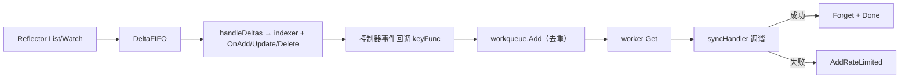

[上一篇](10-kubelet-CRI运行时.md) · [总目录](README.md)

# informer 与 workqueue
> **层级**：第四层——函数级源码解析。
> **范围**：client-go SharedInformer 的 List/Watch → DeltaFIFO → indexer/事件分发链路，以及泛型 workqueue 的去重与处理语义。该机制是调度器、控制器、kubelet 配置源的共同基础。

## 1. 模块级
| 项 | 内容 |
|---|---|
| 模块 | `[staging] k8s.io/client-go/tools/cache`（shared_informer、controller、reflector、delta_fifo、indexer） |
| 队列 | `[staging] k8s.io/client-go/util/workqueue`（queue、delaying、rate_limiting） |
| 对外接口 | `SharedInformer`/`SharedIndexInformer`（AddEventHandler、Run、HasSynced、GetIndexer）、workqueue 的 `TypedInterface` |
| 数据流（informer） | Reflector List/Watch → DeltaFIFO → processLoop Pop → handleDeltas → indexer 更新 + OnAdd/Update/Delete → processor 分发监听者 |
| 数据流（控制器侧） | informer 事件回调 → keyFunc → workqueue.Add → worker Get → syncHandler → Done/Forget/AddRateLimited |

## 2. 类型级
| 类型 | 文件 | 职责 |
|---|---|---|
| `sharedIndexInformer` | `cache/shared_informer.go:710` | 组合 Reflector 控制器、indexer、processor、mutation detector |
| `controller` | `cache/controller.go:117` | Reflector + processLoop 的驱动器 |
| `Reflector` | `cache/reflector.go` | 执行 ListAndWatch，把对象写入 DeltaFIFO |
| `DeltaFIFO` | `cache/delta_fifo.go` | 按对象 key 聚合 Delta（Added/Updated/Deleted/Sync）的 FIFO |
| `sharedProcessor | `cache/shared_informer.go` | 管理监听者并分发 notification（含 resync 专用通道） |
| `Typed[T]` | `workqueue/queue.go:190` | 泛型队列：`queue`（待处理集合）、`dirty`（已 Add 未处理）、`processing`（处理中） |
| `TypedRateLimitingInterface[T]` | `workqueue/rate_limiting_queue.go` | Typed + Delaying + rate limiter 的组合接口 |

## 3. Informer 函数级

### 函数：(*sharedIndexInformer).Run / RunWithContext
**源码：** `cache/shared_informer.go:837 / :841`
**职责：** 启动 informer 全套管线；重复 Run 直接告警返回（+4 ～ +8）。
**执行流程：**
```text
RunWithContext (+0)
├── 1. startedLock 内构造 DeltaFIFO（newQueueFIFO）与 Config (+9 ～ +30)
│      Process → handleDeltas；ProcessBatch → handleBatchDeltas
│      New(cfg) 建 controller，置 started=true
├── 2. 独立 processorStopCtx（保证 processor 严格在 controller 之后停）(+39)
├── 3. wg 启动：cacheMutationDetector、processor.run (+47 ～ +48)
├── 4. synced 检查 goroutine：controller.HasSynced → close(s.synced) (+49 ～ +58)
└── 5. controller.RunWithContext(ctx) 阻塞 (+67)
```
**停止顺序（注释 :878 ～ +884）：** controller 先停，processor 后停，避免监听器收到半截事件。

### 函数：(*controller).RunWithContext
**源码：** `cache/controller.go:172`
**执行流程：**
1. ctx 取消时自动 `Queue.Close()`（+2 ～ +6）
2. 构造 Reflector（:179）：绑定 ListerWatcher、Queue、resync 周期、错误处理器（+7 ～ +27）
3. `wg.StartWithContext(ctx, r.RunWithContext)` 启动 ListAndWatch（:208）
4. `wait.UntilWithContext(ctx, c.processLoop, time.Second)` 消费队列（:209）
5. wg.Wait 收尾（:210）
**关键关系：** Reflector 是唯一生产者（写 FIFO），processLoop 是唯一消费者。

### 函数：(*controller).processLoop
**源码：** `cache/controller.go:238`
**职责：** 循环 Pop FIFO 并交给 config.Process；（feature gate）支持 batch 处理（+2 ～ +13）。
**并发约束（注释 :235 ～ +237）：** 当前串行处理，并行化需防止同一对象并发处理。

### 函数：(*DeltaFIFO).Pop
**源码：** `cache/delta_fifo.go:562`
**职责：** 阻塞取一个 key 的全部 Deltas，传给 process；process 成功（含 ErrRequeue 语义）才从队列移除，失败保留重试。

### 函数：(*sharedIndexInformer).handleDeltas
**源码：** `cache/shared_informer.go:1066`
**职责：** 加 blockDeltas 锁，调包级 `processDeltas`（controller.go:823）：按 Delta 类型更新 indexer 并触发 OnAdd/OnUpdate/OnDelete。
**锁语义（注释 :1084 ～ +1085）：** distribute 在 blockDeltas 保护下执行，通知分发与状态更新原子交错。

### 函数：OnAdd / OnUpdate / OnDelete
**源码：** `cache/shared_informer.go:1083 / :1091 / :1113`
**职责：** mutation detector 记录后经 processor.distribute 分发：
- addNotification / deleteNotification 对全部监听者广播
- updateNotification 计算 isSync（RV 未变化即 resync，:1095 ～ +1104），只投递给接受 resync 的监听者
**分发方式：** 非阻塞投递到各 listener channel，慢监听者被丢弃事件并被关闭（processor 内实现）。

## 4. Workqueue 函数级

### 函数：NewTyped / NewTypedWithConfig
**源码：** `workqueue/queue.go:111 / :127`
**职责：** 初始化三集合（queue/dirty/processing）、metrics 与 cond。

### 函数：(*Typed[T]).Add
**源码：** `workqueue/queue.go:227`
**职责：** 去并入队。
**执行流程：**
1. 加锁；shuttingDown 时忽略（+2 ～ +5）
2. item 已在 dirty：处理中则直接返回；未处理则 `queue.Touch`（+8 ～ +16）
3. 新 item：metrics → dirty.Insert（+22 ～ +24）
4. 若已在 processing（处理期间再次被标记变化）：只留 dirty 不 Push（+25 ～ +27）
5. 否则 queue.Push + cond.Signal（+29 ～ +30）
**去重语义：** 处理前任意次 Add 合并为一次；处理中的 Add 保证处理完后再入队一次。

### 函数：(*Typed[T]).Get
**源码：** `workqueue/queue.go:265`
**职责：** 阻塞取出一个待处理项。
**内部动作：** queue 空且未关闭时 cond.Wait（+4 ～ +5）；Pop 后插入 processing、从 dirty 删除（+13 ～ +16）。
**shutdown 语义：** 队列排空后返回 shutdown=true，worker 据此退出。

### 函数：(*Typed[T]).Done
**源码：** `workqueue/queue.go:289`
**职责：** 标记处理完成。
**关键分支：** item 处理期间再次变脏（dirty 命中）→ 重新 Push 并 Signal（+9 ～ +12）；否则 processing 清空时 Signal 供关闭等待（+13 ～ +15）。

### 函数：AddAfter / Delaying queue
**源码：** `workqueue/delaying_queue.go`
**职责：** item 与 readyAt 放入堆，后台 goroutine 到点转入主队列；控制器用它做延迟重试与周期性兜底。

### 函数：AddRateLimited / Forget（rate_limiting_queue.go）
**职责：** AddRateLimited 按 rate limiter（默认指数+上限）计算延迟并 AddAfter；成功处理后 Forget 清除该 item 的失败记录。ReplicaSet 等控制器的失败重试即此路径。

## 5. 两条机制如何拼合


## 6. 关键保证汇总
| 机制 | 保证 |
|---|---|
| DeltaFIFO | 事件按 key 保序；处理失败不丢 Delta |
| indexer | 进程内只读缓存，lister 查询不打 apiserver |
| HasSynced | 首次全量 List 完成后才启动 worker，避免误删/误判 |
| dirty/processing 双集合 | 去重且不丢失"处理期间发生的变化" |
| rate limiting | 失败指数退避，成功后 Forget 重置 |
| resync（isSync） | 周期把缓存对象重投给需要的监听者，驱动纯声明式兜底调谐 |

[上一篇](10-kubelet-CRI运行时.md) · [总目录](README.md)
