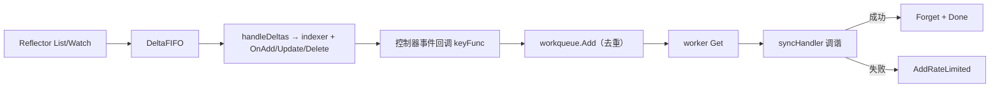

[上一篇](10-kubelet-CRI运行时.md) · [总目录](README.md)

# informer 与 workqueue

> **层级**：第四层——函数级源码解析。
> **范围**：client-go SharedInformer 的 List/Watch → DeltaFIFO → indexer/事件分发链路，以及泛型 workqueue 的去重与处理语义。该机制是调度器、控制器、kubelet 配置源的共同基础。
> **代码基准**：master@`8893923938107170c86eb4b8cc2b7225b4e44e9b`（2026-11-18，工作区源码干净），Go 1.27.4。
> **记法**：`符号+偏移`（函数定义行 = +0）；类型与顶层函数给 `文件:行`。

## 0. 生产视角（对外行为）

### 0.1 informer 作为生产组件
| 行为 | 说明 |
|---|---|
| 启动 | `Run(stopCh)` 仅转调 `RunWithContext(wait.ContextForChannel(stopCh))`（`s.Run+1`，定义 `s.Run+0`）；重复启动被拒绝并告警（`s.RunWithContext+4~+8`） |
| 同步完成信号 | `HasSynced()` 在首次全量 List 完成后才返回 true；`HasSyncedChecker().Done()` 是无需轮询的等待入口 |
| 缓存读 | `GetIndexer()` 返回进程内只读 indexer；lister 查询不打 apiserver |
| 事件注册 | `AddEventHandler` 返回 `ResourceEventHandlerRegistration`，`RemoveEventHandler`/`ShutDownEventHandler` 可注销并阻塞至事件处理完 |
| 停止顺序 | controller 先停，processor 后停（RunWithContext 注释 :934-936），避免监听器收到半截事件 |

### 0.2 workqueue 作为生产组件
| 行为 | 说明 |
|---|---|
| 入队 | `Add(item)` 幂等去重；处理中再次 Add 保证处理完后重入队一次 |
| 取走 | `Get()` 阻塞直到有可处理项；shutdown 排空后返回 `shutdown=true`，worker 据此退出 |
| 完成 | `Done(item)` 标记处理完；处理期间变脏的 item 自动重入队 |
| 延迟 | `AddAfter(item, d)` 延迟入队；`AddRateLimited` 按 rate limiter（默认指数+上限）计算延迟 |
| 退避重置 | `Forget(item)` 清除该 item 的失败记录，成功后调用 |
| 关闭 | `ShutDown()`/`ShutDownWithDrain()`；`ShuttingDown()` 查询 |

## 1. 模块级
| 项 | 内容 |
|---|---|
| 模块 | `[staging] k8s.io/client-go/tools/cache`（shared_informer、controller、reflector、delta_fifo、indexer） |
| 队列 | `[staging] k8s.io/client-go/util/workqueue`（queue、delaying、rate_limiting） |
| 对外接口 | `SharedInformer`/`SharedIndexInformer`（AddEventHandler、Run、HasSynced、GetIndexer）、workqueue 的 `TypedInterface[T]`（queue.go:30） |
| 数据流（informer） | Reflector List/Watch → DeltaFIFO → processLoop Pop → handleDeltas → indexer 更新 + OnAdd/Update/Delete → processor 分发监听者 |
| 数据流（控制器侧） | informer 事件回调 → keyFunc → workqueue.Add → worker Get → syncHandler → Done/Forget/AddRateLimited |

## 2. 类型级
| 类型 | 文件 | 职责 |
|---|---|---|
| `sharedIndexInformer` | `cache/shared_informer.go:753` | 组合 Reflector 控制器、indexer、processor、mutation detector |
| `controller` | `cache/controller.go:117` | Reflector + processLoop 的驱动器 |
| `Reflector` | `cache/reflector.go:106` | 执行 ListAndWatch，把对象写入 DeltaFIFO |
| `DeltaFIFO` | `cache/delta_fifo.go:108` | 按对象 key 聚合 Delta（Added/Updated/Deleted/Sync）的 FIFO |
| `sharedProcessor` | `cache/shared_informer.go:1221` | 管理监听者并分发 notification（含 resync 专用通道） |
| `Typed[T]` | `workqueue/queue.go:208` | 泛型队列：`queue`（待处理集合）、`dirty`（已 Add 未处理）、`processing`（处理中）；**workqueue 下无 typed.go，泛型定义与 `Type = Typed[any]`（:206）、`TypedInterface[T]`（:30）均在 queue.go** |
| `TypedRateLimitingInterface[T]` | `workqueue/rate_limiting_queue.go:30` | Typed + Delaying + rate limiter 的组合接口 |

## 3. Informer 函数级

### 函数：(*sharedIndexInformer).Run / RunWithContext
**源码：** `cache/shared_informer.go:893 / :897`
**职责：** 启动 informer 全套管线；`Run` 仅分派到 `RunWithContext(wait.ContextForChannel(stopCh))`（:894-895）。重复 Run 直接告警返回（+4 ～ +8）。
**执行流程：**
```text
RunWithContext (+0)
├── 1. startedLock 内构造 DeltaFIFO（newQueueFIFO，+13，:910）与 Config (+15 ～ +30)
│      Process → handleDeltas；ProcessBatch → handleBatchDeltas
│      New(cfg) 建 controller，置 started=true
├── 2. 独立 processorStopCtx（保证 processor 严格在 controller 之后停）(+40，:937)
│      context.WithCancelCause(context.WithoutCancel(ctx)) 构造：父上下文取消被忽略，
│      值（含 logger）透传，processor 只随自身 stop 原因退出
├── 3. wg 启动：cacheMutationDetector、processor.run (+46 ～ +47，:943-944)
├── 4. synced 检查 goroutine：controller.HasSyncedChecker().Done() → close(s.synced) (+52 ～ +54，:949-951)
└── 5. controller.RunWithContext(ctx) 阻塞 (+63，:960)
```
**停止顺序（注释 :934-936）：** controller 先停，processor 后停，避免监听器收到半截事件。

### 函数：(*controller).RunWithContext
**源码：** `cache/controller.go:172`
**执行流程：**
1. ctx 取消时自动 `Queue.Close()`（+4，:176）
2. 构造 Reflector（+7 ～ +18，:179-190）：绑定 ListerWatcher、Queue、resync 周期、错误处理器（`r.ShouldResync`/`WatchListPageSize`/watchErrorHandler 在 +19～+28 装配）
3. `wg.StartWithContext(ctx, r.RunWithContext)` 启动 ListAndWatch（:207）
4. `wait.UntilWithContext(ctx, c.processLoop, time.Second)` 消费队列（:209）
5. wg.Wait 收尾（:210）
**关键关系：** Reflector 是唯一生产者（写 FIFO），processLoop 是唯一消费者。

### 函数：(*controller).processLoop
**源码：** `cache/controller.go:238`
**职责：** 循环 Pop FIFO 并交给 config.Process；支持 batch 处理（+1 ～ +5，:239-243）。
```text
processLoop (+0)
├── 1. 声明 useBatchProcess=false（+1，:239）
├── 2. 类型断言 c.config.Queue.(QueueWithBatch)（+2，:240）
├── 3. 条件：断言成功 && ProcessBatch != nil && FeatureGate InOrderInformersBatchProcess 开启（+3～+5，:241-243）
│      → useBatchProcess = true
└── 4. 循环：useBatchProcess ? batchQueue.PopBatch(ProcessBatch, PopProcessFunc(Process))
              : c.config.Pop(PopProcessFunc(Process))
       ErrFIFOClosed → return
```
**并发约束（注释 :235-237）：** 当前串行处理，并行化需防止同一对象并发处理。

### 函数：(*DeltaFIFO).Pop
**源码：** `cache/delta_fifo.go:563`
**职责：** 阻塞取一个 key 的全部 Deltas，传给 process；process 成功（含 ErrRequeue 语义）才从队列移除，失败保留重试。
**实现要点：** 队列空时 `cond.Wait`（:575）；`closed` 时返回 `ErrFIFOClosed`（:572）；首次同步前取项标记 `isInInitialList`（:577）。

#### DeltaFIFO 聚合与弹出语义深度拆解

DeltaFIFO 与普通 FIFO 的本质区别：**队列元素不是对象，而是「按 key 聚合的 Delta 列表（`Deltas []Delta`）」**。核心数据结构（`delta_fifo.go`）：`items map[string]Deltas`（+120 ～ +122，每个 key 至少一个 Delta）+ `queue []string`（key 的弹出顺序）。

**写入路径（`queueActionLocked` 偏移：+483 / `queueActionInternalLocked` 紧随）：**
1. `KeyOf(obj)` 算 key（Delta 对象本身也能识别，`KeyOf` :327）。
2. 可选 transformer：tombstone（`DeletedFinalStateUnknown`）与 Sync 动作**跳过** transform（已 transform 过），其余对象过一次 transform（+10 ～ +20 注释强调幂等性要求）。
3. `newDeltas := append(oldDeltas, Delta{actionType, obj})` → **`dedupDeltas`** 去重。
4. 若 key 不在 `items` 则追加进 `queue`（保证只入队一次）；写回 `items[id]`；`cond.Broadcast()` 唤醒 Pop。
5. 三个入口共享此路径：`Add`（:387，Added）、`Update`（:396，Updated）、`Delete`（:409，Deleted）—— 后两者仅 DeltaType 不同。

**去重语义（`dedupDeltas` 偏移：+444 / `isDup` 紧随）：** 只比较**最后两个** Delta（新事件只会追加到尾部）；若相邻两个是「同一事件」则合并保留一个（典型：重复的 Deleted）。这就是「re-list 与 watch 可能以任意顺序重复投递同一更新」的收敛机制——注释（:435 ～ +441）明确此场景。

**删除去重（`Delete` 偏移：+409）：** Delete 有额外短路——若 `knownObjects == nil` 且 key 不在 `items`（+18 ～ +24，多半已被 relist 删除）直接返回不重复报告；若 `knownObjects != nil`，仅当 key 既不在 `knownObjects` 也不在 `items` 才跳过（+25 ～ +37，注释指出 items 里已有的 Deleted 会在 queueActionLocked 自动去重）。

**弹出路径（`Pop` 偏移：+0，定义行 :563）：**
1. 加锁后 `for` 循环：`queue` 空时若 `closed` 返回 `ErrFIFOClosed`（:572），否则 `cond.Wait()` 阻塞（:575）。
2. `isInInitialList := !f.hasSynced_locked()`（:577）：首次同步完成前取出的项标记为初始列表，供下游区分「初始全量」与「增量事件」。
3. 取队首 key → `queue = queue[1:]` → 记录 `depth`。
4. **`initialPopulationCount--` + `checkSynced_locked()`**（:584 ～ +586）：初始列表每弹出一个 key 计数递减，减到 0 即触发 `HasSynced`。
5. `items[id]` 取出该 key 的全部 Deltas 并 `delete(f.items, id)`（:591 ～ +593）；若 items 中无此 key（不应发生）则记错误并 continue。
6. **深度追踪**（:600 ～ +611）：`depth > 10` 时建 trace，`LogIfLong(100ms)`——注释（:596 ～ +599）解释队列深度天然有限，因为处理时持锁、处理完才能入新项（issue #103789）。
7. **`process(item, isInInitialList)`**（:613）：把整个 `Deltas` 切片交给处理函数；注释（:615 ～ +616）说明所有权转移给调用方、无需 copy。
8. **注意**：无论 process 返回什么，Pop 都已 `delete(f.items, id)` 并返回——「失败重试」不是 DeltaFIFO 自己做的，而是上层 `processLoop` 把 key 重新 Add 回队列（见 controller.processLoop）。

**Replace 的特殊语义（`Replace` 偏移：+625）：** 原子做两件事——① 用 Sync/Replace DeltaType 加入给定对象列表；② 对每个「曾在 items/knownObjects 但不在新 list 里」的 key K，产生 `Delete(DeletedFinalStateUnknown{K, O})` 效果。这是 relist 后「删除已消失对象」的机制。

**设计要点（源码可证）：**
1. **按 key 聚合而非按事件排队**：同一 key 的多次变更在弹出前合并为一个 `Deltas` 列表，消费者一次拿到该 key 的完整变更序列，天然保序且不会因事件风暴放大处理次数。
2. **只去重相邻同事件**：`dedupDeltas` 只看尾部两个 Delta（+448 ～ +450），O(1) 且足够——重复投递总是相邻到达。
3. **HasSynced 由弹出驱动**：初始列表的同步完成不是靠定时器，而是靠 Pop 逐个消耗 `initialPopulationCount`（:584 ～ +586）。
4. **所有权转移**：Pop 弹出的 `Deltas` 直接交给 process（:615 ～ +616 无 copy），避免大对象深拷贝。

### 函数：(*sharedIndexInformer).handleDeltas / handleBatchDeltas
**源码：** `cache/shared_informer.go:1124 / :1134`
**职责：** 加 blockDeltas 锁（+1～+3，:1125-1126），调包级 `processDeltas`（controller.go:827）；batch 版本调 `processDeltasInBatch`（controller.go:903）。
**锁语义：** distribute 在 blockDeltas 保护下执行，通知分发与状态更新原子交错。

### 函数：OnAdd / OnUpdate / OnDelete
**源码：** `cache/shared_informer.go:1141 / :1149 / :1171`
**职责：** mutation detector 记录后经 processor.distribute 分发：
- OnAdd（:1141）：`cacheMutationDetector.AddObject(obj)` → `distribute(addNotification{newObj: obj, isInInitialList: isInInitialList}, false)`（+3～+5，:1144-1145），对全部监听者广播
- OnUpdate（:1149）：计算 `isSync`（RV 未变化即 resync，+7～+13，:1156-1161），`distribute(updateNotification{oldObj: old, newObj: new}, isSync)`，只投递给接受 resync 的监听者
- OnDelete（:1171）：`distribute(deleteNotification{oldObj: old}, false)`（+3，:1174），对全部监听者广播
**分发方式：** 非阻塞投递到各 listener channel，慢监听者被丢弃事件并被关闭（processor 内实现）。

#### 一个 Pod CREATE 事件穿过 informer 管线（第二层补充视角）

本节走一个具体的 **Pod 创建**事件，看它如何从 etcd watch 一路穿过 informer 管线到达控制器的 handler。这是「informer 如何把 etcd 变更变成控制器事件」的完整链路。

**前提：** 一个 informer watch Pods，Reflector 已 ListAndWatch，DeltaFIFO 已就绪。此时 etcd 中新建了一个 Pod `nginx`。

**事件穿过管线的完整链路：**

| 序 | 环节 | 符号 | 做什么 |
|---|---|---|---|
| 1 | etcd watch 回调 | etcd → `wres.Events` | etcd 推送一个 `EventTypePut` 事件（key=`/registry/pods/default/nginx`） |
| 2 | parseEvent | `event.go:66` | 转成内部 `event{key, value, rev, isCreated=true}` |
| 3 | DeltaFIFO.Add | `delta_fifo.go:387` → `queueActionLocked(Added, obj)` | 追加 `Delta{Added, obj}` 到 `items[key]`，key 入 `queue` |
| 4 | DeltaFIFO.Pop | `delta_fifo.go:563` | 弹出 `Deltas`（含一个 Added Delta） |
| 5 | handleDeltas | `shared_informer.go:1124` | 调 `processDeltas`（controller.go:827） |
| 6 | processDeltas | `controller.go:827` | `Sync/Replaced/Added/Updated` 分支：`clientState.Get` 查旧对象 → 不存在 → `clientState.Add` + `handler.OnAdd(obj, isInInitialList)` |
| 7 | OnAdd | `shared_informer.go:1141` | mutation detector 记录 → `distribute(addNotification, false)` |
| 8 | distribute | `shared_informer.go`（distribute） | 投递给**所有** listener（非 sync 事件） |
| 9 | processorListener.add | `shared_informer.go:1495` | 写 `addCh`（阻塞，慢监听者背压） |
| 10 | processorListener.run | `shared_informer.go:1610` 附近 | `handler.OnAdd(newObj, isInInitialList)` |
| 11 | 控制器 handler | 控制器的 OnAdd | keyFunc 算 key → workqueue.Add → worker 调谐 |

**processDeltas 的关键分支（controller.go:827）：**
```text
processDeltas (从 oldest 到 newest 遍历 Deltas)
├── ReplacedAll → processReplacedAllInfo（替换全部）
├── SyncAll → 对 clientState.List() 的每个 obj 调 handler.OnUpdate(obj, obj)（resync）
├── Sync/Replaced/Added/Updated
│    ├── clientState.Get(obj) 存在 → clientState.Update + handler.OnUpdate(old, obj)
│    └── 不存在 → clientState.Add + handler.OnAdd(obj, isInInitialList)
├── Deleted → clientState.Delete + handler.OnDelete(obj)
└── Bookmark → （仅推进 revision，不触发 handler）
```

**Added vs Updated 的判定（processDeltas Sync/Replaced/Added/Updated 分支）：**
- `clientState.Get(obj)` **存在** → 说明对象已在缓存（之前 Add 过）→ `clientState.Update` + `handler.OnUpdate(old, obj)`。
- **不存在** → `clientState.Add` + `handler.OnAdd(obj, isInInitialList)`。
- 即：**同一 Pod 第一次出现是 OnAdd，之后变更是 OnUpdate**——由 clientState 是否已有该 key 决定，而非 DeltaType 本身。

**Deleted 的处理：** `clientState.Delete(obj)` + `handler.OnDelete(obj)`——从缓存删除并通知。

**设计要点（源码可证）：**
1. **Added/Updated 由 clientState 是否已有 key 决定**：processDeltas 的 Sync/Replaced/Added/Updated 分支用 `clientState.Get` 查旧对象，存在则 Update+OnUpdate，不存在则 Add+OnAdd——同一 DeltaType 在不同缓存状态下产生不同事件。
2. **SyncAll 是 resync 的实现**：对 `clientState.List()` 的每个 obj 调 `handler.OnUpdate(obj, obj)`（old==new）——这就是 resync 的实现（见 informer resync 专题）。
3. **processDeltas 从 oldest 到 newest 遍历**：保证同一 Pod 的多个 Delta 按序处理，不乱序。
4. **Bookmark 不触发 handler**：Bookmark 事件仅推进 revision，不产生 handler 调用。

## 4. Workqueue 函数级

### 函数：NewTyped / NewTypedWithConfig
**源码：** `workqueue/queue.go:127 / :143`
**职责：** 初始化三集合（queue/dirty/processing）、metrics 与 cond；`NewTyped` 用空配置调 `NewTypedWithConfig`（:128-130），后者经 `newQueueWithConfig`（:158）落 `newQueue`（:180）。

### 函数：(*Typed[T]).Add
**源码：** `workqueue/queue.go:246`
**职责：** 去并入队。
**执行流程：**
1. 加锁；shuttingDown 时忽略（+3，:249）
2. item 已在 dirty：处理中则直接返回；未处理则 `queue.Touch`（+7～+12，:252-258）
3. 新 item：metrics.add（+15，:261）→ dirty.Insert（+17，:263）
4. 若已在 processing（处理期间再次被标记变化）：只留 dirty 不 Push（+18，:264）
5. 否则 queue.Push + cond.Signal（+22～+23，:268-269）
**去重语义：** 处理前任意次 Add 合并为一次；处理中的 Add 保证处理完后再入队一次。

### 函数：(*Typed[T]).Get
**源码：** `workqueue/queue.go:284`
**职责：** 阻塞取出一个待处理项。
**内部动作：** queue 空且未关闭时 cond.Wait（+4，:288）；Pop 后插入 processing、从 dirty 删除（+12～+16，:296-301）。
**shutdown 语义：** 队列排空后返回 shutdown=true，worker 据此退出。

### 函数：(*Typed[T]).Done
**源码：** `workqueue/queue.go:309`
**职责：** 标记处理完成。
**关键分支：** item 处理期间再次变脏（dirty 命中）→ 重新 Push 并 Signal（+6～+11，:315-320）；否则 processing 清空时 Signal 供关闭等待（+9～+11，:319-321）。

### 函数：AddAfter / Delaying queue
**源码：** `workqueue/delaying_queue.go:280`（`(*delayingType[T]).AddAfter`；`TypedDelayingInterface` :37）
**职责：** item 与 readyAt 放入堆，后台 goroutine 到点转入主队列；控制器用它做延迟重试与周期性兜底。shutting down 直接忽略（+2～+4，:282-284），duration ≤ 0 立即 `Add`（+9～+12，:289-292）。

### 函数：AddRateLimited / Forget（rate_limiting_queue.go）
**源码：** `workqueue/rate_limiting_queue.go:157 / :165`（`NewTypedRateLimitingQueue` :86）
**职责：** `AddRateLimited` 按 rate limiter（默认指数+上限）计算延迟并 `AddAfter`（+1～+2，:157-159）；成功处理后 `Forget` 清除该 item 的失败记录（+1，:165-167）。ReplicaSet 等控制器的失败重试即此路径。

## 5. 两条机制如何拼合

**拼合点：** informer 的 `processDeltas`/`processDeltasInBatch` 完成 indexer 写入与事件分发后，控制器侧事件回调以 keyFunc 生成 key 写入 workqueue；workqueue 的 dirty/processing 双集合保证「处理期间发生的变化不丢失」，worker 调谐结果经 Done/Forget/AddRateLimited 回流。

## 6. 关键保证汇总
| 机制 | 保证 |
|---|---|
| DeltaFIFO | 事件按 key 保序；处理失败不丢 Delta |
| indexer | 进程内只读缓存，lister 查询不打 apiserver |
| HasSynced | 首次全量 List 完成后才启动 worker，避免误删/误判 |
| dirty/processing 双集合 | 去重且不丢失"处理期间发生的变化" |
| rate limiting | 失败指数退避，成功后 Forget 重置 |
| resync（isSync） | 周期把缓存对象重投给需要的监听者，驱动纯声明式兜底调谐 |
| batch 处理（FeatureGate） | `InOrderInformersBatchProcess` 开启且 Queue 实现 `QueueWithBatch` 时，processLoop 走 `PopBatch`/`processDeltasInBatch`（controller.go:240-243、:903） |
| processor 停止顺序 | `context.WithoutCancel` 使 processor 只随自身 stop 原因退出，严格在 controller 之后停止（shared_informer.go:937） |

## 7. 设计意图与验证
**设计意图：**
- informer 以「单一生产者（Reflector）+ 单一消费者（processLoop）」解耦 List/Watch 与事件分发，DeltaFIFO 按 key 聚合保证每个对象的事件顺序，`HasSynced` 门控避免在初始列表未完成时启动调谐。
- workqueue 的 dirty/processing 双集合把「去重」与「不丢变更」合二为一：dirty 记录待处理，processing 记录在途；处理中再次 Add 只置 dirty，Done 时发现 dirty 再 Push——这是控制器幂等调谐语义的基石。
- rate limiter 与延迟队列把失败重试与周期性兜底统一到「时间驱动」路径，`Forget` 在成功后重置退避，使失败重试不无限积累。

**验证（本稿锚点与源码逐条核对，2026-11-18）：**
- 类型级：`sharedIndexInformer` :753、`controller` :117、`Reflector` :106、`DeltaFIFO` :108、`sharedProcessor` :1221、`Typed[T]` queue.go:208、`TypedRateLimitingInterface` rate_limiting_queue.go:30 —— 全部与定义行一致。
- 函数级：Run :893、RunWithContext :897、handleDeltas :1124、OnAdd :1141、OnUpdate :1149、OnDelete :1171、NewSharedIndexInformer :427；controller.RunWithContext :172、processLoop :238、processDeltas :827、processDeltasInBatch :903；DeltaFIFO.Pop :563；NewTyped :127、NewTypedWithConfig :143、Add :246、Get :284、Done :309；AddAfter :280、AddRateLimited :157、Forget :165。
- 关键偏移：RunWithContext 内 DeltaFIFO 构造 +13（:910）、processorStopCtx +40（:937）、cacheMutationDetector/processor.run +46～+47（:943-944）、synced +52～+54（:949-951）、controller.RunWithContext +63（:960）；controller.RunWithContext 内 Queue.Close +4（:176）、Reflector +7～+18（:179-190）、wg.StartWithContext :207、wait.UntilWithContext :209、wg.Wait :210；processLoop 内 batch +1～+5（:239-243）；Typed.Add 内 shuttingDown +3（:249）、Touch +10（:256）、dirty.Insert +17（:263）、processing +18（:264）、Push+Signal +22～+23（:268-269）；Typed.Get 内 cond.Wait +4（:288）、Pop+processing +12～+16（:296-301）；Typed.Done 内 dirty +6～+7（:315-316）、Signal +9～+11（:318-320）。
- 未确认项：`[源码未确认]`（无）。

[上一篇](10-kubelet-CRI运行时.md) · [总目录](README.md)
