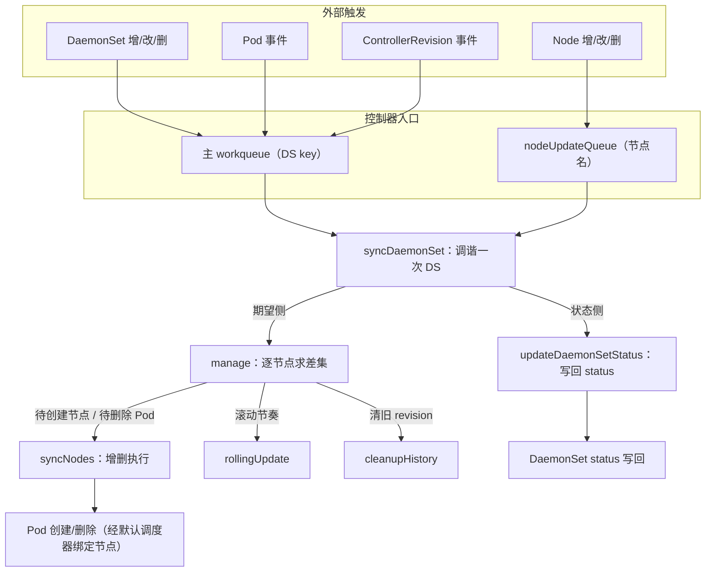

[上一篇](13-job与cronjob控制器.md) · [总目录](README.md) · [下一篇](15-garbage-collector垃圾回收.md)

# DaemonSet 控制器

> **层级**：第四层——函数级源码解析。
> **代码基准**：master@`8893923938107170c86eb4b8cc2b7225b4e44e9b`（2026-11-18，工作区干净），Go 1.27.4。
> **范围**：DaemonSet 如何把 Pod 与节点一一对应、节点准入判定、节点亲和性注入、surge 滚动更新。
> **锚点记法**：`符号+偏移`，函数定义行 = +0，偏移 = 目标行 − 函数声明行（函数行含 `func` 关键字）。

---

## 1. 生产视角：DaemonSet 对外行为与可见结果

DaemonSet 是集群级控制器，**保证每个符合条件的节点上都运行一份 Pod 副本**。它把「调度决策」从「按资源找节点」改成「按节点找 Pod」：给定一个节点，判定它该不该有这份 Pod，有则保证在跑，没有则创建。

### 1.1 用户可观察的行为

| 行为 | 说明 |
|---|---|
| 逐节点一份 | 默认每个满足准入条件的节点一份 Pod；节点新加入 → 自动补一份；节点删除 → 该节点 Pod 由 GC 清理 |
| 准入条件 | 三层：`nodeSelector`/`requiredDuringScheduling` 亲和性、taint/toleration（含 NoExecute）、模板 `nodeName` 若指定则必须等于节点名 |
| 污点容忍 | 每个 DS Pod 自动追加 `not-ready` 与 `unreachable` 的 `NoExecute` toleration（`AddOrUpdateDaemonPodTolerations`），节点故障时 Pod 不被立即驱逐 |
| 绑定方式 | 创建时把 `kubernetes.io/hostname` 写成 `RequiredDuringScheduling` 亲和性（`ReplaceDaemonSetPodNodeNameNodeAffinity`），由默认调度器把 Pod 固定到目标节点；不设自定义 schedulerName（全包 grep `SchedulerName`/`schedulerName` 零命中） |
| 更新策略 | `OnDelete`（手动删旧再建新）或 `RollingUpdate`（surge / maxUnavailable 控制节奏，见 §7） |
| 失败退避 | Failed Pod 与 kubelet 反复拉锯时按节点维度指数退避（`failedPodsBackoff`），避免热循环 |
| 状态字段 | `DesiredNumberScheduled`、`CurrentNumberScheduled`、`NumberMisscheduled`、`NumberReady`、`NumberAvailable`、`UpdatedNumberScheduled`、`NumberUnavailable` |

### 1.2 生产流程（外部事件 → 可见结果）



**关键事实**：调谐单位是「节点 × Pod」。`manage` 逐节点独立判定，产出两类清单——待创建节点、待删除 Pod，交给 `syncNodes` 批量执行；`rollingUpdate` 只负责删除旧 Pod 以触发重建，不直接创建；`cleanupHistory` 按 `revisionHistoryLimit` 清理过期 ControllerRevision。

---

## 2. 模块级

| 项 | 内容 |
|---|---|
| 目录 | `pkg/controller/daemon/` |
| 主文件 | `daemon_controller.go`（DaemonSetsController、syncDaemonSet、manage、syncNodes）、`update.go`（滚动/历史）、`util/daemonset_util.go` |
| 依赖 | DS/Node/Pod/ControllerRevision 四类 informer、queue + nodeUpdateQueue、expectations、failedPodsBackoff、consistencyStore |
| 数据流 | DS/Node/Pod 事件 → queue → syncDaemonSet → manage：逐节点比对期望与现存 Pod → syncNodes 增删 → 写 status |

## 3. 类型级

| 类型 | 文件 | 职责 |
|---|---|---|
| `DaemonSetsController` | `DaemonSetsController+0` | 持有 podControl、crControl、ds/node/pod/history Lister、podIndexer（按 node 名与 ControllerRef UID 双索引）、burstReplicas、nodeUpdateQueue、failedPodsBackoff、consistencyStore |
| `history` | update.go | 当前/历史 ControllerRevision 的包装（rollingUpdate 的局部辅助） |

## 4. 运行函数级

### 函数：NewDaemonSetsController

**源码：** `NewDaemonSetsController+0`
**职责：** 注册四类 informer handler（Node 事件进 nodeUpdateQueue，其余进主 queue），赋值 syncHandler=syncDaemonSet。
**关键点：** 构造入参含 failedPodsBackoff（:165），字段赋值含 burstReplicas、nodeUpdateQueue、consistencyStore。

### 函数：Run

**源码：** `dsc.Run+0`
**执行流程：** WaitForNamedCacheSync 后启动主 worker（runWorker:395/processNextWorkItem:401）、额外启动 `runNodeUpdateWorker`（节点事件独立消费）与 backoff GC（`wait.Until(dsc.failedPodsBackoff.GC, BackoffGCInterval, ctx.Done())`，BackoffGCInterval=1min，:72）。

### 函数：syncDaemonSet

**源码：** `dsc.syncDaemonSet+0`
**执行流程：**

```text
syncDaemonSet (+0)
├── 1. consistencyStore.EnsureReady (+21)   # 写一致性闸门，见 §8
├── 2. dsLister.Get (+32)
├── 3. nodeLister.List (+43)
├── 4. constructHistory（`constructHistory+0`，cur/old ControllerRevision）(+75)
├── 5. expectations 未满足 → 跳过 manage 只更新 status (+81)
├── 6. updateDaemonSet（:973）(+86)
│      ├─ manage（:1003）
│      ├─ rollingUpdate（`dsc.rollingUpdate+0`）
│      └─ cleanupHistory（`dsc.cleanupHistory+0`）
└── 7. updateDaemonSetStatus（:1211）(+87)
```

**分支细节：**
- 删除中的 DS（`DeletionTimestamp != nil`）直接返回，不更新 status——删除期间 ControllerRevision 可能已被删/被孤立，状态不可靠。
- `ds.Spec.Selector` 为空选择子（selecting all）时发 `SelectingAllReason` 事件并返回。

### 函数：updateDaemonSet

**源码：** `dsc.updateDaemonSet+0`
**职责：** 期望侧变更：manage 求节点-Pod 差集，rollingUpdate 处理滚动节奏，cleanupHistory 按 revisionHistoryLimit 删旧 ControllerRevision。
**流程：** `manage`（:975）→ 若 expectations 满足则按 `UpdateStrategy.Type` 分派 `rollingUpdate`（:984）→ `cleanupHistory`（:995）。

## 5. 节点-Pod 差集函数级

### 函数：manage

**源码：** `dsc.manage+0`
**职责：** 逐节点比对，产出待创建节点与待删除 Pod。
**执行流程：**
1. `getNodesToDaemonPods`（:796；内部 getDaemonPods:764，按 `util.GetTargetNodeName` 分组）（+2）
2. 预备 daemonPodTolerations（:1016）与 requiredNodeAffinity（:1017，`nodeaffinity.NewRequiredNodeAffinity` 解析 nodeSelector+affinity）（+13 ～ +14）
3. 逐节点调 podsShouldBeOnNode（:849）（+16）
4. `getUnscheduledPodsWithoutNode`（:1457）清理指向已消失节点的未调度 Pod（+25）
5. 结果交 syncNodes（+28）

### 函数：podsShouldBeOnNode

**源码：** `dsc.podsShouldBeOnNode+0`
**职责：** 单节点上的全部判定，返回节点名（需创建）与 Pod 名（需删除）。
**前置：** `nodeShouldRunDaemonPod`（:1413）先算两个布尔：shouldRun（是否该有 Pod）、shouldContinueRunning（现存 Pod 是否该继续）。
**分支：**

```text
podsShouldBeOnNode (+0)
├── shouldRun && !exists            → nodesNeedingDaemonPods（case 标签 +14，shouldRun 判定 +10）
├── shouldContinueRunning（case +17）:
│   ├── Failed Pod → backoff 后加入 podsToDelete（+25；backoff 实际 +28~+40）
│   ├── Succeeded Pod → podsToDelete（+47）
│   ├── 非 surge：running Pod 超 1 个，按创建时间只留最旧（+59，surge 注释 +81）
│   └── surge：按 ControllerRevisionHash 区分新旧 Pod:
│        旧 Pod 不 ready 或新 Pod 已 Available → 删旧 Pod（+81 ～ end）
└── !shouldContinueRunning && exists → 该节点全部 Pod 入 podsToDelete（case +111）
```

**热循环防护（+25 ～ +40）：** kubelet 拒绝 DS Pod（如资源不足）时 Failed Pod 会反复出现，failedPodsBackoff 按 node 维度指数退避（`failedPodsBackoffKey` :1451，键为 `ds.UID/observedGeneration/nodeName`），退避期间 enqueueDaemonSetAfter 延迟重试（+36）。

### 函数：nodeShouldRunDaemonPod / NodeShouldRunDaemonPod

**源码：** `nodeShouldRunDaemonPod+0` / `NodeShouldRunDaemonPod+0`
**职责：** 节点准入：taint 是否被 toleration 容忍、required node affinity 是否匹配。
**跨包迁移（关键修正）：** 准入谓词 `predicates` 已**移出 daemon 包**，迁至 `staging/src/k8s.io/component-helpers/apps/daemonset/helpers.go` 的 `predicates+0`（**包私有**，由 `NodeShouldRunDaemonPodWithPrecomputed` :53 调用；daemon 包零引用）。旧文「predicates（:1439）」失效，须以 helpers.go 为准。`nodeShouldRunDaemonPod` 委托 `NodeShouldRunDaemonPodWithPrecomputed`，并传入 `TaintTolerationComparisonOperators` feature 开关。

**谓词语义（`predicates+0`）：**
- `predicates` 返回 `fitsNodeAffinity`、`fitsTaints` 两个布尔：`requiredNodeAffinity.Match(node)` 匹配亲和性；`FindMatchingUntoleratedTaint` 检查 taint 是否被 toleration 容忍（NoExecute / NoSchedule 任一未容忍即不匹配）。
- `NodeShouldRunDaemonPodWithPrecomputed` 组合：模板 `nodeName` 非空且 ≠ node.Name → 直接 false；亲和性不匹配 → false；taint 不匹配 → 若未容忍的是 NoExecute taint 则 `shouldContinueRunning=true`（已调度的 Pod 在节点故障时继续跑），否则 false。

## 6. 创建/删除执行函数级

### 函数：syncNodes

**源码：** `dsc.syncNodes+0`
**执行流程：**
1. SetExpectations（+18）
2. `util.CreatePodTemplate`（:1071，加 hash/generation label）（+31）
3. **节点亲和性注入**（+52）：每个待创建 Pod 调 `ReplaceDaemonSetPodNodeNameNodeAffinity`（util:176），写入 `kubernetes.io/hostname` 的 RequiredDuringScheduling 节点选择条件
4. `podControl.CreatePods`（:1095）
5. `podControl.DeletePod`（:1131）
6. slow-start 分批（初始 `SlowStartInitialBatchSize`，成功后翻倍），错误聚合

**slow-start 说明：** 批量创建按「慢启动」节奏——首轮小批，若该批失败则跳过剩余、递减 expectations 并退出，避免低配额下对 API server 的请求与事件风暴。

### 节点亲和性相关（util/daemonset_util.go）

| 函数 | 行 | 职责 |
|---|---|---|
| `ReplaceDaemonSetPodNodeNameNodeAffinity` | 176 | 构造指向指定节点 hostname 的 NodeSelectorTerm |
| `GetTargetNodeName` | 226 | 从 Pod 的 node affinity 反取节点名（NodeName 为空时） |
| `AddOrUpdateDaemonPodTolerations` | 48 | 注入 not-ready/unreachable 的 NoExecute toleration，保证 DS Pod 能在节点故障时保留 |
| `CreatePodTemplate` | 107 | Pod 模板补 ControllerRevisionHash label |
| `AllowsSurge` | 126 | 更新策略是否允许 surge |
| `SurgeCount` | 134 | surge 数量上限解析 |
| `UnavailableCount` | 153 | 不可用上限解析 |
| `IsPodUpdated` | 165 | Pod template hash 是否匹配当前 revision |

### 死代码标注（关键修正）：`NewPod`

**源码：** `NewPod+0`
**结论：** **死代码**。定义 `NewPod+0`，全仓库（含测试）零调用点——它直接设 `spec.nodeName` 绑定节点，但主 sync 流程未接入（实际绑定走亲和性注入 + 默认调度器）。标注为遗留的旧路径，勿据此推断当前绑定机制。

#### surge 与非 surge 的节点内决策深度拆解

DaemonSet 滚动更新的核心是：**每个节点上「保留哪个 Pod、删哪个 Pod、是否新建」**。决策在 `podsShouldBeOnNode`（`dsc.podsShouldBeOnNode+0`）内按节点逐一做出，surge 开关走两条完全不同的分支。

**surge 开关：**
- `util.AllowsSurge`（`AllowsSurge+0`）：`SurgeCount(ds,1) > 0` 即允许 surge。
- `util.SurgeCount`（:134）：非 `RollingUpdate` 策略或 `RollingUpdate.MaxSurge == nil` 时返回 0（即不 surge）；否则按 `intstrutil.GetScaledValueFromIntOrPercent(MaxSurge, numberToSchedule, true)` 解析（支持绝对数与百分比）。

**非 surge 分支（`podsShouldBeOnNode` 内，surge 注释 :907 ～ :916）：**
- 节点上 running Pod ≤ 1 → 无需清理（break）。
- running Pod > 1 → `podByCreationTimestampAndPhase` 排序后，**只保留最旧的 1 个，其余全部入 `podsToDelete`**。即非 surge 下节点上恒定只有 1 个 DaemonSet Pod。

**surge 分支（:917 ～ :955）：**
1. running Pod ≤ 1：无多余可清理；若 running Pod == 0 且 `shouldRun`，则把该节点加入 `nodesNeedingDaemonPods`（surge 中节点上至少要有 1 个未删除 Pod）（:920 ～ :926）。
2. running Pod > 1：按 `ControllerRevisionHashLabelKey == hash` 把 running Pod 分成 **oldestNewPod**（匹配当前 revision）与 **oldestOldPod**（不匹配），每组各取最旧的一个，**其余 Pod 全部删除**（:930 ～ :946）。即 surge 下节点上最多短暂共存 2 个 Pod（新旧各一）。
3. **切换条件**（:947 ～ :955）：仅当 `oldestNewPod` 与 `oldestOldPod` 同时存在时判定——
   - 旧 Pod **不 ready** → 删旧 Pod（让位给新 Pod）。
   - 新 Pod **已 Available**（`IsPodAvailable`，考虑 `MinReadySeconds`）→ 删旧 Pod。
   - 两者都不满足（旧 ready、新未 available）→ 都保留，等待下轮。

**两侧分支的对比：**

| 维度 | 非 surge | surge |
|---|---|---|
| 节点上 DaemonSet Pod 上限 | 恒 1 | 短暂 2（新旧各一） |
| 新版本上线前提 | 必须先删旧 Pod 腾位 | 新 Pod 可先创建 |
| 删旧 Pod 条件 | 新建前无条件删 | 旧不 ready **或** 新已 Available |
| 更新期间可用性 | 每节点有中断窗口 | 尽量保持至少一个可用 Pod |
| 候选排序 | `podByCreationTimestampAndPhase` 只留最旧 | 新旧分组各留最旧，其余删 |

**设计要点（源码可证）：**
1. **surge 用 ControllerRevisionHash 区分新旧**：不是按创建时间，而是按 Pod 是否带当前 revision 的 hash label 判定归属（:930 ～ :938），使「新旧并存」有明确语义。
2. **切换是单向门槛**：旧不 ready 立刻让位、或新 available 才让位——两者都不满足时保持共存等待，避免新 Pod 未就绪就删旧 Pod 造成节点真空。
3. **非 surge 严格 1:1**：删到只剩最旧一个，保证 `OnDelete`/无 surge 场景下节点上不出现并发 Pod。
4. **热循环防护独立于 surge**：Failed Pod 的退避（failedPodsBackoff）在进入 surge/非 surge 分支前已完成，两条分支都只处理 running Pod。

## 7. 状态函数级

### 函数：updateDaemonSetStatus

**源码：** `dsc.updateDaemonSetStatus+0`
**职责：** 状态计算与写回（无独立 calculateStatus 符号，计算内联）。
**内部步骤：** 逐节点用 nodeShouldRunDaemonPod（+13）的结果统计 `DesiredNumberScheduled`、`CurrentNumberScheduled`、`NumberMisscheduled`、`NumberReady`、`NumberAvailable`、`UpdatedNumberScheduled`（+48 得 `numberUnavailable = desired - available`），随后 `storeDaemonSetStatus`（+50）写回。
**consistencyStore 写一致性（关键修正，见 §8）：** 写回成功后若 `updatedDS != nil`，在函数末尾调 `consistencyStore.WroteAt`（+55，行 :1266-:1271），记录本次写回的时间戳/UID/ResourceVersion。

### 函数：rollingUpdate（update.go）

**源码：** `dsc.rollingUpdate+0`
**职责：** 滚动更新的删除节奏。当 `maxSurge == 0` 时按 `maxUnavailable` 挑出可替换的旧 Pod 删除（不可用旧 Pod 优先、否则按候选数），让核心循环在相应节点创建新 Pod；surge 路径由 `updatedDesiredNodeCounts`（`dsc.updatedDesiredNodeCounts+0`）计算上下限。

#### rollingUpdate 两分支深度拆解（第二层补充视角）

DaemonSet 滚动更新有两条分支：**maxSurge == 0**（先删后建，无 surge）与 **maxSurge > 0**（先建后删，有 surge）。本节走一遍这两条分支，看每轮 reconcile 如何推进滚动更新。

**rollingUpdate（`dsc.rollingUpdate+0`）入口：**
```text
rollingUpdate (+0)
├── getNodesToDaemonPods（:49）→ 按 node 分组当前 Pod
├── updatedDesiredNodeCounts（:52）→ 算 maxSurge/maxUnavailable/desiredNumberScheduled
└── maxSurge == 0 ?
     ├── 是 → 删分支（删旧 Pod，让核心循环建新）
     └── 否 → surge 分支（建新 Pod，最多 maxSurge 个）
```

**分支一：maxSurge == 0（先删后建，:62 ～ :126）**
```text
逐节点 findUpdatedPodsOnNode（`findUpdatedPodsOnNode+0`）区分 newPod/oldPod
├── oldPod == nil && newPod == nil，或都存在 → numUnavailable++（跳过）
├── newPod != nil：
│    └── !IsPodAvailable(newPod) → numUnavailable++（新 Pod 不可用占预算）
├── oldPod != nil（更新候选）：
│    ├── !IsPodAvailable(oldPod) → 加入 allowedReplacementPods + numUnavailable++
│    │     （旧 Pod 不可用，优先替换，不计入预算）
│    ├── numUnavailable >= maxUnavailable → continue（无预算）
│    └── 否则 → 加入 candidatePodsToDelete（可替换候选）
└── remainingUnavailable = maxUnavailable - numUnavailable
     oldPodsToDelete = allowedReplacementPods + candidatePodsToDelete[:remainingUnavailable]
     → syncNodes(ds, oldPodsToDelete, nil, hash)
```
**关键：** 先删旧 Pod，让核心循环（manage）在相应节点建新 Pod——**不 surge，节点上不会短暂出现 2 个 Pod**。

**分支二：maxSurge > 0（先建后删，:126 起）**
```text
surge 分支：允许节点上短暂出现 2 个 Pod（一个旧、一个新）
├── 建：manage 循环在无 Pod 或只有旧 Pod 的节点建新 Pod（最多 maxSurge 个）
└── 删：旧 Pod 在新 Pod Available 后才删（surge 节点内决策，见 §surge 深度拆解）
```

**两分支对照：**

| 维度 | maxSurge == 0（先删后建） | maxSurge > 0（先建后删） |
|---|---|---|
| 节点上 Pod 上限 | 恒 1 | 短暂 2（新旧各一） |
| 删旧 Pod 时机 | 建 new 前先删 old | new Available 后才删 old |
| 更新期间可用性 | 每节点有中断窗口 | 尽量保持至少一个可用 Pod |
| 不可用预算 | numUnavailable 计数 | maxSurge 控制额外 Pod 数 |
| 候选排序 | 不可用旧 Pod 优先，否则按候选数 | manage 循环按节点建新 Pod |

**设计要点（源码可证）：**
1. **maxSurge == 0 优先删不可用旧 Pod**：`!IsPodAvailable(oldPod)` 的旧 Pod 加入 `allowedReplacementPods`，不计入 `numUnavailable`——因为它们已经不可用，删掉不会增加不可用数（rollingUpdate :100 ～ :110）。
2. **candidatePodsToDelete 受 remainingUnavailable 限制**：`remainingUnavailable = maxUnavailable - numUnavailable`，最多删这么多健康旧 Pod（:120 ～ :125）——避免一次性删太多健康 Pod。
3. **surge 由 manage 循环建新 Pod**：surge 分支不直接建 Pod，而是让 manage 循环建（`podsShouldBeOnNode` 判定），rollingUpdate 只负责删旧 Pod——职责分离。
4. **deleted pods 不计 unavailable**：注释（:71）明确「Deleted pods do not count as unavailable so that updates make progress when nodes are down」——节点 down 时更新仍能推进。

### 函数：constructHistory / cleanupHistory（update.go）

**源码：** `constructHistory+0` / `dsc.cleanupHistory+0`
**职责：** `constructHistory` 生成当前与历史 ControllerRevision（含 hash label）；`cleanupHistory` 按 `revisionHistoryLimit` 删旧。

## 8. consistencyStore 写一致性机制（新增观察）

`DaemonSetsController` 持有 `consistencyStore`（`consistencyutil "k8s.io/client-go/util/consistency"`，daemon_controller.go:50/:154）。这是「写后读一致性」闸门，由 feature gate `StaleControllerConsistencyDaemonSet` 控制：

| 项 | 值 |
|---|---|
| FeatureGate 常量 | `StaleControllerConsistencyDaemonSet+0` |
| 默认值 | Beta，默认 `true`（v1.36，`kube_features.go:2082`） |
| syncDaemonSet 首步 | `consistencyStore.EnsureReady(dsNamespacedName)`（:1302）——若前次写还未被 informer 观察到则返回一致性错误，跳过本次调谐 |
| 写回侧 | `updateDaemonSetStatus` 末尾调 `consistencyStore.WroteAt`（:1266-:1271，传入 NamespacedName、UID、GroupResource、ResourceVersion） |
| 跳过指标 | 一致性错误时递增 `metrics.DaemonsetRequeueSkips`（group/resource 维度） |

**设计意图：** 控制器读的是 informer 缓存，写的是 API server；写完立即读可能读到旧值（写未传播），导致「这次调谐基于过期状态重复决策」。EnsureReady 在写未观察到时主动返回错误（requeue），待 informer 追上再继续，避免对同一 DS 的重复/过期写。

## 9. 调用关系总览

```text
syncDaemonSet
 ├── consistencyStore.EnsureReady
 ├── constructHistory
 ├── updateDaemonSet
 │    ├── manage
 │    │    ├── getNodesToDaemonPods
 │    │    │    └── getDaemonPods
 │    │    ├── podsShouldBeOnNode → nodeShouldRunDaemonPod → NodeShouldRunDaemonPodWithPrecomputed → predicates(helpers.go)
 │    │    └── getUnscheduledPodsWithoutNode
 │    ├── syncNodes
 │    │    ├── CreatePodTemplate
 │    │    ├── ReplaceDaemonSetPodNodeNameNodeAffinity
 │    │    ├── podControl.CreatePods / DeletePod
 │    │    └── rollingUpdate / cleanupHistory
 └── updateDaemonSetStatus
      ├── getNodesToDaemonPods
      ├── nodeShouldRunDaemonPod
      ├── storeDaemonSetStatus
      └── consistencyStore.WroteAt
```

**注意：** `rollingUpdate`、`cleanupHistory` 由 `updateDaemonSet` 调用（非 manage 直接调用）；`predicates` 已跨包，位于 component-helpers，不属 daemon 包调用链。

## 10. 设计意图（源码可证）

- DS 的调谐单位是"节点 × Pod"，每节点独立判定，节点增删即自动增删 Pod。
- Pod 经亲和性进默认调度器，使资源请求、污点、优先级等通用调度语义对 DS 同样生效。
- surge 更新允许新旧两个 Pod 短暂共存，切换条件（旧不 ready 或新已 available）在 podsShouldBeOnNode 集中判定。
- 写一致性（consistencyStore）与失败退避（failedPodsBackoff）是两类「防自我干扰」机制：前者防读旧写、后者防热循环。

## 11. 验证与未确认项

**验证方式：** 所有锚点以 `grep -nE '^func '` / `sed` 对当前基准（HEAD 8893923938107170c86eb4b8cc2b7225b4e44e9b，daemon 包工作区干净）逐项核对，函数定义行与偏移均与证据索引一致。

**关键差异（vs 旧文）：**

| 项 | 旧文 | 当前基准 | 结论 |
|---|---|---|---|
| `predicates` | daemon_controller.go:1439 | 跨包迁至 component-helpers/apps/daemonset/helpers.go 的 `predicates+0`（包私有） | 更正，daemon 包零引用 |
| `NewPod` | :1450（未使用） | :1419，零调用点 | 死代码，行号 -31 |
| `getUnscheduledPodsWithoutNode` | :1488 | :1457 | 漂移 -31 |
| consistencyStore | 未覆盖 | daemon_controller.go:50/:154，EnsureReady :1302，WroteAt :1266-1271 | 新增观察 |
| Go 版本 | — | 1.27.4（基准声明） | 工作区实际 go1.27.1，以基准声明为准 |

**仍未确认项：** 无。所有锚点均经源码核对。

---

[上一篇](13-job与cronjob控制器.md) · [总目录](README.md) · [下一篇](15-garbage-collector垃圾回收.md)
