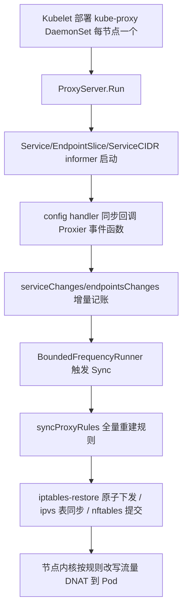

[上一篇](15-garbage-collector垃圾回收.md) · [总目录](README.md) · [下一篇](17-CRD扩展与聚合层.md)

# kube-proxy 网络代理
> **层级**：第四层——函数级源码解析。
> **范围**：Service/EndpointSlice 事件接入、iptables 规则生成（KUBE-SERVICES/SVC/SEP 三级链）、ipvs 模式定位、nftables 模式定位。
> **代码基准**：master@`8893923938107170c86eb4b8cc2b7225b4e44e9b`（2026-11-18，工作区干净），Go 1.27.4。
> **锚点记法**：`符号+偏移`，函数定义行 = `+0`；括号内为当前绝对行号，仅作核对辅助，不作引用依据。

## 0. 生产视角（对外行为与可见结果）

**它是什么**：kube-proxy 是一个以 DaemonSet 部署、每节点一个副本的组件，职责是把发往 Service 的流量（ClusterIP、NodePort、ExternalIP、LoadBalancer）按 Service 定义改写（DNAT/SNAT/MASQ）后转发到后端 Pod。数据面**不经过** kube-proxy 进程本身——规则下发后，流量在节点内核里被改写，进程只在规则变更时做配置面工作。

**对外可见结果**：
- iptables 模式：节点 NAT/Filter 表出现 `KUBE-SERVICES` → `KUBE-SVC-*` → `KUBE-SEP-*` 三级链；`iptables-restore` 原子下发。
- ipvs 模式：内核 IPVS 表出现 VirtualServer（对应 ServicePort）与 RealServer（对应 endpoint），哈希表查找取代线性遍历链。
- nftables 模式：nftables 规则集取代 iptables 链，结构与 iptables 三级链同构。
- 事件面：Service/EndpointSlice/ServiceCIDR 变化 → 增量记账 → 定时/触发全量重建规则。

**生产流程**：



**可观察判据**：`iptables-save -t nat | grep KUBE-` 能看到三级链；`ipvsadm -Ln` 能看到 VS/RS；`nft list ruleset` 能看到 nftables 规则集。

## 1. 模块级

| 项 | 内容 |
|---|---|
| 入口 | `cmd/kube-proxy/proxy.go#main` → `cmd/kube-proxy/app`（NewProxyCommand、Options、ProxyServer.Run） |
| 实现位置 | **主模块 `pkg/proxy/`**（本分支差异：staging 的 `k8s.io/kube-proxy` 只含配置 API，无 proxy 实现，见 `staging/src/k8s.io/kube-proxy/config/v1alpha1/`） |
| 子模块 | `config`（Service/EndpointSlice 事件）、`iptables`、`ipvs`、`nftables`、`metaproxier`、`runner`、`conntrack`、`endpoint*`、`healthcheck`、`localnodeportproxy`、`metrics`、`nodemanager`、`serviceport`、`topology`、`types`、`util`、`winkernel` |
| Proxier 创建 | `cmd/kube-proxy/app/server_linux.go`：iptables.NewProxier+0（:165） / ipvs.NewProxier+0（:211） / nftables.NewProxier+0（:248） |
| 数据流 | Service/EndpointSlice informer → config handler（直接函数回调）→ proxier 内部 changes 缓存 → Sync → syncProxyRules 全量生成规则 → iptables-restore / ipvs 表 / nftables 提交 |

## 2. 类型级

| 类型 | 文件 | 职责 |
|---|---|---|
| `Provider`（interface） | `pkg/proxy/types.go:28` | 组合 Service/EndpointSlice/NodeTopology/ServiceCIDR handler 接口加 `Sync()`/`SyncLoop()`（**无 provider.go 文件**：iptables/ipvs/nftables 下均无，确认） |
| `metaProxier` | `metaproxier/meta_proxier.go:26` | 双栈包装：持有 ipv4/ipv6 两个 Provider，按 EndpointSlice 地址类型分发 |
| `ServiceConfig` | `config/config.go:167` | Service 事件入口，持有 eventHandlers |
| `EndpointSliceConfig` | `config/config.go:73` | EndpointSlice 事件入口（**本分支无 EndpointsConfig**，grep `type EndpointsConfig` 无命中） |
| iptables `Proxier` | `iptables/proxier.go:127` | 持有 serviceChanges、endpointsChanges、svcPortMap、endpointsMap、syncRunner、nat/filter LineBuffer |
| ipvs `Proxier` | `ipvs/proxier.go:148` | ipvs 模式实现（结构同构） |
| nftables `Proxier` | `nftables/proxier.go:146` | nftables 模式实现（结构同构，文件 2021 行） |

## 3. 启动与事件接入函数级

### 函数：NewProxyCommand / Options / ProxyServer.Run
**源码：** `cmd/kube-proxy/app/server.go NewProxyCommand+0`（:102）、`options.go Options+0`（:52） / `NewOptions+0`（:195）、`server.go ProxyServer.Run+0`（:532）。

**Run 装配段（`Run+63 ~ +114`，当前 :595~:646）：**
1. `NewServiceConfig` → `serviceConfig.RegisterEventHandler(s.Proxier)` → `go serviceConfig.Run(ctx.Done())`（serviceConfig 创建 `Run+82` :614，Run 调用 `Run+84` :616）
2. EndpointSlice 同构（endpointSliceConfig 创建 `Run+86` :618，`RegisterEventHandler` :619，`go Run(ctx.Done())` :620）
3. ServiceCIDR 同构（serviceCIDRConfig 创建 `Run+90` :622，`go Run(wait.NeverStop)` :624）
4. `informerFactory.StartWithContext(ctx)`（`Run+96` :628）
5. `s.birthCry()`（`Run+112` :644）
6. `go s.Proxier.SyncLoop()`（`Run+114` :646）

### 函数：config ServiceConfig / EndpointSliceConfig
**源码：** `pkg/proxy/config/config.go`
**关键特征：** informer 事件经 `handleAdd/Update/DeleteService+0`（:212/:224/:241）与 `handleAdd/Update/DeleteEndpointSlice+0`（:118/:130/:147）**同步遍历** eventHandlers 直接调用 proxier 回调；事件不入中间 channel。`EndpointSliceConfig.Run+0`（:105）与 `ServiceConfig.Run+0`（:199）在 `WaitForCacheSync` 后回调 `OnXxxSynced`。

### 函数：iptables Proxier 的事件回调
**源码：** `pkg/proxy/iptables/proxier.go`
- `OnServiceUpdate+0`（:454）：写入 `serviceChanges`，initialized 后调 `Sync()`
- EndpointSlice 回调：`OnEndpointSliceAdd/Update/Delete+0`（:481/:489/:497），写入 endpointsChanges
**设计效果：** 事件只做增量记账；规则生成是定时/触发的全量重建，避免增量改规则的中间不一致。

### 函数：Sync / SyncLoop
**源码：** `iptables/proxier.go Sync+0`（:413）/ `SyncLoop+0`（:422）
**机制：** Sync 触发 `BoundedFrequencyRunner.Run`（最小间隔/突发参数）；SyncLoop 让 runner 常驻循环。runner 实现见 `pkg/proxy/runner/bounded_frequency_runner.go`，把高频事件合并为有限频率的规则同步。

## 4. 规则生成函数级（iptables 模式）

### 函数：syncProxyRules
**源码：** `iptables/proxier.go syncProxyRules+0`（:625）
**职责：** 从当前全部 ServicePort 与 endpoint 全量生成 iptables 规则，一次性 restore。
**执行流程（偏移以 `syncProxyRules+0` 计）：**
```text
syncProxyRules (+0)
├── 1. initialized 门控：等 Service 与 EndpointSlice 都 synced (+5)
├── 2. svcPortMap.Update(serviceChanges)、endpointsMap.Update(endpointsChanges) (+29 ~ +30)
├── 3. 全量场景 EnsureChain/EnsureRule 建 PREROUTING→KUBE-SERVICES jump (+64 ~ +73)
├── 4. 写顶层链：KUBE-SERVICES、KUBE-NODEPORTS、KUBE-POSTROUTING、KUBE-MARK-MASQ (+107 ~ +112)
├── 5. for svcName, svc := range svcPortMap 逐 ServicePort (+192):
│      ├─ clusterPolicyChain：KUBE-SVC-<portProtoHash> (+209)
│      ├─ internalTrafficChain (+230)
│      └─ 外部流量链 KUBE-FW-/KUBE-XLB-
├── 6. ClusterIP 捕获：-A KUBE-SERVICES -d <clusterIP> --dport -j internalChain (+301 ~ +309)
├── 7. writeServiceToEndpointRules (+583):
│      KUBE-SVC-XXXX 内按 --mode random --probability 写概率跳 KUBE-SEP-XXXX
├── 8. 逐 endpoint 写 KUBE-SEP-XXXX：hairpin SNAT + DNAT --to-destination（KUBE-SEP 链声明 +605）
├── 9. 与现存规则 diff，清理不再使用的旧链
└── 10. proxier.iptables.Restore 一次性 iptables-restore（NoFlushTables）(+763)
```

### 三级链结构
```text
KUBE-SERVICES（按 ClusterIP/NodePort 匹配，一跳）
  ↓
KUBE-SVC-XXXX（一个 ServicePort：按概率在多 endpoint 间负载均衡）
  ↓
KUBE-SEP-XXXX（一个 endpoint：MARK-MASQ 判断 + DNAT 到 Pod IP:Port）
```
链常量：`KUBE-SERVICES`（nat/filter）、`KUBE-SVC-` 前缀（:540）、`KUBE-SEP-` 前缀（:544）。

### 函数：writeServiceToEndpointRules
**源码：** `iptables/proxier.go writeServiceToEndpointRules+0`（:1434）
**概率算法：** n 个 endpoint 时每条规则概率 `1/(剩余数)`（`--mode random --probability proxier.probability(numEndpoints-i)`，:1434+35~+40）；最后一条不带 probability 作兜底（i == numEndpoints-1）。

### 关键差异：RestoreAll 已更名
旧文 `RestoreAll` 在 `pkg/proxy` 无命中（grep 无），当前为 **`proxier.iptables.Restore`**（`iptables/proxier.go:1388`，即 `syncProxyRules+763`）。`iptables` 接口以 `Restore` 为名。

## 5. ipvs 模式定位

| 函数 | 符号+偏移 | 职责 |
|---|---|---|
| `NewProxier` | `ipvs/proxier.go NewProxier+0`（:242） | 建 ipvs Proxier（同样用 syncRunner） |
| `Sync` / `SyncLoop` | `ipvs/proxier.go Sync+0`（:549）/ `SyncLoop+0`（:558） | 与 iptables 同构 |
| `syncProxyRules` | `ipvs/proxier.go syncProxyRules+0`（:658） | 逐 ServicePort 维护 VirtualServer/RealServer 集合 |
| 事件回调 | `ipvs/proxier.go OnServiceAdd+0`（:581）/ `OnEndpointSliceAdd+0`（:610） | OnServiceAdd、OnEndpointSliceAdd |

### 关键修正：VS/RS 增删改不再为 Proxier 方法
旧文 `AddVirtualServer`/`AddRealServer`/`UpdateRealServer` **已不再是 `Proxier` 方法**（在 `ipvs/proxier.go` 中无命中；仅 `proxier_test.go` 的 fakeIpvs 有同名）。当前增删改集中在两个私有方法：

| 方法 | 符号+偏移 | 职责 |
|---|---|---|
| `syncService` | `ipvs/proxier.go syncService+0`（:1534） | 内部经 `proxier.ipvs.AddVirtualServer/UpdateVirtualServer` 维护 VirtualServer |
| `syncEndpoint` | `ipvs/proxier.go syncEndpoint+0`（:1574） | 内部经 `proxier.ipvs.AddRealServer/UpdateRealServer/GetRealServers` 维护 RealServer |

调用点（`syncProxyRules` 内）：`syncService` 于 :845/:903/:1012/:1136，`syncEndpoint` 于 :854/:908/:1017/:1138。

ipvs 模式把负载均衡下发给内核 IPVS（哈希表查找），kube-proxy 只维护 virtual/real server 集合；Service ClusterIP 的捕获仍配合少量 iptables 规则。

## 6. nftables 模式定位（补充说明）

**已完整实现**（本分支为完整代码而非占位）：

| 函数/类型 | 符号+偏移 | 职责 |
|---|---|---|
| `type Proxier` | `nftables/proxier.go Proxier+0`（:146） | nftables 模式结构体 |
| `NewProxier` | `nftables/proxier.go NewProxier+0`（:226） | 建 nftables Proxier |
| `Sync` / `SyncLoop` | `nftables/proxier.go Sync+0`（:783）/ `SyncLoop+0`（:792） | 与 iptables 同构 |
| `syncProxyRules` | `nftables/proxier.go syncProxyRules+0`（:1163） | 全量生成 nftables 规则集 |

装配：`cmd/kube-proxy/app/server_linux.go nftables.NewProxier+0`（:248）为独立分支，与 iptables/ipvs 并列，按 `--proxy-mode` 选择。

### 6.1 ipvs 规则同步深度拆解（syncService / syncEndpoint）

ipvs 模式不生成链式规则，而是维护内核 IPVS 表的 VirtualServer（VS，对应 ServicePort 的 VIP:port）与 RealServer（RS，对应 endpoint 的 ip:port）。全流程在 `ipvs/proxier.go`。

**syncProxyRules 主流程（`syncProxyRules+0`，:658）：**
1. `isInitialized()` 门控（+7 ～ +11）：Services 与 Endpoints 都收到前不同步。
2. `initialSync = false`（+17，注释说明作为启动动作标志、持锁故安全）。
3. `svcPortMap.Update(serviceChanges)` + `endpointsMap.Update(endpointsChanges)`（+30 ～ +31）：把累积的增量变更合并进全量视图。
4. 重置 `natChains/natRules/filterChains` 缓冲（+40 ～ +43，注释：避免内存重分配）。
5. 遍历 ServicePort，逐个调 `syncService` / `syncEndpoint`（调用点 :845/:903/:1012/:1136 与 :854/:908/:1017/:1138）。

**syncService（`syncService+0`，:1534）——维护 VS：**
1. `ipvs.GetVirtualServer(vs)` 取内核中已应用的 VS。
2. `appliedVirtualServer == nil` → **`AddVirtualServer`**（新建 VS）；不相等 → **`UpdateVirtualServer`**（更新，注释：更新期间 VIP 不会 down）。
3. `bindAddr` 为真时把 VIP 绑到 dummy 设备（`EnsureAddressBind(vs.Address, defaultDummyDevice)`，+25 ～ +33）：`alreadyBoundAddrs` 已含该地址则提前返回，避免重复 bind。

**syncEndpoint（`syncEndpoint+0`，:1574）——维护 RS：**
1. `GetVirtualServer` 确认 VS 存在（不存在报错）。
2. `ipvs.GetRealServers(appliedVirtualServer)` 列出内核当前 RS → `curEndpoints` 集合。
3. **拓扑感知过滤**（+19 ～ +45）：`proxy.CategorizeEndpoints` 把 endpoint 分为 cluster/local 两组；`onlyNodeLocalEndpoints` 为真时优先用 localEndpoints，**无 local endpoint 时回退 clusterEndpoints**（PR #97081，允许本地 Pod 访问），并按 `InternalPolicyLocal()`/`ExternalPolicyLocal()` 把该 Service 记入 `serviceNoLocalEndpointsInternal/External`。
4. 对比 `newEndpoints` 与 `curEndpoints`：新增的 `AddRealServer`、变更的 `UpdateRealServer`、消失的删除（后续段）。

**设计要点（源码可证）：**
1. **iptables + IPVS 混合**：ipvs 模式仍用少量 iptables 规则捕获 ClusterIP 流量并做 masquerade，真正的负载均衡由内核 IPVS 哈希表完成（syncProxyRules 内同时写 natChains/natRules）。
2. **dummy 设备承载 VIP**：VIP 绑在 dummy 接口（`defaultDummyDevice`）而非物理网卡，使本机可路由到 ClusterIP。
3. **更新不中断**：`UpdateVirtualServer` 注释明确 VIP 不 down，保证更新期间服务连续。

### 6.2 nftables 部分同步 vs 全量同步

**源码：** `nftables/proxier.go syncProxyRules+0`（:1163）

nftables 模式相比 iptables/ipvs 多一个**部分同步**能力：

- `doFullSync := proxier.needFullSync || (time.Since(proxier.lastFullSync) > proxyutil.FullSyncPeriod)`（+18）：满足任一条件才做全量同步。
- 指标分档（+21 ～ +28）：全量走 `SyncFullProxyRulesLatency`，部分走 `SyncPartialProxyRulesLatency`（iptables/ipvs 无此区分）。
- `needFullSync` 初值 `true`（NewProxier :266，首次必须全量）；同步失败时置回 `true`（:1205）强制下次全量，成功则 `lastFullSync = time.Now()`（:1207）并清标志（:1895 附近）。
- `syncRunner = NewBoundedFrequencyRunner(..., FullSyncPeriod)`（:302）：与 iptables 同用 BoundedFrequencyRunner 限频。

**与 iptables/ipvs 的本质差异：** iptables 每轮全量重写规则缓冲再 `iptables.Restore`；nftables 可只提交变更的部分规则集，减少大集群下的规则下发开销。

## 7. 调用关系总览

```text
Service/EndpointSlice informer
 ↓ 同步回调
Proxier.OnServiceUpdate / OnEndpointSliceUpdate
 └── serviceChanges/endpointsChanges 记账 → Sync
      ↓ BoundedFrequencyRunner
syncProxyRules
 ├── svcPortMap/endpointsMap 更新
 ├── KUBE-SERVICES 顶层链
 ├── 逐 ServicePort：KUBE-SVC 概率链 → KUBE-SEP DNAT 链
 └── iptables.Restore（ipvs：syncService/syncEndpoint 维护 VS/RS；nftables：nft 提交）
```

## 8. 设计意图（源码可证）

- 事件与规则生成分离：informer 回调只增量记账，规则全量重建后原子 restore，规则表始终一致。
- 三级链按"匹配 Service → 选择 endpoint → DNAT"分层，endpoint 增减只改对应 SVC/SEP 链。
- 双栈经 metaProxier 在入口分流，ipv4/ipv6 各自一套独立规则。
- ipvs 模式把"逐包遍历链"换成内核哈希查找，kube-proxy 只做 VS/RS 集合维护，捕获仍靠少量 iptables。

## 9. 验证与差异说明

**锚点核对（证据索引 `docs/sourceReader/.progress/evidence/16.md`，全部照抄当前值）：**
- 完全一致（Δ=0）：`types.go Provider+0`（:28）、config.go 全部 8 个锚点、iptables/proxier.go 7 个锚点（:454/:481/:489/:497/:413/:422/:625）、ipvs/proxier.go 6 个锚点（:242/:549/:558/:658/:581/:610）、options.go `Options+0`/`NewOptions+0`（:52/:195）、server_linux.go 三个 NewProxier（:165/:211/:248）。
- 小幅漂移：`server.go NewProxyCommand+0`（:102，旧 :100，Δ+2）、`Run+0`（:532，旧 :526，Δ+6）、装配段 `Run+63~+114`（旧 :608~639，Δ+7~+13）、iptables `writeServiceToEndpointRules+0`（:1434，旧 :1430，Δ+4）。
- 消失/替代：ipvs `AddVirtualServer`/`AddRealServer`/`UpdateRealServer`（→ `syncService`/`syncEndpoint`）；`RestoreAll`（→ `iptables.Restore`）。
- 补充确认：nftables 模式完整实现；staging `k8s.io/kube-proxy` 仅配置 API；无 `EndpointsConfig`；无 `provider.go`。

**同步到本稿的修正：**
1. ipvs 方法表：`AddVirtualServer/AddRealServer/UpdateRealServer` 改为 `syncService`/`syncEndpoint`。
2. `RestoreAll` → `proxier.iptables.Restore`（iptables/proxier.go:1388）。
3. `writeServiceToEndpointRules` 锚点 :1430 → :1434（Δ+4）。
4. 新增 nftables 模式完整实现说明。

**未确认项**：无（全部关键锚点已按证据与源码复核命中）。若后续基准移动，以 `符号+偏移` 重核对即可。

[上一篇](15-garbage-collector垃圾回收.md) · [总目录](README.md) · [下一篇](17-CRD扩展与聚合层.md)
