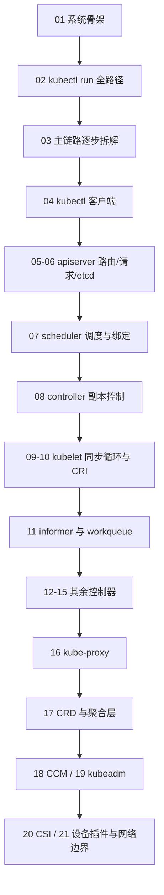

# Kubernetes 源码走读文档

> 面向新手的 Kubernetes 源码阅读文档库：从系统骨架到函数级源码，主线为 Pod 从 `kubectl run` 到容器运行的完整生命周期。
> 源码基准：commit `8893923938107170c86eb4b8cc2b7225b4e44e9b`（2026-11-18，master，工作区干净），Go 1.27.4（`.go-version`）。范围与约定见 [00-文档说明与约定](00-文档说明与约定.md)。

## 学习路径

## 文档索引
| # | 层级 | 文档 | 说明 |
|---|---|---|---|
| 00 | — | [文档说明与约定](00-文档说明与约定.md) | 覆盖范围、主线场景、源码定位规则、分支差异、术语 |
| 01 | 第一层 | [系统骨架](01-系统骨架.md) | 进程与组件职责、模块依赖、输入输出与主数据流 |
| 02 | 第二层 | [kubectl run 全路径走读](02-kubectl-run全路径走读.md) | 裸 Pod 成功场景：客户端→apiserver→etcd→scheduler→kubelet→CRI→状态回报 |
| 03 | 第三层 | [主链路逐步拆解](03-主链路逐步拆解.md) | 五段逐跳拆解：参数转换、内部动作、状态变化与错误传播，含 Mermaid 时序图 |
| 04 | 第四层 | [kubectl 客户端](04-kubectl客户端.md) | 进程启动、命令树、RunOptions、Factory 与 POST 发出的函数级解析 |
| 05 | 第四层 | [apiserver 启动与路由](05-apiserver启动与路由.md) | CreateServerChain 委托构造、DefaultBuildHandlerChain 中间件链、director 分流与路由生成 |
| 06 | 第四层 | [apiserver 请求处理与 etcd](06-apiserver请求处理与etcd.md) | createHandler 全流程、podStrategy 默认化校验、Store.create 与 etcd3 OptimisticPut |
| 07 | 第四层 | [scheduler 调度与绑定](07-scheduler调度与绑定.md) | ScheduleOne 编排、SchedulePod 过滤打分、assume 与 bindingCycle 各插件点的函数级解析 |
| 08 | 第四层 | [controller 副本控制](08-controller副本控制.md) | ReplicaSet 控制器函数级解析：入队、syncReplicaSet、manageReplicas 慢启动创建与并发删除 |
| 09 | 第四层 | [kubelet 同步循环](09-kubelet同步循环.md) | NewMainKubelet、PodConfig 三源、Run/syncLoop、podWorkers、PLEG 与 statusManager 的函数级解析 |
| 10 | 第四层 | [kubelet CRI 运行时](10-kubelet-CRI运行时.md) | SyncPod 差集、createPodSandbox/startContainer 与 cri-client grpc 的函数级解析 |
| 11 | 第四层 | [informer 与 workqueue](11-informer与workqueue机制.md) | sharedIndexInformer 管线、DeltaFIFO、Reflector、Typed workqueue 去重与退避 |

| 12 | 第四层 | [Deployment 控制器](12-deployment控制器.md) | RS 集合管理、滚动先扩后缩、回滚与状态计算 |
| 13 | 第四层 | [Job 与 CronJob 控制器](13-job与cronjob控制器.md) | Job Pod 调谐与 tracking finalizer；CronJob 周期调度与并发策略 |
| 14 | 第四层 | [DaemonSet 控制器](14-daemonset控制器.md) | 节点-Pod 一一对应、节点准入与亲和性注入、surge 更新 |
| 15 | 第四层 | [Garbage Collector](15-garbage-collector垃圾回收.md) | owner/dependent 依赖图与 Foreground/Background/Orphan 级联删除 |
| 16 | 第四层 | [kube-proxy](16-kube-proxy网络代理.md) | Service/EndpointSlice 事件到 iptables 三级链与 ipvs 规则 |
| 17 | 第四层 | [CRD 扩展与聚合层](17-CRD扩展与聚合层.md) | CRD 懒分发与 APIService 后端代理 |
| 18 | 第四层 | [cloud-controller-manager](18-cloud-controller-manager.md) | 四类云控制器与 cloud-provider 接口、与 KCM 职责切分 |
| 19 | 第四层 | [kubeadm 集群引导](19-kubeadm集群引导.md) | init 阶段工作流、静态 Pod 控制面落盘、join 与 bootstrap token |
| 20 | 第四层 | [CSI 存储插件](20-CSI存储插件.md) | plugin manager 注册、volume manager 调谐与 NodePublishVolume |
| 21 | 第四层 | [设备插件与网络边界](21-设备插件与网络边界.md) | 设备注册/Allocate 进入 CRI config；kubelet 与 CNI 的职责边界 |

## 专题（topics/）
跨篇的机制纵深专题，按「代码基准 + 结论速览 → 生产视角 → 开发视角 → 验证」组织，符号+偏移锚点。适合在读完主线篇后针对某个子系统深挖。

| 专题 | 主题 | 一句话定位 |
|---|---|---|
| [调度器抢占 preemption](topics/调度器抢占-preemption.md) | kube-scheduler 抢占 | PostFilter→Preempt→DryRun→SelectCandidate→Actuate 全链：选受害者、PDB tie-break、nominated node、异步驱逐 |
| [etcd3 写入路径](topics/etcd3写入路径.md) | apiserver storage 层 | Create/Update→OptimisticPut 乐观事务：key 准备、编码、加密变换、lease、冲突重试循环 |
| [优先级与公平性流控](topics/优先级与公平性流控.md) | apiserver APF 流控 | WithPriorityAndFairness→Handle→startRequest：FlowSchema 分类、PriorityLevel 排队、并发席位、429 拒绝 |
| [informer resync 机制](topics/informer-resync机制.md) | client-go informer | resyncPeriod 确定→shouldResync 判定→distribute(sync=true) 仅投需 resync 的 handler→OnUpdate(old==new) 自愈 |
| [leader election 机制](topics/leader-election机制.md) | client-go leader election | Run→acquire→renew→tryAcquireOrRenew：Lease 竞争、快慢路径、写门、Recovery 恢复 |
| [kubelet 探针机制](topics/kubelet探针机制.md) | kubelet 探针 | prober_manager→worker→doProbe→prober：HTTP/TCP/exec/gRPC 探测、阈值判定、容器重启与 readiness |
| [API Server 全景](topics/api-server.md) | kube-apiserver 全链路 | 三层委托链（aggregator→kubeAPIServer→apiextensions）装配、路由注册、40+ 层中间件链、CRUD handlers、etcd3 storage/加密、watch cache、聚合代理、discovery |
| [workqueue 机制](topics/workqueue机制.md) | client-go workqueue | 基础队列（Add/Get/Done 去重+脏标记）+ delaying（AddAfter 延迟）+ rate-limiting（指数退避重试）三层包装 |
| [scheduler 过滤打分框架](topics/scheduler过滤打分框架.md) | kube-scheduler 调度周期 | SchedulePod 两阶段：PreFilter→Filter（并行逐节点）→PostFilter、PreScore→Score（分×权重选节点）；10 个扩展点接口 |
| [Deployment 滚动更新](topics/deployment滚动更新.md) | Deployment 滚动更新 | syncDeployment 策略分派→rolloutRolling 先扩后缩（maxSurge/maxUnavailable）、比例伸缩 GetReplicaSetProportion、回滚=模板回退 |
| [kubelet 同步循环与 PLEG](topics/kubelet同步循环与PLEG.md) | kubelet 主循环与状态探测 | 三源 PodConfig→syncLoop 事件分派→podWorkers per-Pod 串行（podWorkerLoop）→SyncPod；GenericPLEG 周期 Relist 生成容器事件驱动自愈 |
| [garbage-collector 依赖图与级联删除](topics/garbage-collector依赖图与级联删除.md) | GC 依赖图与级联删除 | GraphBuilder 依赖图装配→classifyReferences/isDangling 判定→attemptToDeleteItem 按 finalizer 选策略；Foreground/Background/Orphan 三路径 |
| [kube-proxy 规则生成](topics/kube-proxy规则生成.md) | kube-proxy 规则生成 | 事件回调→changes 缓存→BoundedFrequencyRunner 限频 Sync→syncProxyRules 全量重建 iptables 三级链（KUBE-SERVICES/SVC/SEP）概率负载均衡，iptables-restore 原子下发；ipvs/nftables 同构定位 |
| [ReplicaSet 副本控制](topics/replicaset副本控制.md) | ReplicaSet 副本控制（基础控制器范式） | informer→queue→worker→syncReplicaSet→manageReplicas：expectations 抑制、slowStartBatch 指数批量创建、getPodsToDelete 删除优先级、calculateStatus 回写 |
| [Job 与 CronJob 周期调度](topics/job与cronjob周期调度.md) | Job/CronJob 周期调度 | Job：syncJob+tracking finalizer 精确计数+manageJob+backoff；CronJob：syncCronJob 周期调度（mostRecentScheduleTime）+并发策略 Allow/Forbid/Replace |
| [CRD 建立与懒分发](topics/CRD建立与懒分发.md) | CRD 动态注册与懒分发 | crdHandler 注册 NonGoRestfulMux /apis→ServeHTTP 分发→getOrCreateServingInfoFor 懒安装（atomic.Value 缓存）；establish 控制器置 Established；CRD 清理 finalizer |
| [DaemonSet 控制器](topics/daemonset控制器.md) | DaemonSet 节点-Pod 一一对应 | syncDaemonSet→manage→podsShouldBeOnNode/nodeShouldRunDaemonPod 三层准入；ReplaceDaemonSetPodNodeNameNodeAffinity 注入 hostname 亲和由默认调度器绑定；rollingUpdate surge/maxUnavailable |
| [设备插件注册与 Allocate](topics/设备插件注册与Allocate.md) | 设备管理器与设备插件 gRPC | 三条 gRPC 通道（Register 插件→kubelet / ListAndWatch 流式 / Allocate 按需）→GetDeviceRunContainerOptions→makeDevices 进 CRI config；kubelet 不直接调 CNI |

新增专题：在 `topics/` 下建 `中文名.md`，按单篇专题骨架（先总结、再生产、再开发、末验证）写，并在本表追加一行。

## 阅读建议
- 顺序阅读：严格按编号从 01 到 21，四层逐级深入。
- 带着问题读：第一层回答"系统由什么组成、数据怎么流转"；第二、三层回答"一个 Pod 请求具体怎么走"；第四层回答"每个函数内部做了什么"。
- 配合源码：文档给出文件路径与符号名，阅读时在编辑器中跳转验证。
