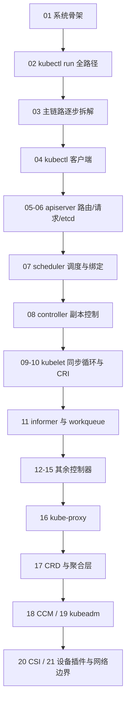

# Kubernetes 源码走读文档

> 面向新手的 Kubernetes 源码阅读文档库：从系统骨架到函数级源码，主线为 Pod 从 `kubectl run` 到容器运行的完整生命周期。
> 源码基准：commit `82f9fd3d`（2026-09-24），Go 1.27.0。范围与约定见 [00-文档说明与约定](00-文档说明与约定.md)。

## 学习路径

## 文档索引
| # | 层级 | 文档 | 说明 |
|---|---|---|---|
| 00 | — | [文档说明与约定](00-文档说明与约定.md) | 覆盖范围、主线场景、源码定位规则、分支差异、术语 |
| 01 | 第一层 | [系统骨架](01-系统骨架.md) | 进程与组件职责、模块依赖、输入输出与主数据流 |
| 02 | 第二层 | [kubectl run 全路径走读](02-kubectl-run全路径走读.md) | 裸 Pod 成功场景：客户端→apiserver→etcd→scheduler→kubelet→CRI→状态回报 |
| 03 | 第三层 | [主链路逐步拆解](03-主链路逐步拆解.md) | 五段逐跳拆解：参数转换、内部动作、状态变化与错误传播，含 Mermaid 时序图 |
| 04 | 第四层 | [kubectl 客户端](04-kubectl客户端.md) | 进程启动、命令树、RunOptions、Factory 与 POST 发出的函数级解析 |
| 05 | 第四层 | [apiserver 启动与路由](05-apiserver启动与路由.md) | CreateServerChain 委托构造、DefaultBuildHandlerChain 中间件链、director 分流与路由生成 |
| 06 | 第四层 | [apiserver 请求处理与 etcd](06-apiserver请求处理与etcd.md) | createHandler 全流程、podStrategy 默认化校验、Store.create 与 etcd3 OptimisticPut |
| 07 | 第四层 | [scheduler 调度与绑定](07-scheduler调度与绑定.md) | ScheduleOne 编排、SchedulePod 过滤打分、assume 与 bindingCycle 各插件点的函数级解析 |
| 08 | 第四层 | [controller 副本控制](08-controller副本控制.md) | ReplicaSet 控制器函数级解析：入队、syncReplicaSet、manageReplicas 慢启动创建与并发删除 |
| 09 | 第四层 | [kubelet 同步循环](09-kubelet同步循环.md) | NewMainKubelet、PodConfig 三源、Run/syncLoop、podWorkers、PLEG 与 statusManager 的函数级解析 |
| 10 | 第四层 | [kubelet CRI 运行时](10-kubelet-CRI运行时.md) | SyncPod 差集、createPodSandbox/startContainer 与 cri-client grpc 的函数级解析 |
| 11 | 第四层 | [informer 与 workqueue](11-informer与workqueue机制.md) | sharedIndexInformer 管线、DeltaFIFO、Reflector、Typed workqueue 去重与退避 |

| 12 | 第四层 | [Deployment 控制器](12-deployment控制器.md) | RS 集合管理、滚动先扩后缩、回滚与状态计算 |
| 13 | 第四层 | [Job 与 CronJob 控制器](13-job与cronjob控制器.md) | Job Pod 调谐与 tracking finalizer；CronJob 周期调度与并发策略 |
| 14 | 第四层 | [DaemonSet 控制器](14-daemonset控制器.md) | 节点-Pod 一一对应、节点准入与亲和性注入、surge 更新 |
| 15 | 第四层 | [Garbage Collector](15-garbage-collector垃圾回收.md) | owner/dependent 依赖图与 Foreground/Background/Orphan 级联删除 |
| 16 | 第四层 | [kube-proxy](16-kube-proxy网络代理.md) | Service/EndpointSlice 事件到 iptables 三级链与 ipvs 规则 |
| 17 | 第四层 | [CRD 扩展与聚合层](17-CRD扩展与聚合层.md) | CRD 懒分发与 APIService 后端代理 |
| 18 | 第四层 | [cloud-controller-manager](18-cloud-controller-manager.md) | 四类云控制器与 cloud-provider 接口、与 KCM 职责切分 |
| 19 | 第四层 | [kubeadm 集群引导](19-kubeadm集群引导.md) | init 阶段工作流、静态 Pod 控制面落盘、join 与 bootstrap token |
| 20 | 第四层 | [CSI 存储插件](20-CSI存储插件.md) | plugin manager 注册、volume manager 调谐与 NodePublishVolume |
| 21 | 第四层 | [设备插件与网络边界](21-设备插件与网络边界.md) | 设备注册/Allocate 进入 CRI config；kubelet 与 CNI 的职责边界 |

## 阅读建议
- 顺序阅读：严格按编号从 01 到 21，四层逐级深入。
- 带着问题读：第一层回答"系统由什么组成、数据怎么流转"；第二、三层回答"一个 Pod 请求具体怎么走"；第四层回答"每个函数内部做了什么"。
- 配合源码：文档给出文件路径与符号名，阅读时在编辑器中跳转验证。
