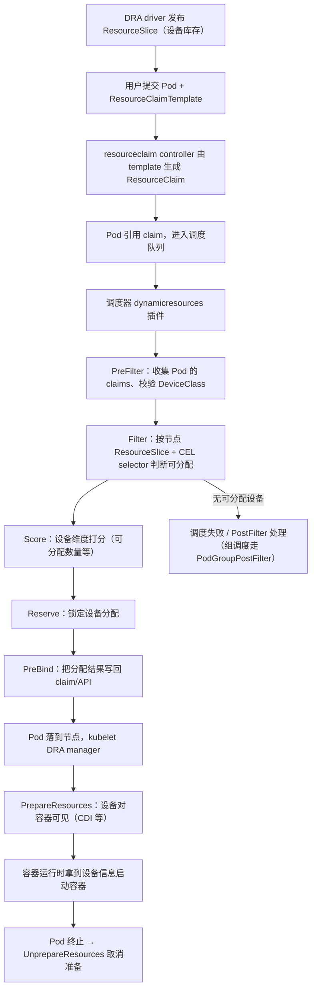

[总目录](../README.md)

# DRA 动态资源分配（Dynamic Resource Allocation）专题

> **代码基准**：`k8s.io/kubernetes`，master@`57d78241ff96c94130c509681b12b4a1715434af`（2026-11-20，工作区除文档产物外干净），Go 1.27.4。
> **范围**：DRA 从「驱动发布设备库存」到「工作负载用上设备」的完整数据流——ResourceSlice/ResourceClaim/DeviceClass/ResourceClaimTemplate 四类 API 对象、调度器 dynamicresources 插件的各扩展点、resourceclaim controller 的 claim 生命周期、kubelet DRA manager 的设备准备与取消准备、devicetainteviction 的设备级驱逐。覆盖调度器 + controller + kubelet 三侧的当前实现。
> **不覆盖**：具体设备驱动的实现（厂商侧，不在本仓库）；组调度与 PodGroup（见 [v1.37 PodGroup 与组合调度](v1.37-PodGroup与组合调度.md)）；传统 device plugin 的注册/Allocate 路径（见 [设备插件注册与 Allocate](设备插件注册与Allocate.md)，DRA 是与之并行的另一套机制）。
> **主文件**：`pkg/scheduler/framework/plugins/dynamicresources/`（调度插件 + DRA manager）、`pkg/controller/resourceclaim/`（claim 生命周期 controller）、`pkg/kubelet/cm/dra/`（节点侧准备/取消准备）、`pkg/controller/devicetainteviction/`（设备 taint 驱逐）、`staging/src/k8s.io/api/resource/v1beta1/`（API 类型）。

## 0. 结论速览

DRA 是 Kubernetes 处理**第三方设备**（GPU、FPGA、网卡、自定义加速器等）的新机制。它把传统 device plugin 的「kubelet 中心化注册 + 按容器 Allocate」换成一套**声明式、可调度感知**的模型：驱动把设备库存发布为 `ResourceSlice`，工作负载通过 `ResourceClaim`/`ResourceClaimTemplate` 声明资源请求，调度器用 `dynamicresources` 插件在 Filter/Reserve 阶段判断「这个节点有没有可分配的设备」，并把分配结果写回 API；kubelet 在 Pod 落地后准备（prepare）设备、Pod 终止时取消准备（unprepare）。

### 0.1 这项能力现在能做什么

- 驱动通过 `ResourceSlice` **发布设备库存**：节点或驱动侧把可提供哪些设备、每个设备的属性上报。
- 工作负载通过 `ResourceClaim`（或 `ResourceClaimTemplate` 生成）**声明设备请求**，与 Pod 解耦、可跨 Pod 共享。
- `DeviceClass` 定义**设备选择/配置类别**：用 CEL selector 表达「要哪类设备」。
- 调度器 `dynamicresources` 插件在 **PreFilter/Filter/Score/Reserve/PreBind** 各扩展点参与调度决策，产生设备分配（allocation）。
- kubelet DRA manager 在节点侧 **PrepareResources / UnprepareResources**：让设备对容器可见（如生成 CDI 信息），Pod 终止按生命周期取消准备。
- `devicetainteviction` controller 把 Node taint 思路扩展到**设备级**：设备不可用/被打 taint 且无法容忍时，驱逐正在使用它的 Pod。

### 0.2 关键结论、适用范围与不做什么

| 结论 | 说明 |
|---|---|
| DRA 与 device plugin 是两套并行机制 | 传统 device plugin（kubelet 注册/Allocate）不等于 DRA；DRA 走 ResourceClaim/ResourceSlice 模型 |
| 设备分配发生在调度期，不是 Pod 运行期 | 调度器 Reserve 阶段锁定分配，PreBind 写回 API；kubelet 只负责「准备已分配的设备」 |
| ResourceClaim 与 Pod 解耦 | claim 可独立于 Pod 创建、可共享；`ResourceClaimTemplate` 按工作负载生成 claim |
| 受版本/特性演进影响 | resource API 存在 v1alpha3/v1beta1/v1beta2/v1 多版本，本文以当前工作区 `v1beta1` 类型为准 |
| 设备不可用会触发驱逐 | devicetainteviction 按设备 taint 与容忍关系推进驱逐，扩展了 Node taint 语义 |

**不做什么**：不实现真实设备驱动；不保证跨驱动的设备语义一致；不处理 device plugin 侧的 `Register`/`Allocate` gRPC（那是 [设备插件注册与 Allocate](设备插件注册与Allocate.md) 的范围）。

## 1. 生产视角：实际怎么用、会得到什么

### 1.1 参与者、真实入口与前置条件

| 角色 | 是谁 | 做什么 |
|---|---|---|
| 设备驱动（vendor） | 集群内运行的 DRA driver | 发布 `ResourceSlice`（设备库存）、处理设备分配 |
| 用户 / 工作负载 | 提交带 `resourceClaims` 的 Pod + `ResourceClaimTemplate` | 声明「我要某类设备」 |
| kube-scheduler | `dynamicresources` 插件 | 调度期判断节点可分配性、锁定分配 |
| resourceclaim controller | `pkg/controller/resourceclaim` | 推进 claim 的生命周期（reserve/binding 等） |
| kubelet DRA manager | `pkg/kubelet/cm/dra` | 节点侧准备/取消准备设备，生成容器可见信息 |
| devicetainteviction controller | `pkg/controller/devicetainteviction` | 设备 taint/不可用时驱逐相关 Pod |

前置条件：① 集群已启用 DRA 相关 API（resource API 版本随版本演进）；② 有 DRA driver 发布了 `ResourceSlice`；③ Pod 通过 `spec.resourceClaims` 引用 claim。缺 ② 时 claim 无法分配、Pod 卡在调度期；缺 ③ 时设备请求不生效。

### 1.2 生产主流程图



### 1.3 输入、处理、输出与接收方

| 生产环节 | 输入 | 实际处理 | 可见输出 | 接收方 |
|---|---|---|---|---|
| 库存发布 | 驱动上报设备 | driver 写 `ResourceSlice` | 节点/驱动设备库存 | 调度器（resourceslicetracker） |
| claim 生成 | `ResourceClaimTemplate` | controller 生成 `ResourceClaim` | claim 对象 | API / 调度器 |
| 调度决策 | Pod 的 claims + 节点库存 | Filter/Score/Reserve | 设备 allocation | claim 状态 / API |
| 节点准备 | 已绑定 Pod + claim | kubelet prepare | 设备对容器可见（CDI 信息） | 容器运行时 |
| 设备驱逐 | DeviceTaintRule / 设备不可用 | devicetainteviction 判定容忍 | 驱逐相关 Pod | kubelet / API |

### 1.4 主流程、分支与异常结果

- **正常路径**：库存就绪 → claim 生成 → 调度器各扩展点通过 → PreBind 写回分配 → kubelet 准备设备 → 容器启动。
- **无设备可分配**：Filter 阶段失败，Pod 不可调度；单 Pod 走 `PostFilter`，组调度走 `PodGroupPostFilter`（联动 [v1.37 PodGroup 与组合调度](v1.37-PodGroup与组合调度.md)）。
- **Reserve 后分配冲突**：`Unreserve` 回滚已锁定的分配。
- **Pod 终止**：`UnprepareResources` 按生命周期取消准备设备。
- **设备被打 taint / 不可用**：`devicetainteviction` 根据设备 taint 与 Pod 容忍关系驱逐正在使用它的 Pod——把 Node taint 扩展到「被 claim 使用的设备」。

### 1.5 边界与验收表现

- DRA 不改变无设备请求 Pod 的调度行为；未引用 claim 的 Pod 完全不经过 dynamicresources 插件的设备分支。
- 验收看三点：claim 是否被正确 reserve/allocation；节点上设备是否对容器可见；设备不可用时相关 Pod 是否按 taint 规则被驱逐。

## 2. 开发视角：当前代码怎么实现

### 2.1 实现地图

| 职责 | 文件 · 符号 |
|---|---|
| 调度插件入口/扩展点 | `pkg/scheduler/framework/plugins/dynamicresources/dynamicresources.go` · `DynamicResources` |
| 调度期 DRA manager | `pkg/scheduler/framework/plugins/dynamicresources/dra_manager.go` · `DefaultDRAManager` |
| claim 生命周期 controller | `pkg/controller/resourceclaim/controller.go` · `Controller` |
| kubelet DRA manager | `pkg/kubelet/cm/dra/manager.go` · `Manager` |
| kubelet DRA plugin manager | `pkg/kubelet/cm/dra/plugin/dra_plugin_manager.go` · `DRAPluginManager` |
| 设备 taint 驱逐 | `pkg/controller/devicetainteviction/device_taint_eviction.go` · `Controller` |
| API 类型 | `staging/src/k8s.io/api/resource/v1beta1/types.go` · `ResourceSlice` / `ResourceClaim` / `DeviceClass` / `ResourceClaimTemplate` |

### 2.2 真实调用链

```
driver → ResourceSlice（库存）
user → ResourceClaimTemplate → resourceclaim controller（生成 ResourceClaim）
Pod(spec.resourceClaims) → 调度队列
  → DynamicResources.PreEnqueue                     （入队前判定 claim 是否就绪）
  → DynamicResources.PreFilter  +0                  （收集 claims、校验 DeviceClass）
  → DynamicResources.Filter     +0                  （按节点库存 + CEL selector 判可分配）
  → DynamicResources.Score      +0 / NormalizeScore （设备维度打分）
  → DynamicResources.Reserve    +0                  （锁定分配）
  → DynamicResources.PreBind    +0                  （分配结果写回 API）
  → 失败：PostFilter +0 / PodGroupPostFilter / Unreserve
Pod 落节点 → kubelet Manager.Start +0 → reconcileLoop +0
  → PrepareResources +0（prepare 设备，容器可见）
  → Pod 终止 → UnprepareResources +0
设备 taint/不可用 → devicetainteviction Controller.Run +0 → 驱逐相关 Pod
```

### 2.3 关键源码定位

锚点记法 `符号+N`：N 为相对符号定义行的偏移，`+0` 即定义行。接收者短名：调度插件 `pl`（`*DynamicResources`）、kubelet manager `m`、resourceclaim controller `ec`、devicetainteviction controller `tc`。可用 `.progress/verify_anchors.py` 反查。

| 符号 | 定义文件 | 作用 |
|---|---|---|
| `New+0` | `pkg/scheduler/framework/plugins/dynamicresources/dynamicresources.go` | 插件构造 |
| `pl.PreFilter+0` | 同上 | 收集 claims、校验 DeviceClass |
| `pl.Filter+0` | 同上 | 逐节点判设备可分配 |
| `pl.Score+0` / `pl.NormalizeScore+0` | 同上 | 设备维度打分 |
| `pl.Reserve+0` / `pl.Unreserve+0` | 同上 | 锁定/回滚分配 |
| `pl.PreBind+0` | 同上 | 分配结果写回 |
| `pl.PostFilter+0` / `pl.PodGroupPostFilter+0` | 同上 | 不可调度兜底（单 Pod / 组） |
| `pl.deallocateOrDeletePodClaims+0` | 同上 | 失败时释放 claim |
| `NewDRAManager+0` | `pkg/scheduler/framework/plugins/dynamicresources/dra_manager.go` | 调度期 DRA manager |
| `ec.Run+0` / `ec.syncHandler+0` | `pkg/controller/resourceclaim/controller.go` | claim 生命周期 controller |
| `NewManager+0` | `pkg/kubelet/cm/dra/manager.go` | kubelet DRA manager 构造 |
| `m.Start+0` / `m.reconcileLoop+0` | `pkg/kubelet/cm/dra/manager.go` | 节点侧调谐循环 |
| `m.PrepareResources+0` / `m.UnprepareResources+0` | `pkg/kubelet/cm/dra/manager.go` | 准备/取消准备设备 |
| `NewDRAPluginManager+0` | `pkg/kubelet/cm/dra/plugin/dra_plugin_manager.go` | 节点侧 DRA plugin manager |
| `tc.Run+0` | `pkg/controller/devicetainteviction/device_taint_eviction.go` | 设备 taint 驱逐 controller |
| `ResourceSlice+0` / `ResourceClaim+0` / `DeviceClass+0` / `ResourceClaimTemplate+0` | `staging/src/k8s.io/api/resource/v1beta1/types.go` | 四类核心 API 对象 |

- 调度插件状态：`stateData+0`（单 Pod 周期状态）、`podGroupStateData+0`（组调度状态，联动组调度）、`nodeAllocation+0`（节点分配结果）。
- 设备池模型：`pkg/controller/devicetainteviction/device_taint_eviction.go` 的 `pool+0` / `poolID+0` / `taintedDevice+0` 表达「驱动→设备池→被 taint 设备」，`allocatedClaim+0` 关联被 claim 占用的设备。

### 2.4 核心机制与必须保持的规则

- **分配在调度期锁定**：`Reserve` 锁定、`PreBind` 写回、`Unreserve` 回滚——三者必须成对，否则分配泄漏。
- **claim 与 Pod 生命周期解耦**：claim 可先于 Pod 存在、可共享；controller 负责把 claim 推进到可分配/已分配。
- **节点侧只「准备已分配设备」**：kubelet `PrepareResources` 不做分配决策，只让已 reserve 的设备对容器可见；Pod 终止必须 `UnprepareResources`，否则设备泄漏。
- **库存来自 ResourceSlice**：调度器不直接问驱动，而是读 `ResourceSlice`（经 resourceslicetracker 缓存）；库存变化通过事件触发重新入队。
- **设备 taint 驱逐独立于 Node taint**：`devicetainteviction` 观察 Pod、ResourceClaim、ResourceSlice、DeviceTaintRule、DeviceClass，把 taint 语义下沉到被 claim 使用的具体设备。

### 2.5 验证方式与可观察结果

- 单元测试：`pkg/scheduler/framework/plugins/dynamicresources/dynamicresources_test.go`、`dra_manager_test.go`；`pkg/controller/devicetainteviction/device_taint_eviction_test.go`。
- 代码回核：本文锚点可用 `.progress/verify_anchors.py` 反查定义行与偏移。
- 生产实测：需集群启用 DRA + 部署真实 driver 后，观察 claim 的 allocation 状态、节点设备可见性、设备 taint 驱逐 `[待运行验证]`。

### 2.6 后续引用与修改联动

- 组调度中的设备：[v1.37 PodGroup 与组合调度](v1.37-PodGroup与组合调度.md)（`PodGroupPostFilter`、`podGroupStateData`）。
- 传统设备插件对照：[设备插件注册与 Allocate](设备插件注册与Allocate.md)。
- kubelet 资源管理：[kubelet volume manager](kubelet-volume-manager.md)（同类「准备/取消准备」双状态模型）。
- 改动联动：调整 resource API 版本（v1beta1→v1）会影响调度插件、controller、kubelet 三侧的类型引用；调整 `Reserve`/`Unreserve` 配对逻辑会直接影响分配一致性。

## 3. 证据与缺口

- 本文符号均在当前工作区 `pkg/scheduler/framework/plugins/dynamicresources/`、`pkg/controller/resourceclaim/`、`pkg/controller/devicetainteviction/`、`pkg/kubelet/cm/dra/`、`staging/src/k8s.io/api/resource/v1beta1/` 下经 grep 核实存在；偏移以定义行为 `+0`。
- 源自旧库 `docs/adrian/sourceReader2/11-v1.37-Workload-PodGroup与DRA.md` 的主题，按当前源码重写并替换其 `#L` 行号引用为符号+偏移。
- 待确认：resource API 的默认启用版本与各版本 gate 关系，以 `staging/src/k8s.io/api/resource/` 当前版本目录与 `pkg/features/` 为准 `[待运行验证]`。

[总目录](../README.md)
