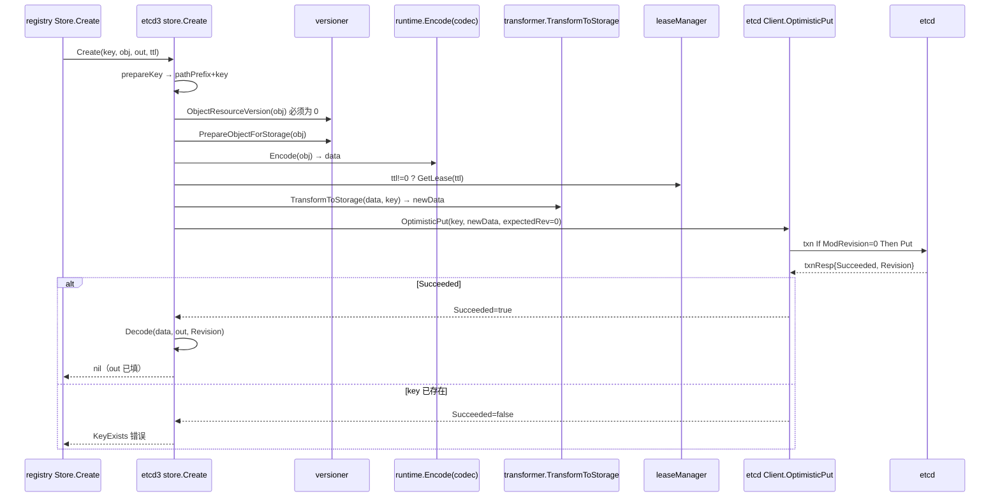

[总目录](../README.md)

# etcd3 写入路径专题

> **代码基准**：`k8s.io/kubernetes`，master@`782c049`（工作区文档产物外干净），Go 1.27.4。
> **范围**：apiserver 的 storage 层如何把一个对象写进 etcd——从 `storage.Interface.Create` / `GuaranteedUpdate` 进入，经 key 准备、编码、加密变换、lease、乐观事务（OptimisticPut），到冲突重试与短路写。覆盖 Create 与 Update 两条写路径，以及读-改-写的重试循环。
> **不覆盖**：etcd 集群自身的 raft/compaction/lease 续期机制；watch 推送链路；KMS 加密 provider 的具体实现（只讲 `transformer.TransformToStorage` 这一层）。
> **主文件**：`staging/src/k8s.io/apiserver/pkg/storage/etcd3/store.go`（Create/Get/GuaranteedUpdate/UpdateOnce）、`.../storage/txn.go`（通用重试循环）、`.../storage/interfaces.go`（PrepareKey）、`vendor/go.etcd.io/etcd/client/v3/kubernetes/client.go`（OptimisticPut，本分支魔改）。

## 0. 结论速览

apiserver 对 etcd 的写入**全部走乐观事务**：每次写都是一个 etcd txn，`If(ModRevision(key) == expectedRevision).Then(Put)`。Create 用 `expectedRevision=0`（key 必须不存在），Update 用上次读到的 `origState.Rev`（key 必须仍是那个版本）。冲突时不是加锁，而是**整轮重读-重算-重写**（`GuaranteedUpdate` 的 `for` 循环）。写入前对象要过三道处理：`PrepareObjectForStorage`（清 ResourceVersion）→ `runtime.Encode`（序列化）→ `TransformToStorage`（加密/变换）；长 TTL 对象还会绑一个 etcd lease。

### 0.1 这项能力现在能做什么

- **Create**：原子创建一个 key，key 已存在则返回 `KeyExists`（不覆盖）。
- **GuaranteedUpdate**：读-改-写的乐观循环，带前置条件（resourceVersion/uid）与 tryUpdate 函数，冲突自动重读重试，**保证最终写入成功或返回明确错误**。
- **加密落盘**：`TransformToStorage` 在写前把数据变成密文，读时 `TransformFromStorage` 解回——落盘数据始终是密文。
- **短路口**：Update 时若新数据与已读数据完全一致且非 stale，跳过写（`success=true, nil`），减少无谓 etcd 写。
- **TTL / lease**：带 TTL 的对象（如 lease、event）绑 etcd lease，到期由 etcd 自动清理。

### 0.2 关键结论、适用范围与不做什么

| 结论 | 说明 |
|---|---|
| 写 = 单条 etcd txn（乐观并发） | 无分布式锁；并发靠 `ModRevision` 比较实现 CAS |
| Create 用 expectedRev=0 | `OptimisticPut(ctx, key, data, 0, ...)`——key 不存在才成功 |
| Update 用 expectedRev=origState.Rev | key 自上次读后未被改才成功 |
| 冲突 → 整轮重试，不是自旋锁 | `GuaranteedUpdate` 的 `for` 循环：`refreshOnError` 重读 → `updateState` 重算 → `UpdateOnce` 重写 |
| 三道前置处理固定顺序 | `PrepareObjectForStorage` → `Encode` → `TransformToStorage` → (lease) → `OptimisticPut` |
| 短路写存在 | `UpdateOnce` 里 `!Stale && data==origState.Data` 时直接返回成功，不发 etcd txn |
| key 必带 resourcePrefix + pathPrefix | `prepareKey` → `PrepareKey`（防 `..`/`./` 逃逸 + 校验前缀）→ 拼 `pathPrefix` |

**不做什么**：不做批量事务（一次一个 key）；不在 storage 层做重试以外的并发控制；不缓存写结果（除 `GuaranteedUpdate` 调用方自带的 `cachedExistingObject`）。

## 1. 生产视角：实际怎么用、会得到什么

### 1.1 参与者、真实入口与前置条件

| 角色 | 是谁 | 做什么 |
|---|---|---|
| 调用方 | apiserver 的 registry 层（如 `generic/registry/store.go` 的 `Store.Create`/`Store.update`） | 发起 `Create`/`GuaranteedUpdate` |
| storage 实现 | `pkg/storage/etcd3/store.go` 的 `store`（实现 `storage.Interface`） | 执行 key 准备、编码、加密、事务 |
| 通用重试循环 | `pkg/storage/txn.go GuaranteedUpdate` | 驱动读-改-写重试 |
| etcd 客户端 | `vendor/go.etcd.io/etcd/client/v3/kubernetes.Client`（**本分支魔改**，加 `OptimisticPut`/`OptimisticDelete`/`Get`） | 发 etcd txn |
| transformer | `s.transformer`（`ValueTransformer`，KMS/AES 等 provider） | 写前加密、读前解密 |
| leaseManager | `s.leaseManager` | 为带 TTL 的对象申请 etcd lease |

**前置条件：**
1. etcd 客户端已连接（`s.client.Kubernetes`）。
2. `s.codec` / `s.versioner` / `s.transformer` / `s.leaseManager` 已注入。
3. 调用方传入的 key 已是相对 key（如 `/registry/pods/default/nginx`）；绝对 key 由 `prepareKey` 拼 `pathPrefix`。
4. Create 时对象**不得自带 ResourceVersion**（否则 `ErrResourceVersionSetOnCreate`）。

### 1.2 生产主流程图（Create 路径）



图后说明：
- **前提**：调用方已把对象默认化、校验通过（registry 层职责，见篇 06）。
- **分支**：`ttl != 0` 才走 lease；`out != nil` 才回填。
- **终点**：etcd 新增 key，revision 递增；watch 广播 CREATE 事件给订阅者。

### 1.3 输入、处理环节、输出与接收方

| 环节 | 输入 | 处理 | 输出 | 接收方 |
|---|---|---|---|---|
| key 准备 | 相对 key | `prepareKey`→`PrepareKey`（防逃逸+前缀校验）→拼 `pathPrefix` | 绝对 key（如 `/registry/pods/default/nginx`） | 后续所有 etcd 调用 |
| ResourceVersion 检查 | obj | Create 时必须为 0 | 或 `ErrResourceVersionSetOnCreate` | 调用方 |
| 对象准备 | obj | `PrepareObjectForStorage` | 清空/设置 ResourceVersion | Encode |
| 编码 | obj | `runtime.Encode(codec)` | `data []byte` | TransformToStorage |
| lease | ttl | `ttl!=0` → `GetLease` | `leaseID` | OptimisticPut |
| 加密变换 | data + key | `TransformToStorage` | `newData`（密文） | OptimisticPut |
| 事务 | key + newData + expectedRev | `OptimisticPut` | `txnResp{Succeeded, Revision}` | 回填 out / 冲突重试 |
| 回填 | data + Revision | `decoder.Decode` | `out` 对象 | 调用方 |

### 1.4 业务分支、异常表现、重复操作与边界

| 分支/异常 | 触发条件 | 用户可见结果 |
|---|---|---|
| Create 时 key 已存在 | `txnResp.Succeeded == false`（expectedRev=0 但 key 在） | `storage.NewKeyExistsError` → registry 层转 409 AlreadyExists |
| Create 时对象带 RV | `ObjectResourceVersion(obj) != 0` | `ErrResourceVersionSetOnCreate` |
| Update 冲突 | `OptimisticPut` expectedRev 不匹配 | `NewResourceVersionConflictsError` → `GuaranteedUpdate` 重读重试 |
| 短路写 | `!Stale && data == origState.Data` | 不发 txn，直接返回 `success=true` |
| 加密变换失败 | `TransformToStorage` 出错 | `NewInternalError`（500） |
| key 非法 | 含 `..`/`./`/空/缺前缀 | `PrepareKey` 返回 `invalid key` / `empty key` |
| TTL 对象 | `ttl != 0` | 绑 lease，到期 etcd 自动删 |
| capacity/lease 异常 | leaseManager 出错 | 直接返回错误，不写 |

### 1.5 一次真实操作示例

`kubectl run nginx` → `Store.Create` → `etcd3 store.Create`：

```text
key = /registry/pods/default/nginx
1. prepareKey → pathPrefix + key（校验前缀、防逃逸）
2. ObjectResourceVersion(obj) == 0 ✓（新建无 RV）
3. PrepareObjectForStorage → 清理/设置 RV
4. runtime.Encode(codec, obj) → data（JSON/protobuf 字节）
5. ttl == 0（Pod 无 TTL）→ 跳过 lease
6. TransformToStorage(data) → newData（若启用加密则为密文）
7. OptimisticPut(key, newData, expectedRev=0)
   etcd txn: If ModRevision(key)==0 Then Put(key, newData)
8. Succeeded=true → Decode(data, out, Revision)
9. 返回 nil；out = 存回的 Pod（带 etcd 分配的 revision）
```
若此时另一个请求也想创建同名 Pod：它的 `OptimisticPut(expectedRev=0)` 因 `ModRevision(key)!=0` 而 `Succeeded=false` → `KeyExists` → registry 层转 409 AlreadyExists。

## 2. 开发视角：当前代码怎样实现

### 2.1 实现地图：进程、入口、核心源码

| 角色 | 文件 | 符号（偏移以定义行为 +0） |
|---|---|---|
| storage 实现 | `staging/src/k8s.io/apiserver/pkg/storage/etcd3/store.go` | `store.Create`（:293）、`store.Get`（:244）、`store.Delete`（:361）、`store.GuaranteedUpdate`（:437）、`store.UpdateOnce`（:472）、`store.updateOnce`（:485）、`store.prepareKey`（:1232） |
| 通用重试循环 | `staging/src/k8s.io/apiserver/pkg/storage/txn.go` | `GuaranteedUpdate`（:114） |
| key 校验 | `staging/src/k8s.io/apiserver/pkg/storage/interfaces.go` | `PrepareKey`（:438） |
| etcd 客户端（魔改） | `vendor/go.etcd.io/etcd/client/v3/kubernetes/client.go` | `Client.OptimisticPut`（:83） |
| registry 调用方 | `staging/src/k8s.io/apiserver/pkg/registry/generic/registry/store.go` | `Store.Create`（:564）、`Store.create`（:595） |

**注意**：`OptimisticPut`/`OptimisticDelete`/`Get` 是**本分支魔改** `vendor/go.etcd.io/etcd/client/v3/kubernetes` 包新增的方法；上游 etcd client v3 无此 `kubernetes.Client`。见篇 00 分支差异。

### 2.2 技术前置条件

| 前置项 | 位置 | 说明 |
|---|---|---|
| `s.codec` | `New` 注入 | 对象序列化（JSON 或 protobuf） |
| `s.versioner` | `New` 注入 | `APIServerVersioner`：管理 ResourceVersion |
| `s.transformer` | `New` 注入 | 加密/变换 provider 链 |
| `s.leaseManager` | `New` 注入 | etcd lease 管理（TTL 对象） |
| `s.client.Kubernetes` | `New` 注入 | 魔改 etcd client |
| `s.pathPrefix` / `s.resourcePrefix` | `New` 注入 | key 前缀 |
| span / tracing | `tracing.Start` | 每个操作一个 span，`defer span.End(500ms)` |

### 2.3 真实调用链与关键源码锚点（Create 路径）

```text
Store.Create (registry store.go:564)
  └── store.Create (etcd3 store.go:293)
       ├── prepareKey (+? :1232) → PrepareKey (interfaces.go:438) → 拼 pathPrefix
       ├── ObjectResourceVersion(obj) != 0 → ErrResourceVersionSetOnCreate
       ├── PrepareObjectForStorage(obj)  [versioner]
       ├── runtime.Encode(codec, obj) → data
       ├── ttl!=0 → leaseManager.GetLease(ttl)
       ├── transformer.TransformToStorage(data, key) → newData
       ├── OptimisticPut(key, newData, 0, {LeaseID})  [client.go:83]
       │    └── etcd txn: If ModRevision=0 Then Put  (client.go:85-91)
       ├── !Succeeded → NewKeyExistsError
       └── out!=nil → decoder.Decode(data, out, Revision)
```

### 2.4 真实调用链与关键源码锚点（Update 路径）

```text
Store.GuaranteedUpdate (registry store.go)
  └── store.GuaranteedUpdate (etcd3 store.go:437)
       ├── prepareKey
       ├── origState = cachedExistingObject 或 GetCurrentState
       └── storage.GuaranteedUpdate (txn.go:114)   ← 通用重试循环
            └── for {
                  ├── preconditions.Check → 失败 refreshOnError 重读
                  ├── updateState(origState, tryUpdate) → ret, ttl
                  └── UpdateOnce (+472) → updateOnce (:485)
                       ├── PrepareObjectForStorage
                       ├── Encode → data
                       ├── !Stale && data==origState.Data → 短路成功
                       ├── TransformToStorage → newData
                       ├── ttl!=0 → GetLease
                       ├── OptimisticPut(key, newData, origState.Rev)  ← CAS
                       ├── !Succeeded → ResourceVersionConflicts → 重读重试
                       └── Succeeded → Decode(data, destination, Rev)
                }
```

**Create vs Update 的唯一区别（`OptimisticPut` 的 expectedRev）：**

| 路径 | expectedRev | etcd txn If 条件 | 冲突含义 |
|---|---|---|---|
| Create | `0` | `ModRevision(key) == 0`（key 不存在） | key 已存在 → KeyExists |
| Update | `origState.Rev` | `ModRevision(key) == origState.Rev` | key 已被别人改 → 冲突 → 重读重试 |

**短路写（`updateOnce` 内）：** `!origState.Stale && bytes.Equal(data, origState.Data)` 时——若 `origState` 来自缓存（`FromStorage=false`）则**必须先回 etcd 刷新确认**（注释：防止缓存与 etcd 序列化不一致），确认仍相等才短路；否则发 `ResourceVersionConflicts`。短路成功返回 `success=true, nil`，不发 etcd txn。

### 2.5 字段、转换、加密与 lease

| 处理 | 符号 | 输入 → 输出 | 说明 |
|---|---|---|---|
| 清/设 RV | `versioner.PrepareObjectForStorage` | obj → obj（RV 被清/设） | Create 清空、Update 设新 rev 语义 |
| 序列化 | `runtime.Encode(s.codec)` | obj → `data []byte` | codec 决定 JSON/protobuf |
| 加密变换 | `transformer.TransformToStorage` | data + `authenticatedDataString(key)` → newData | **落盘始终密文**；读时 `TransformFromStorage` 解回 |
| lease | `leaseManager.GetLease(ttl)` | ttl → `LeaseID` | 仅 `ttl != 0`；Pod 无 TTL 跳过 |
| 乐观事务 | `Client.OptimisticPut` | key + value + expectedRev → txnResp | `If ModRevision=expectedRev Then Put` |
| 回填 | `decoder.Decode(data, out, Rev)` | data → out 对象 | 把 etcd 分配的 revision 写进 out |

### 2.6 分支、失败处理与必须保持的规则

| 规则 | 锚点 | 为什么必须保持 |
|---|---|---|
| Create 时 RV 必须为 0 | `store.Create`（:303 ～ :305） | 否则破坏「新建无 RV」契约，etcd 侧 CAS 语义失效 |
| 落盘必加密 | `TransformToStorage`（Create :328 / updateOnce :527） | 落盘明文会泄露数据；读时 `TransformFromStorage` 对称解密 |
| 冲突走重读重试、不加锁 | `txn.go GuaranteedUpdate`（:114 `for` 循环） | etcd 乐观并发模型；加锁会破坏 etcd 线性化语义 |
| 短路前必须确认非 stale | `updateOnce`（:508 ～ :521） | 缓存可能滞后于 etcd，直接短路会丢写 |
| key 防逃逸 | `PrepareKey`（interfaces.go:438） | 防 `..`/`./` 逃逸出 resourcePrefix，越权访问其它 key |
| Create 不覆盖 | `OptimisticPut(expectedRev=0)` | 保证 Create 幂等语义：已存在即失败 |
| uid 前置条件（上层） | registry 层 `AdmissionToValidateObjectFunc` | 见篇 06；storage 层只负责 RV 前置条件 |

### 2.7 refreshOnError、transformer 链与 lease 复用（加深）

#### refreshOnError（txn.go:146）——冲突后重读的精确语义

`GuaranteedUpdate` 的 `for` 循环在冲突/前置条件失败时调 `refreshOnError` 重读。其精确语义：
```text
refreshOnError(st, err, ignoreNotFound, getCurrentState)
├── st.Current → 返回 st + err（数据已最新，返回原错误）
├── cachedRev = st.Rev; cachedErr = err（记住可能 stale 的 rev 和错误）
├── currentState = getCurrentState(ctx, ignoreNotFound)（从 etcd 重读）
├── cachedRev == currentState.Rev → 返回 currentState + cachedErr
│     （缓存数据其实不 stale，返回原错误）
└── 否则 → 返回 currentState, nil（重试）
```
**语义：** 只有当缓存 rev 与 etcd 当前 rev **不同**（数据真变了）才重试；若相同（数据没变，错误是别的原因）则返回原错误。这避免了「错误是别的原因却无限重试」。

#### transformer 链（value/transformer.go）

`transformer.TransformToStorage` 的实现是一个 **provider 链**：
- `Transformer` 接口（transformer.go:59）= `Read` + `Write`（即 `TransformFromStorage` / `TransformToStorage`）。
- `prefixTransformers`（transformer.go:172）：按前缀匹配多个 transformer，**每个 transformer 用自己的 prefix 作为 `authenticatedDataString`**——这是加密的关联数据（AAD），保证 key 绑定密文。
- 具体实现：
  - `identityTransformer`（encrypt/identity/identity.go:55）：恒等变换（不加密，用于未启用加密的资源）。
  - `envelopeTransformer`（encrypt/envelope/kmsv2/envelope.go:256）：KMS envelope 加密——用 DEK 加密数据，DEK 用 KEK（KMS provider）加密后存 etcd annotation。
  - `compression.go:68`：压缩 transformer（先压缩再加密）。

**provider 链的意义：** 资源可按 `ResourceTransformers.TransformerForResource(GroupResource)` 选择不同 transformer——不同资源可用不同加密策略。

#### lease 复用（`leaseManager.GetLease`，lease_manager.go:90）

etcd lease 是**有限资源**（每个 lease 有 maxObjectCount），故 `leaseManager` 复用 lease：
```text
GetLease(ttl)
├── reuseDurationSeconds = getReuseDurationSecondsLocked(ttl)
├── valid = now + ttl < prevLeaseExpirationTime（lease 未过期）
├── sufficient = now + (ttl + reuseDurationSeconds) < prevLeaseExpirationTime
│     （lease 还有足够余量）
├── leaseAttachedObjectCount++
├── valid && sufficient && count <= maxObjectCount → 复用 prevLeaseID
└── 否则 → Grant(ttl + reuseDurationSeconds) 新 lease
       → 缓存新 leaseID + 过期时间 + 重置 count
```
**语义：** 复用条件是「lease 未过期 + 余量足够 + 对象数未超限」。不满足则申请新 lease（带额外 `reuseDurationSeconds` 余量）。这避免为每个对象都申请新 lease（etcd lease 有上限）。

#### GetList 分页（store.GetList，:736）

`GetList` 支持 etcd 分页：
- `prepareKey(key, Recursive)` → keyPrefix。
- `limit = opts.Predicate.Limit; paging = limit > 0`——`limit > 0` 时启用分页。
- etcd 请求带 `limit` + `continue`（续读 token），实现大 list 的分页。

## 3. 验证、缺口与后续修改

### 3.1 代码回核与生产实测记录

- **代码回核**：本专题所有「符号+偏移」均在 HEAD `782c049` 上用 `grep -n` / `sed -n` 复核（`store.Create` :293、`store.GuaranteedUpdate` :437、`store.updateOnce` :485、`prepareKey` :1232、`OptimisticPut` client.go:83、`txn.go GuaranteedUpdate` :114、`PrepareKey` interfaces.go:438）。
- **生产实测**：**未实测** `[待运行验证]`。etcd txn 的实际 `ModRevision` 比较、加密 provider 行为、lease 到期清理均为代码推断，未在真实 etcd 集群抓包/查 key 验证。

### 3.2 已知缺口和待验证事项

| 缺口 | 性质 | 说明 |
|---|---|---|
| 通用 `GuaranteedUpdate` 的 `refreshOnError` | 未逐行读 | 冲突/前置条件失败后的重读细节（txn.go:146 起）未展开 |
| `TransformToStorage` 的 provider 链 | 未深挖 | KMS/AES-gcm 等具体 provider 实现未读（只讲 storage 层调用点） |
| etcd lease 续期 | 未深挖 | `leaseManager` 如何续期、到期清理时序未读 |
| watch 推送 | 不在范围 | 写入后的 watch 广播属 watch 链路，本专题不覆盖 |
| `GetList` 分页/续读 | 未深挖 | `store.GetList`（:736）的 list/continue 语义未展开 |

### 3.3 修改联动清单、源码索引与关联文档

**改动这块前必查：**
- 改 `OptimisticPut` 签名或语义 → 同步 etcd3 `store.Create`/`updateOnce`/`deleteOnce` 三处调用，以及魔改 client `vendor/.../kubernetes/client.go`。
- 改加密变换 → 同步写路径 `TransformToStorage` 与读路径 `TransformFromStorage`（对称）。
- 改 key 前缀/校验 → `prepareKey`（etcd3）与 `PrepareKey`（interfaces.go）两处都要改。
- 改重试循环 → `txn.go GuaranteedUpdate` 的 `for` 循环与 `refreshOnError`。
- 改短路写 → `updateOnce` 的 `!Stale && data==origState.Data` 分支与其 `FromStorage` 判定。

**源码索引：**

| 符号 | 文件:行 |
|---|---|
| `store.Get` | `etcd3/store.go:244` |
| `store.Create` | `etcd3/store.go:293` |
| `store.Delete` | `etcd3/store.go:361` |
| `store.DeleteOnce` | `etcd3/store.go:394` |
| `store.GuaranteedUpdate` | `etcd3/store.go:437` |
| `store.UpdateOnce` | `etcd3/store.go:472` |
| `store.updateOnce` | `etcd3/store.go:485` |
| `store.GetList` | `etcd3/store.go:736` |
| `store.prepareKey` | `etcd3/store.go:1232` |
| `txnError` | `etcd3/store.go:1253` |
| `Client.OptimisticPut` | `vendor/.../kubernetes/client.go:83` |
| `GuaranteedUpdate`（通用循环） | `storage/txn.go:114` |
| `PrepareKey` | `storage/interfaces.go:438` |
| registry `Store.Create` | `generic/registry/store.go:564` |
| registry `Store.create` | `generic/registry/store.go:595` |

**关联文档：** [06-apiserver请求处理与etcd](../06-apiserver请求处理与etcd.md)（§2.3 泛型 Store 与 etcd、§5.3 deleteObject 为本专题的上层入口浓缩版）；[03-主链路逐步拆解](../03-主链路逐步拆解.md)（第二段 apiserver 持久化）。

[总目录](../README.md)
