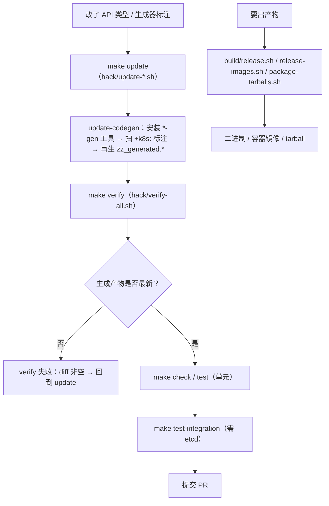

[总目录](../README.md)

# 构建发布与代码生成专题

> **代码基准**：`k8s.io/kubernetes`，master@`57d78241ff96c94130c509681b12b4a1715434af`（2026-11-20，工作区除文档产物外干净），Go 1.27.4（`.go-version`）。
> **范围**：从源码到可交付产物的开发侧流程——`Makefile` 的 verify/update/test 目标、`hack/update-codegen.sh` 与各 `*-gen` 生成器、`hack/verify-*.sh` 静态门禁、`build/` 下的 release 脚本。回答「改了 API/生成器后如何再生代码、如何本地校验、产物如何构建」。
> **不覆盖**：测试分层与替身选择（见 [测试与质量体系](测试与质量体系.md)）；具体生成代码的业务语义（各子系统专题）；真实 CI 系统配置（本仓库只含脚本，不含 CI 平台定义）。
> **主文件**：`Makefile`、`hack/update-codegen.sh`、`hack/verify-all.sh` 与 `hack/verify-*.sh`、`build/release.sh`、`build/common.sh`、`vendor/k8s.io/code-generator/`（生成器真身）。

## 0. 结论速览

Kubernetes 大量代码是**生成的**：clientset、informer、lister、deepcopy、defaulter、conversion、openapi 等都由 `k8s.io/code-generator` 的各 `*-gen` 工具从 `+k8s:` 标注生成。改 API 类型后必须重跑 `make update`（或对应 `hack/update-*`）再生代码，并用 `make verify`（`hack/verify-all.sh`）确认生成产物已同步。构建产物走 `build/` 下的 release 脚本。

### 0.1 这套流程现在能做什么

- **再生生成代码**：`hack/update-codegen.sh` 用 `deepcopy-gen`、`defaulter-gen`、`conversion-gen`、`validation-gen`、`prerelease-lifecycle-gen` 等，从带 `+k8s:` 标注的类型生成 `zz_generated.*` 等文件。
- **本地静态校验**：`Makefile` 的 `verify` / `quick-verify` 目标 → `hack/verify-all.sh` → 各 `hack/verify-*.sh`（只读，检查生成代码是否最新、格式、boilerplate 等）。
- **运行测试**：`Makefile` 的 `check`/`test`（单元）、`test-integration`（集成）、`ginkgo`（e2e 二进制）。
- **构建发布产物**：`build/release.sh`、`build/release-images.sh`、`build/package-tarballs.sh`（容器镜像与 tarball）。

### 0.2 关键结论、适用范围与不做什么

| 目标 / 脚本 | 类型 | 作用 |
|---|---|---|
| `make update` / `hack/update-*.sh` | **改文件** | 再生生成代码、格式化、更新文档 |
| `make verify` / `hack/verify-*.sh` | **只读** | 校验生成代码最新、格式、boilerplate（CI 门禁） |
| `make check` / `test` | 只读 | 单元测试 |
| `make test-integration` | 需环境 | 集成测试（etcd） |
| `build/release.sh` | 改产物 | 构建发布二进制/镜像 |

**不做什么**：本仓库不含 CI 平台定义（Prow/Jenkins 配置在社区侧）；`update-*` 会覆盖 `zz_generated.*`，不要手工编辑生成文件；`verify` 不做功能测试。

## 1. 生产视角：实际怎么用、会得到什么

### 1.1 参与者、真实入口与前置条件

| 角色 | 是谁 | 用什么 | 得到什么 |
|---|---|---|---|
| API 开发者 | 改 `staging/src/k8s.io/api` 类型的人 | `make update` | 重生的 deepcopy/defaulter/conversion/openapi |
| 提交者 | 准备 PR 的人 | `make verify` / `quick-verify` | 生成代码与格式是否合规 |
| 发布工程师 | 出产物的人 | `build/release*.sh` | 二进制 / 容器镜像 / tarball |

前置条件：本机 Go 工具链版本须匹配 `.go-version`（当前 1.27.4）；`update-codegen` 用 `GOPROXY=off go install` 从 `vendor/k8s.io/code-generator` 安装生成器，因此 vendor 必须完整；release 脚本需要容器构建环境。

### 1.2 生产主流程图



### 1.3 输入、处理、输出与接收方

| 环节 | 输入 | 实际处理 | 可见输出 | 接收方 |
|---|---|---|---|---|
| 再生代码 | 带 `+k8s:` 标注的类型 | `*-gen` 工具生成 | `zz_generated.*`、clientset/informer/lister | 版本库 |
| 静态校验 | 当前工作区 | `verify-*.sh` 只读比对 | 退出码 / diff | CI 门禁 |
| 单元/集成测试 | 测试代码 | `hack/test-go.sh` 等 | PASS/FAIL | 开发者 |
| 构建发布 | 源码 + 构建环境 | release 脚本 | 二进制/镜像/tarball | 发布渠道 |

### 1.4 主流程、分支与异常结果

- **verify 因生成代码过期失败**：先 `make update` 再 `verify`；不要手工改 `zz_generated.*`。
- **update-codegen 报生成器安装失败**：多为 vendor 不完整或 Go 版本不匹配 `.go-version`；`GOPROXY=off` 要求依赖已在 vendor 内。
- **release 失败**：多为构建环境（容器/依赖）缺失，与代码逻辑无关。

### 1.5 一次真实操作示例

给某 API 类型加一个新字段：
1. 改 `staging/src/k8s.io/api/<group>/<version>/types.go` 的类型定义（带 `+k8s:` 标注处）。
2. `make update` → `update-codegen` 重生 `zz_generated.deepcopy.go`、defaulter/conversion、clientset/informer/lister、openapi。
3. `make verify` 确认无 diff；`make check` 跑受影响单元测试。
4. 若字段影响默认值，补 defaulter；影响校验，补 validation（生成器覆盖）。

### 1.6 边界与验收表现

- 生成代码的正确性由生成器保证，人工只维护带标注的源类型；验证表现为 `verify` 无 diff + 测试通过。
- `update` 与 `verify` 必须成对理解：`update` 改文件、`verify` 只读，CI 只跑 `verify`。

## 2. 开发视角：当前代码怎么实现

### 2.1 实现地图

| 职责 | 文件 · 符号 / 目标 |
|---|---|
| 顶层目标 | `Makefile` · `verify`、`quick-verify`、`update`、`check`/`test`、`test-integration`、`ginkgo` |
| 代码生成总入口 | `hack/update-codegen.sh`（`kube::golang::setup_env` 起环境） |
| 生成器工具 | `hack/update-codegen.sh` 内 `GOPROXY=off go install k8s.io/code-generator/cmd/{deepcopy-gen,defaulter-gen,conversion-gen,validation-gen,prerelease-lifecycle-gen}` |
| 静态门禁总入口 | `hack/verify-all.sh` |
| 单元测试脚本 | `hack/test-go.sh` |
| 发布脚本 | `build/release.sh`、`build/release-images.sh`、`build/package-tarballs.sh`、`build/common.sh` |
| 生成器真身 | `vendor/k8s.io/code-generator/`（`GOPROXY=off` 安装来源） |
| Go 版本 | `.go-version` |

### 2.2 真实调用链

```
make update
  → hack/update-codegen.sh
      → kube::golang::setup_env                 （Go 环境）
      → GOPROXY=off go install k8s.io/code-generator/cmd/deepcopy-gen
      → 同法安装 defaulter-gen / conversion-gen / validation-gen / prerelease-lifecycle-gen
      → 扫描 +k8s: 标注文件 → 运行各 *-gen → 写 zz_generated.* / clientset / informer / lister / openapi
make verify
  → hack/verify-all.sh → 各 hack/verify-*.sh     （只读：codegen 是否最新、boilerplate、格式…）
make check / test        → hack/test-go.sh（单元）
make test-integration    → 集成测试（需 etcd）
build/release.sh         → build/common.sh 等 → 发布二进制/镜像
```

### 2.3 关键源码定位

脚本与 Makefile 目标用**稳定名定位**（非 Go 符号，故不用 `+N` 偏移）：

| 稳定名 | 位置 | 说明 |
|---|---|---|
| `verify` / `quick-verify` / `update` / `check` / `test` / `test-integration` / `ginkgo` | `Makefile`（`.PHONY` 目标） | 顶层入口 |
| `update-codegen.sh` | `hack/` | 代码生成总入口；`kube::golang::setup_env` 起环境 |
| `deepcopy-gen` / `defaulter-gen` / `conversion-gen` / `validation-gen` / `prerelease-lifecycle-gen` | `hack/update-codegen.sh` 内 `go install` | 五类生成器 |
| `verify-all.sh` | `hack/` | 静态门禁聚合 |
| `test-go.sh` | `hack/` | 单元测试 |
| `release.sh` / `release-images.sh` / `package-tarballs.sh` / `common.sh` | `build/` | 发布构建 |
| `.go-version` | 仓库根 | Go 版本（当前 1.27.4） |

生成代码的运行期符号（如 `fake.Clientset`、`zz_generated.deepcopy`）属**生成产物**，其机制见 [测试与质量体系](测试与质量体系.md)。

### 2.4 核心机制与必须保持的规则

- **生成器从 `+k8s:` 标注读取意图**：`update-codegen.sh` 扫描带标注文件，喂给对应 `*-gen`；改动要落在源类型的标注上，不是生成文件。
- **`GOPROXY=off` + vendor**：生成器从 `vendor/k8s.io/code-generator` 离线安装，vendor 必须与 `go.mod` 一致。
- **update 改文件 / verify 只读**：这是本地再生与 CI 门禁的分界；手工编辑 `zz_generated.*` 会被下次 `update` 覆盖。
- **Go 版本钉死**：`.go-version` 决定工具链，不匹配会导致生成/构建行为差异。

### 2.5 验证方式与可观察结果

- 本地：`make verify` 退出码 0 且无 diff；`make check` 单元通过。
- 代码回核：本文稳定名可用 grep 定位（`hack/`、`build/`、`Makefile`）。
- 发布实测：`build/release*.sh` 的真实产物构建需相应容器/依赖环境 `[待运行验证]`。

### 2.6 后续引用与修改联动

- 测试分层：[测试与质量体系](测试与质量体系.md)（`make test` / `test-integration` 背后的分层）。
- 生成代码的运行期使用：fake clientset（测试）、clientset/informer/lister（各控制器专题）。
- 改动联动：新增 API group/version 需同步 `hack/update-codegen.sh` 的处理范围与各 `verify-*` 门禁；升级生成器版本需同步 vendor。

## 3. 证据与缺口

- 本文稳定名（Makefile 目标、`hack/`、`build/` 脚本、`.go-version`）均在当前工作区核实存在；生成器名取自 `hack/update-codegen.sh` 内 `go install` 行。
- 源自旧库 `docs/adrian/sourceReader2/07-build-release-cluster-vendor-staging.md`、`05-update-verify-codegen.md` 的主题，按当前源码/脚本合并重写并替换 `#L` 行号引用为稳定名定位。
- 待确认：`make` 各目标的完整参数与 CI 实际触发集以 `Makefile` 与 `hack/verify-all.sh` 当前内容为准 `[待运行验证]`。

[总目录](../README.md)
