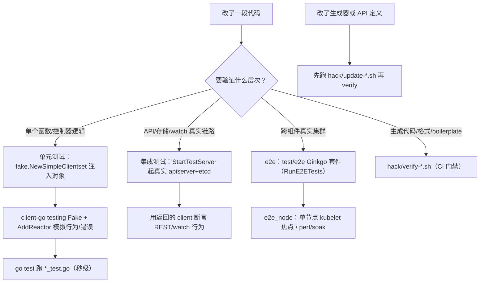

[总目录](../README.md)

# 测试与质量体系专题

> **代码基准**：`k8s.io/kubernetes`，master@`57d78241ff96c94130c509681b12b4a1715434af`（2026-11-20，工作区除文档产物外干净），Go 1.27.4。
> **范围**：Kubernetes 质量保障的四个独立维度——单元测试（fake client + client-go testing reactor）、集成测试（真实 apiserver testserver + etcd）、端到端测试（e2e / e2e_node / perf / soak）、以及 `hack/` 下的 verify/update 脚本体系。回答「测什么、在哪测、用什么替身、怎么跑」。
> **不覆盖**：构建与发布的 Makefile/release 流水线（见 [构建发布与代码生成](构建发布与代码生成.md)）；代码生成器本身（同上）；某个具体子系统的测试细节（各子系统专题的「验证方式」节）。
> **主文件**：`staging/src/k8s.io/client-go/kubernetes/fake/`、`staging/src/k8s.io/client-go/testing/`、`cmd/kube-apiserver/app/testing/`、`test/integration/framework/`、`test/e2e/`（含 `framework/`、`e2e_node/`）、`hack/test-go.sh` 与 `hack/verify-*.sh`。

## 0. 结论速览

Kubernetes 的质量体系不是一条流水线，而是**四个互相独立的维度**：单元测试用假替身验证单个函数/控制器的调谐逻辑；集成测试起真实 apiserver + etcd 验证 API/存储/watch 链路；端到端测试在真实集群验证跨组件行为；`hack/verify-*` 与 `hack/update-*` 脚本守护生成代码、格式、boilerplate 等静态约束。选错层次测错东西，是新手最常见的浪费。

### 0.1 这套体系现在能做什么

- **单元测试**：用 `fake.NewSimpleClientset` 注入预置对象，用 client-go testing 的 `Fake` + reactor 模拟 API 行为与错误，验证控制器调谐逻辑，不起任何进程。
- **集成测试**：用 `cmd/kube-apiserver/app/testing` 或 `test/integration/framework` 起**真实 apiserver（含 etcd）**，验证 REST/存储/watch/准入真实链路。
- **端到端测试**：`test/e2e`（真实集群、Ginkgo 套件）、`test/e2e_node`（单节点 kubelet 焦点）、perf/soak（性能与稳定性）。
- **静态守护**：`hack/verify-*.sh`（只读校验，CI 门禁）、`hack/update-*.sh`（会改文件，本地跑）。

### 0.2 关键结论、适用范围与不做什么

| 维度 | 回答的问题 | 主要入口 | 替身 / 环境 |
|---|---|---|---|
| 单元测试 | 这个函数/控制器的调谐逻辑对吗 | `*_test.go` + `fake.NewSimpleClientset` | fake clientset（内存） |
| 集成测试 | API→存储→watch 真实链路通吗 | `StartTestServer`（apiserver testing / integration framework） | 真实 apiserver + etcd |
| e2e 测试 | 跨组件在真实集群表现对吗 | `test/e2e`（`RunE2ETests` / Ginkgo） | 真实多组件集群 |
| verify/update | 生成代码、格式、boilerplate 合规吗 | `hack/verify-*.sh` / `hack/update-*.sh` | 无（静态脚本） |

**不做什么**：单元测试不验证真实 etcd 行为；集成测试不覆盖真实节点/kubelet；e2e 不用于定位单函数逻辑；verify 脚本不做功能验证。选层原则：能用低层复现的不要上高层。

## 1. 生产视角：实际怎么用、会得到什么

### 1.1 参与者、真实入口与前置条件

| 角色 | 是谁 | 用什么 | 得到什么 |
|---|---|---|---|
| 控制器开发者 | 改 controller 调谐逻辑的人 | fake clientset + reactor | 秒级反馈，不起进程 |
| API/存储开发者 | 改 apiserver/storage/watch 的人 | 集成 testserver | 真实 API 链路验证 |
| 平台/发布验证 | 验证跨组件行为的人 | e2e 套件 | 真实集群端到端结论 |
| CI 门禁 | 提交前/CI | `hack/verify-all.sh` | 静态合规是否通过 |

前置条件：单元测试无需环境；集成测试需本机可跑 etcd（testserver 通常自带/拉起）；e2e 需一个真实集群与 kubeconfig；verify 脚本需本机 Go 工具链与部分外部工具。

### 1.2 生产主流程图



### 1.3 输入、处理、输出与接收方

| 层次 | 输入 | 实际处理 | 可见输出 | 判据 |
|---|---|---|---|---|
| 单元 | 预置 runtime.Object + reactor | 内存 client 调谐 | `go test` PASS/FAIL | 调谐逻辑分支是否覆盖 |
| 集成 | testserver 启动参数 | 真实 apiserver+etcd 处理请求 | client 断言结果 | REST/watch/存储真实行为 |
| e2e | 真实集群 kubeconfig | Ginkgo 套件跑场景 | 套件 PASS/FAIL | 跨组件端到端表现 |
| verify | 当前工作区 | 静态校验脚本 | 退出码 / diff | 生成代码与格式是否合规 |

### 1.4 主流程、分支与异常结果

- **单元测试失败**：定位到具体调谐分支；用 reactor 精确注入错误场景（如 API 返回 Conflict/NotFound）验证重试与回队。
- **集成测试失败**：区分是 apiserver/storage 逻辑还是测试环境（etcd 未就绪）；testserver 输出 apiserver 日志辅助定位。
- **e2e 失败**：先排除环境噪声（集群状态、镜像拉取），再定位组件；perf/soak 关注时序与资源而非单次成败。
- **verify 失败**：若因生成代码过期，先跑对应 `update-*` 再 verify；本地 verify 通过再提交，避免 CI 白跑。

### 1.5 一次真实操作示例

为一个控制器加「API 返回 Conflict 时重试」的逻辑：
1. 单元层：`fake.NewSimpleClientset` 预置对象，`Fake.AddReactor` 让 `update` 返回 Conflict，断言控制器重试并最终成功。
2. 若涉及真实 watch 语义，再上集成 testserver 复现一次，确认真实 apiserver 的 Conflict 行为一致。
3. 提交前跑相关 `hack/verify-*.sh`（如改了生成代码则先 `update-codegen`）。
4. e2e 仅在改动跨组件可见行为时才补。

### 1.6 边界与验收表现

- 层次越低越快越稳定，但覆盖面越窄；不要用 e2e 去测单函数，也不要用单元测试声称「真实 etcd 上没问题」。
- verify/update 是两件事：`verify` 只读、用于门禁；`update` 会改文件、用于本地再生。

## 2. 开发视角：当前代码怎么实现

### 2.1 实现地图

| 层次 | 文件 · 符号 |
|---|---|
| fake clientset 构造 | `staging/src/k8s.io/client-go/kubernetes/fake/clientset_generated.go` · `NewSimpleClientset` / `Clientset` |
| 通用 fake + reactor | `staging/src/k8s.io/client-go/testing/fake.go` · `Fake` / `AddReactor` / `PrependReactor` / `Actions` / `ClearActions` |
| apiserver 集成 testserver | `cmd/kube-apiserver/app/testing/testserver.go` · `TestServer` / `StartTestServer` / `StartTestServerOrDie` |
| integration framework | `test/integration/framework/test_server.go` · `StartTestServer` / `TearDownFunc` |
| e2e 套件入口 | `test/e2e/e2e.go` · `RunE2ETests`；`test/e2e/e2e_test.go` · `TestMain` / `TestE2E` |
| e2e framework | `test/e2e/framework/framework.go` · `Framework` / `NewFramework` |
| e2e_node | `test/e2e_node/e2e_node_suite_test.go`（套件入口） |
| 单元/集成运行脚本 | `hack/test-go.sh` |
| 静态守护 | `hack/verify-all.sh` 及 `hack/verify-*.sh`、`hack/update-*.sh` |

### 2.2 真实调用链

```
单元：test → fake.NewSimpleClientset(objs...)
      → client-go testing Fake（AddReactor 注入 verb/resource 行为）
      → 被测控制器 sync 用内存 client 调谐 → Actions() 断言发出的请求
集成：test → StartTestServer(...)（apiserver testing）
      → 起真实 apiserver + etcd → 返回 client.Interface + rest.Config
      → 断言 REST/watch；TearDownFunc 收尾
      （另一形态）test/integration/framework.StartTestServer(ctx, t, setup)
e2e：TestMain → RunE2ETests → Ginkgo 套件（NewFramework 建客户端/清理）
静态：hack/verify-all.sh → 各 verify-*.sh（只读）；hack/update-*.sh（改文件）
```

### 2.3 关键源码定位

锚点记法 `符号+N`：`+0` 即定义行。接收者短名：client-go testing 的 `c`（`*Fake`）。可用 `.progress/verify_anchors.py` 反查。

| 符号 | 定义文件 | 作用 |
|---|---|---|
| `NewSimpleClientset+0` | `staging/src/k8s.io/client-go/kubernetes/fake/clientset_generated.go` | 用预置对象构造内存 clientset |
| `Clientset+0` | 同上 | fake clientset 类型 |
| `Fake+0` | `staging/src/k8s.io/client-go/testing/fake.go` | 通用 fake 对象 |
| `c.AddReactor+0` / `c.PrependReactor+0` | 同上 | 注入 verb/resource 的反应（含错误注入） |
| `c.Actions+0` / `c.ClearActions+0` | 同上 | 读取/清空已发出请求，用于断言 |
| `TestServer+0` | `cmd/kube-apiserver/app/testing/testserver.go` | 集成 testserver 结果类型 |
| `StartTestServer+0` / `StartTestServerOrDie+0` | 同上 | 起真实 apiserver + etcd |
| `StartTestServer+0` | `test/integration/framework/test_server.go` | integration framework 入口 |
| `TearDownFunc+0` | 同上 | 收尾函数类型 |
| `RunE2ETests+0` | `test/e2e/e2e.go` | e2e 套件运行入口 |
| `TestMain+0` / `TestE2E+0` | `test/e2e/e2e_test.go` | e2e 测试进程入口 |
| `Framework+0` / `NewFramework+0` | `test/e2e/framework/framework.go` | e2e framework 与构造 |

- 组件级集成替身：`cmd/kube-controller-manager/app/testing/testserver.go`、`cmd/kube-scheduler/app/testing/testserver.go` 提供对应组件的 testserver。
- fake clientset 是**生成代码**（`clientset_generated.go`），机制见 [构建发布与代码生成](构建发布与代码生成.md)。

### 2.4 核心机制与必须保持的规则

- **reactor 决定 fake 行为**：`AddReactor(verb, resource, fn)` 按 verb+resource 匹配反应；不匹配则走默认（返回预置对象或 NotFound）。注入错误靠返回 error 的 reactor。
- **Actions 断言「发出了什么请求」**：控制器测试常断言 `Actions()` 里 update/patch 的次数与内容，而非只看返回值。
- **单元与集成的分界是「是否起真实 apiserver」**：fake 是内存对象、无 watch 语义保证；需要真实 watch/存储行为必须上 testserver。
- **e2e 是 Ginkgo 套件**：`RunE2ETests` 以 `t.Run` 驱动 Ginkgo，需要真实集群；`TestMain` 负责进程级初始化。
- **verify 只读、update 改文件**：CI 跑 verify；本地改完先跑 update 再 verify，不要在 CI 里跑 update。

### 2.5 验证方式与可观察结果

- 本文本身描述验证体系；每层的可观察结果即上文 1.3 表的「可见输出」列。
- 代码回核：本文锚点可用 `.progress/verify_anchors.py` 反查定义行与偏移。
- 生产实测：e2e/perf/soak 的真实运行结论需在真实集群执行 `[待运行验证]`。

### 2.6 后续引用与修改联动

- 构建与生成器：[构建发布与代码生成](构建发布与代码生成.md)（fake clientset、`update-codegen` 的来源）。
- 各子系统专题的「验证方式」节引用本文选层；改控制器逻辑优先补单元（reactor 注入错误），改 API/存储优先补集成。
- 改动联动：新增 API 类型/生成器会同时影响 fake clientset 与 verify 门禁；新增 e2e 场景需确认集群前置。

## 3. 证据与缺口

- 本文符号均在当前工作区 `staging/src/k8s.io/client-go/`、`cmd/kube-apiserver/app/testing/`、`test/integration/framework/`、`test/e2e/` 下经 grep 核实存在；偏移以定义行为 `+0`。
- 源自旧库 `docs/adrian/sourceReader2/` 测试体系系列（`01-测试体系总图与选型.md`、`02-单元测试-fixtures与fake-clients.md`、`03-integration与etcd-testserver.md`、`04-e2e-node-perf-soak.md`）的主题，按当前源码合并重写并替换 `#L` 行号引用为符号+偏移。
- 待确认：各 verify/update 脚本的完整清单与 CI 触发关系以 `hack/` 当前脚本为准 `[待运行验证]`。

[总目录](../README.md)
