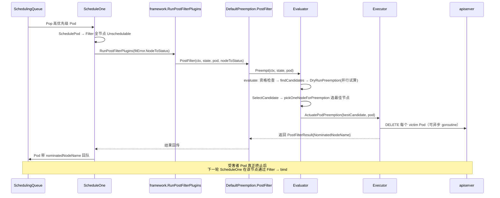

[总目录](../README.md)

# 调度器抢占（Preemption）专题

> **代码基准**：`k8s.io/kubernetes`，master@`8893923938107170c86eb4b8cc2b7225b4e44e9b` 的后继 `782c049`（工作区文档产物外干净），Go 1.27.4。
> **范围**：kube-scheduler 在「Filter 全失败、无节点能放下 Pod」时如何触发抢占——从 PostFilter 入口到选出受害者、驱逐、nominated node 回队，再到下一轮绑定的完整顺序。覆盖单 Pod 抢占为主，PodGroup 抢占与异步抢占作为分支说明。
> **不覆盖**： victim Pod 被驱逐后在 kubelet/eviction API 侧的实际终止过程；PriorityClass 的创建与优先级数值设计。
> **主文件**：`pkg/scheduler/framework/preemption/`（Evaluator/Executor/manager）、`pkg/scheduler/framework/plugins/defaultpreemption/`（默认 PostFilter 插件）。

## 0. 结论速览

抢占是调度器的兜底路径：当 `ScheduleOne` 的 Filter 阶段判所有节点都 `Unschedulable` 时，PostFilter 扩展点被触发，调度器**模拟驱逐**一批低优先级 Pod，为高优先级 Pod 腾出空间。抢占**不真正立即删 Pod**——它先在调度缓存里「假定」受害者会被驱逐，把抢占者标上 `nominatedNodeName` 回队，真正的驱逐由 Executor 异步发起，下一轮调度周期才在目标节点上完成绑定。

### 0.1 这项能力现在能做什么

- 高优先级 Pod 在资源紧张时能**插队**：调度器主动选一个节点、算出「驱逐哪几个 Pod 就能放下它」。
- 通过 PDB（PodDisruptionBudget）**限制驱逐烈度**：优先选 PDB 违规最少的方案。
- 通过 `preemptionPolicy: Never` **禁止抢占**：某些关键 Pod 可声明不可被抢占、也不抢占别人。
- 支持 **PodGroup 抢占**（GenericWorkload）：跨节点的 PodGroup 作为整体受害者被抢占。
- 支持**异步抢占**（KEP-4832，`AsyncPreemption`）：驱逐动作放独立 goroutine，不阻塞调度主循环。

### 0.2 关键结论、适用范围与不做什么

| 结论 | 说明 |
|---|---|
| 抢占只在 Filter 全失败后触发 | Filter 有任一可行节点就轮不到抢占；抢占是 PostFilter 扩展点的职责 |
| 抢占是「模拟 + 提名」，不是同步删 Pod | 调度器只做 dry-run 选受害者 + 打 nominated 标记；实际驱逐由 Executor（可异步）发起 |
| 抢占者下一轮才绑定 | 打上 nominatedNodeName 回队，等受害者真正消失后，下一轮 ScheduleOne 在该节点通过 Filter |
| 默认实现可替换 | `DefaultPreemption` 是 PostFilter 插件，可被自定义 PostFilter 插件替换 |
| 不做「跨调度器协调」 | 抢占决策只基于本调度器快照；多调度器（scheduler-per-scheduler）场景需自行保证 |

**不做什么**：不保证被抢占 Pod 一定成功重建；不为被抢占 Pod 提供任何迁移/保序承诺（它就是被删掉）；不处理 preemptor 自身的 `preemptionPolicy: Never`（这种 Pod 直接在资格检查被拒）。

## 1. 生产视角：实际怎么用、会得到什么

### 1.1 参与者、真实入口与前置条件

| 角色 | 是谁 | 做什么 |
|---|---|---|
| 抢占者（preemptor） | 一个高优先级 Pod（`spec.priorityClassName` 指向高 priority 的 PriorityClass） | 因资源不足调度失败，进入抢占流程 |
| 受害者（victim） | 同节点上优先级更低的 Pod | 被选中驱逐，为抢占者腾资源 |
| 默认抢占插件 | `DefaultPreemption`（PostFilter 插件，`Name = names.DefaultPreemption`） | 实现 `fwk.PostFilterPlugin`，驱动整个抢占决策 |
| Executor | `pkg/scheduler/framework/preemption.Executor` | 真正发起对受害者 Pod 的驱逐（DELETE） |
| PDB | 集群里的 PodDisruptionBudget 对象 | 约束「同时最多驱逐多少」，抢占会尽量少违反 PDB |

**前置条件（可判断，非「满足相关条件」）：**
1. 抢占者 Pod 的 `spec.priorityClassName` 解析出的 priority 高于受害者。
2. 抢占者 `preemptionPolicy != Never`（默认 `PreemptLowerPriority`）。
3. Filter 阶段**所有**节点都返回 `Unschedulable`（否则轮不到 PostFilter）。
4. 集群已部署 `DefaultPreemption` PostFilter 插件（默认开启）。
5. 节点快照（snapshot）已就绪（`Run` 启动时已同步）。

### 1.2 生产主流程图



图后说明：
- **前提**：Filter 阶段对全部节点返回 `Unschedulable`，`fitError.Diagnosis.NodeToStatus` 携带每个节点的失败原因。
- **分支**：`AsyncPreemption` 开启时第 7 步放 goroutine，`PostFilter` 立即返回；关闭时同步驱逐完才返回。
- **终点**：抢占者带 `nominatedNodeName` 回队，等待受害者消失；受害者驱逐是异步的，绑定发生在**下一个**调度周期。

### 1.3 输入、处理环节、输出与接收方

| 环节 | 输入 | 处理 | 输出 | 接收方 |
|---|---|---|---|---|
| 触发 | Filter 全失败的 `FitError` + `NodeToStatus` | `RunPostFilterPlugins`（schedule_one.go:333） | 调用默认 PostFilter 插件 | `DefaultPreemption.PostFilter` |
| 资格检查 | preemptor Pod + nominatedNode 状态 | `PodEligibleToPreemptOthers` | 是否允许抢占 + 原因 | `Evaluator.evaluate` |
| 候选生成 | 全节点快照 + PDB 列表 | `findCandidates` → `DryRunPreemption` 并行试算每节点 | `[]PreemptionCandidate`（带受害者集合） | `SelectCandidate` |
| 选节点 | 候选集合 | `SelectCandidate` → `pickOneNodeForPreemption` 多级打分 | 单个最佳 `PreemptionCandidate` | `ActuatePodPreemption` |
| 驱逐 | 最佳候选的受害者集合 | `Executor.ActuatePodPreemption`（同步/异步） | 对每个 victim 的 DELETE 请求 | apiserver → kubelet |
| 提名 | PostFilterResult | 写 `Status.NominatedNodeName` | Pod 回队 | SchedulingQueue → 下一轮 ScheduleOne |

### 1.4 业务分支、异常表现、重复操作与边界

| 分支/异常 | 触发条件 | 用户可见结果 |
|---|---|---|
| 抢占者无抢占资格 | `preemptionPolicy=Never`，或已 nominated 在同节点 | `PostFilter` 返回 Unschedulable，Pod 回队（BackoffQ），事件 `FailedScheduling` |
| 某节点无受害者 | 驱逐候选后仍放不下 | 该节点标记 `UnschedulableAndUnresolvable`，跳过 |
| 候选全部违反 PDB | 所有方案都违反 PDB | 仍会选一个（violating 候选兜底），但优先选违规最少的 |
| 受害者驱逐失败 | DELETE 被 webhook 拒绝等 | Executor 重试；抢占者滞留队列，下一轮重新抢占 |
| 环（cycle） | owner 等待 dependents 删除且自身有 dependents | 用 `unblockOwnerReferences` patch 打破环后 Foreground 删除（注释明说此检测有误报） |
| 重复抢占 | 抢占者已 nominated 在同节点 | `PodEligibleToPreemptOthers` 拒绝重复抢占 |
| 抢占成功但受害者未消失 | 驱逐异步进行中 | 抢占者滞留队列，直到受害者终止、下一轮 Filter 通过 |

### 1.5 一次真实操作示例

假设集群 3 个节点，每节点 4 核全部被 `priority=100` 的 Pod 占满。现在提交一个 `priority=1000` 的 Pod `high-prio`，请求 2 核。

```bash
kubectl create priorityclass high --value=1000
kubectl run high-prio --image=nginx --priorityclassname=high --restart=Never
# 资源不足 → 调度失败 → 触发抢占
kubectl get pod high-prio -o wide
# NAME        READY   STATUS    ...   NODE
# high-prio   0/1     Pending   ...   node-2   ← spec.nodeName 已被填（nominated）
kubectl describe pod high-prio
# Events:
#   ... Scheduled   Successfully assigned default/high-prio to node-2
#   ... (node-2 上某个 priority=100 的 Pod 被驱逐)
kubectl get pod -A --sort-by=.spec.priority
# priority=100 的某个 Pod 进入 Terminating
```
最终：`high-prio` 在 node-2 上 Running；被驱逐的低优先级 Pod 若由 Deployment 管理会在别处重建，若为裸 Pod 则消失。

## 2. 开发视角：当前代码怎样实现

### 2.1 实现地图：进程、入口、注册点、核心源码

| 角色 | 文件 | 符号（偏移以定义行为 +0） |
|---|---|---|
| PostFilter 触发点 | `pkg/scheduler/schedule_one.go` | `RunPostFilterPlugins` 调用处（:333） |
| 默认抢占插件 | `pkg/scheduler/framework/plugins/defaultpreemption/default_preemption.go` | `DefaultPreemption`，`Name = names.DefaultPreemption`（:46）、`PostFilter`（:163）、`SelectVictimsOnNode`（:287）、`PodEligibleToPreemptOthers`（:458） |
| 抢占决策核心 | `pkg/scheduler/framework/preemption/preemption.go` | `Evaluator.Preempt`（:196）、`evaluate`（:93）、`findCandidates`（:220）、`DryRunPreemption`（:476）、`GetVictimsOnNode`（:554）、`SelectCandidate`（:344）、`pickOneNodeForPreemption`（:383）、`callExtenders`（:253） |
| 驱逐执行 | `pkg/scheduler/framework/preemption/executor.go` | `Executor.ActuatePodPreemption`（:205）、`preemptVictim`（:194）、`prepareCandidateAsync`（:234）、`prepareCandidate`（:370）、`NewExecutor`（:109） |
| PodGroup 抢占 | `pkg/scheduler/framework/preemption/manager.go` | `NewPreemptionManager`（:45）、`GenerateVictims`（:54）、`CompareVictimSets`（:90） |
| 插件注册 | `pkg/scheduler/framework/plugins/registry.go` | `DefaultPreemption` 注册为 PostFilter 插件 |

**插件注册点：** `DefaultPreemption` 在 framework 插件注册表里注册为 PostFilter 插件；`Name = names.DefaultPreemption`（:46）。`var _ fwk.PostFilterPlugin = &DefaultPreemption{}`（:105）与 `var _ fwk.PodGroupPostFilterPlugin = &DefaultPreemption{}`（:107）为接口实现断言。

### 2.2 技术前置条件：配置、依赖、初始化

| 前置项 | 位置 | 说明 |
|---|---|---|
| snapshot 就绪 | `Scheduler.Run`（scheduler.go:538）启动时同步 | 抢占基于 `MutableSnapshotSharedLister()` 的节点快照 |
| 队列已启动 | `SchedulingQueue.Run`（Run+2） | 抢占者回队依赖队列 |
| feature gates | `fts feature.Features`（Evaluator/Executor 构造参数） | `AsyncPreemption`、`GenericWorkload`、`InPlacePodVerticalScalingSchedulerPreemption` 等 |
| PDB informer | `getPodDisruptionBudgets(ev.PdbLister)`（findCandidates 内） | 无 PDB 时按「零违规」处理 |
| Parallelizer | `fh.Parallelizer().Until(...)`（DryRunPreemption 内） | 并行试算候选节点 |
| 插件启用 | kube-scheduler 配置的 PostFilter 插件集 | 默认含 `DefaultPreemption` |

### 2.3 真实调用链与关键源码锚点

```text
ScheduleOne (schedule_one.go)
  └── Filter 全失败 → RunPostFilterPlugins (:333)
       └── DefaultPreemption.PostFilter (+163)
            └── Evaluator.Preempt (+196)
                 ├── evaluate (+93)
                 │    ├── 0. PodLister 取最新 preemptor；nominatedNode 内存修正
                 │    ├── 1. PodEligibleToPreemptOthers (default_preemption.go:458)
                 │    ├── 2. findCandidates (+220)
                 │    │    ├── NodesForStatusCode(Unschedulable) 筛潜在节点
                 │    │    ├── getPodDisruptionBudgets 取 PDB
                 │    │    ├── GetOffsetAndNumCandidates 采样窗口
                 │    │    └── DryRunPreemption (+476)  ← 并行试算
                 │    │         └── checkNode（每候选节点一个 goroutine）
                 │    │              ├── GetVictimsOnNode (+554)
                 │    │              ├── SelectVictimsOnNode (default_preemption.go:287)
                 │    │              └── 分类：nonViolating / violating 候选
                 │    ├── 3. callExtenders (+253) 让扩展器增删候选
                 │    └── 4. SelectCandidate (+344) → pickOneNodeForPreemption (+383)
                 └── 5. ActuatePodPreemption (executor.go:205)
                      ├── AsyncPreemption → prepareCandidateAsync (+234)
                      └── 否则 prepareCandidate (+370) → preemptVictim (+194) 逐个 DELETE
```

**调用关系表（关键跳）：**

| 调用方与符号 | 关系 | 被调用方与符号 | 触发与输入 | 返回与后续 | 错误/状态/副作用 |
|---|---|---|---|---|---|
| `ScheduleOne` | 触发 | `RunPostFilterPlugins`（framework.go） | Filter 全失败 | 调用默认 PostFilter 插件 | — |
| `DefaultPreemption.PostFilter` | 调用 | `Evaluator.Preempt` | ctx/state/pod/nodeToStatus | `PostFilterResult{NominatedNodeName}` | 递增 `PreemptionAttempts` 指标 |
| `Preempt` | 调用 | `evaluate` | 同上 | bestCandidate 或 fitError | — |
| `evaluate` | 调用 | `PodEligibleToPreemptOthers` | pod + nominatedNodeStatus | bool + 原因 | 无资格返回 Unschedulable |
| `evaluate` | 调用 | `findCandidates` | 全节点快照 + PDB | `[]PreemptionCandidate` | 无节点返回错误 |
| `findCandidates` | 调用 | `DryRunPreemption` | potentialNodes + PDB + offset/candidatesNum | 候选列表 + NodeToStatus | 并行，`Parallelizer().Until` |
| `DryRunPreemption` | 调用 | `GetVictimsOnNode` + `SelectVictimsOnNode` | 单候选节点 | 该节点受害者集合 + PDB 违规数 | 只对 mainNode 改 NodeInfo |
| `SelectCandidate` | 调用 | `pickOneNodeForPreemption` | victimsMap + scoreFuncs | 单个最佳节点名 | 多级 tie-break |
| `Preempt` | 调用 | `Executor.ActuatePodPreemption` | bestCandidate + preemptor | Status | 异步则立即返回 nil |
| `prepareCandidate`/`Async` | 调用 | `preemptVictim`（逐 victim） | victim Pod | DELETE 结果 | 驱逐受害者 |

### 2.4 关键算法：选节点与选受害者

**选受害者（`SelectVictimsOnNode`，default_preemption.go:287）：**
1. `GetVictimsOnNode` 先列出节点上**所有可能的受害者**：
   - `GenericWorkload` 关闭：节点上每个 Pod 各自成一个 victim（`NewVictim`，`PodKeyType`）。
   - `GenericWorkload` 开启：`getCrossNodesVictims` 把同 PodGroup（disruption mode=All）跨节点的 Pod 聚成一个 victim。
2. 过滤 `isPreemptionAllowedAcrossAllVictimNodes`（检查每个受影响节点是否允许抢占）得到 `potentialVictims`；为空则返回「无受害者」。
3. `removeVictim`（内联闭包）：把候选受害者从 **mainNode 的 NodeInfo** 移除（远端节点只走 `PreFilterExtension.RemovePod`，**不改远端 NodeInfo**——注释明确这是刻意为之）。
4. 重跑 `RunFilterPluginsWithNominatedPods`（对 mainNode），看移除后 preemptor 能否通过 Filter。
5. 通过则该节点成为候选，记录受害者集合 + PDB 违规数。

**选节点多级 tie-break（`pickOneNodeForPreemption`，:383）：** `scoreFuncs` 为空时按优先级顺序比较，**高分者胜**（各 scoreFunc 返回负值使「小」变「高」）：

| 序 | scoreFunc | 比较口径 |
|---|---|---|
| 1 | `minNumPDBViolatingScoreFunc` | PDB 违规数最少 |
| 2 | `minHighestPriorityScoreFunc` | 受害者中最高优先级最小 |
| 3 | `minSumPrioritiesScoreFunc` | 所有受害者优先级之和最小 |
| 4 | `minNumPodsScoreFunc` | 受害者 Pod 数量最少 |
| 5 | `latestStartTimeScoreFunc` | 最早启动时间最新（最近才启动的优先驱逐） |
| 6 | 仍平 | 取首个节点（近似随机） |

若 `OrderedScoreFuncs`（default_preemption.go:512）提供了自定义打分函数，则**完全替换**上述默认序列。

**候选采样（`findCandidates` + `GetOffsetAndNumCandidates`，default_preemption.go:266）：** 大集群下不对全部节点做 dry-run，而是用一个偏移窗口取 `candidatesNum` 个节点并行试算——`offset` 在多次抢占间轮转以避免总是押注同一批节点。

**异步抢占（`prepareCandidateAsync`，executor.go:234，KEP-4832）：**
- 驱逐放独立 goroutine；`PostFilter` 立即返回。
- 完成前抢占者不重试（`IsPodRunningPreemption`/`IsPodGroupRunningPreemption` 判定）。
- 同时清理低优先级 Pod 的 nominatedNodeName。

### 2.5 分支、失败处理与必须保持的规则

| 规则 | 锚点 | 为什么必须保持 |
|---|---|---|
| 抢占者资格：`preemptionPolicy != Never` | `PodEligibleToPreemptOthers`（:458） | 防止 `Never` 的 Pod 既不被抢占也不抢占，破坏优先级语义 |
| 重复抢占抑制 | `evaluate` 内 nominatedNode 内存修正（+26 附近） | PodLister 可能滞后于内存 nomination，需用内存值防重复抢占 |
| only mainNode 改 NodeInfo | `SelectVictimsOnNode` 注释（:291 ～ :299） | 远端节点 NodeInfo 是共享快照，改它会污染其它 goroutine |
| dry-run 候选保留 | `DryRunPreemption` 注释（:521 ～ :529） | 无受害者但有 extender 时保留候选，让 extender 补受害者 |
| PDB 违规最少优先 | `pickOneNodeForPreemption` scoreFunc 1 | 尊重 PDB 契约，最小化业务中断 |
| 环检测有误报 | `attemptToDeleteItem` 环分支注释 | 务实接受误报以换简单性，必要时需更严格检测 |
| 异步抢占完成前不重试 | `IsPodRunningPreemption` | 防止驱逐未落地就重复抢占同一节点 |

### 2.6 状态与缓存一致性

| 时刻 | 调度缓存 | apiserver/etcd | 受害者 |
|---|---|---|---|
| DryRun 试算 | 无变化（`state.Clone()`） | 无变化 | 无变化 |
| SelectCandidate 完成 | 无变化 | 无变化 | 无变化 |
| Actuate 驱逐 | 抢占者写 nominatedNodeName | victim Pod 打 DeletionTimestamp | 进入 Terminating |
| 受害者消失 | 下一轮快照不含 victim | victim 对象删除 | — |
| 抢占者绑定 | Assume 占节点 | spec.nodeName 填入 | — |

**assume/nominated 语义：** 抢占者回队时带 `nominatedNodeName`，但**尚未 assume**占节点资源——真正的资源占用要等受害者消失、下一轮 Filter 通过、`AssumeAndReserveInCache` 才发生。因此「抢占成功」到「抢占者 Running」之间有一个**受害者终止 + 下一轮调度**的窗口。

### 2.7 异步抢占一致性、扩展器与 PodGroup 跨节点受害者（加深）

#### 异步抢占一致性（`isRunningPreemption`，executor.go:476）

异步抢占（`AsyncPreemption`）下，`prepareCandidateAsync` 把驱逐放 goroutine，抢占者立即回队。为防「驱逐未完成就重复抢占」，Executor 维护两个集合：
- `preempting sets.Set[UID]`（executor.go:85）：记录当前正在触发抢占的 pod/podgroup UID。
- `needsActivation map[UID]*atomic.Bool`（executor.go:97）：记录 `PreEnqueue` 是否因 `prepareCandidateAsync` 未完成而拒绝了抢占者（:90 注释）。

`isRunningPreemption(uid)`（:476）判定：
```text
isRunningPreemption(uid)
├── !preempting.Has(uid) → false（不在抢占中）
└── needsActivation[uid] 存在：
      → needsActivation.Store(true)（标记住：最后一次 victim 终止后需 Activate）
      → return true（继续阻塞抢占者）
```
**语义：** 无 DRAPreemption 时，`isRunningPreemption` 查 podLister，最后一个 victim 终止/删除后放行抢占者。有 DRAPreemption 时，即使最后一个 victim 已 terminating/deleted，`AssumeVictim` 可能还没跑，此时 `PodEligibleToPreempt` 仍会放行另一次抢占——因此**持续阻塞抢占者**，由 `prepareCandidateAsync` 在退出时调 `Activate`。

**调用点：** `IsPodRunningPreemption(podUID)`（:467）和 `IsPodGroupRunningPreemption(podGroupUID)`（:472）供调度队列在 Pop 时判定是否跳过该抢占者。

#### 扩展器路径（`callExtenders`，preemption.go:253）

扩展器（extender）是调度器的 HTTP 扩展点，可在抢占时增删受害者。`callExtenders` 在 `SelectCandidate` 之前调用。

```text
callExtenders (preemption.go:253)
├── deferred resize pod → 直接返回 candidates（不调 extender）
├── extenders = ev.Handler.Extenders()（无 extender → 直接返回）
├── victimsMap = CandidatesToVictimsMap(candidates)
└── for _, extender := range extenders:
      ├── !SupportsPreemption() || !IsInterested(pod) → skip
      ├── 记录 emptyInputNodes（victimsMap 中 victims 为空的节点）
      ├── ProcessPreemption(pod, victimsMap, nodeLister) → nodeNameToVictims
      │     出错且 IsIgnorable() → skip 该 extender
      │     出错且非 ignorable → 返回错误
      └── 回填 nodeNameToVictims（含 emptyInputNodes 的空 victims）
```
**关键语义（注释 :286 ～ :293）：**
- ProcessPreemption 可能修改并返回 victimsMap，需记住调用前的 emptyInputNodes。
- 空 victims 节点保留为候选（让有抢占能力的 extender 补受害者）；无抢占能力 extender 时空 victims 表示抢占无法帮助该节点（非错误）。

#### PodGroup 跨节点受害者（`getCrossNodesVictims`，victims.go）

`GenericWorkload` 开启时，PodGroup 抢占把跨节点的 PodGroup 作为整体受害者。`getCrossNodesVictims`（victims.go）负责收集跨节点受害者：

```text
getCrossNodesVictims (victims.go)
├── existing = sets.New[EntityKey]()（去重）
├── for node ∈ nodes:
│    └── for podInfo ∈ node.GetPods():
│         ├── getHighestAllAncestor(p, snapshot) → highestAllKey
│         │     无 All 祖先 → 该 Pod 作为独立 victim（NewPodVictim）
│         └── 有 All 祖先且未见过 → searchCrossNodesVictimPods(...) 收集同 PodGroup 全部 Pod
└── return victims
```
**searchCrossNodesVictimPods**（victims.go）：遍历 PodGroup 的所有 PodGroupState，收集 `ScheduledPods()`；为空则退化为独立 victim（注释：理论上不应发生）。

**受害者集合比较（`CompareVictimSets`，manager.go:90）：** 比较两组受害者集合，决定哪个更优：
1. PDB 违规数（`countPDBViolations`）少的胜。
2. 按优先级带逐带比较：同优先级带的 Pod 数少的胜。
3. 所有优先级带都平 → 按结构重要性（Pod < PodGroup < CompositePodGroup，同级别取小组）从高到低比较。
**注意（TODO #142718）：** `NumPDBViolations` 在 domain 内静态计算，`DisruptionsAllowed == 0` 时精确，但 `DisruptionsAllowed > 0` 且早期受害者共享同一 PDB 时可能误计——需在 PodGroupPreemptionState 中动态跟踪 `DisruptionsAllowed`。

**受害者选择（`SelectVictimsOnNode`，default_preemption.go:287）：**
- `removeVictim` 闭包：**只改 mainNode 的 NodeInfo**（远端节点走 `PreFilterExtension.RemovePod`，不改远端 NodeInfo——注释明确这是刻意为之）。
- `addVictim` 闭包：同构，只在 mainNode 上加回。
- 遍历 `potentialVictims`（经 `isPreemptionAllowedAcrossAllVictimNodes` 过滤）→ 移除后重跑 Filter。

## 3. 验证、缺口与后续修改

### 3.1 代码回核与生产实测记录

- **代码回核**：本专题所有「符号+偏移」均在 HEAD `8893923` 后继 `782c049` 上用 `grep -n` 复核（`Evaluator.Preempt` :196、`DryRunPreemption` :476、`pickOneNodeForPreemption` :383、`ActuatePodPreemption` executor.go:205、`PostFilter` :163、`SelectVictimsOnNode` :287 等）。
- **生产实测**：**未实测** `[待运行验证]`。事件观测（`Scheduled`/`FailedScheduling`）、`nominatedNodeName` 字段、被驱逐 Pod 的 Terminating 状态均为代码推断，未在真实集群执行抢占验证。

### 3.2 已知缺口和待验证事项

| 缺口 | 性质 | 说明 |
|---|---|---|
| 环检测误报 | 设计特性 | `attemptToDeleteItem` 注释明说环检测有误报、并发下可能 race；未做严格环检测 |
| 异步抢占完成前的一致性 | `[待运行验证]` | `IsPodRunningPreemption` 如何在多 worker 间同步未逐行读（`isRunningPreemption` :476 标记未读取） |
| 扩展器（extender）路径 | 未深挖 | `callExtenders` 与 HTTPExtender 的交互未展开 |
| PodGroup 跨节点受害者 | 未深挖 | `getCrossNodesVictims`/`CompareVictimSets` 的具体比较口径未逐行读 |

### 3.3 修改联动清单、源码索引与关联文档

**改动这块前必查：**
- 改 `PostFilter` 签名或触发时机 → 同步 `schedule_one.go:333` 调用点与 `framework.go` 的 `RunPostFilterPlugins`。
- 改受害者选择逻辑 → 同步 `SelectVictimsOnNode` 与 `pickOneNodeForPreemption` 的 scoreFuncs；新增 scoreFunc 要进 `OrderedScoreFuncs`（default_preemption.go:512）。
- 改驱逐方式 → 同步 `Executor`（同步 `prepareCandidate` 与异步 `prepareCandidateAsync` 两条路径都要改）。
- 改 PDB 处理 → `countPDBViolations`（manager.go:151）与 `CompareVictimSets`。
- 改 feature gate → `AsyncPreemption`/`GenericWorkload`/`InPlacePodVerticalScalingSchedulerPreemption` 三处分支。

**源码索引（便于跳转复核）：**

| 符号 | 文件:行 |
|---|---|
| `DefaultPreemption.Name` | `plugins/defaultpreemption/default_preemption.go:46` |
| `DefaultPreemption.PostFilter` | `plugins/defaultpreemption/default_preemption.go:163` |
| `DefaultPreemption.SelectVictimsOnNode` | `plugins/defaultpreemption/default_preemption.go:287` |
| `DefaultPreemption.PodEligibleToPreemptOthers` | `plugins/defaultpreemption/default_preemption.go:458` |
| `DefaultPreemption.OrderedScoreFuncs` | `plugins/defaultpreemption/default_preemption.go:512` |
| `Evaluator.Preempt` | `framework/preemption/preemption.go:196` |
| `Evaluator.evaluate` | `framework/preemption/preemption.go:93` |
| `Evaluator.findCandidates` | `framework/preemption/preemption.go:220` |
| `Evaluator.callExtenders` | `framework/preemption/preemption.go:253` |
| `Evaluator.SelectCandidate` | `framework/preemption/preemption.go:344` |
| `pickOneNodeForPreemption` | `framework/preemption/preemption.go:383` |
| `Evaluator.DryRunPreemption` | `framework/preemption/preemption.go:476` |
| `Evaluator.GetVictimsOnNode` | `framework/preemption/preemption.go:554` |
| `Executor.ActuatePodPreemption` | `framework/preemption/executor.go:205` |
| `Executor.prepareCandidateAsync` | `framework/preemption/executor.go:234` |
| `Executor.preemptVictim` | `framework/preemption/executor.go:194` |
| `defaultPreemptionManager.GenerateVictims` | `framework/preemption/manager.go:54` |
| `RunPostFilterPlugins` 调用处 | `pkg/scheduler/schedule_one.go:333` |

**关联文档：** [07-scheduler调度与绑定](../07-scheduler调度与绑定.md)（§2.6 抢占深度拆解为本专题的浓缩版；本专题展开完整顺序与算法）；[08-controller副本控制](../08-controller副本控制.md)（受害者被驱逐后由其 owner 控制器重建）。

[总目录](../README.md)
