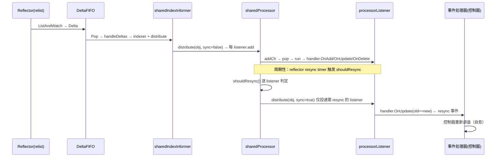

[总目录](../sourceReader/README.md)

# informer resync 机制专题

> **代码基准**：adrian @ `6bf0bfd51d78d1b3cb0917dc7001cd2aaf5549d4`（2026-11-26，Go 1.27.4）。工作区 HEAD 在其后者为纯文档提交，`.go` 零差异，故本文锚点即基线代码事实。
> **范围**：client-go SharedIndexInformer 的 resync（重新同步）机制——resyncPeriod 如何确定、shouldResync 如何判定、resync 事件如何产生并分发、以及 resync 与 List/Watch 的关系。
> **不覆盖**：DeltaFIFO 的 List/Watch 增量（见篇 11）；etcd 侧的 watch；具体 controller 如何使用 resync。
> **主文件**：`staging/src/k8s.io/client-go/tools/cache/shared_informer.go`（resync 判定与分发）、`.../cache/delta_fifo.go`（Sync Delta）、`.../cache/controller.go`（Config.FullResyncPeriod）。

## 0. 结论速览

resync 是 informer 的「保底对账」机制：即使 watch 漏了事件，informer 也会**周期性地把缓存里的全部对象重新投递给事件处理器**（作为 `Update` 通知，oldObj == newObj），从而驱动控制器重新调谐。这使控制器具备**最终一致的自愈能力**。

### 0.1 这项能力现在能做什么

- **自愈**：控制器漏处理一个事件（如进程重启、channel 丢弃）后，resync 会周期性重新投递缓存对象，触发重新调谐。
- **按 handler 独立控制**：每个事件处理器可单独设置 resyncPeriod；不关心的处理器设 0（不 resync）。
- **resync 不重新 List**：resync 从**本地缓存**重投对象，不发 List 请求——与 relist（Reflector 重新 ListAndWatch）是两回事。
- **仅投递给需要 resync 的处理器**：`distribute` 按 handler 的 resync 设置过滤，不需 resync 的处理器不收。

### 0.2 关键结论、适用范围与不做什么

| 结论 | 说明 |
|---|---|
| resync 投递的是缓存对象 | 从 indexer/缓存取，不发 List 请求；与 relist（Reflector ListAndWatch）不同 |
| resync 事件是 `Update(old, new)` 且 old==new | 处理器据此判断「这是 resync，不是真变更」 |
| resyncPeriod=0 表示不 resync | 该 handler 不参与 resync |
| resyncPeriod 会被上调 | 小于 `resyncCheckPeriod` 时上调到 check period；最小 1s（`minimumResyncPeriod`） |
| resync 与 relist 正交 | relist 重新拉全量（写 DeltaFIFO）；resync 重投缓存对象（不碰 etcd） |
| 每个 handler 独立 resync | 同一 informer 的多个 handler 可有不同 resyncPeriod |

**不做什么**：resync 不重新拉取 etcd（那是 relist/Reflector 的职责）；不保证精确的 resync 周期（实际周期会向上取整到 check period 的倍数，且两次 resync 间隔可能更长）。

## 1. 生产视角：实际怎么用、会得到什么

### 1.1 参与者、真实入口与前置条件

| 角色 | 是谁 | 做什么 |
|---|---|---|
| 事件处理器 | controller 的 informer handler（如 ReplicaSet 控制器的 addPod/updatePod） | 注册时指定 resyncPeriod |
| SharedIndexInformer | `cache/shared_informer.go SharedIndexInformer` | 持有缓存，周期性触发 resync |
| sharedProcessor | `shared_informer.go sharedProcessor` | 管理 listener，判定谁需要 resync |
| DeltaFIFO | `cache/delta_fifo.go DeltaFIFO` | resync 产生的 Sync Delta 入队 |

**前置条件：**
1. informer 已 `Run`（processor 已启动，listener 已注册）。
2. handler 注册时指定了非零 `resyncPeriod`（或使用 informer 默认）。
3. informer 的 `resyncCheckPeriod` 非 0（否则 informer 完全不 resync）。

### 1.2 生产主流程图



图后说明：
- **前提**：informer 已 Run，handler 已注册非零 resyncPeriod。
- **分支**：非 sync 事件投递给所有 listener；sync 事件只投递给需 resync 的 listener。
- **终点**：handler 收到 resync 事件，重新调谐缓存里的全部对象。

### 1.3 输入、处理环节、输出与接收方

| 环节 | 输入 | 处理 | 输出 | 接收方 |
|---|---|---|---|---|
| resync 计时 | resyncPeriod + 上次 resync 时间 | `processorListener.shouldResync(now)` | bool | `sharedProcessor.shouldResync` |
| 触发 | `Config.FullResyncPeriod`（= resyncCheckPeriod） | reflector resync timer 周期调 `ShouldResync` | 触发 distribute(sync=true) | sharedIndexInformer |
| 投递 | 缓存对象 + sync=true | `distribute(obj, sync=true)` | 仅需 resync 的 listener.add | processorListener |
| 转换 | addNotification{isInInitialList} | pop → run → handler.OnUpdate(old==new) | 控制器调谐 | 控制器 |

### 1.4 业务分支、异常表现、重复操作与边界

| 分支/异常 | 触发条件 | 用户可见结果 |
|---|---|---|
| resyncPeriod=0 | handler 不关心 resync | 该 handler 不收 resync 事件 |
| resyncPeriod < resyncCheckPeriod | 注册时指定过小周期 | 上调到 check period，打 Warning |
| informer 不支持 resync | `resyncCheckPeriod == 0` | 所有 handler 的 resyncPeriod 置 0 |
| resync 期间处理器慢 | handler 处理慢 | 阻塞 distribute（背压），不丢事件 |
| resync 与真实事件并发 | resync 事件与 watch 事件同时到达 | 按序投递，处理器需幂等（old==new 时应跳过） |

### 1.5 一次真实操作示例

ReplicaSet 控制器注册 informer handler 时指定 resyncPeriod=30s：

```text
t=0s    Pod A 创建 → watch 事件 → OnAdd(A) → 调谐 → 创建 Pod A-1
t=10s   (无事件)
t=30s   resync 触发 → OnUpdate(A, A)（old==new）→ 重新调谐
        → 发现 Pod A-1 已存在且匹配 → 无操作（幂等）
t=45s   Pod A-1 被误删（漏处理 Delete 事件）
t=60s   resync 触发 → OnUpdate(A, A) → 重新调谐
        → 发现期望 1 个但实际 0 个 → 重新创建 Pod A-1  ← 自愈
```
最终：即使 Delete 事件丢失，resync 也会在下一个周期重新创建 Pod——这就是 resync 的自愈价值。

## 2. 开发视角：当前代码怎样实现

### 2.1 实现地图：进程、入口、核心源码

| 角色 | 文件 | 符号（偏移以定义行为 +0） |
|---|---|---|
| resync 判定（processor） | `cache/shared_informer.go` | `sharedProcessor.shouldResync`（:1364） |
| resync 判定（listener） | `cache/shared_informer.go` | `processorListener.shouldResync`（:1593）、`determineNextResync`（:1602 附近） |
| resync 周期确定 | `cache/shared_informer.go` | `determineResyncPeriod`（:1035）、`minimumResyncPeriod`（:1050） |
| resync 投递 | `cache/shared_informer.go` | `sharedProcessor.distribute`（sync bool 分支） |
| 事件转换 | `cache/shared_informer.go` | `processorListener.run`（OnUpdate old==new） |
| 通知类型 | `cache/shared_informer.go` | `addNotification`（:842，含 `isInInitialList`） |
| Config resync 字段 | `cache/controller.go` | `Config.FullResyncPeriod`（:76）、`Config.ShouldResync` |
| DeltaFIFO Sync | `cache/delta_fifo.go` | `Sync DeltaType`（:201） |

### 2.2 技术前置条件

| 前置项 | 说明 |
|---|---|
| informer 已 Run | processor 已启动，listener 已注册（`sharedProcessor.run`） |
| handler 指定非零 resyncPeriod | 否则该 handler 不参与 resync |
| informer 支持 resync | `resyncCheckPeriod != 0`（否则所有 handler resyncPeriod 置 0） |
| handler 幂等 | resync 投递 old==new，处理器需能处理「无变化」的重投 |

### 2.3 真实调用链与关键源码锚点

```text
AddEventHandlerWithResyncPeriod(handler, resyncPeriod) (shared_informer.go:176)
  └── determineResyncPeriod (+1035) 确定实际周期（上调到 check period）
       └── newProcessorListener(resyncPeriod) → processorListener
            └── sharedProcessor.addListener

sharedIndexInformer.Run
  └── sharedProcessor.run
       └── 每 listener: watchSynced / run / pop
            └── reflector resync timer（FullResyncPeriod = resyncCheckPeriod）
                 └── sharedProcessor.shouldResync (+1364)
                      └── 逐 listener 调 listener.shouldResync(now) (:1593)
                           └── 需要 resync → distribute(obj, sync=true)
                                └── 仅需 resync 的 listener.add → addCh → pop → run
                                     └── handler.OnUpdate(old==new)（resync 事件）
```

**resync 周期的确定（`determineResyncPeriod`，:1035）：**
| 条件 | 结果 |
|---|---|
| desired == 0 | 0（不 resync） |
| check == 0（informer 不支持） | 0 + Warning |
| desired < check | 上调到 check + Warning |
| 否则 | desired |

**最小值：** `minimumResyncPeriod = 1 * time.Second`（:1050）；小于此值上调到 1s。

### 2.4 关键算法：resync 判定与投递

**shouldResync（processor 级，:1364）：**
- 遍历所有 listener，调 `listener.shouldResync(now)`，结果存回 `p.listeners[listener]`。
- 任一 listener 需要 resync → 返回 true → 触发 `distribute(obj, sync=true)`。

**shouldResync（listener 级，:1593）：**
- `resyncPeriod == 0` → false（不 resync）。
- `now >= nextResync` → true，并 `determineNextResync(now)` 推进下次时间。

**distribute 的 sync 分支（`sharedProcessor.distribute`）：**
- 非 sync 事件 → 投递给**所有** listener（`listener.add(obj)`）。
- sync 事件 → 只投递给**正在 syncing** 的 listener；不需 resync 的 listener 跳过。
- 这就是「每个 handler 独立 resync」的实现——同一 informer 的不同 handler 可有不同 resyncPeriod。

**resync 事件的产生：**
- resync 触发时，从 indexer/缓存取全部对象，对每个对象产生一个 `updateNotification{oldObj: obj, newObj: obj}`（old==new）。
- 经 `processorListener.run` 的 switch 命中 `updateNotification` → `handler.OnUpdate(old, new)`。
- 处理器据此判断「这是 resync，不是真变更」——典型做法是 `old == new` 时跳过或仅做兜底调谐。

### 2.5 字段、状态与必须保持的规则

| 字段/规则 | 锚点 | 说明 |
|---|---|---|
| `resyncCheckPeriod` | shared_informer.go:775 | reflector resync timer 的触发周期 |
| `defaultEventHandlerResyncPeriod` | shared_informer.go:779 | 未指定时 handler 的默认 resyncPeriod |
| `minimumResyncPeriod` | shared_informer.go:1050（=1s） | resyncPeriod 下限 |
| `Config.FullResyncPeriod` | controller.go:76 | = resyncCheckPeriod，传给 Reflector |
| `Config.ShouldResync` | controller.go:77 | = processor.shouldResync |
| `addNotification.isInInitialList` | shared_informer.go:844 | 区分初始列表与增量事件 |
| resync 不发 List | distribute 从缓存取 | 与 relist（Reflector ListAndWatch）正交 |

### 2.6 分支、失败处理与必须保持的规则

| 规则 | 锚点 | 为什么必须保持 |
|---|---|---|
| resyncPeriod=0 不 resync | `processorListener.shouldResync`（:1595 ～ :1597） | 有些 handler 不希望被周期性打扰 |
| resyncPeriod 下限 1s | `minimumResyncPeriod`（:1050） | 防止过小周期打爆处理器 |
| resyncPeriod 上调到 check period | `determineResyncPeriod`（:1044 ～ :1046） | 避免 resync 周期小于检查周期导致无法按时触发 |
| resync 投递 old==new | `processorListener.run` updateNotification 分支 | 让处理器区分 resync 与真变更 |
| resync 背压不丢 | `processorListener.add`（addCh 阻塞） | 缓慢 handler 不丢 resync 事件（靠 addCh 缓冲 + 阻塞） |
| handler 幂等 | 处理器职责 | resync 会重复投递同一对象，处理器必须幂等 |

## 3. 验证、缺口与后续修改

### 3.1 代码回核与生产实测记录

- **代码回核**：本专题所有「符号+偏移」均在基准 `6bf0bfd51d78d1b3cb0917dc7001cd2aaf5549d4`（2026-11-26）上复核（`shouldResync` :1364/:1593、`determineResyncPeriod` :1035、`minimumResyncPeriod` :1050、`distribute` sync 分支、`addNotification` :842/:844、`Sync DeltaType` delta_fifo.go:201、`sharedIndexInformer` :753、`handleDeltas` :1124、`sharedProcessor` :1221、`sharedProcessor.run` :1324）。相对旧基准 `782c049`，resync 机制相关符号的定义行与语义**零漂移**。
- **生产实测**：**未实测** `[待运行验证]`。resync 的实际触发周期、`OnUpdate(old==new)` 的到达、以及控制器对 resync 的处理均为代码推断，未在真实集群观测。

### 3.2 已知缺口和待验证事项

| 缺口 | 性质 | 说明 |
|---|---|---|
| 精确 resync 周期 | `[待运行验证]` | 实际周期会向上取整到 check period 倍数，且两次间隔可能更长（注释 :169） |
| relist 与 resync 的协作 | 未深挖 | relist（Reflector ListAndWatch）写 DeltaFIFO，resync 重投缓存——两者的时序交互未展开 |
| handleBatchDeltas | 未深挖 | batch 处理路径（`InOrderInformersBatchProcess` feature gate）下的 resync 未展开 |
| 生产 resync 观测 | `[待运行验证]` | 未在真实集群观测 resync 触发频率与控制器反应 |

### 3.3 修改联动清单、源码索引与关联文档

**改动这块前必查：**
- 改 `determineResyncPeriod` → 同步 `minimumResyncPeriod` 与 `AddEventHandlerWithResyncPeriod` 的文档注释。
- 改 `shouldResync` → 同步 processor 级（:1364）与 listener 级（:1593）两处。
- 改 resync 投递 → 同步 `distribute` 的 sync 分支与 `processorListener.run` 的 updateNotification 处理。
- 改 batch 处理 → `processDeltasInBatch`（controller.go:903）与 `InOrderInformersBatchProcess` feature gate。

#### relist（Reflector ListAndWatch）与 resync 的协作（加深）

relist 与 resync 是**两个不同层次的对账**，容易混淆：

| 维度 | relist（Reflector ListAndWatch） | resync（sharedProcessor） |
|---|---|---|
| 数据来源 | **apiserver**（重新 ListAndWatch） | **本地缓存**（indexer 重投） |
| 写入目标 | DeltaFIFO（写 Delta） | 直接 distribute（不写 DeltaFIFO） |
| 触发 | Reflector 周期 relist + watch 断连重连 | processorListener.shouldResync 周期判定 |
| 作用 | 同步 apiserver 真相到缓存 | 驱动控制器重新调谐缓存对象 |

**relist 的两种模式（`Reflector.ListAndWatchWithContext`，reflector.go:465）：**
1. **WatchList 模式**（`useWatchList=true`，feature gate `WatchListClient`）：`r.watchList(ctx)` 打开 watch 流拉数据。
2. **常规 List 模式**（`fallbackToList=true`）：`r.list(ctx)` 一次性 List 全量。

WatchList 不支持时回落到常规 List（注释：`This is expected if watchlist is not supported or disabled in kube-apiserver`）。

**协作时序：**
1. relist 把 apiserver 真相写入 DeltaFIFO（Delta type = Sync/Replaced）。
2. DeltaFIFO Pop → handleDeltas → indexer 更新 + distribute(sync=false) → OnAdd/OnUpdate/OnDelete。
3. **resync 是独立于 relist 的**：resync 不写 DeltaFIFO，而是直接从 indexer 取缓存对象重投 handler。

**协作的意义：** relist 保证缓存与 apiserver 一致（数据平面），resync 保证控制器与缓存一致（调谐平面）——两层对账缺一不可。

#### handleBatchDeltas（batch 处理路径，加深）

**源码：** `shared_informer.go handleBatchDeltas+0`（:1134）
```text
handleBatchDeltas(logger, deltas, isInInitialList)
├── s.blockDeltas.Lock()（与 handleDeltas 同一把锁）
└── processDeltasInBatch(logger, s, s.indexer, deltas, isInInitialList, s.keyFunc)
```
- batch 路径受 **`InOrderInformersBatchProcess` feature gate** 控制（controller.go:64-66：`ProcessBatch must be non-nil` + feature gate enabled）。
- 启用时 `Config.ProcessBatch`（controller.go:67）替代逐 Delta 的 `Process`，一次处理一批 Deltas——减少锁竞争。
- 未启用时走逐 Delta 的 `Process`（controller.go:56）。

**设计要点（源码可证）：**
1. **relist 与 resync 正交**：relist 对账「缓存 vs apiserver」，resync 对账「控制器 vs 缓存」——两层对账缺一不可。
2. **WatchList 模式**：`useWatchList`（reflector.go:170，feature gate `WatchListClient`）启用时用 watch 流拉初始数据，否则回落常规 List。
3. **batch 处理受 feature gate 控制**：`InOrderInformersBatchProcess` 启用时走 `processDeltasInBatch`，否则走逐 Delta 的 `processDeltas`。

**源码索引：**

| 符号 | 文件:行 |
|---|---|
| `AddEventHandlerWithResyncPeriod` | `shared_informer.go:176` |
| `determineResyncPeriod` | `shared_informer.go:1035` |
| `minimumResyncPeriod` | `shared_informer.go:1050` |
| `sharedProcessor.shouldResync` | `shared_informer.go:1364` |
| `processorListener.shouldResync` | `shared_informer.go:1593` |
| `processorListener.determineNextResync` | `shared_informer.go:1602` 附近 |
| `processorListener.run`（updateNotification 分支） | `shared_informer.go:1610` 附近 |
| `sharedProcessor.distribute` | `shared_informer.go`（sync bool 分支） |
| `addNotification` | `shared_informer.go:842` |
| `Config.FullResyncPeriod` | `controller.go:76` |
| `Config.ShouldResync` | `controller.go:77` |
| `Sync DeltaType` | `delta_fifo.go:201` |
| `handleDeltas` | `shared_informer.go:1124` |

**关联文档：** [11-informer与workqueue机制](../sourceReader/11-informer与workqueue机制.md)（DeltaFIFO 聚合与弹出、handleDeltas）；[06-apiserver请求处理与etcd](../sourceReader/06-apiserver请求处理与etcd.md)（watch 广播，resync 的数据来源）。

[总目录](../sourceReader/README.md)
