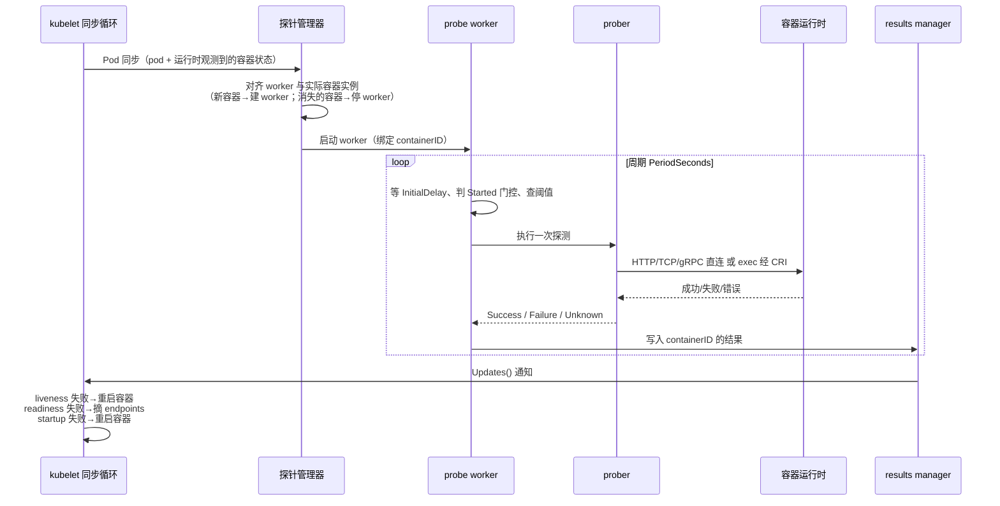
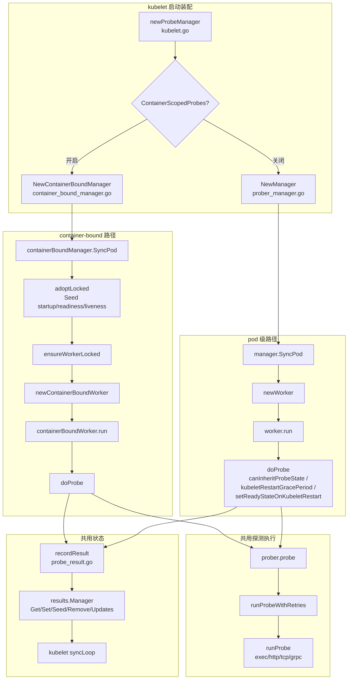

[总目录](../sourceReader/README.md)

# kubelet 探针机制专题

> **代码基准**：`k8s.io/kubernetes`，adrian@`6bf0bfd51d7`（2026-11-26，工作区干净），Go 1.27.4。
> **范围**：kubelet 如何对容器执行 liveness/readiness/startup 三类探针——探针管理器为每个容器实例创建 worker，worker 周期执行一次探测，经 prober 发 HTTP/TCP/exec/gRPC 探测，结果写入 results manager，最终驱动容器重启或 readiness。**含两条并存的探针管理路径**：按 containerID 绑定的 `containerBoundManager`（新，受 `ContainerScopedProbes` gate 控制）与既有的 pod 级 `manager`。
> **不覆盖**：外部监控系统（Prometheus）如何消费探针指标；HTTP/TCP/exec/gRPC 各探测器内部的网络/执行细节（只讲 prober 的分派层）。
> **主文件**：`pkg/kubelet/prober/prober.go`（探测执行）、`pkg/kubelet/prober/worker.go` + `pkg/kubelet/prober/container_bound_worker.go`（周期探测，两条路径各一份）、`pkg/kubelet/prober/prober_manager.go`（pod 级 manager 与 `Manager` 接口）、`pkg/kubelet/prober/container_bound_manager.go`（按 containerID 绑定的 manager）、`pkg/kubelet/prober/results/results_manager.go`（结果缓存）、`pkg/kubelet/prober/probe_result.go`（阈值判定状态）。

## 0. 结论速览

探针是 kubelet 的「容器健康检查」机制：探针管理器为每个配置了探针的容器实例建一个 worker goroutine，worker 周期执行一次探测，经 prober 发 HTTP/TCP/exec/gRPC 探测，结果写入 results manager。liveness 探针失败会触发容器重启；readiness 探针失败会把 Pod 从 Service endpoints 摘除；startup 探针失败会在启动窗口内禁用 liveness/readiness。

本次刷新最重要的变化：探针子系统新增了**按 containerID 绑定**的管理路径（`ContainerScopedProbes` gate），worker 不再按「pod + 容器名」寻址，而是绑定到**一个具体的容器实例 ID**。它解决的是一类生产故障——kubelet 重启、容器崩溃、或 kubelet 漏掉 lifecycle 事件后，旧的探针 worker / 旧的探针结果被错套到**同名的替换容器**上，导致刚重建的容器被旧结果误判（或反过来把幸存的老容器误杀）。

### 0.1 这项能力现在能做什么

- **三类探针**：liveness（失败→重启容器）、readiness（失败→摘 endpoints）、startup（失败→在启动窗口内禁用前两者）。
- **四种探测方式**：HTTP GET（含 H2C，受 `H2CContainerProbe` gate）、TCP socket、exec 命令、gRPC（含 TLS，受 `GRPCContainerProbeTLS` gate）。
- **阈值控制**：`SuccessThreshold`（连续成功几次算健康）、`FailureThreshold`（连续失败几次算不健康）、`PeriodSeconds`（探测间隔）、`TimeoutSeconds`（单次超时）、`InitialDelaySeconds`（启动延迟）。
- **两条管理路径**：pod 级 `manager`（默认）与按 containerID 绑定的 `containerBoundManager`（`ContainerScopedProbes` gate 开启时启用），二者实现同一个 `Manager` 接口。
- **kubelet 重启后的状态继承**：重启后不立即把探针结果打成 Failure，先判断当前容器是「幸存的老容器」还是「新建容器」（关联 issue #141473）。
- **sidecar startup 探针恢复**：restartable init container 在 kubelet 重启后若已 Started，startup 结果 seed 为 Success（关联 issue #136910）。
- **优雅终止静默**：Pod 进入删除流程时，liveness/startup 探针置 Success 并停止，避免终止窗口内的探测噪声。
- **探针崩溃恢复**：worker 的探测函数用 defer recover 吃掉 panic，本次按「继续」处理，下个周期继续。

### 0.2 关键结论、适用范围与不做什么

| 结论 | 说明 |
|---|---|
| 探针由 kubelet 执行，不是运行时 | prober 经 CRI（exec）或直接发 HTTP/TCP/gRPC |
| 每个 probe 一个 worker goroutine | 两条路径都是一 probe 一 worker，周期探测 |
| 结果存 results manager（内存） | 按 containerID 缓存，通过 `Updates()` 通道通知 syncLoop |
| startup 优先于 liveness/readiness | 容器未 Started 前，liveness/readiness 被禁用 |
| 失败不一定立即重启 | 需连续 `FailureThreshold` 次失败才置 Failure |
| 新增：worker 可绑定到容器实例 | `ContainerScopedProbes` 开启后，worker/结果按 containerID 寻址，替换容器不会继承旧结果 |
| 新增：startup worker 探测成功即退出 | startup 是一次性门控，成功后交棒给 readiness/liveness worker |
| 新增：liveness 终态失败即停止 worker | 容器即将被杀，继续探测只是冗余 |

**不做什么**：不在 apiserver 侧执行（探针是 kubelet 本地行为）；不做跨容器的健康判断（每个容器独立）；不提供探针结果的持久化（结果在内存 results manager，kubelet 重启后靠 seed/继承重建）；不做探针结果的跨 kubelet 共享。

## 1. 生产视角：实际怎么用、会得到什么

### 1.1 参与者、真实入口与前置条件

| 角色 | 是谁 | 做什么 |
|---|---|---|
| 探针管理器 | kubelet 内的 prober `Manager`（pod 级或 container-bound，二选一） | 为每个 probe 建/收 worker，在 Pod 同步时对齐 worker 与实际容器 |
| worker | 每 probe 一个的后台 goroutine | 周期执行一次探测，做阈值判定 |
| prober | 探测执行器 | 实际发 HTTP/TCP/exec/gRPC 探测 |
| results manager | 结果缓存（liveness/readiness/startup 各一份） | 按 containerID 缓存结果，通过 Updates() 通知 |
| kubelet 同步循环 | syncLoop | 消费探针结果，触发容器重启或 readiness 更新 |
| 容器运行时 | CRI 运行时 | 提供 containerID / 启动时间 / 运行状态；exec 探测经它执行 |

**前置条件：**
1. 容器配置了 `livenessProbe`/`readinessProbe`/`startupProbe` 之一。
2. 容器已启动并有 containerID（探针按容器实例寻址）。
3. kubelet 已运行，探针管理器已初始化（在 kubelet 启动时按 gate 选定具体实现）。

**路径选择前置条件**：是否启用按 containerID 绑定的新路径，取决于 kubelet 启动时的 `ContainerScopedProbes` feature gate——这是部署期决策，运行期不可切换，两条路径对使用者呈现的行为差异见 §1.4。

### 1.2 生产主流程图



图后说明：
- **前提**：容器配置了探针，kubelet 已运行，容器已有 containerID。
- **对齐动作**：Pod 每次同步都会让 worker 集合匹配「运行时当前实际存在的容器实例」，多出的 worker 被停掉，新容器实例拿到新 worker。
- **分支**：startup 未成功前 liveness/readiness 被禁用；Pod 删除时 liveness/startup 置 Success 并停止。
- **终点**：容器重启（liveness/startup）或 endpoints 摘除（readiness）。

### 1.3 输入、处理环节、输出与接收方

| 环节 | 输入 | 处理 | 输出 | 接收方 |
|---|---|---|---|---|
| 选定管理路径 | kubelet 启动 + feature gate | 按 `ContainerScopedProbes` 选 container-bound 或 pod 级实现 | 一个 `Manager` | kubelet 同步循环 |
| 对齐 worker | pod + 运行时容器状态 | 比对期望容器集合与现存 worker，建/停 worker | worker goroutine 集合 | worker |
| 周期探测 | probeSpec + 容器实例 | worker 判门控/阈值 → prober 分派 | Success/Failure/Unknown | results manager |
| 探测执行 | probeSpec + podIP + containerID | 按 Exec/HTTPGet/TCPSocket/GRPC 分派到对应探测器 | 探测结果 + output | worker |
| 结果缓存 | containerID + result | 写入内存缓存并广播 | Updates() 通道 | kubelet 同步循环 |
| 容器重启 | liveness/startup 置 Failure | kubelet 杀掉并重建容器 | 新容器实例（新 containerID） | 探针管理器（建新 worker） |

### 1.4 业务分支、异常表现、重复操作与边界

| 分支/异常 | 触发条件 | 用户可见结果 |
|---|---|---|
| liveness 失败 | 连续 `FailureThreshold` 次失败 | 容器重启（`Unhealthy` → `Killing container` 事件，RESTARTS +1） |
| readiness 失败 | 连续 `FailureThreshold` 次失败 | Pod 从 Service endpoints 摘除（`READY 0/1`） |
| startup 失败 | 启动窗口内未成功 | 容器重启（等同 liveness 失败） |
| startup 成功 | 容器通过 startup 探针 | 交棒：readiness/liveness 开始探测 |
| 探测错误（非干净失败） | 超时/连接错误/未知结果 | 记 `Unhealthy` 事件并计入失败（Unknown 也折算为 Failure） |
| 探针 panic | 探测过程 panic | 被 recover 吃掉，本次按「继续」处理，下周期重试 |
| kubelet 重启（幸存老容器） | 容器启动时间早于重启宽限窗口，且 API 侧记录的 containerID 与运行时一致 | 沿用旧状态/seed 为 Success，不把 Ready 容器打成 NotReady |
| kubelet 重启（新建容器） | containerID 与 API 侧不一致，或启动时间落在宽限窗口内 | 按新容器处理，写入该 probe 的初始值（readiness=Failure、liveness=Success、startup=Unknown） |
| Pod 优雅终止 | `DeletionTimestamp` 已设置 | liveness/startup 探针置 Success 并停止；readiness 继续探到容器真正停止 |
| 容器非运行态 | 容器已退出 | 置 Failure；是否继续探测取决于重启策略 / 重启规则（含 `RestartAllContainersOnContainerExits`） |
| sidecar（restartable init）重启后 | 已 Started 且带 startup 探针 | startup 结果 seed 为 Success，避免 kubelet 重启后误判初始化未完成 |
| 替换容器（同名重建） | containerID 变化 | container-bound 路径：旧结果不继承，新实例从初始值起步 |

### 1.5 一次真实操作示例

一个 Pod 配置了 liveness HTTP 探针（`/healthz`，`PeriodSeconds=10`，`FailureThreshold=3`）：

```bash
kubectl run probe-demo --image=nginx --restart=Never
# 容器启动后，探针管理器为 liveness 探针建 worker，绑定该容器的 containerID
# 每 10s 探测 /healthz

# 容器 /healthz 开始返回 500
kubectl describe pod probe-demo
# Events:
#   ... Unhealthy  HTTP probe failed: 500 Internal Server Error  (连续 3 次)
# 容器被重启
kubectl get pod probe-demo
# NAME         READY   STATUS    RESTARTS
# probe-demo   1/1     Running   1        ← RESTARTS +1
```

最终：连续 3 次探测失败 → 容器被杀重建，RESTARTS +1。重建出的容器是一个**新的 containerID**，探针管理器为它建一个全新 worker，从初始值重新累积阈值，不会继承被杀容器的失败计数。

对照一个 kubelet 重启场景：节点上 kubelet 重启，容器本身没动。重启后第一次同步时，探针管理器发现「运行时里的 containerID」和「API 侧记录的 containerID」一致、且容器启动时间早于重启宽限窗口，于是判定这是**幸存的老容器**，liveness seed 为 Success、readiness 沿用，不会在重启瞬间把一个本来 Ready 的容器打成 NotReady（这就是 issue #141473 修的问题）。

## 2. 开发视角：当前代码怎样实现

### 2.1 实现地图：进程、入口、核心源码

| 角色 | 文件 | 符号（偏移以定义行为 `+0`） |
|---|---|---|
| `Manager` 接口 | `pkg/kubelet/prober/prober_manager.go` | `Manager` `+0` |
| pod 级 manager（默认路径） | `pkg/kubelet/prober/prober_manager.go` | `manager` `+0`、`NewManager` `+0`、`SyncPod` `+0`、`setReadyStateOnKubeletRestart` `+0` |
| container-bound manager（新路径） | `pkg/kubelet/prober/container_bound_manager.go` | `containerBoundManager` `+0`、`NewContainerBoundManager` `+0`、`SyncPod` `+0`、`adoptLocked` `+0`、`resultsManager` `+0`、`UpdatePodStatus` `+0` |
| 周期探测（pod 级） | `pkg/kubelet/prober/worker.go` | `worker` `+0`、`newWorker` `+0`、`run` `+0`、`doProbe` `+0`、`stop` `+0` |
| 周期探测（container-bound） | `pkg/kubelet/prober/container_bound_worker.go` | `probeTarget` `+0`、`containerBoundWorkerOptions` `+0`、`containerBoundWorker` `+0`、`newContainerBoundWorker` `+0`、`run` `+0`、`firstProbeDelay` `+0`、`doProbe` `+0` |
| 探测执行 | `pkg/kubelet/prober/prober.go` | `maxProbeRetries` `Const:maxProbeRetries`、`prober` `+0`、`newProber` `+0`、`probe` `+0`、`runProbeWithRetries` `+0`、`runProbe` `+0`、`newExecInContainer` `+0` |
| 阈值判定状态 | `pkg/kubelet/prober/probe_result.go` | `probeResultState` `+0`、`newProbeResultState` `+0`、`recordResult` `+0` |
| 结果缓存 | `pkg/kubelet/prober/results/results_manager.go` | `Manager` `+0`、`manager` `+0`、`NewManager` `+0`、`Get` `+0`、`Set` `+0`、`Seed` `+0`、`Remove` `+0`、`Updates` `+0` |
| 容器探针生命周期接口 | `pkg/kubelet/container/probe_lifecycle.go` | `ProbeType` `+0`、`ContainerProbeLifecycle` `+0`、`NoopContainerProbeLifecycle` `+0` |
| 探针管理器装配 | `pkg/kubelet/kubelet.go` | `newProbeManager` `+0` |
| 重启判定 helper | `pkg/kubelet/container/helpers.go` | `ShouldAllContainersRestart` `+0` |
| feature gate | `pkg/features/kube_features.go` | `ContainerScopedProbes`、`ChangeContainerStatusOnKubeletRestart`、`RestartAllContainersOnContainerExits` |

### 2.2 技术前置条件

| 前置项 | 说明 |
|---|---|
| containerID | 两条路径最终都按 containerID 写结果；container-bound 路径在 worker 创建时就绑定 containerID |
| probeSpec | `livenessProbe`/`readinessProbe`/`startupProbe` 之一，由 `probeSpec(probeType, &container)` 取得 |
| prober | `newProber` 注入 http/tcp/exec/grpc 四个探测器 + CommandRunner + EventRecorder |
| results manager | liveness/readiness/startup 各一个 `results.Manager` 实例 |
| feature gate | `ContainerScopedProbes` 决定管理路径；`ChangeContainerStatusOnKubeletRestart` 决定是否走状态继承判定；`RestartAllContainersOnContainerExits` 影响容器退出后是否继续探测 |
| statusManager / podStatus | pod 级路径用 statusManager 取 Pod 状态；container-bound 路径用运行时 `PodStatus` 对齐 worker |

### 2.3 真实调用链与关键源码锚点

**路径选择（kubelet 启动）：**

```text
newProbeManager (kubelet.go)
  ├── ContainerScopedProbes 开启 → NewContainerBoundManager (container_bound_manager.go)
  │     └── newProber(runner, recorder)
  └── 否则 → NewManager (prober_manager.go)
```

**container-bound 路径（新）：**

```text
containerBoundManager.SyncPod (container_bound_manager.go)
  ├── probedContainers(pod)              取 regular + restartable init 容器
  ├── 停掉已从 spec 移除的容器 worker      stopContainerWorkersLocked
  └── 逐容器：
        ├── runningContainerStatus        只认最新且 Running 的实例
        ├── tracksContainerLocked         已跟踪同一 containerID？
        │     └── 是 → startProbesLocked(adopted=false)
        └── 否 → adoptLocked               从 API 状态恢复探针结果
              ├── apiContainerStatus       校验 API 侧 containerID 与目标一致
              ├── startupManager.Seed      已 Started → Success，否则 Unknown
              ├── readinessManager.Seed    Ready 且 Pod Ready → Success，否则 Failure
              ├── livenessManager.Seed     一律 Success（避免误杀幸存容器）
              └── startProbesLocked(adopted=true)
                    └── ensureWorkerLocked → newContainerBoundWorker → go w.run()

containerBoundWorker.run (container_bound_worker.go)
  └── wait(firstProbeDelay) → 周期 doProbe
        ├── prober.probe
        ├── recordResult（阈值判定）
        ├── resultsManager.Set
        ├── startup 成功 → onStartupSucceeded → 返回 false（worker 退出）
        └── liveness Failure → 返回 false（worker 退出，容器即将被杀）
```

**pod 级路径（默认）：**

```text
manager.SyncPod (prober_manager.go)
  ├── context.WithoutCancel(ctx)          让探针在 Pod 优雅终止期间继续
  ├── 遍历 InitContainers|Containers（仅 restartable init）
  │     └── 每 probeType（startup/readiness/liveness）→ newWorker → go w.run(ctx)
  └── 停掉已从 spec 移除的容器 worker

worker.run (worker.go)
  ├── 派生可取消 context；HTTP 探针递增 ActiveProbes 指标
  ├── kubelet 刚重启时先 jitter 一段时间
  └── probeLoop: doProbe(ctx) → 等 ticker / stopCh / manualTriggerCh

worker.doProbe (worker.go)
  ├── statusManager.GetPodStatus → Pod 终态则退出
  ├── 取容器状态（ContainerStatuses，回退 InitContainerStatuses）
  ├── containerID 变化 → 结果继承判定（见 §2.6）
  ├── 非运行态 → 置 Failure + 重启判定（ShouldAllContainersRestart）
  ├── DeletionTimestamp != nil 且 liveness/startup → 置 Success 并停止
  ├── InitialDelaySeconds 未到 → 跳过
  ├── Started 门控 → startup 已成功则跳过；未 Started 时禁用 liveness/readiness
  ├── prober.probe → recordResult → resultsManager.Set
  └── liveness/startup 置 Failure → onHold=true，等新容器
```

### 2.4 关键算法：探测分派与结果判定

**探测分派（`prober.go` · `runProbe` `+0`）：**

```text
runProbe (+0)
├── Exec      → ExpandContainerCommandOnlyStatic 后 newExecInContainer → pb.exec.Probe
├── HTTPGet   → NewRequestForHTTPGetAction → (H2C 且 gate 开) pb.http.ProbeH2C : pb.http.Probe
├── TCPSocket → ResolveContainerPort → pb.tcp.Probe(host||podIP, port, timeout)
├── GRPC      → pb.grpc.Probe(host=podIP, service, port, timeout, {UseTLS})
└── 其他      → probe.Unknown + "missing probe handler"
```

- HTTP 走 H2C 需 `p.HTTPGet.Protocol == HTTP2` 且 `H2CContainerProbe` gate 开启（`runProbe` `+26~+29`）。
- gRPC TLS 需 `GRPCContainerProbeTLS` gate 开启且 `p.GRPC.Mode == TLS`（`runProbe` `+50~+53`）。
- 重试外层是 `runProbeWithRetries` `+0`，重试 `maxProbeRetries`（=3）次，context 取消则立即返回不重试。

**结果判定（`prober.go` · `probe` `+0`）：**

| probe.Result | 事件 | 返回给 worker |
|---|---|---|
| Success | 无 | `results.Success` |
| Warning | `ContainerProbeWarning` | `results.Success` |
| Failure | `ContainerUnhealthy` | `results.Failure` |
| Unknown | 无（仅日志） | `results.Failure` |
| ctx 已取消 | 无（丢弃结果） | `results.Failure` + ctx 错误 |
| probeSpec 为 nil | 无（`Probe is nil`） | `results.Success` |

**阈值判定（`probe_result.go` · `recordResult` `+0`）：**
- 每次尝试递增 `ProberResults` 指标；Success/Unknown 额外观测 `ProberDuration`。
- `lastResult` 相同则 `resultRun++`，否则重置为 1。
- Failure 未达 `FailureThreshold`、或 Success 未达 `SuccessThreshold` → 返回 false，**不改变对外状态**（worker 继续探）。
- 达阈值 → 返回 true，worker 才把结果写进 results manager。

**结果缓存与通知（`results_manager.go`）：**
- `Set` `+0`：缓存变化时向 `Updates()` 通道发 `Update{ContainerID, Result, PodUID}`；context 取消则放弃发送但**不回滚缓存**。
- `Seed` `+0`：只写缓存、**不发 Updates**——专为 kubelet 重启后填充缓存设计，避免重启瞬间触发一轮假更新。
- `Get` `+0` / `Remove` `+0` / `Updates` `+0`：读、清理、订阅。
- 通道容量 20，单一 updates channel（接口注释明确只支持一个订阅者）。

### 2.5 字段、状态与必须保持的规则

| 字段/规则 | 锚点 | 说明 |
|---|---|---|
| `probeType`（pod 级） | `worker.go` · `worker` `+26` | readiness/liveness/startup，决定取哪个 probeSpec 与 resultsManager |
| `initialValue`（pod 级） | `worker.go` · `newWorker` `+16~+28` | readiness=Failure、liveness=Success、startup=Unknown |
| `probeTarget`（container-bound） | `container_bound_worker.go` · `probeTarget` `+0` | 不可变快照：pod、container、containerID、podIPs、startedAt |
| `adopted` | `container_bound_worker.go` · `containerBoundWorkerOptions` `+6` | 容器是「已在跑」时为 true，首次探测加 jitter 防 thundering herd |
| `probeResultState` | `probe_result.go` · `probeResultState` `+0` | lastResult/resultRun + 四组指标 label；两条 worker 路径共用 |
| `PeriodSeconds` | `container_bound_worker.go` · `run` `+13` | 探测间隔 ticker |
| `TimeoutSeconds` | `prober.go` · `runProbe` `+2` | 单次探测超时 |
| `SuccessThreshold` / `FailureThreshold` | `probe_result.go` · `recordResult` `+19~+21` | 连续成功/失败次数阈值 |
| `InitialDelaySeconds` | `container_bound_worker.go` · `firstProbeDelay` `+0` | 相对容器 startedAt 计算首探延迟；为 0 时兜底 1s |

### 2.6 分支、失败处理与必须保持的规则

| 规则 | 锚点 | 为什么必须保持 |
|---|---|---|
| doProbe panic 恢复 | `worker.go` · `doProbe` `+1~+2`；`container_bound_worker.go` · `doProbe` `+2~+3` | 单个探针 panic 不能杀死 kubelet |
| kubelet 重启状态继承（pod 级） | `worker.go` · `doProbe` `+42~+82` | 关联 #141473：区分「幸存老容器」与「新建容器」，避免重启瞬间把 Ready 打成 NotReady |
| — 继承资格判定 | `prober_manager.go` · `canInheritProbeState` `+0` | API 侧记录的 containerID 必须与运行时一致才算同一实例；任一为空则视为可继承 |
| — 重启宽限窗口 | `prober_manager.go` · `kubeletRestartGracePeriod` `+0` | 容器启动时间早于「manager 启动时间 −10s」才判为幸存容器 |
| — 非 gate 路径才做继承 | `worker.go` · `doProbe` `+42` | `ChangeContainerStatusOnKubeletRestart` 关闭时才走继承判定，开启则直接写 initialValue |
| readiness 就绪态纠偏（pod 级） | `prober_manager.go` · `setReadyStateOnKubeletRestart` `+0` | 幸存容器在 live probe 接管前保持 Ready，但 Pod 未 Ready 时仍纠回 NotReady |
| sidecar startup seed | `worker.go` · `doProbe` `+74~+77` | 关联 #136910：已 Started 的 restartable init 容器 seed startup=Success，让初始化检测可用 |
| container-bound 采纳期 seed | `container_bound_manager.go` · `adoptLocked` `+0` | startup→已 Started 则 Success；readiness→Ready 且 Pod Ready 才 Success（防陈旧）；liveness→一律 Success |
| Pod 优雅终止静默 | `worker.go` · `doProbe` `+115~+126` | liveness/startup 置 Success 并停止，保证安静关闭；readiness 继续探 |
| 容器非运行态判定 | `worker.go` · `doProbe` `+93~+112` | 置 Failure 后按 `ContainerRestartRules` / `RestartAllContainersOnContainerExits` + `ShouldAllContainersRestart` 决定是否继续 |
| startup worker 成功即退出 | `container_bound_worker.go` · `doProbe` `+18~+24` | startup 是一次性门控，成功后交棒 readiness/liveness，避免空转 |
| liveness 终态失败停 worker | `container_bound_worker.go` · `doProbe` `+26~+31` | 容器即将被杀，继续探测只是冗余 |
| worker 退出保留结果 | `container_bound_worker.go` · `run` `+5~+7` | worker 退出后缓存结果保留到容器真正拆除/替换，供 reconcile 使用 |
| 替换容器不继承旧结果 | `container_bound_manager.go` · `SyncPod` `+0`、`tracksContainerLocked` `+0` | 按 containerID 绑定，同名新容器拿新 worker 与初始值 |
| readiness 在终止期继续 | `container_bound_manager.go` · `containerBoundManager` `+13~+16` | ctx 刻意长于 Pod sync context，让优雅终止期间 readiness 能把 Pod 标 NotReady |
| 指标 label 清理 | `worker.go` · `run` `+27~+40` | worker 退出时按是否被替换决定是否 Delete 指标序列；ActiveProbes 必须成对增减 |

### 2.7 开发实现图



### 2.8 源码索引

| 符号 | 文件 | 偏移 |
|---|---|---|
| `maxProbeRetries` | `pkg/kubelet/prober/prober.go` | `Const:maxProbeRetries` |
| `prober` | `pkg/kubelet/prober/prober.go` | `+0` |
| `newProber` | `pkg/kubelet/prober/prober.go` | `+0` |
| `probe` | `pkg/kubelet/prober/prober.go` | `+0` |
| `runProbeWithRetries` | `pkg/kubelet/prober/prober.go` | `+0` |
| `runProbe` | `pkg/kubelet/prober/prober.go` | `+0` |
| `newExecInContainer` | `pkg/kubelet/prober/prober.go` | `+0` |
| `Manager`（探针管理器接口） | `pkg/kubelet/prober/prober_manager.go` | `+0` |
| `manager` | `pkg/kubelet/prober/prober_manager.go` | `+0` |
| `NewManager` | `pkg/kubelet/prober/prober_manager.go` | `+0` |
| `SyncPod`（pod 级） | `pkg/kubelet/prober/prober_manager.go` | `+0` |
| `setReadyStateOnKubeletRestart` | `pkg/kubelet/prober/prober_manager.go` | `+0` |
| `kubeletRestartGracePeriod` | `pkg/kubelet/prober/prober_manager.go` | `+0` |
| `canInheritProbeState` | `pkg/kubelet/prober/prober_manager.go` | `+0` |
| `containerBoundManager` | `pkg/kubelet/prober/container_bound_manager.go` | `+0` |
| `NewContainerBoundManager` | `pkg/kubelet/prober/container_bound_manager.go` | `+0` |
| `SyncPod`（container-bound） | `pkg/kubelet/prober/container_bound_manager.go` | `+0` |
| `adoptLocked` | `pkg/kubelet/prober/container_bound_manager.go` | `+0` |
| `UpdatePodStatus`（container-bound） | `pkg/kubelet/prober/container_bound_manager.go` | `+0` |
| `resultsManager`（按 probeType 选缓存） | `pkg/kubelet/prober/container_bound_manager.go` | `+0` |
| `worker` | `pkg/kubelet/prober/worker.go` | `+0` |
| `newWorker` | `pkg/kubelet/prober/worker.go` | `+0` |
| `run`（pod 级） | `pkg/kubelet/prober/worker.go` | `+0` |
| `doProbe`（pod 级） | `pkg/kubelet/prober/worker.go` | `+0` |
| `stop` | `pkg/kubelet/prober/worker.go` | `+0` |
| `probeTarget` | `pkg/kubelet/prober/container_bound_worker.go` | `+0` |
| `containerBoundWorkerOptions` | `pkg/kubelet/prober/container_bound_worker.go` | `+0` |
| `containerBoundWorker` | `pkg/kubelet/prober/container_bound_worker.go` | `+0` |
| `newContainerBoundWorker` | `pkg/kubelet/prober/container_bound_worker.go` | `+0` |
| `run`（container-bound） | `pkg/kubelet/prober/container_bound_worker.go` | `+0` |
| `firstProbeDelay` | `pkg/kubelet/prober/container_bound_worker.go` | `+0` |
| `doProbe`（container-bound） | `pkg/kubelet/prober/container_bound_worker.go` | `+0` |
| `probeResultState` | `pkg/kubelet/prober/probe_result.go` | `+0` |
| `recordResult` | `pkg/kubelet/prober/probe_result.go` | `+0` |
| `Manager`（结果缓存接口） | `pkg/kubelet/prober/results/results_manager.go` | `+0` |
| `NewManager`（结果缓存） | `pkg/kubelet/prober/results/results_manager.go` | `+0` |
| `Get` / `Set` / `Seed` / `Remove` / `Updates` | `pkg/kubelet/prober/results/results_manager.go` | 各 `+0` |
| `ProbeType` | `pkg/kubelet/container/probe_lifecycle.go` | `+0` |
| `ContainerProbeLifecycle` | `pkg/kubelet/container/probe_lifecycle.go` | `+0` |
| `NoopContainerProbeLifecycle` | `pkg/kubelet/container/probe_lifecycle.go` | `+0` |
| `newProbeManager` | `pkg/kubelet/kubelet.go` | `+0` |
| `ShouldAllContainersRestart` | `pkg/kubelet/container/helpers.go` | `+0` |

## 3. 验证、缺口与后续修改

### 3.1 代码回核与生产实测记录

- **代码基准**：adrian@`6bf0bfd51d7`（2026-11-26），工作区干净。
- **代码回核**：本篇所有「符号+偏移」锚点均用 `codegraph_explore` 按符号名取回带行号源码确认定义行，关键分支（`worker.doProbe` 状态继承段、`adoptLocked` seed 段、`recordResult` 阈值段、`results.Manager.Seed`、`newProbeManager` 路径选择）另用 Read 复核函数体。原 43 处 `.go:行号` 已全部迁移为符号+偏移。
- **生产实测**：**未实测** `[待运行验证]`。探针实际触发周期、`Updates()` 到达时机、容器重启、以及 kubelet 重启后的状态继承表现均为代码推断，未在真实集群观测。feature gate 默认值未逐一核对集群实际配置。

### 3.2 已知缺口和待验证事项

| 缺口 | 性质 | 说明 |
|---|---|---|
| HTTP/TCP/exec/gRPC 探测器内部实现 | 未深挖 | 只覆盖 prober 分派层；各探测器超时/连接细节未展开 |
| `ContainerScopedProbes` gate 默认值与成熟度 | `[源码未确认]` | 已确认 gate 名与装配点（`newProbeManager`），但未核对该 gate 当前 default/off 状态与版本说明，见未决项 |
| container-bound 路径的 `startProbesLocked`/`ensureWorkerLocked`/`onStartupSucceeded`/`onWorkerExit` 内部 | 未深挖 | 已确认定义行与职责（worker 建/停、startup 交棒、退出回收），函数体未逐行展开 |
| container-bound 与 pod 级路径的行为差异边界 | 未深挖 | 两路径对 `UpdatePodStatus` 的实现不同（container-bound 直接读缓存，pod 级走继承纠偏），完整等价性未逐分支比对 |
| 探针指标 | 未深挖 | `ProberResults`/`ProberDuration`/`ActiveProbes` 已确认定义，采集口径与告警用法未展开 |
| 生产探针观测 | `[待运行验证]` | 未在真实集群观测探针触发频率、kubelet 重启场景与容器重启 |
| 优雅终止窗口的 readiness 时序 | `[待运行验证]` | 「readiness 在终止期继续」的可见效果未实测 |

#### 未决项（`[源码未确认]`）

1. `ContainerScopedProbes` 与 `ChangeContainerStatusOnKubeletRestart` 在 `6bf0bfd51d7` 的**默认开启状态与阶段**未逐字核对（`pkg/features/kube_features.go` 中仅确认 gate 名与注册项存在），文档因此不写死「默认开/关」，只描述「开启时走 container-bound 路径」。
2. container-bound 路径在 **worker 退出后、容器真正拆除前**的结果保留窗口，以及 `CleanupPods` 的指标 series 删除（`deleteMetricSeries`）具体触发时机未逐行核实。

### 3.3 修改联动清单、源码索引与关联文档

**改动这块前必查：**
- 改探针类型 → 同步 `prober.probe` 的 switch、`runProbe` 的分派，以及 `probeSpec` 的取值。
- 改阈值判定 → `probe_result.go` 的 `recordResult`；两条 worker 路径共用此状态，改一处影响两条路径。
- 改结果缓存语义（尤其 Seed/Updates）→ `results_manager.go` 的 `Get`/`Set`/`Seed`/`Remove`/`Updates`；`Seed` 不发 Updates 是 kubelet 重启不误报的关键。
- 改 kubelet 重启继承 → pod 级 `worker.doProbe` 继承段 + `canInheritProbeState`/`kubeletRestartGracePeriod`/`setReadyStateOnKubeletRestart`；container-bound 侧对应 `adoptLocked` 的 seed 策略，**两处需保持一致的「幸存 vs 新建」口径**。
- 改 worker 生命周期 → pod 级 `manager.SyncPod`/`worker.run`/`worker.stop`；container-bound 侧 `SyncPod`/`startProbesLocked`/`ensureWorkerLocked`/`stopContainerWorkersLocked`。
- 改优雅终止 → `worker.doProbe` 的 `DeletionTimestamp` 分支，并确认 container-bound 路径的等价行为。
- 改容器退出重启判定 → `helpers.go` 的 `ShouldAllContainersRestart` 与 `RestartAllContainersOnContainerExits` gate。
- 改 exec 探测 → `newExecInContainer` 与 `CommandRunner.RunInContainer`。

**关联文档：** [09-kubelet同步循环](../sourceReader/09-kubelet同步循环.md)（syncLoop 消费探针结果）；[10-kubelet-CRI运行时](../sourceReader/10-kubelet-CRI运行时.md)（CRI gRPC 调用序列）。

[总目录](../sourceReader/README.md)