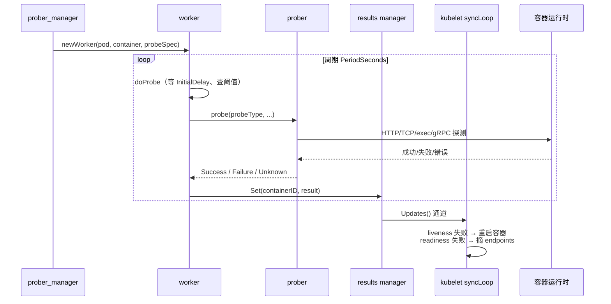

[总目录](../sourceReader/README.md)

# kubelet 探针机制专题

> **代码基准**：`k8s.io/kubernetes`，master@`782c049`（工作区文档产物外干净），Go 1.27.4。
> **范围**：kubelet 如何对容器执行 liveness/readiness/startup 三类探针——从 prober_manager 为每个容器创建 worker，到 worker 周期执行 doProbe，经 prober 发 HTTP/TCP/exec/gRPC 探测，结果写入 results manager，最终驱动容器重启或 readiness。
> **不覆盖**：外部监控系统（Prometheus）如何消费探针指标；具体的 HTTP/TCP 探测实现细节（只讲 prober 的分派层）。
> **主文件**：`pkg/kubelet/prober/prober.go`（探测执行）、`pkg/kubelet/prober/worker.go`（周期探测）、`pkg/kubelet/prober/prober_manager.go`（worker 管理）、`pkg/kubelet/prober/results/results_manager.go`（结果缓存）。

## 0. 结论速览

探针是 kubelet 的「容器健康检查」机制：prober_manager 为每个配置了探针的容器创建一个 worker goroutine，worker 周期执行 doProbe，经 prober 发 HTTP/TCP/exec/gRPC 探测，结果写入 results manager。liveness 探针失败会触发容器重启；readiness 探针失败会把 Pod 从 Service endpoints 摘除；startup 探针失败会在启动窗口内禁用 liveness/readiness。

### 0.1 这项能力现在能做什么

- **三类探针**：liveness（失败→重启容器）、readiness（失败→摘 endpoints）、startup（失败→在启动窗口内禁用前两者）。
- **四种探测方式**：HTTP GET、TCP socket、exec 命令、gRPC。
- **阈值控制**：`SuccessThreshold`（连续成功几次算健康）、`FailureThreshold`（连续失败几次算不健康）、`PeriodSeconds`（探测间隔）、`TimeoutSeconds`（单次超时）、`InitialDelaySeconds`（启动延迟）。
- **平滑启动**：kubelet 重启后不立即置 Failure，避免误杀刚恢复的容器。
- **探针崩溃恢复**：doProbe 的 defer recover 吃掉 panic，1 秒后继续下一个探测。

### 0.2 关键结论、适用范围与不做什么

| 结论 | 说明 |
|---|---|
| 探针由 kubelet 执行，不是运行时 | prober 经 CRI 或直接发 HTTP/TCP，exec 经 CRI exec |
| 每个 probe 一个 worker goroutine | prober_manager 为每个 probe 建 worker，周期 doProbe |
| 结果存 results manager | 探针结果缓存 + 通过 `Updates()` 通道通知 syncLoop |
| startup 优先于 liveness/readiness | startup 未成功前，liveness/readiness 被禁用 |
| 失败不一定立即重启 | 需连续 `FailureThreshold` 次失败才重启 |

**不做什么**：不在 apiserver 侧执行（探针是 kubelet 本地行为）；不做跨容器的健康判断（每个容器独立）；不提供探针结果的持久化（结果在内存 results manager）。

## 1. 生产视角：实际怎么用、会得到什么

### 1.1 参与者、真实入口与前置条件

| 角色 | 是谁 | 做什么 |
|---|---|---|
| prober_manager | `pkg/kubelet/prober/prober_manager.go manager` | 为每个 probe 建 worker，管理 worker 生命周期 |
| worker | `pkg/kubelet/prober/worker.go worker` | 周期执行 doProbe |
| prober | `pkg/kubelet/prober/prober.go prober` | 实际发探测（HTTP/TCP/exec/gRPC） |
| results manager | `pkg/kubelet/prober/results/results_manager.go manager` | 缓存探针结果，通过 Updates() 通知 |
| syncLoop | kubelet.syncLoop | 消费探针结果，触发容器重启或 readiness 更新 |

**前置条件：**
1. 容器配置了 `livenessProbe`/`readinessProbe`/`startupProbe` 之一。
2. 容器已启动（有 containerID）。
3. kubelet 已运行（prober_manager 已 Start）。

### 1.2 生产主流程图



图后说明：
- **前提**：容器配置了探针，kubelet 已运行。
- **分支**：startup 探针未成功前，liveness/readiness 被禁用。
- **终点**：容器重启（liveness）或 endpoints 摘除（readiness）。

### 1.3 输入、处理环节、输出与接收方

| 环节 | 输入 | 处理 | 输出 | 接收方 |
|---|---|---|---|---|
| 建 worker | pod + container + probeSpec | `prober_manager.newWorker` | worker goroutine | worker.run |
| 周期探测 | probeSpec + container | `worker.doProbe` → `prober.probe` | Success/Failure/Unknown | results manager |
| 探测执行 | probeSpec + container | `prober.runProbe` 分派 HTTP/TCP/exec/gRPC | 探测结果 + output | doProbe |
| 结果缓存 | containerID + result | `results_manager.Set` | Updates() 通道 | syncLoop |
| 容器重启 | liveness 失败 | kubelet 重启容器 | 容器重建 | — |

### 1.4 业务分支、异常表现、重复操作与边界

| 分支/异常 | 触发条件 | 用户可见结果 |
|---|---|---|
| liveness 失败 | 连续 `FailureThreshold` 次失败 | 容器重启（`Killing container` 事件） |
| readiness 失败 | 连续 `FailureThreshold` 次失败 | Pod 从 Service endpoints 摘除（`READY 0/1`） |
| startup 失败 | 启动窗口内未成功 | 容器重启（等同 liveness 失败） |
| 探测错误（非失败） | 超时/连接错误 | `ContainerUnhealthy` 事件，计入失败 |
| 探针 panic | doProbe panic | defer recover 吃掉，1s 后继续 |
| kubelet 重启 | kubelet 重启 | 不立即置 Failure（避免误杀） |

### 1.5 一次真实操作示例

一个 Pod 配置了 liveness HTTP 探针（`/healthz`，`PeriodSeconds=10`，`FailureThreshold=3`）：

```bash
kubectl run probe-demo --image=nginx --restart=Never
# 容器启动后，prober_manager 为 liveness 探针建 worker
# 每 10s 探测 /healthz

# 容器 /healthz 开始返回 500
kubectl describe pod probe-demo
# Events:
#   ... Unhealthy  HTTP probe failed: 500 Internal Server Error  (连续 3 次)
# 容器被重启
kubectl get pod probe-demo
# NAME         READY   STATUS    RESTARTS
# probe-demo   1/1     Running   1        ← RESTARTS +1
```
最终：连续 3 次探测失败 → 容器被重启，RESTARTS +1。

## 2. 开发视角：当前代码怎样实现

### 2.1 实现地图：进程、入口、核心源码

| 角色 | 文件 | 符号（偏移以定义行为 +0） |
|---|---|---|
| worker 管理 | `pkg/kubelet/prober/prober_manager.go` | `NewManager`（:138）、`manager.Start`、`manager.AddPod`、`manager.RemovePod`（:268） |
| 周期探测 | `pkg/kubelet/prober/worker.go` | `newWorker`（:97）、`worker.run`（:169）、`worker.doProbe`（:239）、`worker.stop`（:230） |
| 探测执行 | `pkg/kubelet/prober/prober.go` | `newProber`（:57）、`prober.probe`（:84）、`runProbeWithRetries`（:139）、`runProbe`（:152） |
| 结果缓存 | `pkg/kubelet/prober/results/results_manager.go` | `NewManager`（:99）、`Get`（:106）、`Set`（:113）、`Remove`（:131）、`Updates`（:137） |
| exec 探测 | `pkg/kubelet/prober/prober.go` | `newExecInContainer`（:225） |

### 2.2 技术前置条件

| 前置项 | 说明 |
|---|---|
| containerID | 探针需要 containerID 才能探测 |
| probeSpec | `livenessProbe`/`readinessProbe`/`startupProbe` 之一 |
| prober | `newProber` 注入 http/tcp/exec/grpc 探测器 |
| results manager | 缓存探针结果，通过 `Updates()` 通知 syncLoop |
| syncLoop | 消费探针结果，触发容器重启或 readiness 更新 |

### 2.3 真实调用链与关键源码锚点

```text
prober_manager.Start
  └── 为每个 probe 建 worker
       └── worker.run (worker.go:169)
            └── 周期 doProbe (worker.go:239)
                 ├── 等 InitialDelay
                 ├── 查阈值（Success/Failure/Unknown）
                 └── prober.probe (prober.go:84)
                      ├── probeSpec = Readiness/Liveness/Startup
                      ├── runProbeWithRetries (prober.go:139)
                      │    └── runProbe (prober.go:152)
                      │         ├── HTTP → pb.http.Probe
                      │         ├── TCP → pb.tcp.Probe
                      │         ├── exec → pb.exec.Probe
                      │         └── gRPC → pb.grpc.Probe
                      └── results_manager.Set(containerID, result)
                           └── Updates() 通道 → syncLoop
```

### 2.4 关键算法：探测分派与结果判定

**探测分派（`runProbe`，prober.go:152）：**
```text
runProbe (+0)
├── exec → pb.exec.Probe(newExecInContainer(cmd, timeout))
├── http → pb.http.Probe(req, timeout) 或 ProbeH2C
├── tcp  → pb.tcp.Probe(host, port, timeout)
├── grpc → pb.grpc.Probe(host, service, port, timeout, {UseTLS})
└── 其他 → probe.Unknown + "missing probe handler"
```

**结果判定（`probe`，prober.go:84）：**
| 探测结果 | 事件 | 说明 |
|---|---|---|
| Success | 无（或 `ContainerProbeWarning`） | 探测成功 |
| Failure | `ContainerUnhealthy` | 探测失败 |
| Unknown | `ContainerUnhealthy` | 探测错误（超时/连接错误） |

**结果缓存与通知（`results_manager.Set`，results_manager.go:113）：**
- 结果写入 `m.results[containerID]`（内存缓存）。
- 通过 `Updates()` 通道通知 syncLoop。
- `Remove`（:131）在容器删除时清理。

**阈值判定（`doProbe`，worker.go:239）：**
- `resultRun` 记录连续成功/失败次数。
- `SuccessThreshold` 连续成功 → 置 Success。
- `FailureThreshold` 连续失败 → 置 Failure。
- **平滑启动**：kubelet 重启后不立即置 Failure（:280 ～ :314）。

### 2.5 字段、状态与必须保持的规则

| 字段/规则 | 锚点 | 说明 |
|---|---|---|
| `probeType` | prober.go:86 switch | Readiness/Liveness/Startup 三类 |
| `probeSpec` | prober.go:88/:90/:92 | 对应的 Probe 配置 |
| `PeriodSeconds` | worker.go 周期 | 探测间隔 |
| `TimeoutSeconds` | prober.go 超时 | 单次探测超时 |
| `SuccessThreshold` / `FailureThreshold` | worker.go 阈值 | 连续成功/失败次数 |
| `InitialDelaySeconds` | worker.go 延迟 | 启动延迟 |
| `results manager` | results_manager.go | 缓存探针结果 |

### 2.6 分支、失败处理与必须保持的规则

| 规则 | 锚点 | 为什么必须保持 |
|---|---|---|
| doProbe panic 恢复 | worker.go:239 defer recover | 探针 panic 不应杀死 kubelet |
| 探针崩溃后 1s 重试 | worker.go run sleepAfterCrash | 避免探针 panic 后高频重试 |
| kubelet 重启不立即置 Failure | doProbe（:280 ～ :314） | 避免误杀刚恢复的容器 |
| startup 优先于 liveness/readiness | probe.go:88-92 | 启动窗口内禁用前两者 |
| 连续 FailureThreshold 次失败才重启 | doProbe 阈值判定 | 避免单次失败就重启 |
| 探针结果缓存 | results_manager.go | 避免重复探测 |

## 3. 验证、缺口与后续修改

### 3.1 代码回核与生产实测记录

- **代码回核**：本专题所有「符号+偏移」均在 HEAD `782c049` 上用 `grep -n` / `sed -n` / `awk` 复核（`newProber` :57、`probe` :84、`runProbeWithRetries` :139、`runProbe` :152、`newWorker` :97、`doProbe` :239、`NewManager` results_manager.go:99、`Set` :113）。
- **生产实测**：**未实测** `[待运行验证]`。探针的实际触发周期、`OnUpdate(old==new)` 的到达、以及容器重启均为代码推断，未在真实集群观测。

### 3.2 已知缺口和待验证事项

| 缺口 | 性质 | 说明 |
|---|---|---|
| HTTP/TCP/exec/gRPC 探测实现 | 未深挖 | 各探测器的具体实现未展开（只讲 prober 的分派层） |
| 探针指标 | 未深挖 | Prometheus 指标（`prober_probe_total` 等）未展开 |
| 生产探针观测 | `[待运行验证]` | 未在真实集群观测探针触发频率与容器重启 |
| startup 探针的特殊处理 | 未深挖 | startup 探针的特殊处理未展开 |

#### 探测实现（runProbe 四种方式，prober.go:152）

`runProbe`（prober.go:152）按 probeSpec 类型分派到四种探测器：
```text
runProbe (+0)
├── HTTP（container.LivenessProbe.HTTPGet）→ pb.http.Probe(req, timeout)
│     或 ProbeH2C（HTTP/2 cleartext，h2cProbe）
├── TCP（TCPSocket）→ pb.tcp.Probe(host, port, timeout)
├── exec（Exec）→ pb.exec.Probe(newExecInContainer(cmd, timeout))
├── gRPC（GRPC）→ pb.grpc.Probe(host, service, port, timeout, {UseTLS})
└── 其他 → probe.Unknown + "missing probe handler"
```
- HTTP 探测支持 HTTP/2 cleartext（h2cProbe）——用于 gRPC-Web 等场景。
- gRPC 探测支持 TLS（`UseTLS`）——gRPC 健康检查协议。

#### 探针指标（prober_manager.go:46）

`prober_manager.go` 定义探针指标：
- `probe_total`（:46）：探针总数计数器（按 probeType、result 分）。
- `probe_duration_seconds`（:62）：探针耗时直方图。
- 这些指标用于观测探针触发频率与耗时。

#### startup 探针的特殊处理（worker.go:121-125）

startup 探针有几个特殊处理：
1. **独立 resultsManager**：startup 探针用 `m.startupManager`（worker.go:123），与 liveness/readiness 的 resultsManager 分离。
2. **初始值 Unknown**：`w.initialValue = results.Unknown`（worker.go:124）——启动前未知。
3. **Started 门控**：`container.Started` 为 true 时，startup 探针不再探测（worker.go:373）。
4. **restartable init container（sidecar）**：sidecar 的 startup 探针在容器已 Started 后 seed Success（:308 ～ :313），避免 kubelet 重启后误判。
5. **Pod 删除时跳过**：Pod 被删除时，liveness/startup 探针跳过（worker.go:354），readiness 探针继续。

#### 探测实现（runProbe 四种方式，prober.go:152）

`runProbe`（prober.go:152）按 probeSpec 类型分派到四种探测器：
```text
runProbe (+0)
├── HTTP（container.LivenessProbe.HTTPGet）→ pb.http.Probe(req, timeout)
│     或 ProbeH2C（HTTP/2 cleartext，h2cProbe）
├── TCP（TCPSocket）→ pb.tcp.Probe(host, port, timeout)
├── exec（Exec）→ pb.exec.Probe(newExecInContainer(cmd, timeout))
├── gRPC（GRPC）→ pb.grpc.Probe(host, service, port, timeout, {UseTLS})
└── 其他 → probe.Unknown + "missing probe handler"
```
- HTTP 探测支持 HTTP/2 cleartext（h2cProbe）——用于 gRPC-Web 等场景。
- gRPC 探测支持 TLS（`UseTLS`）——gRPC 健康检查协议。

#### 探针指标（prober_manager.go:46）

`prober_manager.go` 定义探针指标：
- `probe_total`（:46）：探针总数计数器（按 probeType、result 分）。
- `probe_duration_seconds`（:62）：探针耗时直方图。
- 这些指标用于观测探针触发频率与耗时。

#### startup 探针的特殊处理（worker.go:121-125）

startup 探针有几个特殊处理：
1. **独立 resultsManager**：startup 探针用 `m.startupManager`（worker.go:123），与 liveness/readiness 的 resultsManager 分离。
2. **初始值 Unknown**：`w.initialValue = results.Unknown`（worker.go:124）——启动前未知。
3. **Started 门控**：`container.Started` 为 true 时，startup 探针不再探测（worker.go:373）。
4. **restartable init container（sidecar）**：sidecar 的 startup 探针在容器已 Started 后 seed Success（:308 ～ :313），避免 kubelet 重启后误判。
5. **Pod 删除时跳过**：Pod 被删除时，liveness/startup 探针跳过（worker.go:354），readiness 探针继续。

### 3.3 修改联动清单、源码索引与关联文档

**改动这块前必查：**
- 改探针类型 → 同步 `probe` 的 switch 与 `runProbe` 的分派。
- 改阈值判定 → 同步 `doProbe` 的阈值判定与 `results_manager.Set`。
- 改结果缓存 → `results_manager.go` 的 `Get`/`Set`/`Remove`/`Updates`。
- 改 worker 管理 → `prober_manager.go` 的 `Start`/`AddPod`/`RemovePod`。
- 改 exec 探测 → `newExecInContainer` 与 `internalLifecycle.PreCreateContainer`/`PreStartContainer`。

**源码索引：**

| 符号 | 文件:行 |
|---|---|
| `newProber` | `prober.go:57` |
| `prober.probe` | `prober.go:84` |
| `prober.runProbeWithRetries` | `prober.go:139` |
| `prober.runProbe` | `prober.go:152` |
| `prober.newExecInContainer` | `prober.go:225` |
| `newWorker` | `worker.go:97` |
| `worker.run` | `worker.go:169` |
| `worker.doProbe` | `worker.go:239` |
| `worker.stop` | `worker.go:230` |
| `results manager.NewManager` | `results_manager.go:99` |
| `results manager.Get/Set/Remove/Updates` | `results_manager.go:106/:113/:131/:137` |
| `prober_manager.NewManager` | `prober_manager.go:138` |
| `prober_manager.Start` | `prober_manager.go:268` |

**关联文档：** [09-kubelet同步循环](../sourceReader/09-kubelet同步循环.md)（syncLoop 消费探针结果）；[10-kubelet-CRI运行时](../sourceReader/10-kubelet-CRI运行时.md)（CRI gRPC 调用序列）。

[总目录](../sourceReader/README.md)
