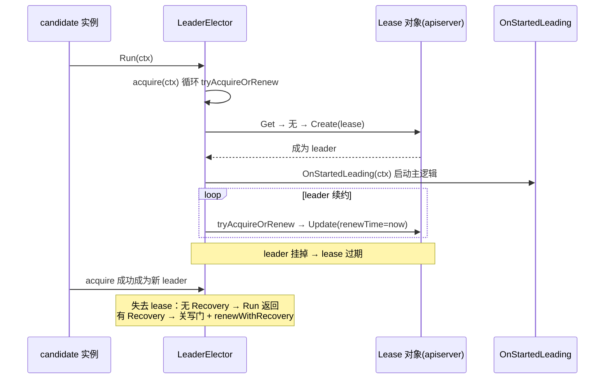

[总目录](../sourceReader/README.md)

# Leader Election 专题

> **代码基准**：`k8s.io/kubernetes`，adrian @ `6bf0bfd51d78d1b3cb0917dc7001cd2aaf5549d4`（2026-11-26，Go 1.27.4）。工作区 HEAD 是其后续文档提交，代码态一致（仅 `.codegraph/` 未跟踪）。
> **范围**：client-go 的 leader election 机制——多个副本的组件（kube-controller-manager、kube-scheduler、cloud-controller-manager）如何通过竞争一个 lease 选出唯一 leader，以及 leader 失去 lease 后的行为（含 write gate 与 Recovery）。
> **不覆盖**：具体控制器的业务逻辑（见篇 08/12-15）；etcd lease 的底层实现（本专题用 `Lease` API 对象）；APF 流控（见 P&F 专题）。
> **主文件**：`staging/src/k8s.io/client-go/tools/leaderelection/leaderelection.go`（LeaderElector 主循环与抢占/续约）、`staging/src/k8s.io/client-go/tools/leaderelection/writegate.go`（写门 writeGate 与 ErrWriteGateClosed）、`staging/src/k8s.io/client-go/tools/leaderelection/resourcelock/leaselock.go`（Lease 锁实现）、`staging/src/k8s.io/client-go/tools/leaderelection/resourcelock/interface.go`（锁接口 `Interface` 与 `LeaderElectionRecord`）。

## 0. 结论速览

Leader election 让多副本组件**只有一个实例真正工作**（leader），其余实例（candidate）待命。它通过竞争一个 **Lease 对象**（`coordination.k8s.io/v1`）实现：leader 周期性续约（renew），candidate 周期性尝试获取（acquire）。谁持有未过期的 lease，谁就是 leader。

### 0.1 这项能力现在能做什么

- **唯一 leader**：任意时刻只有一个实例持有未过期的 lease，其余实例不执行主逻辑。
- **自动故障转移**：leader 挂掉后 lease 过期，candidate 之一获取 lease 成为新 leader。
- **写门（write gate）**：带 `Recovery` 的 elector 失去 lease 后不退出，而是**关闭写门**——非安全方法（POST/PUT/PATCH/DELETE）被拒绝，只放行 GET/HEAD/OPTIONS/TRACE。
- **平滑切换**：leader 转移时递增 `LeaderElectionRecord.LeaderTransitions`（落到 Lease 的 `spec.leaseTransitions`），可观测切换次数。

### 0.2 关键结论、适用范围与不做什么

| 结论 | 说明 |
|---|---|
| 竞争的是 Lease 对象 | `coordination.k8s.io/v1` Lease，`holderIdentity`/`leaseDurationSeconds`/`renewTime` 字段 |
| acquire 与 renew 是同一个函数 | `tryAcquireOrRenew`——首次调用是 acquire，之后是 renew |
| 乐观更新 + 快慢路径 | leader 优先用乐观 Update（快路径）；失败回落到 Get→Update（慢路径） |
| 三个时间参数约束 | `LeaseDuration > RenewDeadline > RetryPeriod`（构造时校验） |
| 失去 lease 的两种行为 | 无 Recovery：`Run` 返回（进程退出）；有 Recovery：`renewWithRecovery` 关写门继续运行尝试恢复 |
| Lease 本身不被写门拦截 | 续约用的 client 不被 gate（`WriteGate` 文档明说），否则恢复期间无法续约 |
| 写门已独立成文件 | `writeGate` struct 与 `open`/`close` 在 `writegate.go`；`WriteGate()` 只是取 wrapper 的方法 |

**不做什么**：不保证 leader 切换零中断（切换有 lease 过期的窗口）；不处理 etcd/apiserver 不可用；不做跨集群 leader election。

## 1. 生产视角：实际怎么用、会得到什么

### 1.1 参与者、真实入口与前置条件

| 角色 | 是谁 | 做什么 |
|---|---|---|
| LeaderElector | 每个 controller-manager/scheduler/CCM 实例 | 竞争 lease，leader 执行主逻辑 |
| Lease 对象 | `coordination.k8s.io/v1` Lease（如 `kube-controller-manager`） | 记录 `holderIdentity`/`leaseDurationSeconds`/`renewTime` |
| candidate | 非 leader 实例 | 周期性尝试 acquire |
| write gate | 带 Recovery 的 elector | 非 leader 时拦截写请求 |

**前置条件（可判断）：**
1. `Lock` 非 nil（`NewLeaderElector` 校验，`+34`）。
2. `LeaseDuration > RenewDeadline`（`+1`）、`RenewDeadline > JitterFactor*RetryPeriod`（`+4`），且三者均 ≥ 1。
3. `Callbacks.OnStartedLeading` / `OnStoppedLeading` 非 nil（`+26` / `+29`）。
4. `Lock.Identity()` 非空（`+37`），通常为 `hostname_uuid`。
5. Lease 命名空间/名称已配置（如 `kube-system/kube-controller-manager`）。
6. `Recovery` 与 `Coordinated` 互斥（`+20` 校验，二者同设直接报错）。

### 1.2 生产主流程图



图后说明：
- **前提**：多个实例竞争同一个 Lease 对象。
- **分支**：`Recovery == nil` 走 `renew`（失去即退出）；有 `Recovery` 走 `renewWithRecovery`（关写门继续尝试恢复）。
- **终点**：leader 持续续约直到 ctx 取消或续约失败。

### 1.3 输入、处理环节、输出与接收方

| 环节 | 输入 | 处理 | 输出 | 接收方 |
|---|---|---|---|---|
| acquire | ctx + Lock + RetryPeriod | 循环 `tryAcquireOrRenew`（`JitterUntilWithContext`） | bool（是否成为 leader） | `Run` |
| renew | ctx + Lock + RenewDeadline | `PollUntilContextTimeout` 循环续约 | 失败则 cancel | `Run` |
| tryAcquireOrRenew | Lock + now | 快慢路径 Update/Create | bool | acquire/renew |
| OnStartedLeading | ctx | 启动主逻辑（控制器/scheduler） | — | 组件主逻辑 |
| write gate | HTTP 请求 | 非 leader 拦截非安全方法 | 放行或 ErrWriteGateClosed | 组件的 client |

### 1.4 业务分支、异常表现、重复操作与边界

| 分支/异常 | 触发条件 | 用户可见结果 |
|---|---|---|
| 成为 leader | `tryAcquireOrRenew` 成功（Create 或 Update） | `OnStartedLeading` 启动主逻辑；`became leader` 事件 |
| 续约成功 | `tryAcquireOrRenew` 快路径或慢路径 Update 成功 | 继续持有 lease |
| 续约失败（超 RenewDeadline） | 连续 `RetryPeriod` 内无法续约 | 失去 lease；无 Recovery 则退出，有 Recovery 关写门 |
| 候选发现 lease 被持有 | `oldLeaderElectionRecord.HolderIdentity` 非空且 lease 有效 | 返回 false，继续等待 |
| 候选发现 lease 过期 | holder 为空或 lease 过期 | 抢占 lease，并把记录的切换计数加一（`LeaderElectionRecord.LeaderTransitions`，见 `staging/src/k8s.io/client-go/tools/leaderelection/resourcelock/interface.go` · `LeaderElectionRecord` `+10`） |
| ctx 取消 + ReleaseOnCancel | 进程优雅退出 | `release` 释放 lease（立即让位） |
| 写门关闭 | 非 leader（有 Recovery） | 非 GET/HEAD/OPTIONS/TRACE 请求被 `ErrWriteGateClosed` 拒绝 |

### 1.5 一次真实操作示例

两个 kube-controller-manager 实例（A、B）竞争 `kube-system/kube-controller-manager` lease：

```bash
# A 先启动，获取 lease 成为 leader
kubectl get lease -n kube-system kube-controller-manager -o yaml
# spec:
#   holderIdentity: A_<id>
#   leaseDurationSeconds: 15
#   renewTime: "2026-11-19T20:00:00Z"
#   acquireTime: "..."
#   leaseTransitions: 0

# A 的日志
# Successfully acquired lease
# ... 控制器开始工作 ...

# A 挂掉 → lease 15s 后过期
# B 尝试 acquire → 发现 lease 过期 → 抢占
# B 的日志
# Successfully acquired lease
# ... spec.leaseTransitions: 1  ← 切换计数 +1（tryAcquireOrRenew 慢路径对非 leader +1）
```
最终：B 成为新 leader，继续运行控制器；A 重启后成为 candidate。

## 2. 开发视角：当前代码怎样实现

### 2.1 实现地图：进程、入口、核心源码

以下符号均在 `staging/src/k8s.io/client-go/tools/leaderelection/leaderelection.go`：

| 角色 | 符号（偏移以定义行为 +0） |
|---|---|
| elector 构造 | `staging/src/k8s.io/client-go/tools/leaderelection/leaderelection.go` · `NewLeaderElector` `+0`、`RunOrDie` `+0` |
| 主循环 | `staging/src/k8s.io/client-go/tools/leaderelection/leaderelection.go` · `Run` `+0`、`acquire` `+0`、`renew` `+0`、`renewWithRecovery` `+0` |
| 抢占/续约核心 | `staging/src/k8s.io/client-go/tools/leaderelection/leaderelection.go` · `tryAcquireOrRenew` `+0`、`tryCoordinatedRenew` `+0`、`maybeReportTransition` `+0` |
| Recovery 恢复 | `staging/src/k8s.io/client-go/tools/leaderelection/leaderelection.go` · `recoverLease` `+0`、`tryRecover` `+0`、`release` `+0`、`tryRelease` `+0` |
| 写门方法 | `staging/src/k8s.io/client-go/tools/leaderelection/leaderelection.go` · `WriteGate` `+0`（取 wrapper）；`staging/src/k8s.io/client-go/tools/leaderelection/writegate.go` · `LeaderElector.RegisterPausable` `+0` |
| elector 状态 | `staging/src/k8s.io/client-go/tools/leaderelection/leaderelection.go` · `LeaderElector` `+0`（struct） |

写门实现在 `staging/src/k8s.io/client-go/tools/leaderelection/writegate.go`：`writeGate` struct `+0`、`writeGate.open` `+0`、`writeGate.close` `+0`、`writeGate.wrapper` `+0`、`Const:ErrWriteGateClosed`、`isSafeMethod` `+0`、`writeGateRoundTripper` `+0`。

锁接口在 `staging/src/k8s.io/client-go/tools/leaderelection/resourcelock/interface.go`：`Interface` `+0`（方法声明 `Get`/`Create`/`Update` 在其体内 `+2`/`+5`/`+8`）、`LeaderElectionRecord` `+0`、`ResourceLockConfig` `+0`、`New` `+0`、`NewFromKubeconfig` `+0`、私有 `new` `+0`。

Lease 锁在 `staging/src/k8s.io/client-go/tools/leaderelection/resourcelock/leaselock.go`：`LeaseLock` `+0`、`LeaseLock.Get` `+0`、`LeaseLock.Create` `+0`、`LeaseLock.Update` `+0`、`LeaseSpecToLeaderElectionRecord` `+0`、`LeaderElectionRecordToLeaseSpec` `+0`。

多锁在 `staging/src/k8s.io/client-go/tools/leaderelection/resourcelock/multilock.go`：`MultiLock` `+0`（已 Deprecated）、`MultiLock.Get` `+0`、`MultiLock.Create` `+0`、`MultiLock.Update` `+0`。

**注册点：** controller-manager/scheduler/CCM 在 `cmd/kube-controller-manager/app/controllermanager.go` · `leaderElectAndRun` `+0` 中构造 `resourcelock.ResourceLockConfig` → `resourcelock.NewFromKubeconfig` 得到锁 → 组装 `leaderelection.LeaderElectionConfig` → `RunOrDie(ctx, lec)`。

### 2.2 技术前置条件

| 前置项 | 说明 |
|---|---|
| `Lock` | `resourcelock.Interface`（接口名就是 `Interface`，当前无 `ResourceLock` 类型；通常 `LeaseLock`，指向一个 Lease 对象） |
| `LeaseDuration > RenewDeadline > JitterFactor*RetryPeriod` | 构造校验（`NewLeaderElector` `+1`/`+4`/`+7~+13`），违反则报错 |
| `Callbacks.OnStartedLeading/OnStoppedLeading` | 非 nil（`NewLeaderElector` `+26`/`+29`） |
| `Lock.Identity()` | 唯一标识（通常 `hostname_uuid`） |
| apiserver 可达 | Lease 对象存于 apiserver（非直连 etcd） |
| 锁 client 超时 | `NewFromKubeconfig` 设为 `max(1s, RenewDeadline/2)`，避免单个挂起请求直接导致丢锁 |

### 2.3 真实调用链与关键源码锚点

```text
RunOrDie → NewLeaderElector(lec) → LeaderElector.Run (+0)
  ├── acquire (+0)
  │    └── wait.JitterUntilWithContext(RetryPeriod, JitterFactor, immediate=true)
  │         └── tryAcquireOrRenew (+0)   ← Coordinated=false
  │              ├── 快路径：IsLeader && isLeaseValid → Lock.Update（乐观）
  │              └── 慢路径：Lock.Get → Create/Update
  │    成功 → writeGate.open() + OnStartedLeading(ctx)
  ├── renew (+0)  ← 无 Recovery
  │    └── wait.UntilWithContext(RetryPeriod)
  │         └── PollUntilContextTimeout(RenewDeadline, immediate=true)
  │              └── tryAcquireOrRenew → 失败 cancel
  │    退出 → ReleaseOnCancel ? release : 退出
  └── renewWithRecovery (+0)  ← 有 Recovery
       └── PollUntilContextTimeout(RenewDeadline, immediate=true)
            └── tryRecover (+0) → lost 则 errLeaseLost
       失败 → writeGate.close() + notifyStoppedLeading()
            → recoverLease (+0) 反复 tryRecover；成功 → writeGate.open()
```

**tryAcquireOrRenew 四步（`+0`）：**
1. **快路径**（`+13 ～ +22`）：`IsLeader() && isLeaseValid(now)` → 乐观 `Lock.Update`（保留 AcquireTime/LeaderTransitions）；成功即返回 true；失败回落慢路径。
2. **慢路径 Get/Create**（`+26 ～ +40`）：`Lock.Get` 取旧记录；NotFound 则 `Lock.Create` 创建并返回 true。
3. **Identity & Time 检查**（`+43 ～ +51`）：若旧 holder 非空且 lease 有效且**我不是 leader** → 返回 false（lease 被别人持有且未过期）。
4. **Update**（`+53 ～ +71`）：纠正 AcquireTime/LeaderTransitions（非 leader 时 +1）→ `Lock.Update` → `setObservedRecord`。

### 2.4 关键算法：快慢路径与 lease 有效性

**快路径（乐观更新）：** leader 假设「上次观察到的记录就是当前版本」，直接 `Lock.Update`。失败（如 RV 冲突）则回落慢路径。

**慢路径（Get → 检查 → Update）：**
- `Lock.Get` 取旧记录 → `setObservedRecord`。
- 检查 `oldLeaderElectionRecord.HolderIdentity` 非空且 `isLeaseValid(now)` 且非我 → 被持有，返回 false。
- 否则（holder 为空、lease 过期、或我是 leader）→ Update。

**isLeaseValid（lease 是否过期）：** `observedTime + observedRecord.LeaseDurationSeconds > now`（`isLeaseValid` `+5`）。`observedTime` 在每次 `setObservedRecord` 时刷新为当前时钟，`RenewTime` 字段本身不直接参与判断。

**时间参数约束（`NewLeaderElector` 校验，`+1 ～ +15`）：**
```text
LeaseDuration > RenewDeadline                      (+1)
RenewDeadline > JitterFactor * RetryPeriod         (+4)   JitterFactor=1.2 (Const:JitterFactor)
LeaseDuration >= 1, RenewDeadline >= 1, RetryPeriod >= 1   (+7/+10/+13)
Recovery.RecoveryDeadline >= 1s（若设）            (+16)
Recovery 与 Coordinated 互斥                       (+20)
```
- 典型值：LeaseDuration=15s、RenewDeadline=10s、RetryPeriod=2s。
- 语义：lease 15s 过期；leader 每 RenewDeadline(10s) 内必须续约成功；每次重试间隔 RetryPeriod(2s)。

### 2.5 分支、失败处理与必须保持的规则

| 规则 | 锚点 | 为什么必须保持 |
|---|---|---|
| LeaseDuration > RenewDeadline | `NewLeaderElector` `+1` | 否则 lease 在续约前就过期，导致频繁切换 |
| RenewDeadline > JitterFactor*RetryPeriod | `NewLeaderElector` `+4` | 否则单次重试就可能超 RenewDeadline |
| leader 快路径优先 | `tryAcquireOrRenew` `+13` | 减少 Get 往返，降低 apiserver 负载 |
| 非 leader 不抢占未过期 lease | `tryAcquireOrRenew` `+49` | 保证唯一 leader，不双写 |
| Lease 自身不被写门拦截 | `WriteGate` `+0`（注释 `+1～+3`）；`writeGate` struct 注释 | 否则恢复期间无法续约，永远无法重新成为 leader |
| LeaderTransitions 计数 | `tryAcquireOrRenew` `+59`（非 leader +1） | 可观测切换次数，切换频繁说明不稳定 |
| 写门 open 仅在 acquire 成功后 | `staging/src/k8s.io/client-go/tools/leaderelection/leaderelection.go` · `acquire` `+21` → `writegate.go` · `open` `+0` | 否则 candidate 在拿锁前就能写 apiserver |

### 2.6 写门（write gate）与 Recovery

**无 Recovery（默认）：** `Run` 中 `renew` 失败 → `Run` 返回 → `defer le.writeGate.close()` + `defer le.notifyStoppedLeading()` → `OnStoppedLeading` → 组件退出（由 KCM/scheduler 的外层重启）。defer 兜底见 `staging/src/k8s.io/client-go/tools/leaderelection/leaderelection.go` · `Run` `+12`，通知见 `Run` `+4`。

**有 Recovery：** `Run` 中改走 `renewWithRecovery`（同文件 · `renewWithRecovery` `+0`）——失去 lease 后**不退出**，而是：
1. 关闭写门（`staging/src/k8s.io/client-go/tools/leaderelection/leaderelection.go` · `renewWithRecovery` `+30`）——非安全方法被 `ErrWriteGateClosed` 拒绝（`writegate.go` · `Const:ErrWriteGateClosed`）。
2. 调 `notifyStoppedLeading`（`renewWithRecovery` `+40`，内部保证只通知一次，见同文件 · `notifyStoppedLeading` `+0`）。
3. 进入 `recoverLease`（`renewWithRecovery` `+41`）反复 `tryRecover`；恢复成功则 `renewWithRecovery` `+46` 重新 open 写门并记录 `resumed leading`。

**写门在哪实现：** `staging/src/k8s.io/client-go/tools/leaderelection/leaderelection.go` · `WriteGate` `+0` 只返回 wrapper；真正的拦截逻辑全在 `staging/src/k8s.io/client-go/tools/leaderelection/writegate.go`，关键符号（偏移以定义行为 +0）：`writeGate`（struct，持锁与 pausables）、`writeGate.open`、`writeGate.close`、`writeGate.wrapper`、`writeGateRoundTripper`（实现 `RoundTrip`）、`isSafeMethod`、`ErrWriteGateClosed`（`Const:`）。判定规则是**安全方法白名单**（GET/HEAD/OPTIONS/TRACE），其余一律视为写。

**关闭写门时还做两件事：** `staging/src/k8s.io/client-go/tools/leaderelection/writegate.go` · `writeGate.close` `+0` 先 `cancel()` 切断在途写请求（`+12`），再对注册过的 `Pausable` 调 `Pause()`（`+17`）——这就是篇 01 里「非 Pausable 控制器靠写门拦截、Pausable 控制器被主动暂停」的来源，注册入口是同文件 · `LeaderElector.RegisterPausable` `+0`。

**为什么需要写门：** 带 Recovery 的 elector 在失去 lease 后继续运行（不退出），若不拦截写请求，非 leader 实例会继续写 apiserver，造成双写。写门保证只有 leader 能写；同时 Lease 续约用的 client 不被 gate，否则恢复期间无法续约。

### 2.7 字段、状态与必须保持的规则

| 字段 | 锚点 | 说明 |
|---|---|---|
| `HolderIdentity` | `staging/src/k8s.io/client-go/tools/leaderelection/resourcelock/interface.go` · `LeaderElectionRecord` `+6` | 当前 leader 标识（`hostname_uuid`） |
| `LeaseDurationSeconds` | `staging/src/k8s.io/client-go/tools/leaderelection/resourcelock/interface.go` · `LeaderElectionRecord` `+7` | lease 时长（秒） |
| `AcquireTime` / `RenewTime` | `staging/src/k8s.io/client-go/tools/leaderelection/resourcelock/interface.go` · `LeaderElectionRecord` `+8`/`+9` | 获取/续约时间 |
| `LeaderTransitions` | `staging/src/k8s.io/client-go/tools/leaderelection/resourcelock/interface.go` · `LeaderElectionRecord` `+10` | 切换计数；落到 Lease 的 `spec.leaseTransitions`，见 `staging/src/k8s.io/client-go/tools/leaderelection/resourcelock/leaselock.go` · `LeaderElectionRecordToLeaseSpec` `+2` |
| `Strategy` / `PreferredHolder` | 同上 · `LeaderElectionRecord` `+11`/`+12` | 协调式 lease 策略与首选 holder（Coordinated 模式用） |
| `observedRecord` / `observedRawRecord` | `staging/src/k8s.io/client-go/tools/leaderelection/leaderelection.go` · `LeaderElector` `+3`/`+4` | 本地缓存的上次观察记录与原始字节（快路径与变更检测） |
| `observedTime` | 同上 · `LeaderElector` `+6` | 上次 setObservedRecord 的时钟，`isLeaseValid` 用它判过期 |
| `writeGate` | 同上 · `LeaderElector` `+26` | 写门指针，`NewLeaderElector` `+45` 初始化 |
| `stoppedLeadingNotified` | 同上 · `LeaderElector` `+30` | 保证单次 leadership loss 只通知一次 OnStoppedLeading |

### 2.8 失败处理与必须保持的规则

| 规则 | 锚点 | 为什么必须保持 |
|---|---|---|
| ctx 取消即退出 | `staging/src/k8s.io/client-go/tools/leaderelection/leaderelection.go` · `Run` `+4`（defer notifyStoppedLeading）/ `Run` `+12`（defer writeGate.close） | 优雅退出，不悬挂、不放漏写请求 |
| ReleaseOnCancel 释放 lease | 同上 · `renew` `+30`（`renewWithRecovery` `+61` 同样处理） | 优雅退出时立即让位，缩短切换窗口 |
| 续约失败 cancel context | 同上 · `renew` `+23 ～ +27` | 停止续约循环 |
| 快路径失败回落慢路径 | 同上 · `tryAcquireOrRenew` `+22 ～ +24` | 乐观失败（RV 冲突）时不放弃 |
| release 前 re-check holder | 同上 · `tryRelease` `+15` | 防 outage 后缓存过期、误清新 holder 的锁 |
| release 冲突重试 | 同上 · `tryRelease` `+26 ～ +27` | ctx 取消与在途 renew 竞争时不能放弃释放 |

### 2.9 Recovery 恢复流程与 MultiLock（加深）

#### Recovery 恢复流程（`renewWithRecovery` `+0`）

带 `Recovery` 的 elector 失去 lease 后**不退出**，而是进入恢复循环。本节解剖恢复流程。

```text
renewWithRecovery (+0)
├── ctx, cancel（独立 cancel，与 Run 的 ctx 分离）
├── leading = true
├── wait.UntilWithContext(ctx, RetryPeriod)
│    └── PollUntilContextTimeout(RenewDeadline, immediate=true)
│         ├── ctx.Err() → return false, err（短路径，避免无谓处理）
│         └── tryRecover(ctx) → (renewed, lost)
│              ├── lost → return false, errLeaseLost（lease 被别人拿走或被删）
│              └── renewed → return renewed, nil
│    成功 → 继续续约
│    失败 → leading=false + writeGate.close()（`renewWithRecovery` `+30`）+ leaderOff 指标
│            + RecordEvent("stopped leading")（+32）+ notifyStoppedLeading()（+40）
│            → recoverLease（+41）；成功 → writeGate.open()（+46）+ RecordEvent("resumed leading")
│    恢复失败 → recoverLease 返回 false → cancel → 循环结束
└── 循环结束且 leading=true（ctx 在两次续约间被取消）→ RecordEvent("stopped leading")（+52）
    ReleaseOnCancel → writeGate.close()（+62）+ release()（+63）
```

**recoverLease（`+0`）——恢复循环的外层：** 若配了 `Recovery.RecoveryDeadline` 就给它套一个超时 ctx（`+6`/`+10`），否则无期限重试。每次尝试都被 `RenewDeadline` 单独封顶（`+18`），这样「锁 client 没有自己的超时」也不会把恢复卡死。返回 `true` 表示续约成功，`false` 表示 lease 变手/被删/超时/ctx 取消。

**tryRecover（`+0`）——恢复时的续约尝试：**
```text
tryRecover(ctx) → (renewed, lost)
├── 1. 快路径（+9）：IsLeader() && isLeaseValid → 乐观 Update（条件于 RV）
│     失败 → 回落慢路径
├── 2. Lock.Get 取记录（+26）（**与 tryAcquireOrRenew 不同：从不 Create**）
│     NotFound → return false, true（lease 被删）
└── 3. 仅当仍持有（+46）：!IsLeader → return false, true（变手即放弃，即使对方已释放/过期）
    4. 仍是我 → Update（+59）续约
```
**与 tryAcquireOrRenew 的区别：** tryRecover **从不 Create** lease——恢复场景只续约已持有的 lease，不抢别人的；且变手后立即放弃（`+46`），不像抢占路径会等 lease 过期。

**写门的精确时机（`WriteGate` `+1～+3` 注释、`writeGate` struct `+0` 注释）：**
- 写门在「观察到失去 lease」时关闭（`staging/src/k8s.io/client-go/tools/leaderelection/leaderelection.go` · `renewWithRecovery` `+30`），**早于任何 release**（release 在 `+63`）。
- 无 Recovery 时 `Run` 在失去 lease 时退出，写门由 `staging/src/k8s.io/client-go/tools/leaderelection/leaderelection.go` · `Run` `+12` 的 defer 兜底关闭。
- Lease 自身用的 client **不被写门拦截**（否则恢复期间无法续约）。

#### MultiLock（多锁，`MultiLock` `+0`）

`MultiLock` 定义为 Primary + Secondary 两把 `Interface`。**当前状态：已 Deprecated** ——非 lease 锁（endpoints/configmaps）在 Kubernetes 1.28 被移除，`staging/src/k8s.io/client-go/tools/leaderelection/resourcelock/multilock.go` 文件头注释明确「Support for non-lease locks was removed, making MultiLock non-functional. Use LeaseLock directly instead.」`staging/src/k8s.io/client-go/tools/leaderelection/resourcelock/interface.go` · `new` `+0`（私有构造函数）对 `endpoints`/`configmaps`/`endpointsleases`/`configmapsleases` 四种类型一律返回 `fmt.Errorf("... is removed, migrate to leases")`，只保留 `leases`。

```text
MultiLock.Get(ctx)（+0）
├── Primary.Get → primary, primaryRaw
├── Secondary.Get → secondary, secondaryRaw
│     NotFound 且 primary.HolderIdentity != 我 → 返回 primary（旧 client 兼容）
├── primary.HolderIdentity != secondary.HolderIdentity
│     → HolderIdentity = UnknownLeader（两把锁不一致 → 未知 leader）
└── 返回 primary + ConcatRawRecord(primaryRaw, secondaryRaw)
```
**语义：** 两把锁 holder 不一致则返回 `UnknownLeader`——防止脑裂时双 leader。`Create`/`Update` 对两把锁都写（`staging/src/k8s.io/client-go/tools/leaderelection/resourcelock/multilock.go` · `MultiLock.Create` `+0`、`MultiLock.Update` `+0`）。由于已非功能性，新代码不应再使用。

#### 写门与 Recovery 的时间线

| 时刻 | 写门 | 进程 | 动作 |
|---|---|---|---|
| 持有 lease | open | 运行主逻辑 | 正常续约 |
| 续约失败（超 RenewDeadline） | **close** | 继续运行（有 Recovery） | OnStoppedLeading 通知 |
| 尝试恢复 | close | 继续尝试续约 | tryRecover 循环 |
| 恢复成功 | open | 重新成为 leader | 继续主逻辑 |
| 恢复失败（lease 被夺） | close | 退出（无 Recovery）或继续（有 Recovery） | — |

**设计要点（源码可证）：**
1. **写门早于 release 关闭**：写门在观察到失去 lease 时就关闭（早于 release），防止非 leader 实例继续写 apiserver。
2. **Lease 自身不被写门拦截**：续约用的 client 不被 gate，否则恢复期间无法续约，永远无法重新成为 leader。
3. **Recovery 不 Create lease**：tryRecover 从不 Create，只续约已持有的 lease——避免恢复场景下抢占别人的 lease。
4. **MultiLock 防脑裂**：Primary 与 Secondary 不一致时返回 `UnknownLeader`，防止脑裂时双 leader。

## 3. 验证、缺口与后续修改

### 3.1 代码回核与生产实测记录

- **代码回核**：本专题所有「符号+偏移」均在工作区基准 `6bf0bfd51d78d1b3cb0917dc7001cd2aaf5549d4` 上用 MCP `codegraph_explore` 回核（`Run`/`acquire`/`renew`/`renewWithRecovery`/`tryAcquireOrRenew`/`tryRecover`/`recoverLease`/`WriteGate`/`writeGate.open`/`writeGate.close`/`NewLeaderElector`/`Interface`/`LeaderElectionRecord`/`LeaseLock`/`MultiLock`），并用 `sr_tools.py` 的 `verify` 子命令校验引用档位。基准与 UPDATE-SPEC 记载的 `6bf0bfd51d7` 一致；工作区 HEAD 是其后继文档提交，代码态相同。
- **本次修正的语义漂移**：①锁接口名是 `Interface` 而非 `ResourceLock`（后者只是包名 `rl`）；②写门实现已拆到 `writegate.go`（`WriteGate()` 方法仍在 `leaderelection.go`）；③`MultiLock` 已 Deprecated 且 `resourcelock.new` 已拒绝 endpoints/configmaps 四类锁；④`Recovery` 与 `Coordinated` 互斥（构造期报错）。
- **生产实测**：**未实测** `[待运行验证]`。lease 切换、写门拦截、Recovery 恢复均为代码推断，未在真实多副本集群观测 leader 切换。

### 3.2 已知缺口和待验证事项

| 缺口 | 性质 | 说明 |
|---|---|---|
| `tryCoordinatedRenew` | 未深挖 | `Coordinated` 模式（apiserver election controller 决定 holder，KEP-6361）未展开，定义在 `tryCoordinatedRenew` `+0` |
| 恢复期间 metrics/事件细节 | 未逐行读 | `leaderOff`/`leaderOn`/`slowpathExercised` 的指标口径未展开（见 `metrics.go`） |
| 生产 leader 切换观测 | `[待运行验证]` | 未在真实多副本集群观测 lease 切换与写门行为 |
| Recovery deadline 行为 | `[待运行验证]` | `RecoveryConfig.RecoveryDeadline` 的实际取值与组件默认配置未核对 |

### 3.3 修改联动清单、源码索引与关联文档

**改动这块前必查：**
- 改 `tryAcquireOrRenew` → 同步 `acquire`/`renew`/`renewWithRecovery` 三处调用，以及 `tryRecover` 是否需要镜像改动（两者快/慢路径相似但语义不同）。
- 改写门 → 同步 `WriteGate`（方法）与 `writegate.go` 的 `writeGate.open/close/wrapper`，以及 KCM 的 `PausableRegistrar`（篇 01 提到非 Pausable 控制器靠 write gate 拦截）。
- 改时间参数校验 → `NewLeaderElector` `+1 ～ +22` 的约束链。
- 改锁实现 → `resourcelock/interface.go` 的 `Interface` 与 `LeaseLock`/`MultiLock`，注意 `new` 已拒绝非 lease 锁。

**源码索引（符号 → 文件，偏移以定义行为 +0）：**

| 符号 | 文件 |
|---|---|
| `NewLeaderElector` / `RunOrDie` / `JitterFactor` | `staging/src/k8s.io/client-go/tools/leaderelection/leaderelection.go` |
| `LeaderElector.Run` / `acquire` / `renew` / `renewWithRecovery` | 同上 |
| `LeaderElector.tryAcquireOrRenew` / `tryCoordinatedRenew` | 同上 |
| `LeaderElector.tryRecover` / `recoverLease` / `release` / `tryRelease` | 同上 |
| `LeaderElector.WriteGate` / `RegisterPausable` / `LeaderElector`（struct） | 同上 |
| `writeGate`（struct）/ `writeGate.open` / `writeGate.close` / `writeGate.wrapper` / `ErrWriteGateClosed` / `isSafeMethod` | `staging/src/k8s.io/client-go/tools/leaderelection/writegate.go` |
| `LeaderElectionRecord` / `Interface` / `ResourceLockConfig` / `New` / `NewFromKubeconfig` / `new` | `staging/src/k8s.io/client-go/tools/leaderelection/resourcelock/interface.go` |
| `LeaseLock` / `LeaseLock.Get` / `Create` / `Update` / `LeaseSpecToLeaderElectionRecord` / `LeaderElectionRecordToLeaseSpec` | `staging/src/k8s.io/client-go/tools/leaderelection/resourcelock/leaselock.go` |
| `MultiLock` / `MultiLock.Get`（Deprecated） | `staging/src/k8s.io/client-go/tools/leaderelection/resourcelock/multilock.go` |

**关联文档：** [01-系统骨架](../sourceReader/01-系统骨架.md)（KCM 非 Pausable 控制器靠 write gate 拦截）；[07-scheduler调度与绑定](../sourceReader/07-scheduler调度与绑定.md)（scheduler 的 leader election）；[18-cloud-controller-manager](../sourceReader/18-cloud-controller-manager.md)（CCM 的 leader election）。

[总目录](../sourceReader/README.md)
