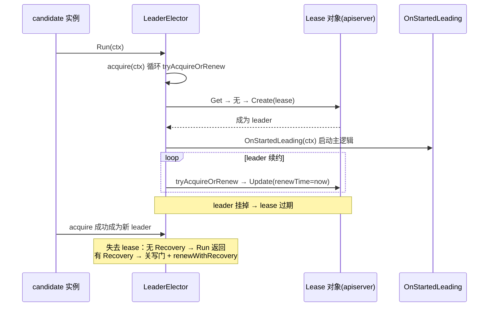

[总目录](../sourceReader/README.md)

# Leader Election 专题

> **代码基准**：`k8s.io/kubernetes`，master@`782c049`（工作区文档产物外干净），Go 1.27.4。
> **范围**：client-go 的 leader election 机制——多个副本的组件（kube-controller-manager、kube-scheduler、cloud-controller-manager）如何通过竞争一个 lease 选出唯一 leader，以及 leader 失去 lease 后的行为（含 write gate 与 Recovery）。
> **不覆盖**：具体控制器的业务逻辑（见篇 08/12-15）；etcd lease 的底层实现（本专题用 `Lease` API 对象）；APF 流控（见 P&F 专题）。
> **主文件**：`staging/src/k8s.io/client-go/tools/leaderelection/leaderelection.go`（LeaderElector）、`.../resourcelock/leaselock.go`（Lease 锁实现）、`.../resourcelock/interface.go`（ResourceLock 接口）。

## 0. 结论速览

Leader election 让多副本组件**只有一个实例真正工作**（leader），其余实例（candidate）待命。它通过竞争一个 **Lease 对象**（`coordination.k8s.io/v1`）实现：leader 周期性续约（renew），candidate 周期性尝试获取（acquire）。谁持有未过期的 lease，谁就是 leader。

### 0.1 这项能力现在能做什么

- **唯一 leader**：任意时刻只有一个实例持有未过期的 lease，其余实例不执行主逻辑。
- **自动故障转移**：leader 挂掉后 lease 过期，candidate 之一获取 lease 成为新 leader。
- **写门（write gate）**：带 `Recovery` 的 elector 失去 lease 后不退出，而是**关闭写门**——非安全方法（POST/PUT/PATCH/DELETE）被拒绝，只放行 GET/HEAD/OPTIONS/TRACE。
- **平滑切换**：leader 转移时递增 `LeaderTransitions` 计数，可观测切换次数。

### 0.2 关键结论、适用范围与不做什么

| 结论 | 说明 |
|---|---|
| 竞争的是 Lease 对象 | `coordination.k8s.io/v1` Lease，`holderIdentity`/`leaseDurationSeconds`/`renewTime` 字段 |
| acquire 与 renew 是同一个函数 | `tryAcquireOrRenew`——首次调用是 acquire，之后是 renew |
| 乐观更新 + 快慢路径 | leader 优先用乐观 Update（快路径）；失败回落到 Get→Update（慢路径） |
| 三个时间参数约束 | `LeaseDuration > RenewDeadline > RetryPeriod`（构造时校验） |
| 失去 lease 的两种行为 | 无 Recovery：`Run` 返回（进程退出）；有 Recovery：关写门继续运行尝试恢复 |
| Lease 本身不被写门拦截 | 续约用的 client 不被 gate，否则恢复期间无法续约 |

**不做什么**：不保证 leader 切换零中断（切换有 lease 过期的窗口）；不处理 etcd/apiserver 不可用；不做跨集群 leader election。

## 1. 生产视角：实际怎么用、会得到什么

### 1.1 参与者、真实入口与前置条件

| 角色 | 是谁 | 做什么 |
|---|---|---|
| LeaderElector | 每个 controller-manager/scheduler/CCM 实例 | 竞争 lease，leader 执行主逻辑 |
| Lease 对象 | `coordination.k8s.io/v1` Lease（如 `kube-controller-manager`） | 记录 `holderIdentity`/`leaseDurationSeconds`/`renewTime` |
| candidate | 非 leader 实例 | 周期性尝试 acquire |
| write gate | 带 Recovery 的 elector | 非 leader 时拦截写请求 |

**前置条件（可判断）：**
1. `Lock` 非 nil（`NewLeaderElector` 校验，:115）。
2. `LeaseDuration > RenewDeadline > RetryPeriod`（:83/:86 校验，否则报错）。
3. `Callbacks.OnStartedLeading` / `OnStoppedLeading` 非 nil（:108/:111）。
4. Lease 命名空间/名称已配置（如 `kube-system/kube-controller-manager`）。

### 1.2 生产主流程图



图后说明：
- **前提**：多个实例竞争同一个 Lease 对象。
- **分支**：`Recovery == nil` 走 `renew`（失去即退出）；有 `Recovery` 走 `renewWithRecovery`（关写门继续尝试恢复）。
- **终点**：leader 持续续约直到 ctx 取消或续约失败。

### 1.3 输入、处理环节、输出与接收方

| 环节 | 输入 | 处理 | 输出 | 接收方 |
|---|---|---|---|---|
| acquire | ctx + Lock + RetryPeriod | 循环 `tryAcquireOrRenew`（`JitterUntilWithContext`） | bool（是否成为 leader） | `Run` |
| renew | ctx + Lock + RenewDeadline | `PollUntilContextTimeout` 循环续约 | 失败则 cancel | `Run` |
| tryAcquireOrRenew | Lock + now | 快慢路径 Update/Create | bool | acquire/renew |
| OnStartedLeading | ctx | 启动主逻辑（控制器/scheduler） | — | 组件主逻辑 |
| write gate | HTTP 请求 | 非 leader 拦截非安全方法 | 放行或 ErrWriteGateClosed | 组件的 client |

### 1.4 业务分支、异常表现、重复操作与边界

| 分支/异常 | 触发条件 | 用户可见结果 |
|---|---|---|
| 成为 leader | `tryAcquireOrRenew` 成功（Create 或 Update） | `OnStartedLeading` 启动主逻辑；`became leader` 事件 |
| 续约成功 | `tryAcquireOrRenew` 快路径或慢路径 Update 成功 | 继续持有 lease |
| 续约失败（超 RenewDeadline） | 连续 `RetryPeriod` 内无法续约 | 失去 lease；无 Recovery 则退出，有 Recovery 关写门 |
| 候选发现 lease 被持有 | `oldLeaderElectionRecord.HolderIdentity` 非空且 lease 有效 | 返回 false，继续等待 |
| 候选发现 lease 过期 | holder 为空或 lease 过期 | 抢占 lease（`LeaderTransitions+1`） |
| ctx 取消 + ReleaseOnCancel | 进程优雅退出 | `release` 释放 lease（立即让位） |
| 写门关闭 | 非 leader（有 Recovery） | 非 GET/HEAD/OPTIONS/TRACE 请求被 `ErrWriteGateClosed` 拒绝 |

### 1.5 一次真实操作示例

两个 kube-controller-manager 实例（A、B）竞争 `kube-system/kube-controller-manager` lease：

```bash
# A 先启动，获取 lease 成为 leader
kubectl get lease -n kube-system kube-controller-manager -o yaml
# spec:
#   holderIdentity: A_<id>
#   leaseDurationSeconds: 15
#   renewTime: "2026-11-19T20:00:00Z"
#   acquireTime: "..."
#   leaseTransitions: 0

# A 的日志
# Successfully acquired lease
# ... 控制器开始工作 ...

# A 挂掉 → lease 15s 后过期
# B 尝试 acquire → 发现 lease 过期 → 抢占
# B 的日志
# Successfully acquired lease
# ... leaseTransitions: 1  ← 切换计数 +1
```
最终：B 成为新 leader，继续运行控制器；A 重启后成为 candidate。

## 2. 开发视角：当前代码怎样实现

### 2.1 实现地图：进程、入口、核心源码

| 角色 | 文件 | 符号（偏移以定义行为 +0） |
|---|---|---|
| elector 构造 | `tools/leaderelection/leaderelection.go` | `NewLeaderElector`（:82）、`RunOrDie`（:290 附近） |
| 主循环 | `tools/leaderelection/leaderelection.go` | `LeaderElector.Run`（:284）、`acquire`（:354）、`renew`（:382）、`renewWithRecovery`（:421） |
| 抢占/续约核心 | `tools/leaderelection/leaderelection.go` | `tryAcquireOrRenew`（:749）、`maybeReportTransition`（:823） |
| 写门 | `tools/leaderelection/leaderelection.go` | `WriteGate`（:330 附近）、`writeGate.close`/`open` |
| 锁接口 | `tools/leaderelection/resourcelock/interface.go` | `ResourceLock`（Get :83/Create :86/Update :89/RecordEvent :92/Identity :95） |
| Lease 锁 | `tools/leaderelection/resourcelock/leaselock.go` | `LeaseLock`（:31）、`Get`（:42）、`Create`（:57）、`Update`（:73） |
| 多锁 | `tools/leaderelection/resourcelock/multilock.go` | `MultiLock`（多地区/多锁） |

**注册点：** controller-manager/scheduler/CCM 在 `Run` 中构造 `LeaderElectionConfig` 并调 `NewLeaderElector(lec).Run(ctx)`。

### 2.2 技术前置条件

| 前置项 | 说明 |
|---|---|
| `Lock` | `resourcelock.ResourceLock`（通常 `LeaseLock`，指向一个 Lease 对象） |
| `LeaseDuration > RenewDeadline > RetryPeriod` | 构造校验（:83/:86/:89-95），违反则报错 |
| `Callbacks.OnStartedLeading/OnStoppedLeading` | 非 nil（:108/:111） |
| `Lock.Identity()` | 唯一标识（通常 `hostname_uuid`） |
| apiserver 可达 | Lease 对象存于 apiserver（非直连 etcd） |

### 2.3 真实调用链与关键源码锚点

```text
RunOrDie → NewLeaderElector(lec) → LeaderElector.Run (+284)
  ├── acquire (+354)
  │    └── wait.JitterUntilWithContext(RetryPeriod, JitterFactor, immediate=true)
  │         └── tryAcquireOrRenew (+749)
  │              ├── 快路径：IsLeader && isLeaseValid → Lock.Update（乐观）
  │              └── 慢路径：Lock.Get → Create/Update
  │    成功 → writeGate.open() + OnStartedLeading(ctx)
  ├── renew (+382)  ← 无 Recovery
  │    └── wait.UntilWithContext(RetryPeriod)
  │         └── PollUntilContextTimeout(RenewDeadline)
  │              └── tryAcquireOrRenew → 失败 cancel
  │    退出 → ReleaseOnCancel ? release : 退出
  └── renewWithRecovery (+421)  ← 有 Recovery
       └── 失去 lease → 关写门 + 继续尝试恢复
```

**tryAcquireOrRenew 四步（:749）：**
1. **快路径**（:757 ～ :770）：`IsLeader() && isLeaseValid(now)` → 乐观 `Lock.Update`（保留 AcquireTime/LeaderTransitions）；成功即返回 true。
2. **慢路径 Get/Create**（:772 ～ :794）：`Lock.Get` 取旧记录；NotFound 则 `Lock.Create` 创建。
3. **Identity & Time 检查**（:802 ～ :810）：若旧 holder 非空且 lease 有效且**我不是 leader** → 返回 false（lease 被别人持有且未过期）。
4. **Update**（:812 ～ :820）：纠正 AcquireTime/LeaderTransitions（非 leader 时 +1）→ `Lock.Update` → `setObservedRecord`。

### 2.4 关键算法：快慢路径与 lease 有效性

**快路径（乐观更新）：** leader 假设「上次观察到的记录就是当前版本」，直接 `Lock.Update`。失败（如 RV 冲突）则回落慢路径。

**慢路径（Get → 检查 → Update）：**
- `Lock.Get` 取旧记录 → `setObservedRecord`。
- 检查 `oldLeaderElectionRecord.HolderIdentity` 非空且 `isLeaseValid(now)` 且非我 → 被持有，返回 false。
- 否则（holder 为空、lease 过期、或我是 leader）→ Update。

**isLeaseValid（lease 是否过期）：** `now - renewTime < LeaseDuration`（renewTime 由 leader 每次续约刷新）。

**时间参数约束（`NewLeaderElector` 校验，:83 ～ :95）：**
```text
LeaseDuration > RenewDeadline > JitterFactor * RetryPeriod
且 LeaseDuration >= 1, RenewDeadline >= 1, RetryPeriod >= 1
```
- 典型值：LeaseDuration=15s、RenewDeadline=10s、RetryPeriod=2s。
- 语义：lease 15s 过期；leader 每 RenewDeadline(10s) 内必须续约成功；每次重试间隔 RetryPeriod(2s)。

### 2.5 分支、失败处理与必须保持的规则

| 规则 | 锚点 | 为什么必须保持 |
|---|---|---|
| LeaseDuration > RenewDeadline | `NewLeaderElector`（:83） | 否则 lease 在续约前就过期，导致频繁切换 |
| RenewDeadline > JitterFactor*RetryPeriod | `NewLeaderElector`（:86） | 否则单次重试就可能超 RenewDeadline |
| leader 快路径优先 | `tryAcquireOrRenew`（:757） | 减少 Get 往返，降低 apiserver 负载 |
| 非 leader 不抢占未过期 lease | `tryAcquireOrRenew`（:802 ～ :810） | 保证唯一 leader，不双写 |
| Lease 自身不被写门拦截 | `WriteGate` 注释（:330 附近） | 否则恢复期间无法续约，永远无法重新成为 leader |
| LeaderTransitions 计数 | `tryAcquireOrRenew`（:815 ～ :818） | 可观测切换次数，切换频繁说明不稳定 |

### 2.6 写门（write gate）与 Recovery

**无 Recovery（默认）：** `Run` 中 `renew` 失败 → 返回 → `OnStoppedLeading` → 组件退出（由 KCM/scheduler 的外层重启）。

**有 Recovery：** `Run` 中 `renewWithRecovery`（:421）——失去 lease 后**不退出**，而是：
1. 关闭写门（`writeGate.close`）——非安全方法被 `ErrWriteGateClosed` 拒绝。
2. 调 `OnStoppedLeading`。
3. 继续尝试恢复 lease；恢复成功则重新 open 写门。

**为什么需要写门：** 带 Recovery 的 elector 在失去 lease 后继续运行（不退出），若不拦截写请求，非 leader 实例会继续写 apiserver，造成双写。写门保证只有 leader 能写。

### 2.7 字段、状态与必须保持的规则

| 字段 | 锚点 | 说明 |
|---|---|---|
| `HolderIdentity` | `resourcelock/interface.go:46 LeaderElectionRecord` | 当前 leader 标识（`hostname_uuid`） |
| `LeaseDurationSeconds` | 同上 / leaselock.go:150 | lease 时长 |
| `RenewTime` / `AcquireTime` | 同上 | 续约/获取时间 |
| `LeaderTransitions` | 同上 | 切换计数 |
| `observedRecord` / `observedRawRecord` | `tryAcquireOrRenew` | 本地缓存的上次观察记录（用于快路径与变更检测） |
| `writeGate` | `leaderelection.go WriteGate` | 写门 wrapper |

### 2.8 失败处理与必须保持的规则

| 规则 | 锚点 | 为什么必须保持 |
|---|---|---|
| ctx 取消即退出 | `Run`（:286 `defer notifyStoppedLeading`） | 优雅退出，不悬挂 |
| ReleaseOnCancel 释放 lease | `renew`（:415 ～ :419） | 优雅退出时立即让位，缩短切换窗口 |
| 续约失败 cancel context | `renew`（:405 ～ :409） | 停止续约循环 |
| 快路径失败回落慢路径 | `tryAcquireOrRenew`（:770 ～ :772） | 乐观失败（RV 冲突）时不放弃 |

### 2.9 Recovery 恢复流程与 MultiLock（加深）

#### Recovery 恢复流程（`renewWithRecovery`，leaderelection.go:421）

带 `Recovery` 的 elector 失去 lease 后**不退出**，而是进入恢复循环。本节解剖恢复流程。

```text
renewWithRecovery (+0，:421)
├── ctx, cancel（独立 cancel，与 Run 的 ctx 分离）
├── leading = true
├── wait.UntilWithContext(ctx, RetryPeriod)
│    └── PollUntilContextTimeout(RenewDeadline, immediate=true)
│         ├── ctx.Err() → return false, err（短路径，避免无谓处理）
│         └── tryRecover(ctx) → (renewed, lost)
│              ├── lost → return false, errLeaseLost（lease 被别人拿走）
│              └── renewed → return renewed, nil
│    成功 → 继续续约
│    失败 → leading=false + writeGate.close() + leaderOff 指标
│            + RecordEvent("stopped leading") + notifyStoppedLeading()
│            （写门关闭，但**不退出**，继续尝试恢复）
└── ctx 取消 → cancel
```

**tryRecover（:547）——恢复时的续约尝试：**
```text
tryRecover(ctx) → (renewed, lost)
├── 1. 快路径：IsLeader() && isLeaseValid → 乐观 Update（条件于 RV）
│     失败 → 回落慢路径
├── 2. Lock.Get 取记录（**与 tryAcquireOrRenew 不同：从不 Create**）
│     注释：Recovery 场景从不创建 lease——只续约已持有的 lease
└── 检查 holder/lease 有效性
```
**与 tryAcquireOrRenew 的区别：** tryRecover **从不 Create** lease——恢复场景只续约已持有的 lease，不抢别人的。

**写门的精确时机（注释 :330 附近）：**
- 写门在「观察到失去 lease」时关闭（`writeGate.close()`），**早于任何 release**。
- 无 Recovery 时 `Run` 在失去 lease 时退出，写门也在那时关闭。
- Lease 自身用的 client **不被写门拦截**（否则恢复期间无法续约）。

#### MultiLock（多锁，multilock.go:36）

`MultiLock` 用于多地区/多锁场景（如 HA 跨 region）：

```text
MultiLock.Get(ctx)
├── Primary.Get → primary, primaryRaw
├── Secondary.Get → secondary, secondaryRaw
│     NotFound 且 primary.HolderIdentity != 我 → 返回 primary（旧 client 兼容）
├── primary.HolderIdentity != secondary.HolderIdentity
│     → HolderIdentity = UnknownLeader（两把锁不一致 → 未知 leader）
└── 返回合并后的记录
```
**语义：** Primary 与 Secondary 两把锁，若 holder 不一致则返回 `UnknownLeader`——防止脑裂时双 leader。

#### 写门与 Recovery 的时间线

| 时刻 | 写门 | 进程 | 动作 |
|---|---|---|---|
| 持有 lease | open | 运行主逻辑 | 正常续约 |
| 续约失败（超 RenewDeadline） | **close** | 继续运行（有 Recovery） | OnStoppedLeading 通知 |
| 尝试恢复 | close | 继续尝试续约 | tryRecover 循环 |
| 恢复成功 | open | 重新成为 leader | 继续主逻辑 |
| 恢复失败（lease 被夺） | close | 退出（无 Recovery）或继续（有 Recovery） | — |

**设计要点（源码可证）：**
1. **写门早于 release 关闭**：写门在观察到失去 lease 时就关闭（早于 release），防止非 leader 实例继续写 apiserver。
2. **Lease 自身不被写门拦截**：续约用的 client 不被 gate，否则恢复期间无法续约，永远无法重新成为 leader。
3. **Recovery 不 Create lease**：tryRecover 从不 Create，只续约已持有的 lease——避免恢复场景下抢占别人的 lease。
4. **MultiLock 防脑裂**：Primary 与 Secondary 不一致时返回 `UnknownLeader`，防止脑裂时双 leader。

## 3. 验证、缺口与后续修改

### 3.1 代码回核与生产实测记录

- **代码回核**：本专题所有「符号+偏移」均在 HEAD `782c049` 上用 `grep -n` / `sed -n` / `awk` 复核（`Run` :284、`acquire` :354、`renew` :382、`tryAcquireOrRenew` :749、`WriteGate` :330 附近、`ResourceLock` interface.go:83/:86/:89、`LeaseLock` leaselock.go:31/:42/:57/:73）。
- **生产实测**：**未实测** `[待运行验证]`。lease 切换、写门拦截、Recovery 恢复均为代码推断，未在真实多副本集群观测 leader 切换。

### 3.2 已知缺口和待验证事项

| 缺口 | 性质 | 说明 |
|---|---|---|
| `renewWithRecovery` 完整流程 | 未逐行读 | Recovery 配置下的恢复逻辑（:421 起）未展开 |
| `tryCoordinatedRenew` | 未深挖 | `Coordinated` 模式（协调式续约）未展开 |
| `MultiLock` | 未深挖 | 多地区/多锁场景未展开 |
| 生产 leader 切换观测 | `[待运行验证]` | 未在真实多副本集群观测 lease 切换与写门行为 |

### 3.3 修改联动清单、源码索引与关联文档

**改动这块前必查：**
- 改 `tryAcquireOrRenew` → 同步 `acquire`/`renew`/`renewWithRecovery` 三处调用。
- 改写门 → 同步 `WriteGate` 与 `writeGate.open/close`，以及 KCM 的 `PausableRegistrar`（篇 01 提到非 Pausable 控制器靠 write gate 拦截）。
- 改时间参数校验 → `NewLeaderElector`（:83 ～ :116）的约束。
- 改锁实现 → `resourcelock/interface.go` 的 `ResourceLock` 与 `LeaseLock`/`MultiLock`。

**源码索引：**

| 符号 | 文件:行 |
|---|---|
| `NewLeaderElector` | `leaderelection.go:82` |
| `LeaderElector.Run` | `leaderelection.go:284` |
| `LeaderElector.acquire` | `leaderelection.go:354` |
| `LeaderElector.renew` | `leaderelection.go:382` |
| `LeaderElector.renewWithRecovery` | `leaderelection.go:421` |
| `LeaderElector.tryAcquireOrRenew` | `leaderelection.go:749` |
| `LeaderElector.WriteGate` | `leaderelection.go:330` 附近 |
| `LeaderElectionRecord` | `resourcelock/interface.go:46` |
| `ResourceLock`（Get/Create/Update） | `resourcelock/interface.go:83/:86/:89` |
| `LeaseLock` | `resourcelock/leaselock.go:31` |
| `LeaseLock.Get/Create/Update` | `resourcelock/leaselock.go:42/:57/:73` |

**关联文档：** [01-系统骨架](../sourceReader/01-系统骨架.md)（KCM 非 Pausable 控制器靠 write gate 拦截）；[07-scheduler调度与绑定](../sourceReader/07-scheduler调度与绑定.md)（scheduler 的 leader election）；[18-cloud-controller-manager](../sourceReader/18-cloud-controller-manager.md)（CCM 的 leader election）。

[总目录](../sourceReader/README.md)
