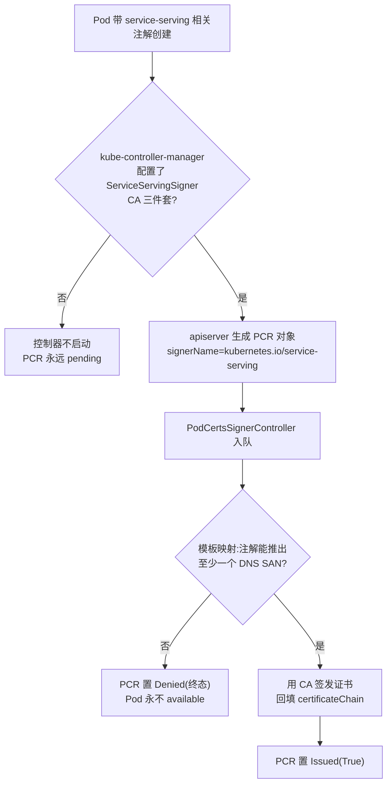

# PodCertsSigner 服务签名

> 代码基准：adrian@`6bf0bfd51d78d1b3cb0917dc7001cd2aaf5549d7`（2026-11-26，工作区干净，Go 1.27.4）；核实日期：2026-11-26。
> 范围：`kubernetes.io/service-serving` 签名器——Pod 通过 `PodCertificateRequest`（PCR）为 Service webhook/APIService 申请服务证书的完整链路。不覆盖 CSR 签名器（`kubernetes.io/kubelet-serving` 等四类，走 `pkg/controller/certificates/signer/`）、不覆盖 ClusterTrustBundle 发布细节。

## 0. 结论速览

### 0.1 当前能做什么、谁能用、得到什么

| 项 | 内容 |
|---|---|
| 能力 | 为 Pod 内进程签发用于 TLS 服务端的 X.509 证书，SAN 来自 Pod 关联的 Service DNS 名 |
| 触发者 | Pod 创建后，kube-apiserver 自动生成一条 `PodCertificateRequest`（`spec.signerName=kubernetes.io/service-serving`） |
| 前置条件 | kube-controller-manager 配置了 `ServiceServingSigner` 的 CA 证书/密钥/信任包三件套；Pod 属于某个匹配的 Service |
| 输出 | PCR 的 `status.certificateChain` 被填入证书链，`Issued` 条件置 True |
| 失败可见结果 | 不可恢复错误 → PCR `Denied` 条件置 True（终态）；可恢复错误 → 退避重试 |

### 0.2 关键结论、适用范围与边界

- 这是 v1.35+ 引入的**新签名器**，与既有 CSR 签名器并存但完全独立：PCR 是新 API 对象，不走 `CertificateSigningRequest`。
- 证书的 DNS SAN **只来自 Pod 显式声明的注解**（`UnverifiedUserAnnotations`），不是自动推断——Pod 要么声明 `AddPodFQDN=true`（用 Pod FQDN），要么声明 `ServiceNames`（用 Service DNS）。
- 证书生命周期刷新点固定在有效期 60% 处（`BeginRefreshAt`），由客户端负责续期。

## 1. 生产视角

### 1.1 参与者、真实入口与前置条件



参与者：
- **Pod**：声明 `service-serving` 注解，是证书的最终使用者。
- **kube-apiserver**：为符合条件的 Pod 自动创建 PCR（本篇不展开 apiserver 侧生成逻辑）。
- **PodCertsSignerController**：kube-controller-manager 内的签名控制器。
- **KubeServiceCATemplateMapper**：把 PCR + Pod 映射成 X.509 模板，是准入判定的真正执行者。

前置条件（可判断）：
1. KCM 启动参数配置 `ServiceServingSigner.CACertPath`/`CAKeyPath`/`CABundlePath` 三者齐全，否则控制器**整体跳过**（见开发视角装配点）。
2. Pod 的 `spec.subdomain` 非空（若申请 Pod FQDN）；或 Pod 所属 Service 的 selector 匹配该 Pod（若申请 Service DNS）。

### 1.2 生产主流程与环节小结

| 生产环节 | 触发者 / 接收者 | 前置条件 | 输入资料 | 实际处理 | 可见输出 | 失败时 |
|---|---|---|---|---|---|---|
| PCR 生成 | apiserver → etcd | Pod 含服务签名注解 | Pod spec | 创建 PCR 对象 | `PodCertificateRequest` | 无（apiserver 侧） |
| 入队 | informer Add → workqueue | PCR 未到终态 | PCR key | `enqueue` 加队列 | — | 已终态则忽略 |
| 取 PCR + 校验 | worker | 缓存已同步 | NamespacedName | 查 PCR、校验 signerName/Pod UID | — | UID 不符→报错重试 |
| 模板映射 | mapper | PCR + Pod 就绪 | PCR spec 注解 | 推导 DNS SAN、校验 Service | X.509 模板 | 推不出 SAN→Denied |
| 签发 | controller | CA 密钥对可用 | 模板 | `x509.CreateCertificate` | 证书链 PEM | 签名错→报错重试 |
| 回写状态 | controller → apiserver | 拿到证书 | PCR status | 写 certificateChain/NotBefore/NotAfter/BeginRefreshAt | PCR `Issued=True` | 更新失败→退避重试 |

### 1.3 输入、处理、输出与接收方

- **输入**：PCR 对象（含 `spec.stubPKCS10Request` CSR、`spec.maxExpirationSeconds`、`spec.unverifiedUserAnnotations`）+ 关联 Pod。
- **处理**：从 CSR 提取公钥与基础模板 → 按注解推导 DNS SAN → 用 service-serving CA 签发。
- **输出**：写回 PCR `status`：`certificateChain`（叶子证书+CA 链 PEM）、`notBefore`/`notAfter`、`beginRefreshAt`（有效期 60% 处）、`conditions[Issued=True]`。
- **接收方**：Pod 内进程通过 watch PCR 拿到证书，用于 Service webhook/APIService 的 TLS 服务端。

### 1.4 主流程、业务分支与异常结果

正常路径：PCR 入队 → 映射出 SAN → 签发 → `Issued`。

三个明确的业务分支：
1. **Denied（终态，不可恢复）**：`MapPodCertRequestToX509Template` 返回 `TemplateMapperDeniedError`。触发条件三种——申请 Pod FQDN 但 `subdomain` 为空（`PodSubdomainMissing`）；注解推不出任何 SAN（`PodCertificateConfigurationInvalid`）；Service selector 不匹配 Pod（`ServiceNotMatched`）。置 `Denied=True` 后 PCR 进入终态，**不再重试**，Pod 永不 available。
2. **Service 未找到（可恢复，发 Warning 事件）**：`checkServiceForPod` 查不到 Service（`RefServiceNotFound`），可能是 Service 还没建好（ eventual consistency）。发 `ServiceNotFound` Warning 事件，返回错误走退避重试，**不置终态**。
3. **其他错误（退避重试）**：签名失败、状态更新失败等，`processNextWorkItem` 调 `AddRateLimited` 退避重试。

### 1.5 一次真实操作示例

Pod 声明要为 Service `my-webhook` 提供 TLS：

```yaml
apiVersion: v1
kind: Pod
metadata:
  name: my-webhook-0
  annotations:
    service-serving.kubernetes.io/service-names: "my-webhook"
spec:
  subdomain: my-webhook   # 若还要 Pod FQDN 则必须
  ...
```

apiserver 生成 PCR → 控制器映射出 SAN `my-webhook.<ns>.svc` 和 `my-webhook.<ns>.svc.cluster.local` → 校验 `my-webhook` Service 的 selector 命中该 Pod → 签发 → PCR `status.certificateChain` 填入证书链、`Issued=True`。Pod 读到证书后即可在 `my-webhook.<ns>.svc:443` 提供 TLS 服务，kube-apiserver 信任 service-serving CA 信任包。

### 1.6 边界、非目标与验收表现

- **非目标**：不为 CSR（`CertificateSigningRequest`）签名；不做证书续期（只标记 `BeginRefreshAt`，续期由客户端发起新 PCR）；不管理 ClusterTrustBundle 的分发细节（由配套 publisher 负责）。
- **验收表现**：`kubectl get podcertificaterequest` 看到 `Issued=True` 且 `certificateChain` 非空即成功；`Denied=True` 表示配置错误需改 Pod。

## 2. 开发视角

### 2.1 实现地图：入口、注册点、核心源码与测试

| 角色 | 位置 |
|---|---|
| 控制器主体 | `pkg/controller/certificates/podcertssigner/podcertssigner.go` |
| KCM 装配点 | `cmd/kube-controller-manager/app/certificates.go` · `func newKubeServiceCASignerControllers` `+0` |
| signerName 常量 | `pkg/apis/certificates/types.go` · `Const:ServiceServingSignerName`（`kubernetes.io/service-serving`） |
| KCM config API | `staging/src/k8s.io/kube-controller-manager/config/v1alpha1/types.go` · `ServiceServingSignerConfiguration` |
| 测试 | `pkg/controller/certificates/podcertssigner/podcertssigner_test.go` |

### 2.2 技术前置条件：配置、依赖、初始化

装配点 `newKubeServiceCASignerControllers`（`certificates.go:403`）逻辑：
1. 读 `ComponentConfig.ServiceServingSigner` 的 `CACertPath`/`CAKeyPath`/`CABundlePath`，任一为空则 `return nil, nil` 整体跳过（日志 "Skipping Service Serving Signer controller"）。
2. `NewPodCertificatesSigner`（`podcertssigner.go:150`）创建控制器：用 `NewDynamicServingContentFromFiles` 加载 CA 密钥对（支持热重载）、建带 `spec.signerName` field-selector 的 PCR informer、建 workqueue、注册 Add 事件处理器。
3. `NewKubeServiceCATemplateMapper`（`podcertssigner.go:396`）注入 Service lister/informer/client + clusterDomain。
4. 并发跑三个 goroutine：信任包 `Run`、`signer.Run(ctx, 5)`（5 worker）、ClusterTrustBundle publisher。

### 2.3 真实调用链与关键源码定位

```
informer Add(PCR)                                  podcertssigner.go · func (s *PodCertsSignerController) enqueue +0
  └─> queue.Add                                    (非终态才入队)
worker 循环                                        podcertssigner.go · func (s *PodCertsSignerController) Run +0
  └─> processNextWorkItem                          podcertssigner.go · func (s *PodCertsSignerController) processNextWorkItem +0
       └─> syncPodCertificateRequest               podcertssigner.go · func (s *PodCertsSignerController) syncPodCertificateRequest +0
            ├─> certTemplateMapper.MapPodCertRequestToX509Template   podcertssigner.go · func (m *KubeServiceCATemplateMapper) MapPodCertRequestToX509Template +0
            │     └─> checkServiceForPod            podcertssigner.go · func (m *KubeServiceCATemplateMapper) checkServiceForPod +0
            │           └─> liveFallbackGet         podcertssigner.go · func liveFallbackGet +0  (lister 未命中→client 兜底)
            │           └─> selectorMatchesLabels   podcertssigner.go · func selectorMatchesLabels +0
            └─> x509.CreateCertificate → UpdateStatus(Issued)
```

关键点：
- `enqueue`（`:210`）只在 PCR **未到终态**时入队——`isPCRInFinalState`（`:550`）检查 `Issued`/`Denied`/`Failed` 任一为 True 即跳过。PCR 不可变，只关心 Add 事件。
- `Run`（`:232`）先 `WaitForNamedCacheSync`（PCR + Pod 两个 informer），再等 `certTemplateMapper.WaitUntilReady`（等 Service informer 同步），然后起 worker。
- `MapPodCertRequestToX509Template`（`:457`）是准入判定核心：`templateFor` 从 CSR 建模板 → 按注解加 SAN。`AddPodFQDN=true` 但 `subdomain` 空直接 Denied；`ServiceNames` 逐个 `checkServiceForPod`；最终 SAN 为空则 Denied。

### 2.4 字段、转换、状态、持久化与响应

| 生产步骤 | 数据/字段 | 来源 | 校验/默认值 | 转换/传递 | 存储/输出 | 消费者与失败行为 |
|---|---|---|---|---|---|---|
| 模板 | `spec.stubPKCS10Request` | PCR | CSR 可解析 | `templateFor` 提取公钥/subject | 内存模板 | 解析失败→报错重试 |
| 有效期 | `spec.maxExpirationSeconds` | PCR | 上限 `signerMaxExpirationSeconds` | 截断到上限 | 模板 NotBefore/NotAfter | — |
| SAN | `unverifiedUserAnnotations` | PCR | 注解白名单键 | 推导 FQDN/Service DNS | `template.DNSNames` | 空→Denied |
| 刷新点 | `BeginRefreshAt` | 计算 | NotBefore + lifetime×3/5 | — | PCR status | 客户端据此续期 |
| 终态 | `status.conditions` | controller | Denied/Issued/Failed | `UpdateStatus` | PCR | 更新失败→退避 |

### 2.5 核心机制、分支、失败处理与必须保持的规则

- **终态机**：PCR 一旦 `Issued`/`Denied`/`Failed` 为 True 即终态，`isPCRInFinalState` 是唯一判据。**必须保持**：Denied 只用于"全局状态永不恢复"（如不可变 Pod 字段配置非法），绝不能把可恢复错误置成 Denied，否则 Pod 永久卡死。
- **eventual consistency 处理**：`HookEvents`（`:413`）让 mapper 把"依赖的 Service 后建"的 PCR 重新入队——Service informer 的 Add 事件通过 `enqueueForService` 补投那些因 Service 缺失而失败的 PCR。
- **缓存兜底**：`liveFallbackGet`（`:541`）先查 lister 缓存，未命中再打 client 实时查，规避 Service 刚建、缓存未同步的窗口。注释明确警告返回的是缓存指针、不可写。
- **CA 热重载**：用 `DynamicCertKeyPairContent`，CA 轮换不需重启控制器。

### 2.6 开发图、配置表与异常对照表

配置项（`ServiceServingSignerConfiguration`）：

| 配置 | 含义 | 缺省/校验 |
|---|---|---|
| `caCertPath` / `caKeyPath` | 签名 CA 证书/密钥 | 三者任一为空则控制器跳过 |
| `caBundlePath` | 信任包（apiserver 侧信任） | 同上 |
| `clusterDomain` | 集群域名 | `RecommendedDefaultPodCertsSignerConfiguration` 默认 `cluster.local` |

异常对照：

| 现象 | 原因 | 分类 |
|---|---|---|
| PCR 停在 pending 不动 | KCM 未配 ServiceServingSigner 三件套 | 控制器未启动 |
| PCR `Denied`（PodSubdomainMissing） | 申请 Pod FQDN 但 `subdomain` 空 | 终态，改 Pod |
| PCR `Denied`（ServiceNotMatched） | Service selector 不匹配 Pod | 终态，改 Service/Pod |
| PCR `Denied`（PodCertificateConfigurationInvalid） | 注解推不出任何 SAN | 终态，改注解 |
| 反复重试 + `ServiceNotFound` 事件 | Service 尚未创建 | 可恢复，建 Service 后自愈 |

### 2.7 验证方式与可观察结果

- 单元测试：`podcertssigner_test.go`（覆盖 mapper 的 SAN 推导、Denied 分支、终态判定）。
- 可观察结果：`kubectl get podcertificaterequest -o yaml` 看 `status.conditions` 与 `certificateChain`。
- 生产实际值（如真实集群是否启用该签名器）未实测 `[待运行验证]`。

### 2.8 后续引用与修改联动清单

- 上游调用方：apiserver 的 PCR 生成逻辑（本篇未展开）。
- 下游依赖：ClusterTrustBundle publisher（`ctbpublisher.NewGAClusterTrustBundlePublisher`）消费同一信任包。
- 修改联动：改 `X509TemplateMapper` 接口签名需同步 mapper 实现 + `Run` 中的 `WaitUntilReady` 调用；新增 Denied reason 需同步 `TemplateMapperDeniedError` 的 reason 常量与异常对照表。

## 3. 证据、缺口与源码索引

源码索引（符号 → 文件，均在 `pkg/controller/certificates/podcertssigner/podcertssigner.go`）：

| 符号 | 角色 |
|---|---|
| `type PodCertsSignerController` `+0` | 控制器主体 |
| `func NewPodCertificatesSigner` `+0` | 构造 |
| `func (s *PodCertsSignerController) Run` `+0` | 启动/worker 编排 |
| `func (s *PodCertsSignerController) syncPodCertificateRequest` `+0` | 单条 PCR 调谐 |
| `type KubeServiceCATemplateMapper` `+0` | 模板映射器 |
| `func (m *KubeServiceCATemplateMapper) MapPodCertRequestToX509Template` `+0` | 准入判定核心 |
| `func (m *KubeServiceCATemplateMapper) checkServiceForPod` `+0` | Service selector 校验 |
| `func isPCRInFinalState` `+0` | 终态判据 |

未决项：
- apiserver 侧 PCR 自动生成逻辑（什么条件触发、注解如何透传）本篇未覆盖，属 apiserver 篇范围。
- ClusterTrustBundle publisher 的分发细节未展开。
