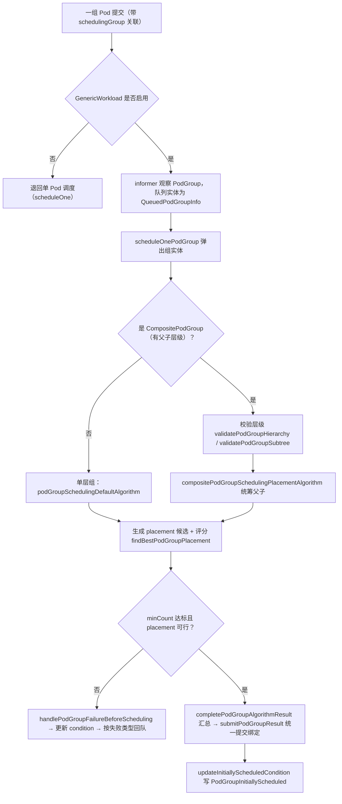

[总目录](../sourceReader/README.md)

# v1.37 组调度：PodGroup 与 CompositePodGroup 专题

> **代码基准**：`k8s.io/kubernetes`，master@`57d78241ff96c94130c509681b12b4a1715434af`（2026-11-20，工作区除文档产物外干净），Go 1.27.4。
> **范围**：kube-scheduler 在 GenericWorkload 特性下把「一组 Pod」作为调度实体——PodGroup 的入队、组调度周期、minCount 约束、placement 生成与评分、CompositePodGroup 父子层级、失败时的 condition 与回队。覆盖调度器侧为主。
> **不覆盖**：DRA 设备动态资源分配（见 [DRA 动态资源分配](DRA动态资源分配.md)）；kubelet 侧的设备准备；PodGroup 的 API 对象存储与 controller 侧生命周期（本仓库 scheduling API 类型在 staging，controller 侧不在本文）。
> **主文件**：`pkg/scheduler/schedule_one_podgroup.go`（组调度周期编排）、`pkg/scheduler/algorithm_podgroup.go`（组调度算法与 placement）、`pkg/scheduler/eventhandlers.go`（组员维护）、`pkg/scheduler/framework/types.go`（组实体类型）、`pkg/features/kube_features.go`（特性门控）。

## 0. 结论速览

组调度解决「单 Pod 模型不够」的问题：AI/HPC、拓扑敏感和分布式任务常要求**一组 Pod 共同满足最小数量或布局约束**。当前源码通过 `GenericWorkload`、`CompositePodGroup` 等特性扩展调度实体，让调度队列里的实体不再总是单个 `QueuedPodInfo`，而可以是 `QueuedPodGroupInfo`。调度器收集组成员、检查 minCount、为多个 Pod 产生 placement/assignment、统一提交结果，并更新 PodGroup 的 condition。

### 0.1 这项能力现在能做什么

- 把多个 Pod 作为**一个调度实体**：组成员一起评估、一起推进，避免部分成员占资源却永远等不到其他成员。
- 支持 **minCount**：组达到最低可行集合后才共同提交，未达阈值不产生绑定。
- 支持 **placement 生成与评分**：为整组产生多个候选布局（placement），按扩展点评分选最优。
- 支持 **CompositePodGroup**：多个 PodGroup 组成父子层级，父组统筹子组的 placement 组合。
- 失败可观察：把「整组不可调度 / 部分 Pod 失败 / 等待抢占 / placement 插件失败」区分开，写入不同 condition。

### 0.2 关键结论、适用范围与不做什么

| 结论 | 说明 |
|---|---|
| 受特性门控控制 | `GenericWorkload`、`CompositePodGroup` 默认关闭；未启用时调度器退回单 Pod 路径 |
| 组调度是「收集—评估—统一提交」，不是原子事务 | 底层 API `Bind` 仍是逐 Pod 的；组级语义靠补偿与 condition 保证可观察性 |
| minCount 是「最低可行集合」 | 达到 minCount 才提交；不是「必须全部成员成功」 |
| placement 是候选布局 | 一次可为整组生成多个 placement，评分后选优，而非逐 Pod 独立选节点 |
| 失败必须映射回正确队列 | 组失败不能简单把所有成员独立放回 activeQ，要按失败类型处理 |

**不做什么**：不保证组级 `Bind` 原子；不提供跨调度器协调；不处理 kubelet 侧设备准备（DRA 节点插件职责）。源码存在、默认启用、稳定 API 是三个不同层次——本文描述的是「源码存在」路径，`GenericWorkload`/`CompositePodGroup` 截至当前基准仍非默认启用 `[待运行验证]`（默认值见 `pkg/features/kube_features.go`，`GenericWorkload` 默认 stays false）。

## 1. 生产视角：实际怎么用、会得到什么

### 1.1 参与者、真实入口与前置条件

| 角色 | 是谁 | 做什么 |
|---|---|---|
| 用户 / 上游 controller | 提交一组带 `schedulingGroup` 关联的 Pod（及 PodGroup 对象） | 声明期望：这几个 Pod 要作为一组被调度 |
| kube-scheduler | 组调度周期 | 收集组成员、检查约束、产生 placement、统一提交绑定 |
| 特性门控 | `GenericWorkload` / `CompositePodGroup` | 未开启则整组能力不生效，退回单 Pod 调度 |
| etcd / API | PodGroup 对象与 Pod 的 schedulingGroup 字段 | 组的定义与状态（conditions）落库 |

前置条件：① 相关特性门控已启用；② Pod 通过 `spec.schedulingGroup.podGroupName` 关联到 PodGroup；③ 调度器 informer 已观察到 PodGroup（GenericWorkload 启用时才观察）。缺 ① 时组字段被忽略、退回单 Pod；缺 ②③ 时组不成立或成员不全。

### 1.2 生产主流程图



### 1.3 输入、处理、输出与接收方

| 生产环节 | 输入 | 实际处理 | 可见输出 | 接收方 |
|---|---|---|---|---|
| 组实体入队 | Pod 事件（Add/Update） | `Cache.AddPodGroupMember` 维护组成员，`podGroupHierarchyTracker` 维护层级 | 队列中出现 `QueuedPodGroupInfo` | 调度队列 |
| 组调度周期 | 弹出的组实体 | 收集 `queuedPodInfos`、校验层级、跑组算法 | 组内各 Pod 的 placement/assignment | 调度框架 |
| 提交 | 组算法结果 | `completePodGroupAlgorithmResult` 汇总 → `submitPodGroupResult` | 逐 Pod 的 Bind + 组 condition 更新 | API / etcd |
| 失败 | 组算法失败状态 | `handlePodGroupFailureBeforeScheduling` + `updatePodGroupConditionWithError` | PodGroup condition（区分失败类型） | API / 用户 |

### 1.4 主流程、分支与异常结果

- **正常路径**：组实体出队 → 收集成员 → （Composite 则先校验层级）→ 生成并评分 placement → minCount 达标 → 汇总结果统一提交 → 写 `PodGroupInitiallyScheduled` condition。
- **minCount 未达标 / 无可行 placement**：走 `handlePodGroupFailureBeforeScheduling`，更新 condition，按失败类型把成员放回正确队列（不是无脑全放回 activeQ）。
- **Composite 层级不合法**：`validatePodGroupHierarchy` / `validatePodGroupSubtree` 在调度前拦截，避免父子状态不一致。
- **部分成员失败**：区分「整组不可调度 / 部分 Pod scheduler error / 等待抢占 / placement 插件失败」，分别映射 condition 与回队策略。

### 1.5 边界与验收表现

- 组调度不改变单 Pod 调度的对外语义；未启用特性时行为与主线 [scheduler 调度与绑定](../sourceReader/07-scheduler调度与绑定.md) 一致。
- 验收看两点：PodGroup 的 condition 是否正确反映调度进度；组内 Pod 是否在达到 minCount 后才出现绑定。

## 2. 开发视角：当前代码怎么实现

### 2.1 实现地图

| 职责 | 文件 · 符号 |
|---|---|
| 组调度周期编排 | `pkg/scheduler/schedule_one_podgroup.go` · `Scheduler.scheduleOnePodGroup` `+0` |
| 组周期内主循环 | `pkg/scheduler/schedule_one_podgroup.go` · `Scheduler.podGroupCycle` `+0` |
| 组调度算法入口 | `pkg/scheduler/algorithm_podgroup.go` · `PodGroupSchedulingAlgorithm.RunRootSchedulingAlgorithm` `+0` |
| 单层组算法 | `pkg/scheduler/algorithm_podgroup.go` · `PodGroupSchedulingAlgorithm.podGroupSchedulingDefaultAlgorithm` `+0` |
| placement 算法 | `pkg/scheduler/algorithm_podgroup.go` · `PodGroupSchedulingAlgorithm.podGroupSchedulingPlacementAlgorithm` `+0` |
| Composite 父子算法 | `pkg/scheduler/algorithm_podgroup.go` · `PodGroupSchedulingAlgorithm.compositePodGroupSchedulingPlacementAlgorithm` `+0` |
| 选最优 placement | `pkg/scheduler/algorithm_podgroup.go` · `PodGroupSchedulingAlgorithm.findBestPodGroupPlacement` `+0` |
| 组员维护 | `pkg/scheduler/eventhandlers.go` · 组员登记（Add 路径） |
| 组实体类型 | `pkg/scheduler/framework/types.go` · `QueuedPodGroupInfo` `+0`、`PodGroupInfo` `+0` |
| 特性门控 | `pkg/features/kube_features.go` · `GenericWorkload`、`CompositePodGroup` |

### 2.2 真实调用链

```
eventhandlers（Pod Add/Update）
  → Cache.AddPodGroupMember / podGroupHierarchyTracker.AddPod      （维护组成员与层级）
  → SchedulingQueue.Add                                            （入队，实体可为组）
Scheduler.scheduleOnePodGroup  +0
  → validatePodGroupHierarchy / validatePodGroupSubtree            （Composite 层级校验）
  → PodGroupSchedulingAlgorithm.RunRootSchedulingAlgorithm  +0
      → podGroupSchedulingDefaultAlgorithm / podGroupSchedulingPlacementAlgorithm
      → compositePodGroupSchedulingPlacementAlgorithm              （Composite）
      → findBestPodGroupPlacement                                  （评分选优）
  → completePodGroupAlgorithmResult / completeCompositePodGroupAlgorithmResult
  → submitPodGroupResult / submitCompositePodGroupResult           （统一提交绑定）
  → updateInitiallyScheduledCondition                              （写 condition）
失败分支：handlePodGroupFailureBeforeScheduling → updatePodGroupConditionWithError
```

### 2.3 关键源码定位

锚点记法 `符号+N`：N 为相对符号定义行的偏移，`+0` 即定义行。可用 `.progress/verify_anchors.py` 反查。

| 符号 | 定义文件 | 偏移 |
|---|---|---|
| `sched.scheduleOnePodGroup+0` | `pkg/scheduler/schedule_one_podgroup.go` | 组实体出队入口 |
| `sched.podGroupCycle+0` | `pkg/scheduler/schedule_one_podgroup.go` | 周期主循环 |
| `sched.handlePodGroupFailureBeforeScheduling+0` | `pkg/scheduler/schedule_one_podgroup.go` | 失败前置处理 |
| `sched.updatePodGroupConditionWithError+0` | `pkg/scheduler/schedule_one_podgroup.go` | condition 更新 |
| `sched.validatePodGroupHierarchy+0` | `pkg/scheduler/schedule_one_podgroup.go` | Composite 层级校验 |
| `sched.validatePodGroupSubtree+0` | `pkg/scheduler/schedule_one_podgroup.go` | 子树校验 |
| `sched.submitPodGroupResult+0` | `pkg/scheduler/schedule_one_podgroup.go` | 统一提交绑定 |
| `p.RunRootSchedulingAlgorithm+0` | `pkg/scheduler/algorithm_podgroup.go` | 组算法根入口 |
| `p.podGroupSchedulingDefaultAlgorithm+0` | `pkg/scheduler/algorithm_podgroup.go` | 单层组算法 |
| `p.podGroupSchedulingPlacementAlgorithm+0` | `pkg/scheduler/algorithm_podgroup.go` | placement 算法 |
| `p.compositePodGroupSchedulingPlacementAlgorithm+0` | `pkg/scheduler/algorithm_podgroup.go` | Composite 父子算法 |
| `p.findBestPodGroupPlacement+0` | `pkg/scheduler/algorithm_podgroup.go` | 评分选最优 placement |
| `QueuedPodGroupInfo+0` | `pkg/scheduler/framework/types.go` | 组队列实体 |
| `PodGroupInfo+0` | `pkg/scheduler/framework/types.go` | 组状态 |
| `PodGroupSchedulingAlgorithm+0` | `pkg/scheduler/algorithm_podgroup.go` | 组算法结构 |
| `Const:GenericWorkload`、`Const:CompositePodGroup` | `pkg/features/kube_features.go`（包级 var，非 func/type，故用稳定键名定位） | 特性门控 |

- 组实体 `QueuedPodGroupInfo+0` 内嵌 `*PodGroupInfo` + `queuedPodInfos map[fwk.EntityKey][]*QueuedPodInfo`（按 priority/timestamp 确定序）+ `podsWithPendingPlugins`。
- 组员维护：`pkg/scheduler/eventhandlers.go` 的 Add 路径调用 `sched.Cache.AddPodGroupMember(pod)`，并在 `sched.podGroupHierarchyTracker != nil` 时同步层级；Update 路径对应 `UpdatePodGroupMember` / `UpdatePod`。
- placement 评分参数由 `WithAlgorithmPercentageOfPlacementsToScore+0`、`WithShufflePlacements+0` 注入；`numFeasiblePlacementsToFind+0` 决定要找多少可行 placement，`placementsToEvaluate+0` 决定评估哪些。
- `eventhandlers.go` 中 `utilfeature.DefaultFeatureGate.Enabled(features.GenericWorkload)` 决定是否走组路径。

### 2.4 核心机制与必须保持的规则

- **placement 优先于逐 Pod 选节点**：组算法先产生整组布局候选，再评分选优（`findBestPodGroupPlacement`），与单 Pod 的「逐节点 Filter/Score」不同。
- **minCount 是提交闸门**：未达最低可行集合不提交，避免部分成员占资源。
- **失败映射回正确队列**：`handlePodGroupFailureBeforeScheduling` 按失败类型分流，不得把整组成员无差别放回 activeQ。
- **层级一致性**：Composite 场景必须先 `validatePodGroupHierarchy` / `validatePodGroupSubtree`，父子状态不一致会在调度前被拦。
- **组不是原子事务**：底层 `Bind` 逐 Pod，组级语义靠 condition（如 `PodGroupInitiallyScheduled`）与补偿保证可观察，不要假设「要么全成、要么全不成」。

### 2.5 验证方式与可观察结果

- 单元测试：`pkg/scheduler/schedule_one_podgroup_test.go`（组周期、层级、feature gate 组合边界）、`pkg/scheduler/algorithm_podgroup_test.go`（placement 生成/评分/minCount）。
- 代码回核：本文锚点可用 `.progress/verify_anchors.py` 反查定义行与偏移。
- 生产实测：需启用 `GenericWorkload`（及 `CompositePodGroup`）后观察 PodGroup condition 与组内 Pod 绑定时序 `[待运行验证]`。

### 2.6 后续引用与修改联动

- 设备维度：组内 Pod 若涉及设备请求，联动 [DRA 动态资源分配](DRA动态资源分配.md)。
- 单 Pod 调度基线：[scheduler 调度与绑定](../sourceReader/07-scheduler调度与绑定.md)、[调度器抢占 preemption](调度器抢占-preemption.md)（组级抢占分支）。
- 改动联动：调整组实体字段（`framework/types.go`）会影响队列、eventhandlers、算法三层；调整特性门控默认值会改变生产行为可见性。

## 3. 证据与缺口

- 本文所有符号均在当前工作区 `pkg/scheduler/`、`pkg/scheduler/framework/`、`pkg/features/` 下经 grep 核实存在；偏移以定义行为 `+0`。
- 源自旧库 `docs/adrian/sourceReader2/11-v1.37-Workload-PodGroup与DRA.md` 的主题，按当前源码重写并替换其 `#L` 行号引用为符号+偏移。
- 待确认：`GenericWorkload`/`CompositePodGroup` 在具体发布版本是否默认启用，以 `pkg/features/kube_features.go` 当前默认值为准 `[待运行验证]`。

[总目录](../sourceReader/README.md)
