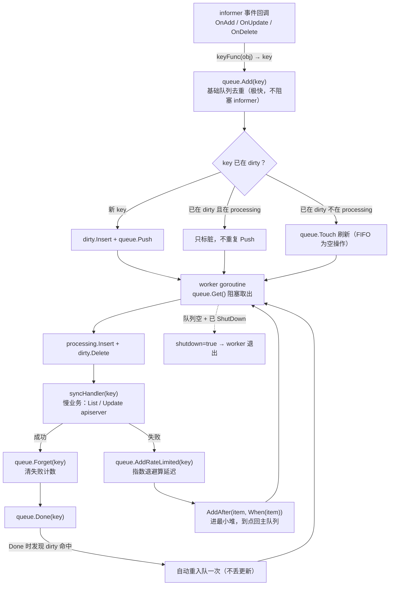
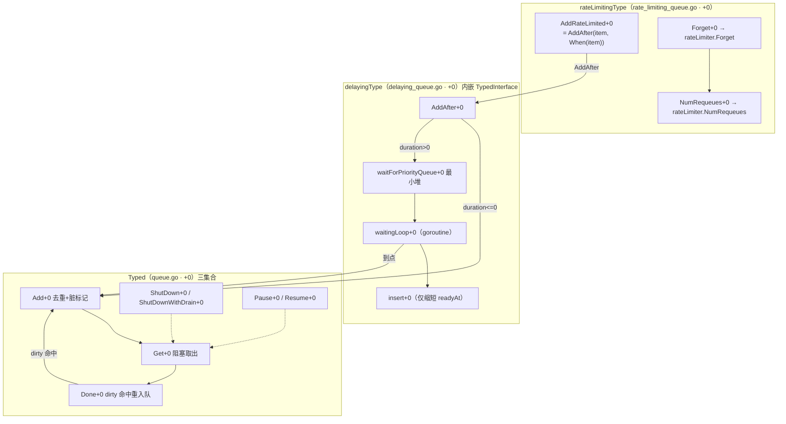

[上一篇](../sourceReader/21-设备插件与网络边界.md) · [总目录](../sourceReader/README.md) · [返回专题索引](../sourceReader/README.md#专题topics)

# workqueue 机制

> **层级**：跨篇机制纵深专题——把 client-go 泛型 workqueue（基础队列 + delaying + rate-limiting 三层）的去重、延迟、限流重试、暂停、优雅排空语义讲透。它是**所有控制器/调度器/kubelet 配置源**共用的处理骨架。
>
> **代码基准**：adrian @ `6bf0bfd51d7`（2026-11-26，工作区干净），Go 1.27.4。所有「符号+偏移」均在该基准上用 codegraph 回核（当前工作区 HEAD 为 `fafe132f3c9`，晚数个提交，`staging/src/k8s.io/client-go/util/workqueue/` 三文件无差异，锚点一致）。
>
> **锚点记法**：符号体内偏移以符号声明行为 **+0**，如 `Add+0`（定义行）、`Add+3`（声明行后第 3 行）。staging 文件一律写完整路径（含 `staging/src/k8s.io/`）。
>
> **泛型说明**：workqueue 已全面泛型化。`Typed` 的泛型形参在源码里是小写 **`t`**（`` `Typed[t comparable]` ``），方法接收者写作 `*Typed[T]`；本文符号名**保留真实形态**（`` `Typed` ``/`` `TypedInterface` ``/`` `TypedBucketRateLimiter.When` `` 等）。sr_tools.py 的正则不覆盖泛型方括号形态，对这些符号会误报 MISS——已逐个用 codegraph_explore 回核真实定义行，详见 §8。
>
> **事实红线**：生产实测与代码推断分开标注；未实测项标 `[待运行验证]`。
>
> **与主线篇的关系**：[11-informer与workqueue机制](../sourceReader/11-informer与workqueue机制.md) §4 是本专题的浓缩版；本专题纵向展开三层队列的完整语义。锚点一致，deepen 时同步。

---

## 0. 结论速览

### 0.1 workqueue 解决什么问题

控制器的事件回调（informer 的 OnAdd/OnUpdate/OnDelete）**不能直接做业务处理**——回调里做慢活会阻塞 informer 的事件分发。workqueue 是回调与业务处理之间的**缓冲层**：回调只做 `Add(key)`（极快），worker goroutine 从队列 `Get(key)` 后才做慢的 `syncHandler`。

### 0.2 三层队列，各解决一件事

| 层 | 类型 | 解决的问题 | 关键方法 |
|---|---|---|---|
| **基础队列** | `` `Typed` ``（`staging/src/k8s.io/client-go/util/workqueue/queue.go`） | **去重 + 处理中脏标记 + 可暂停 + 可排空** | `Add`/`Get`/`Done`/`Pause`/`ShutDownWithDrain` |
| **延迟队列** | `delayingType`（`staging/src/k8s.io/client-go/util/workqueue/delaying_queue.go`） | **延迟入队**（到点才进基础队列） | `AddAfter`/`waitingLoop` |
| **限流队列** | `rateLimitingType`（`staging/src/k8s.io/client-go/util/workqueue/rate_limiting_queue.go`） | **失败指数退避重试** | `AddRateLimited`/`Forget`/`NumRequeues` |

三层是**包装关系**：`rateLimitingType` 内嵌 `TypedDelayingInterface`，`delayingType` 内嵌 `TypedInterface`。控制器用的是最外层 `` `TypedRateLimitingInterface` ``。

### 0.3 七条关键结论

1. **去重**：处理前任意次 `Add(key)` 合并为一次（`dirty` 集合去重）。
2. **处理中脏标记**：`Get` 取走后进 `processing`；处理期间再 `Add` 只标 `dirty` 不 Push，`Done` 时若发现 `dirty` 命中则自动重入队一次——**保证不丢更新**。
3. **重复 Add 刷新顺序**：`Add` 一个已在 `dirty` 但不在 `processing` 的 item，会调 `queue.Touch`（默认 FIFO 实现为空操作），给可插拔存储一个改优先级的机会。
4. **延迟项只缩短不延长**：同一 item 多次 `AddAfter`，`` `waitingLoop` `` 的 `insert` 仅在新的 `readyAt` **更早**时才更新（dedup 语义）。
5. **暂停**：`` `Pausable` `` 实现可 `Pause` 阻塞 `Get`；暂停期间 `Add`/`Done`/`Forget` 照常工作，`Get` 不再分发剩余 item。
6. **优雅退出两档**：`ShutDown` 立即让 worker 收到 shutdown（排空与否看实现）；`ShutDownWithDrain` 额外等 `processing` 清零才返回。
7. **延迟重试 + 成功清除**：失败 `AddRateLimited` 按指数退避（默认 base 5ms、max 1000s）算延迟，经 `AddAfter` 进主队列；成功 `Forget` 清失败计数，下次失败从 base 重新退避。

---

## 1. 生产视角：控制器怎么用

### 1.1 一个对象从入队到处理完的真实旅程

以 ReplicaSet 控制器为例：某 Pod 被删 → informer 触发 `OnDelete` 回调 → 回调只做 `Add(rsKey)` → worker 取出 key → `syncHandler` 比 `spec.replicas` 与实际 Pod 数 → 差一个就 `Create` 补齐。

### 1.2 生产流程图



### 1.3 三个对外行为

| 行为 | 生产表现 | 前置条件 | 边界/异常 |
|---|---|---|---|
| 入队 | `Add` 幂等；处理中再 Add 保证处理完重入队一次 | 队列未 ShutDown | `shuttingDown` 时 Add 被静默忽略（不入队也不标 dirty） |
| 取走 | `Get` 阻塞直到有项；排空+关闭返回 `shutdown=true` | worker 常驻 goroutine | 暂停中 `Get` 不分发，需 `Resume` 或 ShutDown 才返回 |
| 重试 | 失败 `AddRateLimited` 指数退避；成功 `Forget` 清计数 | 必须记得调 `Forget` | 退避上限 max（默认 1000s）；漏 Forget 会永久跟踪失败计数 |

### 1.4 可见结果（生产如何确认）

| 观测点 | 可见现象 |
|---|---|
| metrics depth / adds / latency | 队列积压、入队速率、处理时延（named 队列才注册） |
| 重试节奏 | 失败对象按 5ms→10ms→20ms→…→1000s 间隔反复 `syncHandler` |
| 优雅停机 | 收到 SIGTERM 后 worker 排空退出，不悬挂、不丢在途更新 |

`[待运行验证]` 以上生产现象为代码推断 + 通用 controller 行为常识，未在真实控制面运行时逐项采样。

---

## 2. 开发视角：基础队列（`` `Typed` ``）

### 2.1 三集合模型 + 可插拔存储

`` `Typed[t comparable]` ``（`staging/src/k8s.io/client-go/util/workqueue/queue.go` · `` `Typed` `` `+0`）核心是**三个集合**：
- `queue Queue[t]`：待处理 FIFO（**可插拔**，`` `Queue` `` 接口 `+0` 定义 `Touch`/`Push`/`Len`/`Pop`，默认实现 `` `DefaultQueue` `` `+0` = slice FIFO）。
- `dirty sets.Set[t]`：已 Add 但未处理完（去重集合）。
- `processing sets.Set[t]`：正在被 worker 处理（脏标记集合）。

`` `TypedInterface` ``（`queue.go` · `` `TypedInterface` `` `+0`）定义 `Add`/`Len`/`Get`/`Done`/`ShutDown`/`ShutDownWithDrain`/`ShuttingDown`。`` `NewTypedWithConfig` ``（`+0`）→ `` `newQueueWithConfig` `` `+0` → `` `newQueue` `` `+0` 初始化三集合 + metrics + cond，非 `noMetrics` 时还会起一个 `` `updateUnfinishedWorkLoop` `` `+0`（周期 `defaultUnfinishedWorkUpdatePeriod` `+0` = 500ms）刷新未完成工作量指标。

### 2.2 `Add`——去并入队（`queue.go` · `Add+0`）

```text
Add(item)
├── +3 加锁；+4 shuttingDown → 忽略返回（不入队、不标 dirty）
├── +7 item 已在 dirty:
│     ├── +10 不在 processing → q.queue.Touch(item)（可插拔存储刷新优先级；FIFO 为空操作）
│     └── +13 return（已排队，去重）
├── +16 新 item:
│     ├── +16 metrics.add
│     ├── +18 dirty.Insert(item)
│     ├── +19 若已在 processing → return（只留 dirty，处理完由 Done 重入队）
│     └── +23 否则 queue.Push(item) + cond.Signal
```
**去重语义：** 处理前任意次 Add 合并为一次；处理中的 Add 保证处理完后再入队一次。

### 2.3 `Get`——阻塞取出（`queue.go` · `Get+0`）

```text
Get() → (item, shutdown)
├── +3 加锁
├── +3 for (queue空 || paused) && !shuttingDown → cond.Wait（+4）
├── +6 queue 空或 paused（必是 ShutDown 中）→ 返回零值 + shutdown=true
│        暂停中的队列不分发剩余 item（见 Pausable）
├── +12 queue.Pop → item
├── +14 metrics.get
├── +16 processing.Insert(item)（标记处理中）
├── +17 dirty.Delete(item)（从待处理集合移除）
└── +19 返回 item, false
```
**shutdown 语义：** 队列排空后返回 `shutdown=true`，worker 据此退出。**暂停语义：** `paused` 与 `queue.Len()==0` 同样触发返回 shutdown。

### 2.4 `Done`——处理完成（`queue.go` · `Done+0`）

```text
Done(item)
├── +4 metrics.done
├── +6 processing.Delete(item)
├── +7 item 仍在 dirty（处理期间再次变脏）→ queue.Push + cond.Signal（重新入队）
└── +10 否则若 processing.Len()==0 → cond.Signal（唤醒 ShutDownWithDrain 的等待）
```
**关键：** 处理期间变脏的 item 在 `Done` 时自动重入队——**不丢更新**。

### 2.5 `Pause`/`Resume`/`ShutDown`/`ShutDownWithDrain`——流量控制与退出

| 方法 | 锚点 | 语义 |
|---|---|---|
| `` `Pause` `` | `queue.go` · `Pause+0`（`+5` 置 `paused=true`） | `Get` 不再返回 item；`Add`/`Done`/`Forget` 照常 |
| `` `Resume` `` | `queue.go` · `Resume+0`（`+6` 已非 paused 直接返回；`+9` 置 false + `Broadcast`） | 恢复 `Get` 分发 |
| `` `ShutDown` `` | `queue.go` · `ShutDown+0`（`+1` `defer wg.Wait`；`+2` `stopOnce` 关 `stopCh`；`+9` 置 `drain=false`/`shuttingDown=true` + `Broadcast`） | 忽略新 item，worker 处理完在队列 item 后收到 shutdown；等 `wg`（unfinished-work goroutine）退出 |
| `` `ShutDownWithDrain` `` | `queue.go` · `ShutDownWithDrain+0`（`+10` 置 `drain=true`；`+12` for `processing.Len()!=0 && drain` → `Wait`） | 额外等在途 item 全部 `Done` 才返回；暂停时不排空未分发 item。worker 必须 `Done`，否则永久阻塞 |
| `` `ShuttingDown` `` | `queue.go` · `ShuttingDown+0` | 只读返回 `shuttingDown`，供 `AddAfter` 等快速判空 |

`` `Pausable` ``（`queue.go` · `` `Pausable` `` `+0`）是可选接口（`Pause`/`Resume`），`` `Typed` `` 通过类型断言对外暴露；`delayingType`/`rateLimitingType` 用 `pausableDelayingType`（`delaying_queue.go` · `+0`）、`pausableRateLimitingType`（`rate_limiting_queue.go` · `+0`）包装后才真正满足它。

---

## 3. 开发视角：延迟队列（`delayingType`）

`delayingType`（`staging/src/k8s.io/client-go/util/workqueue/delaying_queue.go` · `+0`）内嵌 `TypedInterface[T]`，多出一个按 `readyAt` 排序的最小堆（`` `waitForPriorityQueue` `` `+0`）与后台 goroutine。`` `TypedDelayingInterface` `` `+0` = `TypedInterface[T]` + `AddAfter`。

### 3.1 `AddAfter`——延迟入队（`delaying_queue.go` · `AddAfter+0`）

```text
AddAfter(item, duration)
├── +2 shuttingDown → 忽略
├── +6 metrics.retry()
├── +9 duration ≤ 0 → 立即 q.Add(item) 并返回
└── +14 select {
         <-stopCh → ShutDown 时解除阻塞
         waitingForAddCh <- &waitFor{data, readyAt: clock.Now()+duration}   放入最小堆通道
     }
```
`waitFor`（`+0`）持 `data`/`readyAt`/`index`。`` `newDelayingQueue` `` `+0` 起 `waitingLoop` goroutine，`waitingForAddCh` 容量 1000。

### 3.2 `waitingLoop`——后台到点转主队列（`delaying_queue.go` · `waitingLoop+0`）

```text
for {
  ShuttingDown → return
  now = clock.Now()
  排空堆里所有 readyAt ≤ now 的 entry → q.Add(entry.data)
  堆非空 → 给堆顶 readyAt 设 nextReadyAtTimer
  select {
    stopCh → return
    heartbeat.C()（maxWait+0 = 10s）→ 续跑（保险，防止 item 滞留 >10s）
    nextReadyAt → 续跑（到点）
    waitingForAddCh 收到 → readyAt 已到则直接 Add，否则 insert 入堆 + drain 通道剩余
  }
}
```
**dedup 语义（`` `insert+0` ``）：** 同一 item 已在堆里时，**仅当新的 `readyAt` 更早才更新**（`existing.readyAt.After(entry.readyAt)` 才 `heap.Fix`）——重复 `AddAfter` 只能缩短延迟、不能延长。

**用途：** 控制器用它做**延迟重试**与**周期性兜底 resync**。

---

## 4. 开发视角：限流队列（`rateLimitingType`）

`rateLimitingType`（`staging/src/k8s.io/client-go/util/workqueue/rate_limiting_queue.go` · `+0`）内嵌 `TypedDelayingInterface[T]` + `rateLimiter TypedRateLimiter[T]`。`` `TypedRateLimitingInterface` `` `+0` = `TypedDelayingInterface[T]` + `AddRateLimited`/`Forget`/`NumRequeues`。构造链：`` `NewTypedRateLimitingQueueWithConfig` `` `+0`（默认建 `` `NewTypedDelayingQueueWithConfig` `` 包一层 delaying）。

### 4.1 三个方法（`rate_limiting_queue.go`）

| 方法 | 锚点 | 作用 |
|---|---|---|
| `AddRateLimited` | `+0`（`+1` 调 `AddAfter(item, rateLimiter.When(item))`） | 按 rate limiter 算延迟 → 交给 delaying 层 |
| `NumRequeues` | `+0`（`+1` 透传 `rateLimiter.NumRequeues`） | 该 item 累计重试次数 |
| `Forget` | `+0`（`+1` 透传 `rateLimiter.Forget`） | 清除失败记录。**只清 limiter 计数，仍需调用方另调 `Done`** |

### 4.2 默认 rate limiter——指数退避（`default_rate_limiters.go`）

`` `DefaultTypedControllerRateLimiter` ``（`staging/src/k8s.io/client-go/util/workqueue/default_rate_limiters.go` · `+0`）= `` `NewTypedMaxOfRateLimiter` `` 组合两个 limiter，取**最坏值**：
- `` `TypedItemExponentialFailureRateLimiter` ``（`+0`，构造 `` `NewTypedItemExponentialFailureRateLimiter` `` `+0`，默认 base `5ms`、max `1000s`）：按失败次数指数增长。
- `` `TypedBucketRateLimiter` ``（`+0`）：`rate.NewLimiter(rate.Limit(10), 100)`——**整体 10 qps、burst 100**，只做整体限速（非 per-item）。

旧的无参构造 `` `DefaultControllerRateLimiter` `` `+0` 已 Deprecated，内部转调 `` `DefaultTypedControllerRateLimiter[any]()` ``。

| limiter | 关键方法锚点 | 行为 |
|---|---|---|
| `` `TypedItemExponentialFailureRateLimiter` `` | `When+0` / `NumRequeues+0` / `Forget+0` | `When`：`exp=failures[item]` 后自增，`baseDelay × 2^exp`，封顶 `maxDelay` 且防 `math.MaxInt64` 溢出；`Forget`：`delete(failures, item)` |
| `` `TypedBucketRateLimiter` `` | `When+0` / `NumRequeues+0` / `Forget+0` | `When` 返回 `Limiter.Reserve().Delay()`；`NumRequeues` 恒 0；`Forget` 空操作 |
| `` `TypedMaxOfRateLimiter` `` | `When+0` / `NumRequeues+0` / `Forget+0` | 遍历所有子 limiter 取 max（`Forget` 全部广播） |
| `` `TypedItemFastSlowRateLimiter` `` | `When+0` / `NumRequeues+0` / `Forget+0` | 前 `maxFastAttempts` 次用 `fastDelay`，之后 `slowDelay` |

**退避序列（默认 exponential）：** `When` 首次 `exp=0` → `base×2^0`，即 5ms → 10ms → 20ms → 40ms → … → 1000s（封顶）。注：`NumRequeues` 返回的是**已失败次数**（自增后的值），首次失败返回 1。

> 退避与整体限速取 `max`：单个 item 即便指数退避算出很短间隔，仍会被 10 qps token bucket 的 `Reserve().Delay()` 拉长到整体配额允许的时间。

---

## 5. 开发实现图：三层包装与调用链



### 5.1 开发映射表

| 关注点 | 实现入口（文件 · 符号 · 偏移） | 数据结构 |
|---|---|---|
| 去重 | `queue.go` · `Add+0` | `dirty` / `processing` `sets.Set` |
| 处理中不丢更新 | `queue.go` · `Add+0`（processing 分支）+ `Done+0`（dirty 命中重入队） | 同上 |
| 取出/退出 | `queue.go` · `Get+0`（`shutdown=true`）+ `ShutDown+0` | `cond` + `stopCh` + `wg` |
| 暂停 | `queue.go` · `Pause+0`/`Resume+0`、`` `Pausable` `` `+0` | `paused bool` |
| 可插拔存储 | `queue.go` · `` `Queue` `` `+0`、`` `DefaultQueue` `` `+0` | `queue Queue[t]` |
| 延迟 | `delaying_queue.go` · `AddAfter+0`、`waitingLoop+0`、`insert+0` | 最小堆 + `waitingForAddCh` |
| 指数退避 | `default_rate_limiters.go` · `` `TypedItemExponentialFailureRateLimiter.When` `` `+0` | `failures map[T]int` |
| 整体限速 | `default_rate_limiters.go` · `` `TypedBucketRateLimiter.When` `` `+0` | `*rate.Limiter`（10 qps / burst 100） |
| 取最坏值 | `default_rate_limiters.go` · `` `TypedMaxOfRateLimiter.When` `` `+0` | `limiters []TypedRateLimiter[T]` |
| 快慢两档 | `default_rate_limiters.go` · `` `TypedItemFastSlowRateLimiter.When` `` `+0` | `failures map[T]int` |
| 未完成工作量指标 | `queue.go` · `updateUnfinishedWorkLoop+0` | 周期 500ms ticker |

---

## 6. 关键保证汇总

| 保证 | 实现锚点 | 为什么必须保持 |
|---|---|---|
| 处理前去重 | `queue.go` · `Add+0`（`dirty` 集合） | 同一 key 短时间多次事件只处理一次 |
| 处理中不丢更新 | `queue.go` · `Add+0`（processing 分支）+ `Done+0`（dirty 命中重入队） | 处理期间对象又变，处理完重入队 |
| 优雅退出 | `queue.go` · `Get+0`（`shutdown=true`）、`ShutDown+0`、`ShutDownWithDrain+0` | worker 排空后退出，不悬挂、不丢在途更新 |
| 暂停/恢复 | `queue.go` · `Pause+0`/`Resume+0` | 需要时冻结分发（如驱逐/维护窗口），Add/Forget 不受影响 |
| 失败指数退避 | `rate_limiting_queue.go` · `AddRateLimited+0`、`default_rate_limiters.go` · `When+0` | 失败不打爆 apiserver |
| 成功清计数 | `rate_limiting_queue.go` · `Forget+0`、`default_rate_limiters.go` · `` `TypedItemExponentialFailureRateLimiter.Forget` `` `+0` | 下次失败从 base 重新退避；漏调则永久跟踪 |
| 延迟项只缩短 | `delaying_queue.go` · `insert+0` | 避免后到的长延迟覆盖更早的紧迫重试 |

---

## 7. 两条机制如何拼合（informer → workqueue → worker）

```text
informer 事件回调（OnAdd/OnUpdate/OnDelete）
  └── keyFunc(obj) → key
       └── queue.Add(key)                    基础队列去重
            └── [worker goroutine]
                 key, shutdown = queue.Get()
                      └── syncHandler(key)   慢业务（List/Update apiserver）
                           ├── 成功 → queue.Forget(key) + queue.Done(key)
                           └── 失败 → queue.AddRateLimited(key)（指数退避）+ queue.Done(key)
```

**为什么这样设计：** 回调快（只 Add）、worker 慢（syncHandler）、失败退避（AddRateLimited）——三者解耦，informer 不被慢业务阻塞，失败不会打爆 apiserver。

---

## 8. 泛型符号与锚点说明

workqueue 包已全面泛型化，本文涉及的泛型符号如下（**均已在基准上用 codegraph_explore 回核真实定义行**）：

| 泛型符号 | 文件 | 说明 |
|---|---|---|
| `` `Typed[t comparable]` `` | `queue.go` | 泛型形参是**小写 `t`**；方法接收者写作 `*Typed[T]` |
| `` `TypedInterface[T]` `` | `queue.go` | 基础队列接口 |
| `` `Queue[T]` `` / `` `DefaultQueue[T]` `` | `queue.go` | 可插拔底层存储 + slice FIFO 默认实现 |
| `` `TypedRateLimiter[T]` `` | `default_rate_limiters.go` | limiter 接口（`When`/`Forget`/`NumRequeues`） |
| `` `TypedBucketRateLimiter[T]` `` | `default_rate_limiters.go` | token bucket（10 qps / burst 100） |
| `` `TypedItemExponentialFailureRateLimiter[T]` `` | `default_rate_limiters.go` | 指数退避 |
| `` `TypedMaxOfRateLimiter[T]` `` | `default_rate_limiters.go` | 多 limiter 取最坏值 |
| `` `TypedItemFastSlowRateLimiter[T]` `` | `default_rate_limiters.go` | 快慢两档 |
| `` `TypedDelayingInterface[T]` `` / `` `TypedRateLimitingInterface[T]` `` | `delaying_queue.go` / `rate_limiting_queue.go` | 两层包装接口 |

**工具误报说明：** `sr_tools.py` 的符号正则不覆盖泛型方括号形态（`Typed[...]`、`TypedBucketRateLimiter[T].When`），对这些符号会判 MISS。**符号其实都在**，本文一律保留泛型形态并用 codegraph_explore 回核真实定义行；读者可用 `sr_tools.py offset FILE SYM`（传去泛型参数的基础名）实时取行号。`[源码未确认]` 项见 §9。

---

## 9. 验证与边界

### 9.1 锚点回核

本专题所有「符号+偏移」均在基准上用 codegraph_explore 回核（staging 完整路径）：
- `queue.go`：`` `TypedInterface` `` `+0`、`` `Typed` `` `+0`、`` `Queue` `` `+0`、`` `DefaultQueue` `` `+0`、`` `NewTypedWithConfig` `` `+0`、`` `newQueue` `` `+0`、`Add+0`、`Len+0`、`Get+0`、`Done+0`、`Pause+0`、`Resume+0`、`ShutDown+0`、`ShutDownWithDrain+0`、`ShuttingDown+0`、`updateUnfinishedWorkLoop+0`
- `delaying_queue.go`：`` `TypedDelayingInterface` `` `+0`、`delayingType` `+0`、`waitFor` `+0`、`` `waitForPriorityQueue` `` `+0`、`` `newDelayingQueue` `` `+0`、`AddAfter+0`、`waitingLoop+0`、`insert+0`、`maxWait+0`、`` `pausableDelayingType` `` `+0`
- `rate_limiting_queue.go`：`` `TypedRateLimitingInterface` `` `+0`、`rateLimitingType` `+0`、`` `NewTypedRateLimitingQueueWithConfig` `` `+0`、`AddRateLimited+0`、`NumRequeues+0`、`Forget+0`、`` `pausableRateLimitingType` `` `+0`
- `default_rate_limiters.go`：`` `TypedRateLimiter` `` `+0`、`` `DefaultTypedControllerRateLimiter` `` `+0`、`` `DefaultControllerRateLimiter` `` `+0`、`` `TypedBucketRateLimiter` `` `+0`（`When`/`NumRequeues`/`Forget` 各 `+0`）、`` `TypedItemExponentialFailureRateLimiter` `` `+0`（`When`/`NumRequeues`/`Forget` 各 `+0`）、`` `TypedMaxOfRateLimiter` `` `+0`、`` `TypedItemFastSlowRateLimiter` `` `+0`

### 9.2 生产实测

**未实测** `[待运行验证]`。退避序列（5ms→1000s）、dirty/processing 交互、暂停与排空行为、整体 token bucket 与指数退避取 max 的实际节奏，均为代码推断，未在真实 controller 运行时观测重试间隔与 depth 曲线。

### 9.3 已知缺口

| 缺口 | 性质 | 说明 |
|---|---|---|
| metrics | 未深挖 | `workqueue` 的 depth/adds/latency/retries 指标实现（`metrics.go` 的 `queueMetrics`/`retryMetrics`）未逐行读 |
| parallelizer | 未深挖 | `parallelizer.go` 的并行 worker 协调未读 |
| 自定义 `Queue` 实现 | 未列举 | `traceQueue` 等测试用实现未纳入；生产是否有非 FIFO 实现未确认 `[源码未确认]` |

### 9.4 修改联动

- 改去重/脏标记语义 → `queue.go` 的 `Add`/`Done`，同步 [11-informer与workqueue机制](../sourceReader/11-informer与workqueue机制.md) §4。
- 改退避参数 → `default_rate_limiters.go` 的 `` `DefaultTypedControllerRateLimiter` ``/`` `TypedItemExponentialFailureRateLimiter` ``，同步本文 §4.2。
- 改延迟语义 → `delaying_queue.go` 的 `AddAfter`/`waitingLoop`/`insert`。
- 改暂停/排空语义 → `queue.go` 的 `Pause`/`Resume`/`ShutDownWithDrain`。

**关联文档：** [11-informer与workqueue机制](../sourceReader/11-informer与workqueue机制.md)（informer 侧）、[08-controller副本控制](../sourceReader/08-controller副本控制.md)（ReplicaSet 用 workqueue 重试）、[informer-resync机制](informer-resync机制.md)（resync 侧）。

[总目录](../sourceReader/README.md)
