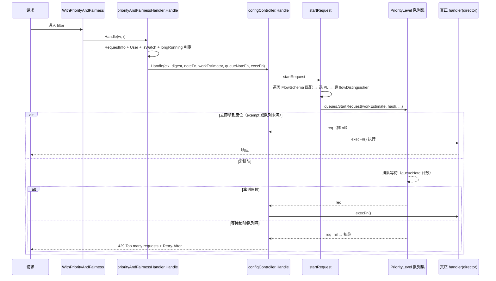

[总目录](../sourceReader/README.md)

# 优先级与公平性流控（Priority and Fairness, APF）专题

> **代码基准**：`k8s.io/kubernetes`，master@`782c049`（工作区文档产物外干净），Go 1.27.4。
> **范围**：kube-apiserver 如何用 APF（Priority and Fairness）对请求做分类、排队、限流与公平调度——从 `WithPriorityAndFairness` filter 进入，经 FlowSchema 匹配、PriorityLevel 选择、排队等待、到放行执行或 429 拒绝。
> **不覆盖**：`MaxInFlightLimit`（APF 的前身，仅作对照）；etcd 侧的限流；webhook 的自身限流；NodeRestriction 等准入插件。
> **主文件**：`staging/src/k8s.io/apiserver/pkg/server/filters/priority-and-fairness.go`（filter）、`staging/src/k8s.io/apiserver/pkg/util/flowcontrol/apf_filter.go`（Handle/startRequest）、`.../flowcontrol/apf_controller.go`（分类/排队/ reap）。

## 0. 结论速览

APF 是 apiserver 的请求准入限流机制：每个请求先被**分类**到一个 FlowSchema → 映射到一个 PriorityLevel（优先级层）→ 进入该层的队列集排队 → 拿到「执行席位」才被放行到真正的 handler。它解决两个问题：**过载保护**（并发上限）与**公平性**（低优先级流量不能饿死高优先级）。

### 0.1 这项能力现在能做什么

- **并发上限**：每个 PriorityLevel 有并发席位（concurrency seats）上限，超出的请求排队而非立即执行。
- **公平排队**：同一 PriorityLevel 内按 flow（由 distinguisher 算出，通常是用户或 namespace）分队列，多队列轮转，单个 flow 不能占满整层。
- **429 拒绝**：排队超过 `QueueLengthLimit` 或等待超过 `HandSize`/等待上限 → 返回 429 `Too many requests` + `Retry-After`。
- **豁免层（exempt）**：`exempt` PriorityLevel 不排队、不限流，保证系统关键请求（如 leader election、liveness）永不因过载被拒。
- **兜底 catch-all**：`catch-all` FlowSchema 兜住未匹配任何 FlowSchema 的请求，保证 APF 不变量（恒有 exempt + catch-all 两个不可删 FlowSchema）。

### 0.2 关键结论、适用范围与不做什么

| 结论 | 说明 |
|---|---|
| APF 在认证/鉴权**之后**执行 | 需要从 context 取 `RequestInfo`（verb/resource）与 `user.Info`，故必须排在认证/鉴权之后 |
| watch 请求特殊处理 | watch 是长连接，APF 用 `shouldStartWatchCh` + 初始化信号控制，直到 `execute()` 才关闭 |
| long-running 非 watch 请求跳过 APF | `longRunningRequestCheck` 命中（如 exec/attach/portforward）直接放行，不排队 |
| 豁免层不排队 | `pl.Spec.Type == Exempt` 的请求直接执行，不占并发席位、不排队 |
| 冲突用 etcd 乐观并发，APF 用并发席位 | 两者解耦：APF 管进入 handler 前的并发，etcd 管写入时的乐观 CAS |
| 429 带 `Retry-After` | 被拒请求收到 `Retry-After` 头，客户端据此退避 |

**不做什么**：不做请求优先级重排（只决定排队与放行顺序，不改请求内容）；不做跨 apiserver 实例的全局限流（每实例独立）；不保证排队请求一定成功（可能等超时被拒）。

## 1. 生产视角：实际怎么用、会得到什么

### 1.1 参与者、真实入口与前置条件

| 角色 | 是谁 | 做什么 |
|---|---|---|
| 请求 | 任意 apiserver 客户端请求（kubectl、controller、kubelet、webhook） | 进入 `WithPriorityAndFairness` filter |
| FlowSchema | 集群里的 `flowschemas.flowcontrol.apiserver.k8s.io` 对象 | 按规则（user/group/resource/verb）把请求分类到某个 PriorityLevel |
| PriorityLevel | `prioritylevelconfigurations` 对象 | 定义并发上限、队列数、排队长度、限流响应 |
| APF 控制器 | `configController`（`apf_filter.go New`，:89） | watch FlowSchema/PriorityLevel，维护运行态 |

**前置条件（可判断）：**
1. apiserver 启用时 `--feature-gates=APIPriorityAndFairness=true`（默认开启）。
2. `c.FlowControl != nil`（见篇 05 中间件链，否则回落 `WithMaxInFlightLimit`）。
3. 请求已通过认证（context 里有 `user.Info`）与 RequestInfo（有 verb/resource）。

### 1.2 生产主流程图



图后说明：
- **前提**：请求已认证（有 user）、有 RequestInfo。
- **分支**：long-running 非 watch 直接放行；watch 走特殊 channel；exempt 层不排队。
- **终点**：要么执行（`execFn()`），要么 429 拒绝。

### 1.3 输入、处理环节、输出与接收方

| 环节 | 输入 | 处理 | 输出 | 接收方 |
|---|---|---|---|---|
| 进入 filter | HTTP 请求 | `WithPriorityAndFairness`（priority-and-fairness.go:323） | `priorityAndFairnessHandler` | `Handle` |
| RequestInfo/User 提取 | req.Context() | `apirequest.RequestInfoFrom`/`UserFrom` | verb/resource + user | 分类 |
| 分类 | RequestDigest | 遍历 FlowSchema `matchesFlowSchema` | FlowSchema + PriorityLevel | startRequest |
| 排队 | workEstimate + hash | `queues.StartRequest` | `req`（非 nil=拿到席位）或排队 | Handle |
| 执行 | execFn | `req.Finish(execFn)` | 真正 handler 响应 | 客户端 |
| 拒绝 | 排队超时/队列满 | `tooManyRequests` | 429 + Retry-After | 客户端 |

### 1.4 业务分支、异常表现、重复操作与边界

| 分支/异常 | 触发条件 | 用户可见结果 |
|---|---|---|
| long-running 非 watch | exec/attach/portforward 等 | 跳过 APF，直接执行（不占并发席位） |
| watch 请求 | `requestInfo.Verb` 为 watch | 特殊 channel，直到 `execute()` 关闭 |
| FlowSchema 无匹配 | 不属于任何 FlowSchema | 回落 `catch-all`（:1035），保证不 panic |
| exempt 层 | `pl.Spec.Type == Exempt` | 不排队、不限流，直接执行 |
| 队列满 | `QueueLengthLimit` 超限 | 429 `Too many requests` + Retry-After |
| 等待超时 | 超过 request context deadline 或 `defaultRequestWaitLimit` | 429 |
| PL 被删/空闲 | 无请求引用 | `maybeReap` 清理运行态（:180） |

### 1.5 一次真实操作示例

某个低优先级用户在高峰期发大量请求：

```bash
# 正常时：请求被分类到某个 FlowSchema → PriorityLevel，排队后执行
kubectl get pods   # 200 OK

# 该 PriorityLevel 并发席位耗尽时：
kubectl get pods   # Error from server (TooManyRequests): Too many requests, please try again later.
                   # 响应头含 Retry-After: 1
```
- `kubectl describe prioritylevelconfiguration workload-high` 可看到 `ConcurrencyLevel`、当前并发、排队数。
- 响应头 `X-Kubernetes-PF-PriorityLevel-UID` / `X-Kubernetes-PF-FlowSchema-UID` 标识命中的分类（用 UID 而非 name，避免暴露分类名）。

## 2. 开发视角：当前代码怎样实现

### 2.1 实现地图：进程、入口、核心源码

| 角色 | 文件 | 符号（偏移以定义行为 +0） |
|---|---|---|
| filter 入口 | `server/filters/priority-and-fairness.go` | `WithPriorityAndFairness`（:323）、`priorityAndFairnessHandler.Handle`（:88）、`StartPriorityAndFairnessWatermarkMaintenance`（:353） |
| APF 控制器 | `util/flowcontrol/apf_filter.go` | `New`（:89）、`NewTestable`（:151）、`configController.Handle`（:155） |
| 分类 + 排队 + 放行 | `util/flowcontrol/apf_controller.go` | `startRequest`（:1022）、`matchesFlowSchema`/`FlowSchemaNameExempt`/`FlowSchemaNameCatchAll`（:780-781/:1035）、`maybeReap`（:180 后） |
| 队列集 | `util/flowcontrol/fairqueuing/` | `QueueSetFactory`、`StartRequest`、`Finish` |
| 旧限流（对照） | `server/filters/maxinflight.go` | `WithMaxInFlightLimit`（:126） |

### 2.2 技术前置条件

| 前置项 | 说明 |
|---|---|
| `fcIfc` 非 nil | `WithPriorityAndFairness` 的 `utilflowcontrol.Interface` 参数；nil 则跳过 APF |
| RequestInfo + User | 从 context 取（认证/鉴权 filter 之后） |
| FlowSchema / PriorityLevel informer | `configController` watch 两类对象，维护运行态 |
| `initAPFOnce` | `WithPriorityAndFairness` 内 `sync.Once` 初始化水位与指标（:337 ～ :341） |
| ServerConcurrencyLimit | `New`（apf_filter.go:89）注入总并发上限 |

### 2.3 真实调用链与关键源码锚点

```text
WithPriorityAndFairness (priority-and-fairness.go:323)
  └── priorityAndFairnessHandler.Handle (:88)
       ├── RequestInfoFrom / UserFrom（无则 handleError）
       ├── isWatchRequest = watchVerbs.Has(verb)
       ├── longRunningRequestCheck && !isWatch → 直接放行（:100 ～ :104）
       ├── isMutatingRequest / noteExecutingDelta / noteWaitingDelta / queueNote
       └── configController.Handle (apf_filter.go:155)
            └── startRequest (apf_controller.go:1022)
                 ├── 遍历 flowSchemas → matchesFlowSchema → selectedFlowSchema
                 │     无匹配 → catch-all 兜底（:1035），再无 → panic（不变量破坏）
                 ├── plName → plState → numQueues/flowDistinguisher/hashValue
                 ├── noteFn(fs, pl, flowDistinguisher) → 分类注解 + 响应头
                 ├── workEstimator() → seats（Initial/Final/AdditionalLatency）
                 └── queues.StartRequest(workEstimate, hash, ...) → req
                      ├── req != nil → Handle 内 req.Finish(execFn) 执行
                      └── req == nil → 拒绝（429）
```

### 2.4 关键算法：分类、排队、放行

**分类（`startRequest`，apf_controller.go:1022）：**
- 遍历 `cfgCtlr.flowSchemas`（按优先级降序），第一个 `matchesFlowSchema(rd, fs)` 的即选中。
- 无匹配 → 回落 `catch-all`；连 catch-all 都没有 → **panic**（注释：APF 保证恒有 exempt + catch-all 两个不可删 FlowSchema，破坏即不变量失败）。
- `plName = selectedFlowSchema.Spec.PriorityLevelConfiguration.Name` → 查 `plState`。
- 非 Exempt 层：按 `LimitResponse.Type == Queue` 取 `numQueues`；`numQueues > 1` 时算 `flowDistinguisher`（默认按 User）+ `hashValue`。

**排队与放行（`queues.StartRequest`）：**
- `StartRequest` 尝试立即拿席位；拿不到则入队等待，`queueNoteFn` 计数等待/离开。
- `Handle` 内 `req.Finish(execFn)`：拿到执行权后跑 `execFn()`（真正 handler），完成后归还席位；`idle` 时 `maybeReap` 清理空闲 PL。
- 等待期间记录 `observeQueueWaitTime`（排队耗时指标）。

**拒绝：** `tooManyRequests`（priority-and-fairness.go:369 附近）设 `Retry-After` + 429。

### 2.5 分支、失败处理与必须保持的规则

| 规则 | 锚点 | 为什么必须保持 |
|---|---|---|
| 认证/鉴权先于 APF | filter 链顺序（篇 05） | APF 需 RequestInfo + User |
| long-running 非 watch 跳过 | `Handle`（:100 ～ :104） | exec/attach 是长连接，占席位会饿死其它请求 |
| watch 走独立 channel | `Handle`（:150 起） | watch 是长连接，需在 `execute()` 关闭信号 |
| 恒有 exempt + catch-all | `matchesFlowSchema` 兜底 + `New`（:89）不变量 | 保证任何请求都有归属，不 panic |
| 豁免层不排队 | `startRequest`（:1058/:1071 `Type != Exempt` 判定） | 系统关键请求永不因过载被拒 |
| 429 带 Retry-After | `tooManyRequests` | 客户端据此退避，避免雪崩 |

### 2.6 与 MaxInFlightLimit 的对照

| 维度 | MaxInFlightLimit（旧） | APF（现默认） |
|---|---|---|
| 粒度 | 全局单一并发上限 | 按 PriorityLevel 分层 + flow 公平排队 |
| 分类 | 无（仅 mutating/readonly 二分） | FlowSchema 规则（user/group/resource/verb） |
| 公平性 | 无（先到先得） | 多队列轮转，单 flow 不占满 |
| 豁免 | 无 | exempt 层不排队 |
| 触发位置 | `WithMaxInFlightLimit`（maxinflight.go:126） | `WithPriorityAndFairness`（:323） |

### 2.7 队列集、workEstimator 与配置热更新（加深）

#### 队列集内部（`queueSet.StartRequest`，queueset.go:308）

`startRequest` 调 `queues.StartRequest` 进入队列集。队列集内部有两条路径：

```text
StartRequest (queueset.go:308)
├── !canAccommodateSeatsLocked(MaxSeats) → 拒绝（席位不足）
│     日志：%d seats asked, %d in use (%d executing), limit %d
│     → return nil, isIdleLocked()
├── dispatchSansQueueLocked(...) → req（队列未满、席位够 → 直接执行）
│     → return req, false（未排队）
└── shuffleShardAndRejectOrEnqueueLocked(...)（需排队）
     ├── shuffle sharding 选队列（按 hashValue）
     ├── 队列满 → 拒绝（queue-full 指标）→ return nil
     └── 否则创建 request 并入队
          → dispatchAsMuchAsPossibleLocked()（公平轮转派发）
          → return req, false
```
**两条路径：**
- **席位够**：`dispatchSansQueueLocked` 直接执行，不排队。
- **席位不够**：`shuffleShardAndRejectOrEnqueueLocked` 用 shuffle sharding 选队列（按 hashValue），队列满则拒绝，否则入队等待。

**workEstimator（mutating/list work_estimator.go）：** 估算请求占用多少「席位」（并发额度）：
- `mutating_work_estimator.estimate`（:43）：`minSeats` 起步，`maxSeats` 由 PriorityLevel 配置；watch 事件数影响 seats（watch 多则 seats 多）。
- `list_work_estimator.estimate`（:58）：list 请求按对象数/对象大小估算 seats（`seatsBasedOnObjectCount` :155 / `seatsBasedOnObjectSize` :184）。
- **意义**：大 list/watch 请求占用更多席位，避免单个大请求占满整层并发。

#### FlowSchema/PriorityLevel 热更新（`syncOne`，apf_controller.go:535）

`configController` watch FlowSchema 和 PriorityLevel 对象，变更时热更新运行态：

```text
syncOne (+0)
├── plLister.List → newPLs
├── fsLister.List → newFSs
└── digestConfigObjects(newPLs, newFSs)（:55+26）
     └── lockAndDigestConfigObjects → newPLStates + fsSeq
          → 更新 cfgCtlr.flowSchemas / priorityLevelStates
```
- `digestConfigObjects`（:581）重建 `priorityLevelStates` 和 `flowSchemas`，使 APF 配置变更**无需重启 apiserver** 即可生效。
- FlowSchema status 更新走 `shouldDelayUpdate`（:65）延迟，避免频繁写 status。

**与 MaxInFlightLimit 的本质差异（加深）：** MaxInFlightLimit 是全局单一并发上限（无分类、无公平）；APF 按 PriorityLevel 分层 + flow 公平排队 + workEstimator 按 seats 计量——三者组合使 APF 能「大请求占多席位、小请求占少席位」，且低优先级流量不能饿死高优先级。

## 3. 验证、缺口与后续修改

### 3.1 代码回核与生产实测记录

- **代码回核**：本专题所有「符号+偏移」均在 HEAD `782c049` 上用 `grep -n` / `sed -n` 复核（`WithPriorityAndFairness` :323、`Handle` :88、`configController.Handle` apf_filter.go:155、`startRequest` apf_controller.go:1022、exempt/catch-all :780-781/:1035、`OptimisticPut` 对照见 etcd3 专题）。
- **生产实测**：**未实测** `[待运行验证]`。429 响应、`Retry-After` 头、`X-Kubernetes-PF-*` 响应头、排队水位指标均为代码推断，未在过载的真实集群观测。

### 3.2 已知缺口和待验证事项

| 缺口 | 性质 | 说明 |
|---|---|---|
| 队列集内部实现 | 未深挖 | `fairqueuing/` 的多队列轮转、`StartRequest`/`Finish` 的席位管理未逐行读 |
| workEstimator | 未深挖 | `workEstimator(r, fsName, plName)` 如何估算 seats 未展开 |
| FlowSchema/PriorityLevel 增删同步 | 未深挖 | `configController` 如何 watch 并热更新 `flowSchemas`/`priorityLevelStates` 未展开 |
| MaxInFlightLimit | 仅对照 | 未逐行读其内部实现 |
| 生产过载行为 | `[待运行验证]` | 未在过载集群观测 429 / 排队水位 |

### 3.3 修改联动清单、源码索引与关联文档

**改动这块前必查：**
- 改 `startRequest` 分类逻辑 → 同步 `matchesFlowSchema` 与 exempt/catch-all 不变量（:780-781/:1035）。
- 改排队/放行 → 同步 `configController.Handle` 的 `req.Finish(execFn)` 与 `maybeReap`。
- 改 feature gate 或并发上限 → 篇 05 中间件链的 `WithPriorityAndFairness` vs `WithMaxInFlightLimit` 分支（config.go:1100-1109）。
- 改 429 响应 → `tooManyRequests` 与 `Retry-After`。

**源码索引：**

| 符号 | 文件:行 |
|---|---|
| `WithPriorityAndFairness` | `server/filters/priority-and-fairness.go:323` |
| `priorityAndFairnessHandler.Handle` | `server/filters/priority-and-fairness.go:88` |
| `tooManyRequests` | `server/filters/priority-and-fairness.go:369` 附近 |
| `getRequestWaitContext` | `server/filters/priority-and-fairness.go:389` |
| `WithMaxInFlightLimit` | `server/filters/maxinflight.go:126` |
| `New`（APF 控制器） | `util/flowcontrol/apf_filter.go:89` |
| `configController.Handle` | `util/flowcontrol/apf_filter.go:155` |
| `configController.startRequest` | `util/flowcontrol/apf_controller.go:1022` |
| `matchesFlowSchema` / exempt/catch-all | `util/flowcontrol/apf_controller.go:1035` / :780-781 |
| `maybeReap` | `util/flowcontrol/apf_controller.go:180` 后 |
| FlowSchemaNameExempt/CatchAll | `util/flowcontrol/apf_controller.go:780-781` |

**关联文档：** [05-apiserver启动与路由](../sourceReader/05-apiserver启动与路由.md)（§DefaultBuildHandlerChain 中 APF 在认证/鉴权之后、冒充之前）；[06-apiserver请求处理与etcd](../sourceReader/06-apiserver请求处理与etcd.md)（写入路径）。

[总目录](../sourceReader/README.md)
