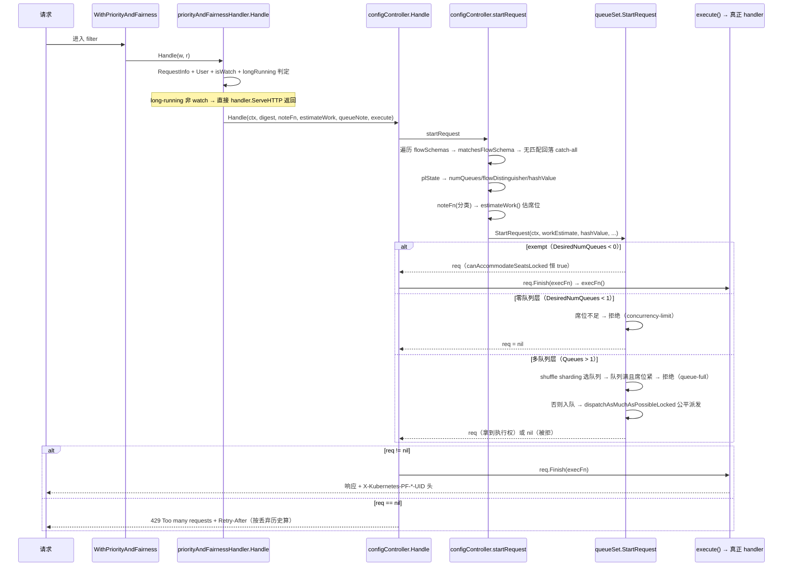

[总目录](../sourceReader/README.md)

# 优先级与公平性流控（Priority and Fairness, APF）专题

> **代码基准**：`k8s.io/kubernetes`，adrian@`6bf0bfd51d7`（2026-11-26，工作区除文档外干净），Go 1.27.4。
> **范围**：kube-apiserver 如何用 APF（Priority and Fairness）对请求做分类、排队、限流与公平调度——从 `WithPriorityAndFairness` filter 进入，经 FlowSchema 匹配、PriorityLevel 选择、队列集排队等待、到拿并发席位执行或 429 拒绝。
> **不覆盖**：`WithMaxInFlightLimit`（APF 的前身，仅作对照）；etcd 侧限流；webhook 自身限流；准入插件。
> **定位记法**：源码引用统一用「文件 · `符号` `+偏移`」，`+0` 为定义行。APF 实现几乎全在 staging，路径写全。

## 0. 结论速览

APF 是 apiserver 的请求准入限流机制：每个请求先被**分类**到一个 FlowSchema → 映射到一个 PriorityLevel（优先级层）→ 进入该层的队列集（QueueSet）排队 → 拿到「并发席位（seat）」才被放行到真正的 handler。它同时解决两个问题：**过载保护**（每层并发席位上限）与**公平性**（低优先级流量不能饿死高优先级，单条 flow 不能占满整层）。

### 0.1 这项能力现在能做什么

- **并发上限**：每个 PriorityLevel 有并发席位上限，超出的请求排队而非立即执行。
- **按请求大小计量**：workEstimator 给请求估席位——大 list、宽 watch、多 watcher 的 mutating 请求占更多席位（默认 mutating 上限 10 席、list 上限 10 席，`SizeBasedListCostEstimate` 开启时 list 上限提到 100 席）。
- **公平排队**：同一 PriorityLevel 内按 flow（由 distinguisher 算出，通常按 User）用 shuffle sharding 分到多队列，公平轮转派发。
- **429 拒绝**：并发席位不足且队列已满、或排队等待超过等待上限 → 返回 429 `Too many requests` + `Retry-After`，拒绝原因分 `concurrency-limit` 与 `queue-full` 两类指标。
- **豁免层（exempt）**：`exempt` PriorityLevel 的队列数为负，被队列集视作「豁免于限流」，不受并发上限约束、不排队。
- **兜底 catch-all**：`catch-all` FlowSchema 兜住未匹配任何 FlowSchema 的请求；APF 恒保证 exempt + catch-all 两个不可删对象存在，连 catch-all 都缺失时 `startRequest` 直接 panic。

### 0.2 关键结论、适用范围与不做什么

| 结论 | 说明 |
|---|---|
| APF 在认证/鉴权之后执行 | 需从 context 取 `RequestInfo`（verb/resource）与 `user.Info`，故必须排在认证/鉴权之后 |
| watch 请求特殊处理 | watch 是长连接，APF 只把「初始化 watch」这段计入席位；`Handle` 用 `shouldStartWatchCh` + 初始化信号控制，初始化完成后 `execute()` 关闭信号 |
| long-running 非 watch 请求跳过 APF | `longRunningRequestCheck` 命中（exec/attach/portforward 等）直接放行，不排队不占席位 |
| 豁免层不受限 | `pl.Spec.Type == Exempt` 的请求经 `StartRequest` 的 `canAccommodateSeatsLocked` 直接放行，不占并发席位 |
| 与 etcd 乐观并发解耦 | APF 管进入 handler 前的并发；etcd 管写入时的乐观 CAS，两者互不替代 |
| 429 带 `Retry-After`，值是算出来的 | APF 用 `DroppedRequestsTracker` 按近期丢弃历史算 `Retry-After`，不是写死的 `1`（旧 maxinflight 才是写死） |
| 分类名不外泄 | 响应头只带 `X-Kubernetes-PF-PriorityLevel-UID` / `X-Kubernetes-PF-FlowSchema-UID`，用 UID 不用 name |

**不做什么**：不重排请求优先级（只决定排队与放行顺序，不改请求内容）；不做跨 apiserver 实例的全局限流（每实例独立，席位数按本实例 `serverConcurrencyLimit` 分摊）；不保证排队请求一定成功（等待超时会被拒）。

## 1. 生产视角：实际怎么用、会得到什么

### 1.1 参与者、真实入口与前置条件

| 角色 | 是谁 | 做什么 |
|---|---|---|
| 请求 | 任意 apiserver 客户端（kubectl、controller、kubelet、webhook） | 进入 `WithPriorityAndFairness` filter |
| FlowSchema | `flowschemas.flowcontrol.apiserver.k8s.io` 对象 | 按规则（user/group/resource/verb）把请求分类到某个 PriorityLevel |
| PriorityLevel | `prioritylevelconfigurations` 对象 | 定义并发份额、队列数、队列长度、限流响应 |
| APF 控制器 | `configController`（`apf_filter.go` · `New` `+0`） | watch 两类配置对象，热更新运行态 |
| 队列集 | 每个 PriorityLevel 一个 `queueSet` | 真正执行席位管理、排队、公平派发、拒绝计数 |

**前置条件（可判断）：**
1. `DefaultBuildHandlerChain` 里 `c.FlowControl != nil`（`staging/src/k8s.io/apiserver/pkg/server/config.go` · `DefaultBuildHandlerChain` `+22`），否则整条 APF 不挂载，回落 `WithMaxInFlightLimit`。
2. APF filter 的 feature gate 默认开启（`APIPriorityAndFairness`）。
3. 请求已通过认证（context 有 `user.Info`）且有 RequestInfo（有 verb/resource）；二者缺失时 `Handle` 返回 500 而非走 APF。

### 1.2 生产主流程图



图后说明：
- **前提**：请求已认证（有 user）、有 RequestInfo，且 `c.FlowControl != nil`。
- **分支**：long-running 非 watch 在进 APF 前就放行；watch 走独立 goroutine + 初始化信号；exempt 层不受限。
- **终点**：要么 `execFn()` 执行（响应带分类 UID 头），要么 429 拒绝。

### 1.3 输入、处理环节、输出与接收方

| 环节 | 输入 | 处理 | 输出 | 接收方 |
|---|---|---|---|---|
| 进入 filter | HTTP 请求 | `WithPriorityAndFairness`（`priority-and-fairness.go` · `WithPriorityAndFairness` `+0`） | `priorityAndFairnessHandler.Handle` | `Handle` |
| 提取身份与语义 | `req.Context()` | `apirequest.RequestInfoFrom` / `apirequest.UserFrom` | verb/resource + user，缺则 500 | 分类 |
| 计算等待上限 | ctx deadline / `defaultRequestWaitLimit` | `getRequestWaitContext`（`+0`，等待上限 = 剩余 deadline/4 或默认值，硬顶 1m） | 带 deadline 的 `handleCtx` | 排队等待 |
| 分类 | `RequestDigest` | `startRequest` 遍历 `flowSchemas` + `matchesFlowSchema`（`staging/src/k8s.io/apiserver/pkg/util/flowcontrol/rule.go` · `matchesFlowSchema` `+0`） | FlowSchema + PriorityLevel + flowDistinguisher | 排队 |
| 估席位 | 请求 + 分类结果 | `estimateWork` → `request.NewWorkEstimator` 的 `workEstimator.estimate`（`width.go` · `estimate` `+0`） | `WorkEstimate{InitialSeats, FinalSeats, AdditionalLatency}` | 排队 |
| 排队与派发 | workEstimate + hashValue | `queueSet.StartRequest`（`queueset.go` · `StartRequest` `+0`） | `req`（非 nil = 拿到执行权）或 nil | `Handle` |
| 执行 | `execFn` | `req.Finish(...)` 内跑 `execFn()`，完归还席位 | 真正 handler 响应 | 客户端 |
| 拒绝 | 队列满 / 并发紧 / 等待超时 | `tooManyRequests`（`+0`） | 429 + `Retry-After` | 客户端 |

### 1.4 业务分支、异常表现、重复操作与边界

| 分支/异常 | 触发条件 | 用户可见结果 |
|---|---|---|
| long-running 非 watch | exec/attach/portforward 等 | 跳过 APF，直接执行（不占席位、不排队） |
| watch 请求 | `requestInfo.Verb` 为 watch | 单独 goroutine 里排队，只把「初始化 watch」计入席位；初始化完成即释放，长连接本体不占席位 |
| FlowSchema 无匹配 | 不属于任何 FlowSchema | 回落 `catch-all` 并打 Warning 日志，保证不 panic |
| 连 catch-all 都没有 | 不变量被破坏（不应发生） | `startRequest` 直接 panic |
| PL 引用了不存在的配置 | FlowSchema 指向的 PL 坏/缺失 | 该 FlowSchema 被跳过（不进匹配序列），status 标 dangling |
| exempt 层 | `pl.Spec.Type == Exempt` | 不排队、不受并发上限约束，直接执行 |
| 零队列层并发满 | `DesiredNumQueues < 1` 且席位不足 | 拒绝，拒绝原因 `concurrency-limit` → 429 |
| 多队列层队列满 | 席位到顶且当前队列长度 ≥ `QueueLengthLimit` | 拒绝，拒绝原因 `queue-full` → 429 |
| 排队等待超时 | 超过 `newReqWaitCtxFn` 给的等待 deadline | `Handle` 返回时 `served == false` → 429 |
| PL 被删且空闲 | `quiescing && numPending == 0 && queues.IsIdle()` | `maybeReap` 触发配置重载清理运行态 |

### 1.5 一次真实操作示例

某个低优先级用户在高峰期发大量请求：

```bash
# 正常时：请求被分类到某个 FlowSchema → PriorityLevel，排队后执行
kubectl get pods   # 200 OK

# 该 PriorityLevel 并发席位耗尽且队列已满时：
kubectl get pods   # Error from server (TooManyRequests): Too many requests, please try again later.
                   # 响应头含 Retry-After（按近期丢弃历史算出的秒数）
```

- `kubectl get prioritylevelconfiguration workload-high -o yaml` 可看到 `Spec.Limited.AssuredConcurrencyShares`、`LimitResponse.Queuing`（Queues/QueueLengthLimit/HandSize/QueueDelayLimit）。
- `kubectl describe flowschema` 的 status 会显示命中的 `MatchingPrecedence` 与 dangling 与否。
- 响应头 `X-Kubernetes-PF-PriorityLevel-UID` / `X-Kubernetes-PF-FlowSchema-UID` 标识命中的分类（用 UID 而非 name，避免暴露分类名）。
- 服务端日志带 `apf_pl` / `apf_fs` / `apf_iseats` / `apf_fseats` / `apf_additionalLatency` / `apf_execution_time` 键值，可按请求追分类与席位占用。

## 2. 开发视角：当前代码怎样实现

### 2.1 实现地图：进程、入口、核心源码

| 角色 | 文件 | 符号（`+0` = 定义行） |
|---|---|---|
| filter 入口 | `staging/src/k8s.io/apiserver/pkg/server/filters/priority-and-fairness.go` | `WithPriorityAndFairness` `+0`、`priorityAndFairnessHandler` `+0`（类型）、`priorityAndFairnessHandler.Handle` `+0`、`StartPriorityAndFairnessWatermarkMaintenance` `+0`、`tooManyRequests` `+0`、`getRequestWaitContext` `+0`、`setResponseHeaders` `+0` |
| APF 控制器壳 | `staging/src/k8s.io/apiserver/pkg/util/flowcontrol/apf_filter.go` | `New` `+0`、`NewTestable` `+0`、`configController.Handle` `+0`、`observeQueueWaitTime` `+0`、`Interface` `+0` |
| 分类 + 排队 + 放行 | `staging/src/k8s.io/apiserver/pkg/util/flowcontrol/apf_controller.go` | `configController` `+0`（类型）、`configController.startRequest` `+0`、`maybeReap` `+0`、`maybeReapReadLocked` `+0`、`syncOne` `+0`、`digestConfigObjects` `+0`、`lockAndDigestConfigObjects` `+0`、`shouldDelayUpdate` `+0`、`computeFlowDistinguisher` `+0` |
| 分类规则匹配 | `staging/src/k8s.io/apiserver/pkg/util/flowcontrol/rule.go` | `matchesFlowSchema` `+0`、`matchesPolicyRule` `+0`、`matchesASubject` `+0`、`matchesSubject` `+0` |
| 队列集 | `staging/src/k8s.io/apiserver/pkg/util/flowcontrol/fairqueuing/queueset/queueset.go` | `queueSet` `+0`（类型）、`queueSet.StartRequest` `+0`、`shuffleShardAndRejectOrEnqueueLocked` `+0`、`dispatchSansQueueLocked` `+0`、`canAccommodateSeatsLocked` `+0`、`findDispatchQueueToBoundLocked` `+0` |
| 席位估算 | `staging/src/k8s.io/apiserver/pkg/util/flowcontrol/request/width.go` | `NewWorkEstimator` `+0`、`WorkEstimatorFunc` `+0`、`workEstimator.estimate` `+0`、`WorkEstimate` `+0` |
| 席位估算（list） | `staging/src/k8s.io/apiserver/pkg/util/flowcontrol/request/list_work_estimator.go` | `listWorkEstimator.estimate` `+0`、`seatsBasedOnObjectCount` `+0`、`seatsBasedOnObjectSize` `+0` |
| 席位估算（mutating/watch） | `staging/src/k8s.io/apiserver/pkg/util/flowcontrol/request/mutating_work_estimator.go` | `mutatingWorkEstimator.estimate` `+0`、`newMutatingWorkEstimator` `+0` |
| 估算配置 | `staging/src/k8s.io/apiserver/pkg/util/flowcontrol/request/config.go` | `DefaultWorkEstimatorConfig` `+0`、`WorkEstimatorConfig` `+0` |
| 旧限流（对照） | `staging/src/k8s.io/apiserver/pkg/server/filters/maxinflight.go` | `WithMaxInFlightLimit` `+0`、`initMaxInFlight` `+0`、`retryAfter`（const 块 `+0`，值 `"1"`） |
| 中间件挂载点 | `staging/src/k8s.io/apiserver/pkg/server/config.go` | `DefaultBuildHandlerChain` `+0`（APF/maxinflight 分支在其体内 `+22`~`+31`） |

### 2.2 技术前置条件

| 前置项 | 说明 |
|---|---|
| `fcIfc` 非 nil | `WithPriorityAndFairness` 的 `utilflowcontrol.Interface` 参数；nil 则打 Warning 并原样返回 handler，不挂 APF |
| RequestInfo + User | 从 context 取；`Handle` 开头取不到即 `handleError` 返回 500（认证/鉴权必须在前） |
| `serverConcurrencyLimit` | `New`（`apf_filter.go` · `New` `+0`）注入总并发上限，控制器据此在各 PriorityLevel 间分摊 `nominalCL` |
| FlowSchema / PriorityLevel informer | `configController` 经 `plLister`/`fsLister` watch 两类对象，单 worker goroutine 处理 |
| `initAPFOnce` | `WithPriorityAndFairness` 内 `sync.Once`（`priority-and-fairness.go` · `initAPFOnce` `+0`）初始化水位观察器 |
| 等待上限 | `c.RequestTimeout/4` 作为 `defaultRequestWaitLimit` 传入（`DefaultBuildHandlerChain` 体内 `+27`），硬顶 1 分钟 |

### 2.3 真实调用链与关键源码锚点

```text
DefaultBuildHandlerChain (server/config.go · DefaultBuildHandlerChain +0)
  └── c.FlowControl != nil → WithPriorityAndFairness (priority-and-fairness.go · WithPriorityAndFairness +0)
        │   fcIfc == nil → 原样返回（不挂 APF）
        │   initAPFOnce.Do → initMaxInFlight(0,0) + 挂 waitingMark 观察器（+12~+16）
        └── priorityAndFairnessHandler.Handle (priority-and-fairness.go · Handle +0)
             ├── RequestInfoFrom / UserFrom（缺 → handleError 500）
             ├── isWatchRequest = watchVerbs.Has(verb)（+13）
             ├── longRunningRequestCheck && !isWatch → handler.ServeHTTP 直接放行（+16~+20）
             ├── noteFn：记 classification + httplog apf_pl/apf_fs（+23~+33）
             ├── estimateWork：workEstimator + fcmetrics.ObserveWorkEstimatedSeats（+35~+52）
             ├── isWatchRequest 分支（+83~+202）：独立 goroutine + shouldStartWatchCh + 初始化信号
             │     └── handleCtx = newReqWaitCtxFn(ctx) → fcIfc.Handle(..., execute)
             └── 非 watch 分支（+203~+217）：handleCtx → fcIfc.Handle(..., execute)
                   └── configController.Handle (apf_filter.go · Handle +0)
                        ├── startRequest (apf_controller.go · startRequest +0)
                        ├── req == nil → 打日志 return（被拒）（+8~+13）
                        └── req.Finish(func(){ ...; execFn() })（+27~+41）
                              └── idle → defer maybeReap(pl.Name)（+23~+25）
```

未 `served` 时 `Handle` 收尾（`priority-and-fairness.go` · `Handle` `+229`~`+240`）：记 dropped 指标、`RecordRequestTermination(429)`、用 `droppedRequests.GetRetryAfter(plName)` 算 `Retry-After`，最后 `tooManyRequests` 写响应。

### 2.4 关键算法：分类、排队、放行

**分类（`apf_controller.go` · `startRequest` `+0`）：**
- `lock.RLock()` 下遍历 `cfgCtlr.flowSchemas`（按匹配优先级排序），第一个 `matchesFlowSchema(rd, fs)` 命中的即选中（`+8`~`+10`）。
- 循环中顺带记住 `catchAllFlowSchema`（`+11`~`+13`）；无命中则回落 catch-all 并打 Warning（`+15`~`+27`）。
- 连 catch-all 都没有 → **panic**（`+20`~`+23`，注释明确：APF 保证恒有 exempt 与 catch-all 两个不可删 FlowSchema）。
- `plName` → `plState`（`+28`~`+29`）；非 Exempt 层且 `LimitResponse.Type == Queue` 时取 `numQueues`（`+33`~`+36`）。
- `numQueues > 1` 才算 `flowDistinguisher`（`computeFlowDistinguisher` `+0`，默认按 User）与 `hashValue = hashFlowID(fsName, flowDistinguisher)`（`+37`~`+40`）。
- 调 `noteFn(selectedFlowSchema, plState.pl, flowDistinguisher)` 回填分类（`+43`），再调 `workEstimator()` 估席位（`+44`）。
- 非 Exempt 层记 `startWaitingTime`（`+46`~`+48`），然后 `plState.queues.StartRequest(...)`（`+50`）；返回的 `idle` 触发 `maybeReapReadLocked`（`+51`~`+53`）。
- 返回值 `isExempt = plState.pl.Spec.Type == PriorityLevelEnablementExempt`（`+54`）。

**排队与派发（`queueset.go` · `StartRequest` `+0`）：**
- Step 0（`DesiredNumQueues < 1`，含 exempt 与「只限并发不排队」层）：`canAccommodateSeatsLocked(MaxSeats)` 不通过 → 拒绝并计 `concurrency-limit`（`+9`~`+16`）；通过则 `dispatchSansQueueLocked` 立即执行（`+17`~`+18`）。
- Step 1（多队列层）：`shuffleShardAndRejectOrEnqueueLocked`（`queueset.go` · `shuffleShardAndRejectOrEnqueueLocked` `+0`）用 shuffle sharding 按 `hashValue` 选队列；返回 nil 即队列满且席位紧 → 计 `queue-full`（`+27`~`+34`）。
- Step 2：`dispatchAsMuchAsPossibleLocked()` 公平轮转派发（`+45`）。
- `canAccommodateSeatsLocked`（`+0`）三种情形：`DesiredNumQueues < 0` 直接放行（这就是 exempt 不受限的落点）、单请求席位超上限且当前无执行请求时放行、否则比较 `totSeatsInUse + seats` 与 `ConcurrencyLimit`。

**放行执行（`apf_filter.go` · `Handle` `+0`）：**
- `req == nil` 直接 return（`+8`~`+13`）；否则 `req.Finish(func(){ ...; execFn() })`（`+27`~`+41`），执行完归还席位。
- `Finish` 返回 `idle` 时，`defer` 里调 `cfgCtlr.maybeReap(pl.Name)`（`apf_filter.go` · `configController.Handle` `+31`~`+33`）。
- 排队耗时经 `observeQueueWaitTime`（`+0`）上报 `ObserveWaitingDuration` 与 `TrackAPFQueueWaitLatency`（`+11`、`+29`、`+43`）。

**拒绝：** `priority-and-fairness.go` · `tooManyRequests` `+0` 设 `Retry-After` 头并写 429 文本；`retryAfter` 的值来自 `DroppedRequestsTracker.GetRetryAfter`，非写死。

### 2.5 分支、失败处理与必须保持的规则

| 规则 | 锚点 | 为什么必须保持 |
|---|---|---|
| 认证/鉴权先于 APF | `DefaultBuildHandlerChain`（`+6`~`+9` 授权、`+54` 认证，均早于 `+27` 的 APF） | APF 需 RequestInfo + User，缺失即 500 |
| long-running 非 watch 跳过 | `priority-and-fairness.go` · `Handle` `+16`~`+20` | exec/attach 是长连接，占席位会饿死其它请求 |
| watch 走独立 goroutine + 初始化信号 | `priority-and-fairness.go` · `Handle` `+83`~`+202` | watch 只在初始化阶段占席位，长连接本体不该占 |
| 等待上限封顶 1 分钟 | `priority-and-fairness.go` · `getRequestWaitContext` `+21`~`+27` | 队列等待不能超过请求自身预算太多，避免无界堆积 |
| 恒有 exempt + catch-all | `apf_controller.go` · `digestFlowSchemasLocked` `+30`~`+40`（补缺）、`startRequest` `+20`~`+23`（兜底失败即 panic） | 保证任何请求都有归属，不 panic |
| 恒有 exempt/catch-all PL | `apf_controller.go` · `lockAndDigestConfigObjects` `+14`~`+19`（`imaginePL` 补缺） | 配置对象被误删时仍能限流 |
| 席位估算与 maxSeats 上限 | `staging/src/k8s.io/apiserver/pkg/util/flowcontrol/request/config.go` · `DefaultWorkEstimatorConfig` `+0`；`list_work_estimator.go` · `estimate` `+0` 内 clamp | 防单条大请求占满整层并发 |
| 429 带 Retry-After | `priority-and-fairness.go` · `tooManyRequests` `+0`；`Handle` 体内 `+228`（`GetRetryAfter` 取值） | 客户端据此退避，避免雪崩 |
| 分类名不外泄 | `priority-and-fairness.go` · `setResponseHeaders` `+0` | 响应头只给 UID，防暴露分类命名 |

### 2.6 与 MaxInFlightLimit 的对照

| 维度 | MaxInFlightLimit（旧） | APF（现默认） |
|---|---|---|
| 粒度 | 全局单一并发上限（mutating / readonly 两条 channel） | 按 PriorityLevel 分层 + flow 公平排队 |
| 分类 | 无（仅 mutating/readonly 二分） | FlowSchema 规则（user/group/resource/verb） |
| 公平性 | 无（先到先得，channel 满即拒） | 多队列 shuffle sharding + 公平轮转派发 |
| 席位计量 | 每请求固定 1 个槽位 | workEstimator 按 InitialSeats/FinalSeats 计量，大请求占多席 |
| 豁免 | 仅 `system:master` 组放行 | exempt 层不受并发上限约束 |
| Retry-After | 写死 `1`（`maxinflight.go` · `retryAfter`，const 块 `+0`，值 `"1"`） | `DroppedRequestsTracker.GetRetryAfter` 按丢弃历史算 |
| 拒绝指标 | `RecordDroppedRequest` 无原因细分 | 拒绝原因分 `concurrency-limit` / `queue-full` |
| 触发位置 | `maxinflight.go` · `WithMaxInFlightLimit` `+0` | `priority-and-fairness.go` · `WithPriorityAndFairness` `+0` |

### 2.7 队列集、workEstimator 与配置热更新（加深）

#### 队列集内部（`queueset.go` · `StartRequest` `+0`）

`startRequest` 调 `plState.queues.StartRequest` 进入队列集，内部三条路径：

```text
queueSet.StartRequest (queueset.go · StartRequest +0)
├── Step 0: qCfg.DesiredNumQueues < 1（exempt 或「只限并发」层）
│    ├── !canAccommodateSeatsLocked(MaxSeats) → 拒绝，AddReject("concurrency-limit")，return nil
│    └── dispatchSansQueueLocked(...) → 立即派发，return req
├── Step 1: 多队列层
│    └── shuffleShardAndRejectOrEnqueueLocked (+0)
│         ├── shuffleShardLocked：按 hashValue 从 dealer 手牌里挑 seat-seconds 最小的队列
│         ├── rejectOrEnqueueToBoundLocked：totSeatsInUse ≥ ConcurrencyLimit 且队列长度 ≥ QueueLengthLimit → 返回 nil
│         │     → StartRequest 计 AddReject("queue-full")，return nil
│         └── 否则入队 → ObserveQueueLength
└── Step 2: dispatchAsMuchAsPossibleLocked → findDispatchQueueToBoundLocked（+0）公平轮转选队列派发
```

**两条主路径：**
- **席位够 / 不排队**：`dispatchSansQueueLocked` 直接执行，不排队、不产生等待耗时指标。
- **席位紧**：`shuffleShardAndRejectOrEnqueueLocked` 入队等待，`dispatchAsMuchAsPossibleLocked` 在保证并发预算内尽量派发；队列满且并发到顶才拒绝。

**workEstimator（`request/width.go` · `workEstimator.estimate` `+0`）：** 按 verb 分派：
- `list` → `listWorkEstimator.estimate`（`list_work_estimator.go` · `estimate` `+0`）：`maxSeats` 由 PL 的 maxSeats 与 `MaximumListSeatsLimit` 取小；按 `SizeBasedListCostEstimate` gate 走 `seatsBasedOnObjectSize`（`+0`，按 `bytesPerSeat = 100_000` 字节/席）或 `seatsBasedOnObjectCount`（`+0`，按 `ObjectsPerSeat = 100` 对象/席）；对象计数过期则按最坏情况（`infiniteObjectCount` + `maxObjectSize`）估。
- `watch` 且 `WatchList` gate 开 → 同 list 计价（watch 初始化要发 init events）；非 init 的 watch 只给 `MinimumSeats`。
- `create/update/patch/delete` → `mutatingWorkEstimator.estimate`（`mutating_work_estimator.go` · `estimate` `+0`）：`InitialSeats = 1`；关注该对象的 watcher 数 ≥ `WatchesPerSeat`（默认 10）时给 `FinalSeats`（上限 `maxSeats`，默认 `MaximumMutatingSeatsLimit = 10`）与 `AdditionalLatency`；`serviceaccounts/token` 子资源豁免于 watch 事件计价。
- 其它 verb → `WorkEstimate{InitialSeats: minimumSeats}`（默认 1）。
- **意义**：大 list / 宽 watch / 多 watcher 的 mutating 占更多席位，避免单请求占满整层并发。

#### FlowSchema/PriorityLevel 热更新（`apf_controller.go` · `syncOne` `+0`）

`configController` 单 worker goroutine 消费 `configQueue`，变更时热更新运行态：

```text
processNextWorkItem (+0)
└── syncOne (+0)
     ├── plLister.List → newPLs
     ├── fsLister.List → newFSs
     └── digestConfigObjects (+0)
          ├── lockAndDigestConfigObjects (+0)   ← 持写锁
          │    ├── digestNewPLsLocked → 为每个 PL 建/复用 queueSet（queueSetCompleterForPL）
          │    ├── digestFlowSchemasLocked → 过滤坏 PL 引用 → 排序 → 补缺 exempt/catch-all FS
          │    ├── processOldPLsLocked → 标记 quiescing
          │    ├── imaginePL（补缺 mandatory PL）
          │    └── finishQueueSetReconfigsLocked → 更新 cfgCtlr.flowSchemas / priorityLevelStates
          └── 逐条写 FlowSchema status condition（ApplyStatus）
               └── shouldDelayUpdate (+0)：同一 FS 每分钟最多 6 次更新，超了就延迟 30~75s
```

- `digestConfigObjects`（`+0`）重建 `priorityLevelStates` 与 `flowSchemas`，使 APF 配置变更**无需重启 apiserver** 即可生效。
- `maybeReap`（`+0`）与 `maybeReapReadLocked`（`+0`）在 PL `quiescing` 且空闲时往 `configQueue` 投一个 0，触发下一轮 `syncOne` 清理运行态。
- 软状态：`nominalCLSum`、`shareSum` 等在 `cfgMeal` 里累计，是并发份额分配算法的输入。

## 3. 验证、缺口与后续修改

### 3.1 代码回核与生产实测记录

- **代码回核**：本篇所有「文件 · `符号` `+偏移`」均在 `6bf0bfd51d7` 上用 MCP `codegraph_explore` 回核定义行，覆盖 `WithPriorityAndFairness` / `priorityAndFairnessHandler.Handle` / `tooManyRequests` / `getRequestWaitContext`（`priority-and-fairness.go`）、`New` / `NewTestable` / `configController.Handle`（`apf_filter.go`）、`configController.startRequest` / `maybeReap` / `syncOne` / `digestConfigObjects` / `lockAndDigestConfigObjects` / `shouldDelayUpdate`（`apf_controller.go`）、`matchesFlowSchema`（`rule.go`，注意**不在** `apf_controller.go`）、`queueSet.StartRequest` / `canAccommodateSeatsLocked`（`queueset.go`）、`workEstimator.estimate` / `mutatingWorkEstimator.estimate` / `listWorkEstimator.estimate`、以及 `DefaultBuildHandlerChain` 的 APF/maxinflight 分支。
- **生产实测**：**未实测** `[待运行验证]`。429 响应文本、`Retry-After` 取值、`X-Kubernetes-PF-*-UID` 头、排队水位与拒绝原因指标均为代码推断，未在过载的真实集群观测。

### 3.2 已知缺口和待验证事项

| 缺口 | 性质 | 说明 |
|---|---|---|
| 公平派发算法细节 | 未深挖 | `dispatchAsMuchAsPossibleLocked` / `boundNextDispatchLocked` 的虚拟时间 R 推进与 anti-windup 未逐行读 |
| 席位借还（borrowing） | 未深挖 | `updateBorrowingLocked`、`seatDemandSmoothingCoefficient` 平滑与 `borrowingAdjustmentPeriod` 周期未展开 |
| `hashFlowID` | 未展开 | flowDistinguisher → hashValue 的具体哈希实现未读 |
| 响应头常量定义 | 未在 flowcontrol types 展开 | `ResponseHeaderMatchedPriorityLevelConfigurationUID` / `ResponseHeaderMatchedFlowSchemaUID` 的常量行只做了 `grep` 确认字面值 |
| FlowSchema status 写入冲突 | 未深挖 | `apply` / `toFlowSchemaApplyConfiguration` 的 server-side apply 细节未读 |
| MaxInFlightLimit | 仅对照 | 只读了 `WithMaxInFlightLimit` 主体，未读其测试与指标 |
| 生产过载行为 | `[待运行验证]` | 未在过载集群观测 429 / 排队水位 / 拒绝原因分布 |

### 3.3 修改联动清单、源码索引与关联文档

**改动这块前必查：**
- 改分类逻辑 → 同步 `matchesFlowSchema`（`rule.go`）与 exempt/catch-all 不变量（`digestFlowSchemasLocked` 补缺 + `startRequest` panic 兜底）。
- 改排队/放行 → 同步 `configController.Handle` 的 `req.Finish(execFn)` 与 `maybeReap` / `maybeReapReadLocked`。
- 改席位估算 → `DefaultWorkEstimatorConfig` 的 seats 上限与 `metrics.work_estimate_seats_samples` 的桶边界要一起改（注释明确要求）。
- 改 feature gate 或并发上限 → `DefaultBuildHandlerChain` 里 `WithPriorityAndFairness` vs `WithMaxInFlightLimit` 分支。
- 改 429 响应 → `tooManyRequests` 与 `DroppedRequestsTracker.GetRetryAfter`。

**源码索引（符号 → 文件）：**

| 符号 | 文件 |
|---|---|
| `WithPriorityAndFairness` / `priorityAndFairnessHandler` / `Handle` / `tooManyRequests` / `getRequestWaitContext` / `setResponseHeaders` / `StartPriorityAndFairnessWatermarkMaintenance` | `staging/src/k8s.io/apiserver/pkg/server/filters/priority-and-fairness.go` |
| `New` / `NewTestable` / `configController.Handle` / `observeQueueWaitTime` / `Interface` | `staging/src/k8s.io/apiserver/pkg/util/flowcontrol/apf_filter.go` |
| `configController` / `startRequest` / `maybeReap` / `maybeReapReadLocked` / `syncOne` / `digestConfigObjects` / `lockAndDigestConfigObjects` / `shouldDelayUpdate` / `computeFlowDistinguisher` | `staging/src/k8s.io/apiserver/pkg/util/flowcontrol/apf_controller.go` |
| `matchesFlowSchema` / `matchesPolicyRule` | `staging/src/k8s.io/apiserver/pkg/util/flowcontrol/rule.go` |
| `queueSet` / `StartRequest` / `shuffleShardAndRejectOrEnqueueLocked` / `dispatchSansQueueLocked` / `canAccommodateSeatsLocked` / `findDispatchQueueToBoundLocked` | `staging/src/k8s.io/apiserver/pkg/util/flowcontrol/fairqueuing/queueset/queueset.go` |
| `NewWorkEstimator` / `WorkEstimatorFunc` / `workEstimator.estimate` / `WorkEstimate` | `staging/src/k8s.io/apiserver/pkg/util/flowcontrol/request/width.go` |
| `listWorkEstimator.estimate` / `seatsBasedOnObjectCount` / `seatsBasedOnObjectSize` | `staging/src/k8s.io/apiserver/pkg/util/flowcontrol/request/list_work_estimator.go` |
| `mutatingWorkEstimator.estimate` / `newMutatingWorkEstimator` | `staging/src/k8s.io/apiserver/pkg/util/flowcontrol/request/mutating_work_estimator.go` |
| `DefaultWorkEstimatorConfig` / `WorkEstimatorConfig` | `staging/src/k8s.io/apiserver/pkg/util/flowcontrol/request/config.go` |
| `WithMaxInFlightLimit` / `initMaxInFlight` / `retryAfter` | `staging/src/k8s.io/apiserver/pkg/server/filters/maxinflight.go` |
| `DefaultBuildHandlerChain` | `staging/src/k8s.io/apiserver/pkg/server/config.go` |

**关联文档：** [05-apiserver启动与路由](../sourceReader/05-apiserver启动与路由.md)（`DefaultBuildHandlerChain` 中 APF 在认证/鉴权之后、冒充之前）；[06-apiserver请求处理与etcd](../sourceReader/06-apiserver请求处理与etcd.md)（写入路径与乐观并发）。

[总目录](../sourceReader/README.md)
