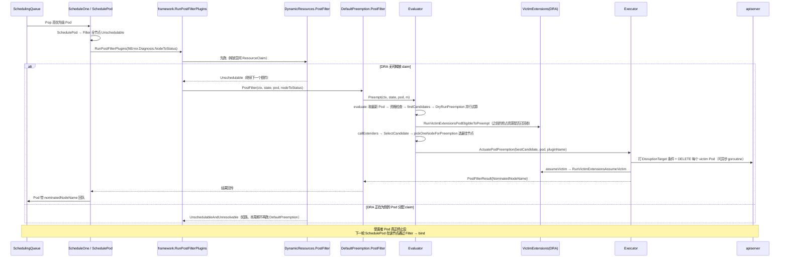

[总目录](../sourceReader/README.md)

# 调度器抢占（Preemption）专题

> **代码基准**：`k8s.io/kubernetes`，adrian@`6bf0bfd51d7`（2026-11-26，工作区文档产物外干净），Go 1.27.4。
> **范围**：kube-scheduler 在「Filter 阶段全部节点判 `Unschedulable`、无节点能放下 Pod」时如何触发抢占——从 PostFilter 扩展点入口，到资格检查、选节点选受害者、驱逐、nominated node 回队，再到下一轮绑定的完整顺序。覆盖单 Pod 抢占为主，PodGroup 抢占与异步抢占作为分支说明；并说明 DRA 抢占如何通过新增的 `VictimExtensions` / `NominationExtensions` 扩展点接入（细节归 [DRA动态资源分配.md](DRA动态资源分配.md)）。
> **不覆盖**：victim Pod 被驱逐后在 kubelet / eviction API 侧的实际终止过程；PriorityClass 的创建与优先级数值设计；DRA claim 释放的内部判定细节。
> **主文件**：`pkg/scheduler/framework/preemption/`（Evaluator / Executor / manager）、`pkg/scheduler/framework/plugins/defaultpreemption/`（默认 PostFilter 插件）、`pkg/scheduler/schedule_one.go`（触发点）。

## 0. 结论速览

抢占是调度器的兜底路径：当 `SchedulePod` 的 Filter 阶段判所有节点都 `Unschedulable` 时，`RunPostFilterPlugins` 扩展点被触发，调度器**模拟驱逐**一批低优先级 Pod，为高优先级 Pod 腾出空间。抢占**不真正立即删 Pod**——它先在调度缓存里「假定」受害者会被驱逐，把抢占者标上 `nominatedNodeName` 回队，真正的驱逐由 Executor 异步发起，下一轮调度周期才在目标节点上完成绑定。

与旧版相比，当前代码有两个结构变化值得先记住：

1. **PostFilter 不止一个插件**。`DynamicResources` 与 `DefaultPreemption` 都作为 MultiPoint 插件注册，因此都实现了 PostFilter；默认配置刻意让 `DynamicResources` 排在 `DefaultPreemption` 之前——先试着释放空闲的 ResourceClaim，再考虑驱逐有实际工作的 Pod。
2. **新增 `VictimExtensions` / `NominationExtensions` 扩展点**。抢占决策不再只由 `DefaultPreemption` 闭环：它会在资格检查时问一遍 `VictimExtensions`（「之前那次抢占腾出的资源是否已被回收」），并在驱逐落地后回调 `AssumeVictim`。DRA 的设备释放判定就是通过这两个扩展点接入的。

### 0.1 这项能力现在能做什么

- 高优先级 Pod 在资源紧张时能**插队**：调度器主动选一个节点、算出「驱逐哪几个 Pod 就能放下它」。
- 通过 PDB（PodDisruptionBudget）**限制驱逐烈度**：优先选 PDB 违规最少的方案。
- 通过 `preemptionPolicy: Never` **禁止抢占**：这类 Pod 既不被抢占、也不抢占别人。
- 支持 **PodGroup 抢占**（`GenericWorkload`）：跨节点的 PodGroup 作为整体受害者被抢占。
- 支持**异步抢占**（KEP-4832，`AsyncPreemption`）：驱逐动作放独立 goroutine，不阻塞调度主循环。
- 支持**就地扩容触发的抢占**（`InPlacePodVerticalScalingSchedulerPreemption`）：一个 deferred resize 的 Pod 卡在已绑定节点上时，可在该节点上抢占腾资源。

### 0.2 关键结论、适用范围与不做什么

| 结论 | 说明 |
|---|---|
| 抢占只在 Filter 全失败后触发 | Filter 有任一可行节点就轮不到抢占；抢占是 PostFilter 扩展点的职责 |
| PostFilter 插件按序执行，DRA 在前 | `DynamicResources` 先跑（可返回 `UnschedulableAndUnresolvable` 短路掉 `DefaultPreemption`）；都失败才算抢占无解 |
| 抢占是「模拟 + 提名」，不是同步删 Pod | 调度器只做 dry-run 选受害者 + 打 nominated 标记；实际驱逐由 Executor（可异步）发起 |
| 抢占者下一轮才绑定 | 打上 nominatedNodeName 回队，等受害者真正消失后，下一轮 `SchedulePod` 在该节点通过 Filter |
| 默认实现可替换 | `DefaultPreemption` 是 PostFilter 插件，可被自定义 PostFilter 插件替换 |
| 抢占资格受 `VictimExtensions` 门控 | 除 `preemptionPolicy` 与 terminating victim 外，还要问 `VictimExtensions.PodEligibleToPreempt` |
| 不做「跨调度器协调」 | 抢占决策只基于本调度器快照；多调度器场景需自行保证 |

**不做什么**：不保证被抢占 Pod 一定成功重建；不为被抢占 Pod 提供任何迁移/保序承诺（它就是被删掉）；不处理 preemptor 自身的 `preemptionPolicy: Never`（这种 Pod 直接在资格检查被拒）。

## 1. 生产视角：实际怎么用、会得到什么

### 1.1 参与者、真实入口与前置条件

| 角色 | 是谁 | 做什么 |
|---|---|---|
| 抢占者（preemptor） | 一个高优先级 Pod（`spec.priorityClassName` 指向高 priority 的 PriorityClass） | 因资源不足调度失败，进入抢占流程 |
| 受害者（victim） | 同节点上优先级更低的 Pod | 被选中驱逐，为抢占者腾资源 |
| 默认抢占插件 | `DefaultPreemption`（PostFilter 插件，`Name = names.DefaultPreemption`） | 实现 `fwk.PostFilterPlugin`，驱动整个抢占决策 |
| DRA 抢占插件 | `DynamicResources`（MultiPoint 插件，同样实现 PostFilter） | 在 `DefaultPreemption` 之前先尝试释放空闲 ResourceClaim |
| Executor | `pkg/scheduler/framework/preemption/executor.go` 的 `Executor` | 真正发起对受害者 Pod 的删除（DELETE） |
| PDB | 集群里的 PodDisruptionBudget 对象 | 约束「同时最多驱逐多少」，抢占会尽量少违反 PDB |
| SchedulingQueue / nominator | `pkg/scheduler/backend/queue/scheduling_queue.go` 的 `PriorityQueue` | 保存 nominated node 记录，控制抢占者何时重新入队 |

**前置条件（可判断，非「满足相关条件」）：**
1. 抢占者 Pod 的 `spec.priorityClassName` 解析出的 priority 高于受害者。
2. 抢占者 `preemptionPolicy != Never`（默认 `PreemptLowerPriority`）。
3. Filter 阶段**所有**节点都返回 `Unschedulable`（否则轮不到 PostFilter）。
4. 该 profile 已注册 PostFilter 插件（`HasPostFilterPlugins()` 为真；默认含 `DynamicResources` 与 `DefaultPreemption`）。
5. 节点快照（snapshot）已就绪（`Scheduler.Run` 启动时已同步）。

### 1.2 生产主流程图



图后说明：
- **前提**：Filter 阶段对全部节点返回 `Unschedulable`，`fitError.Diagnosis.NodeToStatus` 携带每个节点的失败原因。
- **DRA 短路**：`DynamicResources.PostFilter` 在「claim 正被别的 Pod 分配」或「已按抢占处理完 claim」两种情况下返回 `UnschedulableAndUnresolvable`，`RunPostFilterPlugins` 见到此码立即返回，本周期不再执行 `DefaultPreemption`。
- **分支**：`AsyncPreemption` 开启时驱逐放 goroutine，`PostFilter` 立即返回；关闭时同步驱逐完才返回。
- **终点**：抢占者带 `nominatedNodeName` 回队，等待受害者消失；受害者驱逐是异步的，绑定发生在**下一个**调度周期。

### 1.3 输入、处理环节、输出与接收方

| 环节 | 输入 | 处理 | 输出 | 接收方 |
|---|---|---|---|---|
| 触发 | Filter 全失败的 `FitError` + `NodeToStatus` | `RunPostFilterPlugins`（调用点在 `schedule_one.go`） | 按序调用各 PostFilter 插件 | `DynamicResources.PostFilter` → `DefaultPreemption.PostFilter` |
| DRA 快速通道 | preemptor 的 claim 状态 | `deallocateOrDeletePodClaims` / `deallocateVictimClaims` | 有可释放 claim 则返回成功态 | `RunPostFilterPlugins`（短路后续插件） |
| 资格检查 | preemptor Pod + nominatedNode 状态 | `PodEligibleToPreemptOthers` + `RunVictimExtensionsPodEligibleToPreempt` | 是否允许抢占 + 原因 | `Evaluator.evaluate` |
| 候选生成 | 全节点快照 + PDB 列表 | `findCandidates` → `DryRunPreemption` 并行试算每节点 | `[]PreemptionCandidate`（带受害者集合） | `SelectCandidate` |
| 选节点 | 候选集合 | `SelectCandidate` → `pickOneNodeForPreemption` 多级打分 | 单个最佳 `PreemptionCandidate` | `ActuatePodPreemption` |
| 驱逐 | 最佳候选的受害者集合 | `Executor.ActuatePodPreemption`（同步/异步） | 打条件 + 对每个 victim 的 DELETE 请求 | apiserver → kubelet |
| 提名 | `PostFilterResult` | 写 `Status.NominatedNodeName`（DRA 下还同步进内存 nominator） | Pod 回队 | SchedulingQueue → 下一轮 `SchedulePod` |

### 1.4 业务分支、异常表现、重复操作与边界

| 分支/异常 | 触发条件 | 用户可见结果 |
|---|---|---|
| 抢占者无抢占资格 | `preemptionPolicy=Never`，或已 nominated 节点上仍有 terminating victim | `PostFilter` 返回 Unschedulable，Pod 回队（BackoffQ），事件 `FailedScheduling` |
| DRA claim 正被他人分配 | 另一 Pod 正在分配同一 claim | `DynamicResources.PostFilter` 返回 `UnschedulableAndUnresolvable`，本周期跳过 `DefaultPreemption` |
| 某节点无受害者 | 驱逐候选后仍放不下 | 该节点标记 `UnschedulableAndUnresolvable`，跳过 |
| 候选全部违反 PDB | 所有方案都违反 PDB | 仍会选一个（violating 候选兜底），但优先选违规最少的 |
| 受害者驱逐失败 | DELETE 被 webhook 拒绝等 | Executor 记错误指标；抢占者滞留队列，下一轮重新抢占 |
| 受害者已在删除中 | victim 已有 DeletionTimestamp | 跳过重复 DELETE，仅补 `AssumeVictim` 跟踪 |
| 受害者是 WaitingPod / 在 PreBind | 还没落到 apiserver | 在调度器内存里直接抢占/取消绑定，不发 DELETE |
| 重复抢占 | 抢占者已 nominated 在同节点 | `PodEligibleToPreemptOthers` 拒绝重复抢占 |
| 抢占成功但受害者未消失 | 驱逐异步进行中 | 抢占者滞留队列，直到受害者终止、下一轮 Filter 通过 |

### 1.5 一次真实操作示例

假设集群 3 个节点，每节点 4 核全部被 `priority=100` 的 Pod 占满。现在提交一个 `priority=1000` 的 Pod `high-prio`，请求 2 核。

```bash
kubectl create priorityclass high --value=1000
kubectl run high-prio --image=nginx --priorityclassname=high --restart=Never
# 资源不足 → 调度失败 → 触发抢占
kubectl get pod high-prio -o wide
# NAME        READY   STATUS    ...   NODE
# high-prio   0/1     Pending   ...   node-2   ← spec.nodeName 已被填（nominated）
kubectl describe pod high-prio
# Events:
#   ... Preempted   (victim Pod 上) Preempted by Pod default/high-prio on node node-2
#   ... Scheduled   Successfully assigned default/high-prio to node-2
#   ... (node-2 上某个 priority=100 的 Pod 进入 Terminating)
kubectl get pod -A --sort-by=.spec.priority
# priority=100 的某个 Pod 进入 Terminating（带 DisruptionTarget 条件）
```

最终：`high-prio` 在 node-2 上 Running；被驱逐的低优先级 Pod 若由 Deployment 管理会在别处重建，若为裸 Pod 则消失。

> **`[待运行验证]`** 以上事件序列、`nominatedNodeName` 字段取值、victim 的 `DisruptionTarget` 条件均为代码推断，未在真实集群执行抢占验证。

## 2. 开发视角：当前代码怎样实现

### 2.1 实现地图：进程、入口、注册点、核心源码

下表偏移以定义行为 `+0`。

| 角色 | 文件 | 符号 |
|---|---|---|
| PostFilter 触发点 | `pkg/scheduler/schedule_one.go` | `Scheduler.schedulePod` 内的 PostFilter 分支；`HasPostFilterPlugins` 守卫后调用 `RunPostFilterPlugins` |
| PostFilter 执行器 | `pkg/scheduler/framework/runtime/framework.go` | `frameworkImpl.RunPostFilterPlugins` `+0`、`runPostFilterPlugin` `+0` |
| 默认抢占插件 | `pkg/scheduler/framework/plugins/defaultpreemption/default_preemption.go` | `Name:NAME` `+0`、`DefaultPreemption` `+0`、`Name` `+0`、`IsRelevantForPodResize` `+0`、`PostFilter` `+0`、`PreEnqueue` `+0`、`GetOffsetAndNumCandidates` `+0`、`SelectVictimsOnNode` `+0`、`PodEligibleToPreemptOthers` `+0`、`isPreemptionAllowed` `+0`、`OrderedScoreFuncs` `+0`、`isPreemptionAllowedAcrossAllVictimNodes` `+0`、`PodGroupPostFilter` `+0`、`RankNodes` `+0`、`Reserve` `+0`、`Unreserve` `+0` |
| 抢占决策核心 | `pkg/scheduler/framework/preemption/preemption.go` | `Interface` `+0`、`Evaluator` `+0`、`NewEvaluator` `+0`、`evaluate` `+0`、`Preempt` `+0`、`findCandidates` `+0`、`callExtenders` `+0`、`hasInterestedPreemptExtender` `+0`、`SelectCandidate` `+0`、`pickOneNodeForPreemption` `+0`、`DryRunPreemption` `+0`、`GetVictimsOnNode` `+0` |
| 驱逐执行 | `pkg/scheduler/framework/preemption/executor.go` | `Executor` `+0`、`NewExecutor` `+0`、`assumeVictim` `+0`、`preemptVictim` `+0`、`ActuatePodPreemption` `+0`、`prepareCandidateAsync` `+0`、`prepareCandidate` `+0`、`IsPodRunningPreemption` `+0`、`IsPodGroupRunningPreemption` `+0`、`isRunningPreemption` `+0` |
| PodGroup 抢占 | `pkg/scheduler/framework/preemption/manager.go` | `NewPreemptionManager` `+0`、`GenerateVictims` `+0`、`CompareVictimSets` `+0`、`countPDBViolations` `+0` |
| PodGroup 评估 | `pkg/scheduler/framework/preemption/podgrouppreemption.go` | `PodGroupEvaluator.Preempt` `+0`、`evaluate` `+0`、`buildCurrentNominatingInfos` `+0` |
| 跨节点受害者 | `pkg/scheduler/framework/preemption/victims.go` | `getHighestAllAncestor` `+0`、`createDomainVictims` `+0`、`getCrossNodesVictims` `+0`、`searchCrossNodesVictimPods` `+0` |
| Victim 扩展点接口 | `pkg/scheduler/framework/interface.go` | `VictimExtensions` `+0`、`VictimExtensionsRunner` `+0`（`RunVictimExtensionsAssumeVictim`/`RunVictimExtensionsPodEligibleToPreempt` 在此仅作接口方法声明，无函数体） |
| Victim 扩展点执行 | `pkg/scheduler/framework/runtime/victim_extensions.go` | `RunVictimExtensionsAssumeVictim` `+0`、`RunVictimExtensionsPodEligibleToPreempt` `+0`（`frameworkImpl` 实现） |
| DRA 抢占（新增扩展点实现） | `pkg/scheduler/framework/plugins/dynamicresources/preemption.go` | `preemptionData` `+0`、`newPreemptionData` `+0`、`canReleaseOnNode` `+0`、`releasable` `+0` |
| DRA Victim 扩展实现 | `pkg/scheduler/framework/plugins/dynamicresources/victimextensions.go` | `DynamicResources.AssumeVictim` `+0`、`DynamicResources.PodEligibleToPreempt` `+0` |
| DRA PostFilter（同扩展点另一实现） | `pkg/scheduler/framework/plugins/dynamicresources/dynamicresources.go` | `DynamicResources.PostFilter` `+0` |
| nominated node 记录 | `pkg/scheduler/backend/queue/nominator.go` | `nominator` `+0`、`TracksNominationInMemory` `+0`、`addNominatedPod` `+0`、`NominatedNodeName` `+0`、`nominatedNodeName` `+0` |
| Pod 事件入队 | `pkg/scheduler/eventhandlers.go` | `Scheduler.addPodToSchedulingQueue` `+0` |
| 插件注册 | `pkg/scheduler/framework/plugins/registry.go` | `defaultpreemption.Name → runtime.FactoryAdapter(fts, defaultpreemption.New)` |

**插件注册与默认顺序：** `getDefaultPlugins` 把 `names.DynamicResources` 放在 `names.DefaultPreemption` **之前**（注释明说：PostFilter 被调用时，先释放空闲 ResourceClaim 优于驱逐可能有用的 Pod）。`GenericWorkload` 关闭时，`DefaultPreemption` 的 Reserve 扩展被显式禁用（它实现 Reserve 只为 PodGroup 抢占服务）。`DefaultPreemption` 通过 `var _ fwk.PostFilterPlugin`、`var _ fwk.PreEnqueuePlugin`、`var _ fwk.ReservePlugin` 等接口断言绑定到各扩展点。

### 2.2 技术前置条件：配置、依赖、初始化

| 前置项 | 位置 | 说明 |
|---|---|---|
| snapshot 就绪 | `Scheduler.Run` 启动时同步 | 抢占基于 `MutableSnapshotSharedLister()` 的节点快照 |
| 队列已启动 | `SchedulingQueue.Run` | 抢占者回队依赖队列与 nominator |
| feature gates | `fts feature.Features`（Evaluator / Executor 构造参数） | `AsyncPreemption`、`GenericWorkload`、`InPlacePodVerticalScalingSchedulerPreemption`、`DRAPreemption` |
| PDB informer | `getPodDisruptionBudgets(ev.PdbLister)`（`findCandidates` 内） | 无 PDB 时按「零违规」处理 |
| Parallelizer | `fh.Parallelizer().Until(...)`（`DryRunPreemption` 内） | 并行试算候选节点 |
| 插件启用 | kube-scheduler 配置的 MultiPoint / PostFilter 插件集 | 默认含 `DynamicResources`、`DefaultPreemption` |
| nominator 内存跟踪 | `nominator.draPreemption` 字段 | 仅 `DRAPreemption` 开启时在内存里跟踪 nomination（`TracksNominationInMemory`） |

### 2.3 真实调用链与关键源码锚点

```text
Scheduler.schedulePod (schedule_one.go)
  └── Filter 全失败 → HasPostFilterPlugins 守卫 → RunPostFilterPlugins（framework.go · `RunPostFilterPlugins` `+0`）
       ├── DynamicResources.PostFilter（dynamicresources.go · `DynamicResources.PostFilter` `+0`）   ← 先释放空闲 claim
       │    └── 可返回 UnschedulableAndUnresolvable 短路本周期
       └── DefaultPreemption.PostFilter（default_preemption.go · `PostFilter` `+0`）
            └── Evaluator.Preempt（preemption.go · `Preempt` `+0`）
                 ├── evaluate（preemption.go · `evaluate` `+0`）
                 │    ├── 0. PodLister 取最新 preemptor；DRAPreemption 下用内存 nomination 修正
                 │    ├── 1. PodEligibleToPreemptOthers（default_preemption.go · `PodEligibleToPreemptOthers` `+0`）
                 │    │    └── RunVictimExtensionsPodEligibleToPreempt（victim_extensions.go · `RunVictimExtensionsPodEligibleToPreempt` `+0`）
                 │    ├── 2. findCandidates（preemption.go · `findCandidates` `+0`）
                 │    │    ├── NodesForStatusCode(Unschedulable) 筛潜在节点
                 │    │    ├── getPodDisruptionBudgets 取 PDB
                 │    │    ├── GetOffsetAndNumCandidates（default_preemption.go · `GetOffsetAndNumCandidates` `+0`）采样窗口
                 │    │    └── DryRunPreemption（preemption.go · `DryRunPreemption` `+0`）  ← 并行试算
                 │    │         └── checkNode（每候选节点一个 goroutine）
                 │    │              ├── GetVictimsOnNode（preemption.go · `GetVictimsOnNode` `+0`）
                 │    │              ├── SelectVictimsOnNode（default_preemption.go · `SelectVictimsOnNode` `+0`）
                 │    │              └── 分类：nonViolating / violating 候选
                 │    ├── 3. callExtenders（preemption.go · `callExtenders` `+0`）让扩展器增删候选
                 │    └── 4. SelectCandidate（preemption.go · `SelectCandidate` `+0`） → pickOneNodeForPreemption（`pickOneNodeForPreemption` `+0`）
                 └── 5. ActuatePodPreemption（executor.go · `ActuatePodPreemption` `+0`）
                      ├── AsyncPreemption → prepareCandidateAsync（executor.go · `prepareCandidateAsync` `+0`）
                      │    └── preemptVictim（executor.go · `preemptVictim` `+0`） → PreemptPod → assumeVictim（executor.go · `assumeVictim` `+0`）
                      └── 否则 prepareCandidate（executor.go · `prepareCandidate` `+0`） → preemptVictim 逐个 DELETE
```

**调用关系表（关键跳）：**

| 调用方与符号 | 关系 | 被调用方与符号 | 触发与输入 | 返回与后续 | 错误/状态/副作用 |
|---|---|---|---|---|---|
| `Scheduler.schedulePod` | 触发 | `frameworkImpl.RunPostFilterPlugins` | Filter 全失败的 `FitError` | 首个 Success / `UnschedulableAndUnresolvable` 即返回 | 记录 `PostFilterMsg` |
| `RunPostFilterPlugins` | 按序调用 | `DynamicResources.PostFilter` → `DefaultPreemption.PostFilter` | ctx/state/pod/nodeToStatus | `PostFilterResult{NominatedNodeName}` | 非 Success 且非 `Unresolvable` 视为 Error |
| `DefaultPreemption.PostFilter` | 调用 | `Evaluator.Preempt` | 同上 | `PostFilterResult` + Status | 递增 `PreemptionAttempts`（或 resize 专用指标） |
| `Preempt` | 调用 | `evaluate` | 同上 | bestCandidate 或 fitError | — |
| `evaluate` | 调用 | `PodEligibleToPreemptOthers` | pod + nominatedNodeStatus | bool + 原因 | 无资格返回 Unschedulable |
| `PodEligibleToPreemptOthers` | 调用 | `RunVictimExtensionsPodEligibleToPreempt` | pod + nomNodeName | bool + 原因 | 任一插件报不可抢占即拒绝 |
| `evaluate` | 调用 | `findCandidates` | 全节点快照 + PDB | `[]PreemptionCandidate` | 无节点返回错误 |
| `findCandidates` | 调用 | `DryRunPreemption` | potentialNodes + PDB + offset/candidatesNum | 候选列表 + NodeToStatus | 并行，`Parallelizer().Until` |
| `DryRunPreemption` | 调用 | `GetVictimsOnNode` + `SelectVictimsOnNode` | 单候选节点 | 该节点受害者集合 + PDB 违规数 | 只对 mainNode 改 NodeInfo |
| `SelectCandidate` | 调用 | `pickOneNodeForPreemption` | victimsMap + scoreFuncs | 单个最佳节点名 | 多级 tie-break |
| `Preempt` | 调用 | `Executor.ActuatePodPreemption` | bestCandidate + preemptor + pluginName | Status | 异步则立即返回 nil |
| `ActuatePodPreemption` | 调用 | `prepareCandidate` / `prepareCandidateAsync` | 按 `AsyncPreemption` 分支 | 驱逐受害者 | 打 `DisruptionTarget` 条件 |
| `preemptVictim` | 调用 | `assumeVictim` → `RunVictimExtensionsAssumeVictim` | 已发起驱逐的 victim | 无 | 让 DRA 等插件异步跟踪资源释放 |

### 2.4 关键算法：选节点与选受害者

**选受害者（`SelectVictimsOnNode`，`default_preemption.go` `+0`）：**
1. `GetVictimsOnNode`（`preemption.go` `+0`）先列出节点上**所有可能的受害者**：
   - `GenericWorkload` 关闭：节点上每个 Pod 各自成一个 victim（`NewVictim`，`PodKeyType`）。
   - `GenericWorkload` 开启：`getCrossNodesVictims`（`victims.go` `+0`）把同 PodGroup（disruption mode=All）跨节点的 Pod 聚成一个 victim。
2. 过滤 `isPreemptionAllowedAcrossAllVictimNodes`（`+0`，检查每个受影响节点是否允许抢占）得到 `potentialVictims`；为空则返回 `UnschedulableAndUnresolvable`。
3. `removeVictim`（内联闭包）：把候选受害者从 **mainNode 的 NodeInfo** 移除（远端节点只走 `RunPreFilterExtensionRemovePod`，**不改远端 NodeInfo**——注释明确这是刻意为之，否则会污染共享快照）。
4. 重跑 `RunFilterPluginsWithNominatedPods`（对 mainNode），看移除后 preemptor 能否通过 Filter。
5. 通过则按重要性降序排序，先用 `FilterVictimsWithPDBViolation` 分成 violating / nonViolating 两组，再逐个尝试「放回」（reprieve）以尽量少驱逐；最终记录受害者集合 + PDB 违规数。

**选节点多级 tie-break（`pickOneNodeForPreemption`，`preemption.go` `+0`）：** `scoreFuncs` 为空时按优先级顺序比较，**高分者胜**（各 scoreFunc 返回负值使「小」变「高」）：

| 序 | scoreFunc | 比较口径 |
|---|---|---|
| 1 | `minNumPDBViolatingScoreFunc` | PDB 违规数最少 |
| 2 | `minHighestPriorityScoreFunc` | 受害者中最高优先级最小 |
| 3 | `minSumPrioritiesScoreFunc` | 所有受害者优先级之和最小 |
| 4 | `minNumPodsScoreFunc` | 受害者 Pod 数量最少 |
| 5 | `latestStartTimeScoreFunc` | 最早启动时间最新（最近才启动的优先驱逐） |
| 6 | 仍平 | 取首个节点（近似随机） |

若 `OrderedScoreFuncs`（`default_preemption.go` `+0`）提供了自定义打分函数（默认实现返回 `nil`），则**完全替换**上述默认序列。

**候选采样（`findCandidates` + `GetOffsetAndNumCandidates`，`default_preemption.go` `+0`）：** 大集群下不对全部节点做 dry-run，而是用一个偏移窗口取 `candidatesNum` 个节点并行试算——`offset` 在多次抢占间轮转以避免总是押注同一批节点。

**异步抢占（`prepareCandidateAsync`，`executor.go` `+0`，KEP-4832）：**
- 驱逐放独立 goroutine（新建 `context.Background()` 派生的 ctx，脱离调度周期）；`PostFilter` 立即返回。
- 除最后一个 victim 外并行驱逐，最后一个串行——配合 `lastVictimsPendingPreemption` 让 `PreEnqueue` 能判断驱逐是「进行中」还是「已完成但 goroutine 未返回」。
- 同时清理同节点上低优先级 Pod 的 `nominatedNodeName`（它们可能因此不再 fit）。
- 完成时若 API 调用失败、不会产生删除事件、或 `needsActivation` 被置位，则显式 `fh.Activate` 唤醒抢占者，避免其滞留在 unschedulable 池。

### 2.5 分支、失败处理与必须保持的规则

| 规则 | 锚点 | 为什么必须保持 |
|---|---|---|
| 抢占者资格：`preemptionPolicy != Never` | `PodEligibleToPreemptOthers`（`default_preemption.go` `+0`） | 防止 `Never` 的 Pod 既不被抢占也不抢占，破坏优先级语义 |
| 抢占资格还要过 `VictimExtensions` | 同上，末尾 `RunVictimExtensionsPodEligibleToPreempt` | DRA 等插件跟踪的「资源尚未回收完」状态无法从 Pod 本身看出 |
| 重复抢占抑制 | `evaluate` 内 `NominatedNodeName` 内存修正 | PodLister 可能滞后于内存 nomination，需用内存值防重复抢占 |
| only mainNode 改 NodeInfo | `SelectVictimsOnNode` 注释 | 远端节点 NodeInfo 是共享快照，改它会污染其它 goroutine |
| dry-run 候选保留 | `DryRunPreemption` 注释 | 无受害者但有 interested extender 时保留候选，让 extender 补受害者 |
| PDB 违规最少优先 | `pickOneNodeForPreemption` scoreFunc 1 | 尊重 PDB 契约，最小化业务中断 |
| 异步抢占完成前不重试 | `IsPodRunningPreemption` / `IsPodGroupRunningPreemption` | 防止驱逐未落地就重复抢占同一节点 |

### 2.6 状态与缓存一致性

| 时刻 | 调度缓存 | apiserver/etcd | 受害者 |
|---|---|---|---|
| DryRun 试算 | 仅 `state.Clone()` + `nodeInfo.Snapshot()`，无持久变化 | 无变化 | 无变化 |
| SelectCandidate 完成 | 无变化 | 无变化 | 无变化 |
| Actuate 驱逐 | 抢占者写 nominatedNodeName（DRA 下还进内存 nominator） | victim Pod 打 `DisruptionTarget` 条件 + DeletionTimestamp | 进入 Terminating |
| 受害者消失 | 下一轮快照不含 victim | victim 对象删除 | — |
| 抢占者绑定 | Assume 占节点 | spec.nodeName 填入 | — |

**assume/nominated 语义：** 抢占者回队时带 `nominatedNodeName`，但**尚未 assume**占节点资源——真正的资源占用要等受害者消失、下一轮 Filter 通过、`AssumeAndReserveInCache` 才发生。因此「抢占成功」到「抢占者 Running」之间有一个**受害者终止 + 下一轮调度**的窗口。

**DRA 下的额外一致性：** `DRAPreemption` 开启时，nominator 用 `TracksNominationInMemory` 在内存里跟踪 nomination，`NominatedNodeName`（`frameworkImpl` 委托给 nominator）优先返回内存值；`prepareCandidateAsync` 退出前若 `needsActivation` 被置位，必须显式 `Activate`——因为 `AssumeVictim` 可能还没为所有 victim 跑完，不能只靠「最后一个 victim 已 terminating」放行。

### 2.7 异步抢占一致性、扩展器与 PodGroup 跨节点受害者（加深）

#### 异步抢占一致性（`isRunningPreemption`，`executor.go` `+0`）

异步抢占下，`prepareCandidateAsync` 把驱逐放 goroutine，抢占者立即回队。为防「驱逐未完成就重复抢占」，Executor 维护三个集合：

- `preempting sets.Set[types.UID]`（`Executor` `+0` 内声明）：记录当前正在异步触发抢占的 pod/podgroup UID。
- `lastVictimsPendingPreemption map[types.UID]pendingVictim`：记录抢占者正在等的「最后一个 victim」，供 `PreEnqueue` 判定。
- `needsActivation map[types.UID]*atomic.Bool`：记录 `PreEnqueue` 是否因 `prepareCandidateAsync` 未完成而拒绝了抢占者（仅 `DRAPreemption` 下填充）。

`isRunningPreemption(uid)`（`+0`）判定语义：

```text
isRunningPreemption(uid)
├── !preempting.Has(uid) → false（不在抢占中）
└── preempting.Has(uid)：
      ├── 无 DRAPreemption → 查 podLister，最后一个 victim 终止/删除后放行
      └── 有 DRAPreemption → 即使最后一个 victim 已 terminating/deleted，
            AssumeVictim 可能还没跑 → 持续阻塞，由 prepareCandidateAsync 退出时 Activate
```

**调用点：** `IsPodRunningPreemption(podUID)`（`+0`）和 `IsPodGroupRunningPreemption(podGroupUID)`（`+0`）供调度队列在 PreEnqueue 时判定是否暂时拒绝该抢占者。

#### 扩展器路径（`callExtenders`，`preemption.go` `+0`）

扩展器（extender）是调度器的 HTTP 扩展点，可在抢占时增删受害者。`callExtenders` 在 `SelectCandidate` 之前调用；deferred resize 场景直接跳过。

```text
callExtenders
├── deferred resize pod → 直接返回 candidates（不调 extender）
├── extenders = ev.Handler.Extenders()（无 extender → 直接返回）
├── victimsMap = CandidatesToVictimsMap(candidates)
└── for _, extender := range extenders:
      ├── !SupportsPreemption() || !IsInterested(pod) → skip
      ├── 记录 emptyInputNodes（victimsMap 中 victims 为空的节点）
      ├── ProcessPreemption(pod, victimsMap, nodeLister) → nodeNameToVictims
      │     出错且 IsIgnorable() → skip 该 extender
      │     出错且非 ignorable → 返回错误
      ├── 回填 nodeNameToVictims（保留 emptyInputNodes 的空 victims 占位）
      └── victimsMap = nodeNameToVictims；若变空则 break
```

**关键语义（注释）：** `ProcessPreemption` 可能修改并返回 victimsMap，需记住调用前的 emptyInputNodes；空 victims 节点保留为候选（让有抢占能力的 extender 补受害者）；无抢占能力 extender 时空 victims 表示抢占无法帮助该节点（非错误）。`hasInterestedPreemptExtender`（`+0`）是 `DryRunPreemption` 决定是否保留空受害者候选的依据。

#### VictimExtensions：DRA 抢占如何接入

`VictimExtensions`（`pkg/scheduler/framework/interface.go` `+0`）是当前代码里**新增的抢占侧扩展点**，两个方法：

- `AssumeVictim(ctx, victim)`：某个 victim 的抢占已发起时调用，让插件开始异步跟踪它会释放什么。调用点在 `Executor.assumeVictim`（`executor.go` `+0`），同步与异步两条驱逐路径都会走。
- `PodEligibleToPreempt(ctx, pod, nominatedNodeName)`：抢占资格的**附加门控**。调用点在 `PodEligibleToPreemptOthers` 末尾；任一插件报「不可抢占」即整体拒绝。

`DynamicResources` 实现了这两个方法（`victimextensions.go` `+0` / `+0`）：`AssumeVictim` 记录「该 victim 会释放哪些本地设备」，`PodEligibleToPreempt` 用 preemption tracker 判断之前那次抢占腾出的设备是否已被回收。设备是否真的能释放由 `canReleaseOnNode`（`preemption.go` `+0`）判定：只认**节点本地**、非 admin-access、非 share 的设备；claim 若还带非本地设备则整体不释放。

> DRA 抢占的完整语义（claim 释放条件、holds、preemption tracker、`NominationExtensions`）归 [DRA动态资源分配.md](DRA动态资源分配.md)，本篇只交代它通过哪些扩展点挂进抢占流程。

#### PodGroup 跨节点受害者（`getCrossNodesVictims`，`victims.go` `+0`）

`GenericWorkload` 开启时，PodGroup 抢占把跨节点的 PodGroup 作为整体受害者：

```text
getCrossNodesVictims
├── for node ∈ nodes:
│    └── for podInfo ∈ node.GetPods():
│         ├── getHighestAllAncestor(p, snapshot) → highestAllKey（victims.go · `getHighestAllAncestor` `+0`）
│         │     无 All 祖先 → 该 Pod 作为独立 victim（NewPodVictim）
│         └── 有 All 祖先且未见过 → searchCrossNodesVictimPods(...) 收集同 PodGroup 全部 Pod
└── return victims（经 createDomainVictims 包成 DomainVictim）
```

**searchCrossNodesVictimPods**（`+0`）：遍历 PodGroup 的所有 PodGroupState，收集 `ScheduledPods()`；为空则退化为独立 victim。

**受害者集合比较（`CompareVictimSets`，`manager.go` `+0`）：** 比较两组受害者集合，决定哪个更优：
1. PDB 违规数（`countPDBViolations`，`manager.go` `+0`）少的胜。
2. 按优先级带逐带比较：同优先级带的 Pod 数少的胜。
3. 所有优先级带都平 → 按结构重要性（Pod < PodGroup < CompositePodGroup，同级别取小组）从高到低比较。

**注意（TODO #142718）：** `NumPDBViolations` 在 domain 内静态计算，`DisruptionsAllowed == 0` 时精确，但 `DisruptionsAllowed > 0` 且早期受害者共享同一 PDB 时可能误计——需在 PodGroupPreemptionState 中动态跟踪 `DisruptionsAllowed`。

**PodGroup 抢占入口（`PodGroupEvaluator.Preempt`，`podgrouppreemption.go` `+0`）：** 先查 `IsPodGroupWaitingForVictims`（已有进行中的抢占则直接返回当前 nominating infos），再 `GenerateVictims`，最后 `ActuatePodGroupPreemption`；上层由 `DefaultPreemption.PodGroupPostFilter`（`default_preemption.go` `+0`）驱动。

## 3. 验证、缺口与后续修改

### 3.1 代码回核与生产实测记录

- **代码回核**：本专题锚点均在基准 `6bf0bfd51d7` 上用 `codegraph_explore` 回核，抽样 5 处：`DefaultPreemption.PostFilter`、`Evaluator.Preempt`、`Evaluator.DryRunPreemption`、`Executor.ActuatePodPreemption`、`canReleaseOnNode`（定义行见 §3.3 索引表，行号由 `sr_tools.py offset` 实时获取）。`prepareCandidate` 经回核为 `+0` 定义（旧文档记的 `:370` 是注释行，已修正）。
- **生产实测**：**未实测** `[待运行验证]`。事件观测（`Scheduled` / `Preempted` / `FailedScheduling`）、`nominatedNodeName` 字段、被驱逐 Pod 的 Terminating 状态与 `DisruptionTarget` 条件均为代码推断，未在真实集群执行抢占验证。

### 3.2 已知缺口和待验证事项

| 缺口 | 性质 | 说明 |
|---|---|---|
| 环（cycle）检测 | 未逐行读 | 旧文档提过 Foreground 删除的环检测误报，当前工作区未逐行复核 `attemptToDeleteItem`，标 `[源码未确认]` |
| `isRunningPreemption` 完整分支 | 部分未读 | 函数体只读了签名与注释语义，无 DRAPreemption / 有 DRAPreemption 两条分支的逐行实现未全读 |
| `RankNodes` / `Reserve` / `Unreserve` | 未深挖 | `DefaultPreemption` 的 RankNodes、PodGroup Reserve 扩展未逐行读 |
| PodGroup 抢占 actuation | 未深挖 | `ActuatePodGroupPreemption` 与 `buildCurrentNominatingInfos` 未逐行读 |
| `NominationExtensions` 扩展点 | 归 DRA 篇 | 本篇只记录其存在与归属，实现细节未在本篇展开 |

### 3.3 修改联动清单、源码索引与关联文档

**改动这块前必查：**
- 改 PostFilter 签名或触发时机 → 同步 `schedule_one.go` 调用点与 `framework.go` 的 `RunPostFilterPlugins`；注意 `DynamicResources` 也是 PostFilter 插件，顺序语义别破坏。
- 改受害者选择逻辑 → 同步 `SelectVictimsOnNode` 与 `pickOneNodeForPreemption` 的 scoreFuncs；新增 scoreFunc 要进 `OrderedScoreFuncs`。
- 改驱逐方式 → 同步 `Executor`（同步 `prepareCandidate` 与异步 `prepareCandidateAsync` 两条路径都要改），且两条路径都要调 `assumeVictim`。
- 改 PDB 处理 → `countPDBViolations` 与 `CompareVictimSets`。
- 改 feature gate → `AsyncPreemption` / `GenericWorkload` / `InPlacePodVerticalScalingSchedulerPreemption` / `DRAPreemption` 四处分支。
- 改 `VictimExtensions` 接口 → 同步 `victim_extensions.go` runner、`DefaultPreemption.PodEligibleToPreemptOthers` 调用点、`DynamicResources` 实现。

**源码索引（符号 → 文件，便于跳转复核）：**

| 符号 | 文件 |
|---|---|
| `Name:NAME` / `DefaultPreemption` / `Name` / `IsRelevantForPodResize` | `pkg/scheduler/framework/plugins/defaultpreemption/default_preemption.go` |
| `PostFilter` / `PreEnqueue` / `GetOffsetAndNumCandidates` / `SelectVictimsOnNode` | `pkg/scheduler/framework/plugins/defaultpreemption/default_preemption.go` |
| `PodEligibleToPreemptOthers` / `isPreemptionAllowed` / `OrderedScoreFuncs` | `pkg/scheduler/framework/plugins/defaultpreemption/default_preemption.go` |
| `isPreemptionAllowedAcrossAllVictimNodes` / `PodGroupPostFilter` / `RankNodes` / `Reserve` / `Unreserve` | `pkg/scheduler/framework/plugins/defaultpreemption/default_preemption.go` |
| `Interface` / `Evaluator` / `NewEvaluator` / `evaluate` / `Preempt` | `pkg/scheduler/framework/preemption/preemption.go` |
| `findCandidates` / `callExtenders` / `hasInterestedPreemptExtender` / `SelectCandidate` | `pkg/scheduler/framework/preemption/preemption.go` |
| `pickOneNodeForPreemption` / `DryRunPreemption` / `GetVictimsOnNode` | `pkg/scheduler/framework/preemption/preemption.go` |
| `Executor` / `NewExecutor` / `assumeVictim` / `preemptVictim` | `pkg/scheduler/framework/preemption/executor.go` |
| `ActuatePodPreemption` / `prepareCandidateAsync` / `prepareCandidate` | `pkg/scheduler/framework/preemption/executor.go` |
| `IsPodRunningPreemption` / `IsPodGroupRunningPreemption` / `isRunningPreemption` | `pkg/scheduler/framework/preemption/executor.go` |
| `NewPreemptionManager` / `GenerateVictims` / `CompareVictimSets` / `countPDBViolations` | `pkg/scheduler/framework/preemption/manager.go` |
| `PodGroupEvaluator.Preempt` / `evaluate` / `buildCurrentNominatingInfos` | `pkg/scheduler/framework/preemption/podgrouppreemption.go` |
| `getHighestAllAncestor` / `createDomainVictims` / `getCrossNodesVictims` / `searchCrossNodesVictimPods` | `pkg/scheduler/framework/preemption/victims.go` |
| `VictimExtensions` / `VictimExtensionsRunner` / `RunVictimExtensions*` | `pkg/scheduler/framework/interface.go` |
| `frameworkImpl.RunVictimExtensionsAssumeVictim` / `RunVictimExtensionsPodEligibleToPreempt` | `pkg/scheduler/framework/runtime/victim_extensions.go` |
| `frameworkImpl.RunPostFilterPlugins` / `runPostFilterPlugin` | `pkg/scheduler/framework/runtime/framework.go` |
| `preemptionData` / `newPreemptionData` / `canReleaseOnNode` / `releasable` | `pkg/scheduler/framework/plugins/dynamicresources/preemption.go` |
| `DynamicResources.AssumeVictim` / `DynamicResources.PodEligibleToPreempt` | `pkg/scheduler/framework/plugins/dynamicresources/victimextensions.go` |
| `DynamicResources.PostFilter` | `pkg/scheduler/framework/plugins/dynamicresources/dynamicresources.go` |
| `nominator` / `TracksNominationInMemory` / `addNominatedPod` / `NominatedNodeName` | `pkg/scheduler/backend/queue/nominator.go` |
| `PriorityQueue.AddNominatedPod` | `pkg/scheduler/backend/queue/scheduling_queue.go` |
| `Scheduler.addPodToSchedulingQueue` | `pkg/scheduler/eventhandlers.go` |
| `prioritizeNodes` / `Scheduler.handleSchedulingFailure` | `pkg/scheduler/schedule_one.go` |
| `getDefaultPlugins` / `applyFeatureGates` | `pkg/scheduler/apis/config/v1/default_plugins.go` |

**关联文档：** [07-scheduler调度与绑定](../sourceReader/07-scheduler调度与绑定.md)（抢占在本篇展开完整顺序与算法）；[DRA动态资源分配.md](DRA动态资源分配.md)（DRA 抢占的 claim 释放与 tracker 细节）；[08-controller副本控制](../sourceReader/08-controller副本控制.md)（受害者被驱逐后由其 owner 控制器重建）。

[总目录](../sourceReader/README.md)